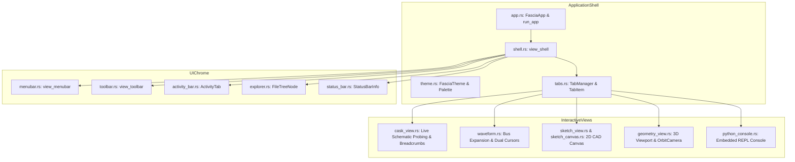

# Fascia: Desktop Shell, Interactive Workbench & Visualization

**Path:** `src/fascia/`  
**Crate Member:** `trellis::fascia`  
**Status:** Desktop GUI & Visualization Subsystem

---

## 1. Module Overview & Mission

`fascia` is Trellis's native desktop application shell and interactive graphical workbench, built with the Iced GUI toolkit and WGPU. It provides:
- **Interactive EDA Schematic View (`cask_view.rs`)**: 2D schematic capture visualization with live signal probing (`LogicLevel`), real-time wire coloring, pin state badges, and hierarchical breadcrumb push/pop navigation.
- **Advanced Digital Waveform Viewer (`waveform.rs`)**: High-performance multi-signal timeline viewer with digital bus expansion, hexagonal transition diamonds, multi-radix value formatting (Hex, Dec, Bin, Ascii), and dual measurement cursors (Marker A, Marker B, $\Delta T$, frequency).
- **Parametric 2D CAD Sketch Canvas (`sketch_canvas.rs`)**: Interactive drafting canvas with sorted cache buffers (`Buff<CurveCacheEntry>`), durable dimension hit-testing, entity picking, and zero `RefCell`/`HashMap` structures.
- **In-Process Python Console (`python_console.rs`)**: Interactive REPL tab evaluating scripts against active circuits and CAD documents with asynchronous background worker threads.
- **Hardware-Accelerated 3D Viewport (`geometry_view.rs`)**: Orbit-camera controlled 3D viewport rendering meshes and LiDAR point clouds.

### Design Principles
- **Model-View-Update (MVU) Architecture**: Pure Elm/Iced architectural pattern isolating state mutations inside `update()` messages.
- **Zero-Allocation Cache Buffers**: Transient caches (like curve rendering tessellations) use pre-sorted `USeg Buff` collections rather than heap-allocating hash maps or interior mutability (`RefCell`).
- **Asynchronous Task Offloading**: Heavy file loading, constraint solving, and script executions are dispatched off the GUI thread to `heist` worker threads.
- **Strict Theme Adherence**: Every widget, wire, pin badge, and text label adheres dynamically to `FasciaTheme` palettes (`WindowsDark`, `WindowsLight`, `Gruvbox`).

---

## 2. Component Hierarchy & File Map



| File | Primary Types & Functions | Description |
|---|---|---|
| `app.rs` | `FasciaApp`, `AppMessage`, `run_app` | Top-level Iced application root, event routing, and window initialization. |
| `shell.rs` | `view_shell` | Assembles the complete desktop layout: top menus, side drawer, tab bar, document canvas, status bar. |
| `theme.rs` | `FasciaTheme`, `ThemePalette`, `FasciaStyle` | Theme definitions (`WindowsDark`, `WindowsLight`, `Gruvbox`), colors, fonts, and widget styling rules. |
| `tabs.rs` | `TabManager`, `TabItem`, `TabKind`, `TabId` | Multi-document tab management (closing, switching, dirty indicators, tab kinds). |
| `cask_view.rs` | `CaskView`, `ProbeValue`, `BreadcrumbTrail` | Interactive EDA schematic canvas: live signal probing, pin badges, wire coloring, and breadcrumb drill-down. |
| `waveform.rs` | `WaveformState`, `WaveformCanvas`, `Marker` | Digital waveform timeline viewer: bus expansion, hex diamonds, radix display, and dual measurement cursors. |
| `sketch_canvas.rs`| `SketchCanvas`, `CurveCacheEntry` | 2D CAD sketch canvas using sorted `USeg Buff` cache without `RefCell` or `HashMap`. |
| `sketch_tool.rs` | `SketchTool`, `ToolMode` | Interactive drafting tools: Select, Line, Circle, Arc, Dimension, Constraint. |
| `sketch_view.rs` | `view_sketch_document` | View adapter binding sketch document, toolbar, inspector, and canvas together. |
| `python_console.rs`| `PythonConsoleTab`, `ConsoleMessage` | In-process Python REPL tab with interactive code editor, output history, and execution thread. |
| `geometry_view.rs`| `view_geometry_view` | Iced `shader::Program` adapter binding `wgpu` device/queue into `swarm::viewport`. |
| `camera.rs` | `OrbitCamera` | Spherical orbit camera calculations (azimuth, elevation, radius, pan, zoom). |
| `explorer.rs` | `ExplorerState`, `FileTreeNode`, `view_explorer` | Interactive filesystem tree view integrated with `fenst`. |
| `menubar.rs` | `view_menubar`, `MenuAction` | Dropdown menus: File (Open, Save, Exit), View, Simulation, Help. |
| `toolbar.rs` | `view_toolbar`, `ToolBarAction` | Quick action buttons: Open File, Reload, Reset Camera, Run Simulation. |
| `activity_bar.rs`| `view_activity_bar`, `ActivityTab` | Leftmost icon bar toggling panels: Explorer, Geometry, Simulation, Settings. |
| `status_bar.rs` | `view_status_bar`, `StatusBarInfo` | Bottom footer showing active file, cursor position, worker counts, and status messages. |

---

## 3. Core Data Structures & Types

### 3.1 Live Signal Probing & Breadcrumbs (`cask_view.rs`)
```rust
#[derive(Clone, Copy, Debug, PartialEq, Eq)]
pub enum LogicLevel {
    Low,
    High,
    Unknown,
    HighZ,
}

pub struct CaskView {
    _Breadcrumbs: Stash<BreadcrumbItem>,
    _ProbeValues: Buff<ProbeValue>,
    _HoveredPin:  u32,
    _HoveredWire: u32,
}
```
- Real-time signal colors: Green for `High` (`1`), Dark Gray for `Low` (`0`), Red for `Unknown` (`X`), Yellow for `HighZ` (`Z`).
- Pin badges render current logic level text directly on block perimeter terminals.
- Breadcrumbs support pushing into submodules (`PushBreadcrumb(id)`) and popping back (`PopBreadcrumb()`).

### 3.2 Bus Waveform Radix & Dual Cursors (`waveform.rs`)
- **Hexagonal Transition Diamonds**: Multi-bit digital buses render with tapered hexagonal transition caps when changing values.
- **Dual Measurement Cursors**:
  - `Marker A` (solid white line) and `Marker B` (solid cyan line).
  - Measurement badge displays: $\text{Time}_A$, $\text{Time}_B$, $\Delta T = |T_B - T_A|$, and instantaneous frequency $f = \frac{1}{\Delta T}$.

---

## 4. Feature-by-Feature Deep Dive

### 4.1 Sorted USeg Sketch Canvas (`sketch_canvas.rs`)
Eliminates interior mutability and heap-allocating maps:
1. When sketch entities (lines, arcs, circles) are drawn, adaptive sagitta tessellation generates discrete curve segments.
2. Curve segments are packed into a sorted `Buff<CurveCacheEntry>` keyed by entity ID.
3. Entity picking and rendering search the cache via binary search in $O(\log N)$ time with zero `RefCell` or `HashMap` allocations.

### 4.2 Interactive EDA Schematic Probing
Allows engineers to debug simulated digital circuits visually:
1. User clicks or hovers over a wire net or pin terminal in `cask_view`.
2. The view queries `SimEngine` for the current 4-state logic level.
3. Wires dynamically illuminate based on signal value.
4. Clicking a complex hierarchical submodule navigates inside it, updating the top breadcrumb trail.

### 4.3 In-Process Python REPL Console
Integrated into the desktop shell for live exploration:
1. Evaluates Python expressions asynchronously via `PythonConsoleEngine`.
2. Automatically injects the active circuit (`session.circuit`) or sketch (`session.sketch`) into Python globals.
3. Streams standard output and formatted error tracebacks directly into the console scrollback pane.

---

## 5. Integration Boundaries

- **Upstream Dependencies**: `iced`, `wgpu`, `fenst` (cask & sketch models), `rube` (simulation engine), `python` (console runtime).
- **Downstream Consumers**:
  - Main user executable (`src/main.rs`).
