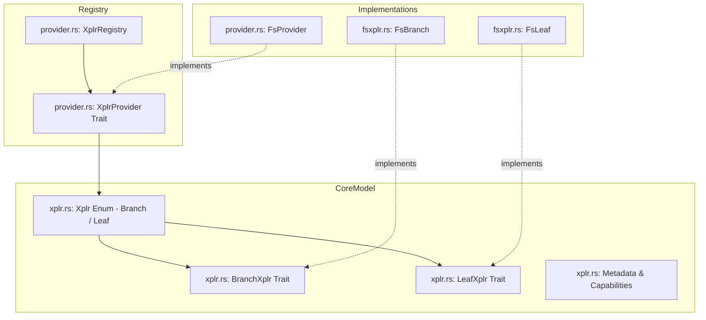

# Fenst: Explorer-Provider & Virtual Workspace Model

**Path:** `src/fenst/`
**Crate Member:** `trellis::fenst`
**Status:** Workspace & File Navigation Framework

---

## 1. Module Overview & Mission

`fenst` establishes a provider-neutral, virtualized directory and document explorer model. It cleanly decouples desktop GUI file navigation (in `fascia`) from the underlying physical storage medium. While its primary implementation is local filesystem access (`FsProvider`), the architecture permits virtual nodes, zip archive browsing, remote repositories, and in-memory test fixtures under an identical tree abstraction.

### Design Principles
- **Provider Neutrality**: Navigation widgets in `fascia` depend strictly on `XplrProvider`, `BranchXplr`, and `LeafXplr` traits, completely unaware of whether files reside on disk, in memory, or across a network.
- **Lazy Evaluation**: Folder contents are enumerated strictly on branch expansion.
- **Stream Slicing (`StreamChunk`)**: Supports chunked reading of large files without loading entire files into memory.

---

## 2. Component Hierarchy & File Map



| File | Primary Types & Functions | Description |
|---|---|---|
| `xplr.rs` | `Xplr`, `BranchXplr`, `LeafXplr`, `CircuitXplr`, `PortDescriptor`, `WireDescriptor`, `TraverseDepth` | Core abstractions: directory branches, document leaves, circuit explorer traits, pin/wire descriptors, and iterative depth-first traversal. |
| `provider.rs` | `XplrProvider`, `XplrRegistry`, `FsProvider` | URI-to-root resolution, provider registration, and filesystem provider definition. |
| `fsxplr.rs` | `FsBranch`, `FsLeaf` | Standard OS filesystem implementation leveraging `std::fs` and metadata queries. |
| `settings.rs` | `SettingsBranch`, `SettingsLeaf`, `SettingsProvider` | Virtual Xplr hierarchy for configuration (themes, layout, system) mounted at `settings://`. |
| `example.rs` | `XplrExample`, `ExampleItemXplr`, `ExampleSuiteXplr`, `ExampleProvider` | Virtual Xplr hierarchy for inspectable runnable test cases mounted at `example://`. |
| `cask.rs` | `CaskNode`, `CaskTree`, `CaskRenderCommand`, `Rect`, `Color` | Presentation-independent 2D/3D layout node hierarchy and visual drawing primitives. |
| `cask2d.rs` | `Cask2dLayout`, `Cask2dLayoutMode`, `Cask2dColorScheme` | 2D recursive layout engine supporting Horizontal, Vertical, NestedBoxes, and Schematic modes. |
| `circuit_layout.rs` | `LayoutCircuitSchematic`, `HitTestSchematicPin`, `HitTestSchematicWire` | Classical EDA schematic layout solver: topological placement, West/East pin distribution, orthogonal Manhattan routing, and hit-testing. |

---

## 3. Core Data Structures & Types

### 3.1 `Xplr` Hierarchy
```rust
pub enum Xplr {
    Branch(Box<dyn BranchXplr>),
    Leaf(Box<dyn LeafXplr>),
}
```

### 3.2 `BranchXplr` & `LeafXplr`
- **`BranchXplr`**: Represents folders/containers:
  ```rust
  pub trait BranchXplr: Send + Sync {
      fn Name(&self) -> &str;
      fn Path(&self) -> &str;
      fn Children(&self) -> Result<Vec<Xplr>, String>;
      fn Refresh(&mut self) -> Result<(), String>;
  }
  ```
- **`LeafXplr`**: Represents files/documents:
  ```rust
  pub trait LeafXplr: Send + Sync {
      fn Name(&self) -> &str;
      fn Path(&self) -> &str;
      fn Size(&self) -> u64;
      fn ReadChunk(&self, offset: u64, len: u32) -> Result<StreamChunk, String>;
  }
  ```

### 3.3 `CircuitXplr`, `PortDescriptor` & `WireDescriptor`
Domain-neutral contract for hardware components, circuit blocks, and multi-die topologies:
```rust
pub trait CircuitXplr: Send + Sync {
    fn ComponentType(&self) -> &str;
    fn Ports(&self) -> Vec<PortDescriptor>;
    fn Wires(&self) -> Vec<WireDescriptor>;
    fn Submodules(&self) -> Vec<Box<dyn CircuitXplr>>;
}
```
- **`PortDescriptor`**: Encapsulates port name and directionality (`PortDirection::In`, `PortDirection::Out`).
- **`WireDescriptor`**: Identifies driver component/port and sink component/port for netlist connections.

---

## 4. Feature-by-Feature Deep Dive

### 4.1 URI Scheme Resolution (`XplrRegistry`)
The explorer registry maps schemes (e.g. `file://`, `virtual://`, `tar://`, `example://`, `settings://`) to provider instances. When the user opens a workspace folder in Fascia, the registry looks up the appropriate provider and returns the root `BranchXplr`.

### 4.2 Safe Sliced Streaming (`StreamChunk`)
`LeafXplr::ReadChunk` returns bounded `StreamChunk` buffers:
- Allows the UI to preview the first 64KB of massive 2GB point cloud files without blocking the interface or blowing out memory limits.

### 4.3 Iterative Depth-First Traversal (`TraverseDepth`)
`TraverseDepth` and `TraverseDepthRoots` execute stack-based iterative depth-first traversal over any `Xplr` hierarchy without recursion:
- **Preorder Entry**: Calls `lambda(ancestors: &[&dyn Xplr], enter: true)`. If the closure returns `false`, the subtree is pruned and treated as a leaf-node (no children traversed and no exit callback invoked).
- **Postorder Exit**: Calls `lambda(ancestors: &[&dyn Xplr], enter: false)` after all children of a branch have been traversed. If the closure returns `false`, the entire rewind/traversal process is aborted immediately.
- **Leaf Nodes**: Pure leaf nodes receive a single entry call (`enter == true`) and never produce an exit call.
- **Path Introspection**: The `ancestors` slice reflects the exact path from the root down to the current node (`ancestors.last().unwrap()`).

### 4.4 Virtual Example Hierarchy (`example://`)
Mounted at `example://`, this provider dynamically discovers and mounts all tests registered via `XplrExample`:
- **Root Provider (`example://`)**: Lists all registered test suites as expandable `ExampleSuiteXplr` folders (`Karst`, `Rube`, `Fenst`, etc.).
- **Suite Folders (`example://<Suite>`)**: Opens a dedicated folder view (`NestedBoxes`) displaying all examples registered under that suite (e.g. `example://Rube` shows `FullAdderExample`, `Adder8Example`, and `DaddaMultiplier4x4`).
- **Inspectable Example Instances (`example://<Suite>/<Example>`)**: Evaluates the example test body in the background and resolves the returned root `Xplr` (such as a circuit schematic or Cask scene).
- **Submodule Drill-Down**: Supports path-based subcomponent navigation into inner modules (e.g., `example://Rube/FullAdderExample/HA1`, `example://Karst/System/Die0Circuit`).

### 4.5 Classical EDA Schematic Layout Solver (`circuit_layout.rs`)
`fenst` contains an automated 2D classical schematic layout solver designed to transform any `CircuitXplr` into clean, publication-grade block schematics:
- **Connectivity-Aware Placement & Barycenter Ordering**: Submodules are staged into topological columns (ranks) from left to right. Within each column, modules are ordered using forward and backward barycenter sweeps based on their interconnections with peers in adjacent columns, placing connected modules adjacent to each other to minimize wire lengths and eliminate crossings.
- **Connectivity-Determined Port Side (`PortSide`)**: Rather than blindly sorting ports by direction, each port's perimeter face (`PortSide::West` vs `PortSide::East`) is determined by the location of its connected peer module or boundary net:
  - Ports connecting to peers in a lower column (to the left) or canvas boundary inputs are positioned on the **West (left) face**.
  - Ports connecting to peers in a higher column (to the right) or canvas boundary outputs are positioned on the **East (right) face**.
  - Ports on each face are vertically ordered by the row index of their connected peer, creating parallel, untangled inter-module connections.
- **Port Placement Invariance During Submodule Exploration**: When a submodule is explored directly (via URI navigation e.g. `example://Karst/System/Host 0`, `example://Karst/System/KarstModule`, or drill-down `SubmoduleXplr`), the port placements (`PortSide::West` vs `PortSide::East`) and perimeter facings decided by the parent module's layout solver are strictly preserved:
  - **Leaf Modules**: Pins remain anchored to their parent-assigned faces (e.g., `Host 0` keeps both `Req` and `Resp` on its East face; `MemChan 0` keeps both `Req` and `Resp` on its West face).
  - **Container Modules**: Outer boundary pins on the canvas frame retain their parent-assigned boundary edges (e.g., `KarstModule` keeps all `Host_*` pins on the West boundary and all `MC_*` pins on the East boundary).
- **Port Directional Arrowheads**: Directional triangles indicate true signal flow on both West and East faces (`In` points into the module, `Out` points away from the module towards the channel).
- **Direct Channel & Highway Manhattan Wire Routing**:
  - **Direct Channel Routes (3 Segments)**: Pins facing each other across an inter-column channel (East-to-West or West-to-East) route directly through the channel with a single vertical jog, avoiding unnecessary loops.
  - **Highway Channel Routes (5 Segments)**: Nets spanning across multiple columns or long-distance loopbacks route through dedicated bottom highway channels to prevent wire collisions through intermediate functional blocks.
- **Soldered Junction Dots (`•`)**: Nets with fanout greater than one place solid branch dots at line intersections.
- **Interactive Hit-Testing**: Functions `HitTestSchematicPin` and `HitTestSchematicWire` provide precise mouse hit detection for tooltips and hover highlights.

---

## 5. Integration Boundaries

- **Upstream Dependencies**: Standard library filesystem and path APIs.
- **Downstream Consumers**:
  - `fascia`: Drives the left-hand workspace tree view, file opening dialogs, and geometry document loading.
