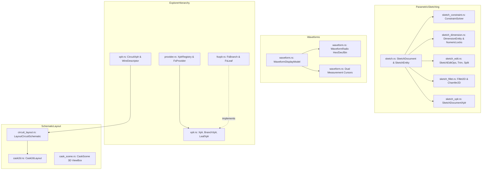

# Fenst: Presentation Abstractions, Parametric 2D Sketching & Constraint Solving

**Path:** `src/fenst/`  
**Crate Member:** `trellis::fenst`  
**Status:** Presentation, Parametric CAD & Explorer Subsystem

---

## 1. Module Overview & Mission

`fenst` provides Trellis's presentation-independent layout models, virtual filesystem explorer contracts (`Xplr`), parametric 2D CAD sketching engines, geometric constraint solving, and waveform measurement models:
- **2D Geometric Constraint Solver (`sketch_constraint.rs`)**: Iterative Newton-Raphson / Jacobian constraint solver implementing 10 geometric constraint types to solve under- and fully-constrained 2D CAD sketches.
- **Parametric 2D CAD Sketching (`sketch.rs`, `sketch_dimension.rs`, `sketch_edit.rs`, `sketch_fillet.rs`)**: Complete document model for 2D drafting entities (lines, arcs, circles, control points, dimensional constraints, fillets, chamfers).
- **Interactive Waveform Analytics (`waveform.rs`)**: Display models for digital signal traces featuring multi-radix bus expansion (`WaveformRadix`: Hex, Dec, Bin, Ascii) and dual measurement cursors ($\Delta T$, frequency).
- **Virtual Filesystem Explorer (`Xplr`)**: Unified hierarchy resolving file trees, test suites (`example://`), configuration settings (`settings://`), and circuit diagrams (`CircuitXplr`).
- **Classical EDA Schematic Layout Solver (`circuit_layout.rs`)**: Automated topological component placement and orthogonal Manhattan wire routing.

### Design Principles
- **Presentation Independence**: All layout algorithms compute geometric coordinates in abstract units, completely decoupled from GUI renderers (such as Iced or WebGPU).
- **Iterative Degree-of-Freedom Relaxation**: The constraint solver formulates constraint equations, evaluates Jacobian derivatives, and iteratively relaxes point coordinates to minimize residual error.
- **Hierarchical Uniformity**: Explorer trees (`Xplr`) treat OS disk directories, virtual test cases, and nested circuit submodules through identical branch/leaf traits.
- **Direct Net Manhattan Routing**: Circuits route wires through dedicated channel tracks, minimizing wire crossings and eliminating diagonal collisions.

---

## 2. Component Hierarchy & File Map



| File | Primary Types & Functions | Description |
|---|---|---|
| `sketch.rs` | `SketchDocument`, `SketchEntity`, `SketchPoint`, `LineEntity`, `CircleEntity`, `ArcEntity` | Core 2D CAD drafting document model managing geometry primitives, control points, and entity IDs. |
| `sketch_constraint.rs`| `ConstraintSolver`, `GeometricConstraint`, `ConstraintKind`, `SolverResult` | Iterative 2D geometric constraint solver supporting 10 constraint types with numerical DoF relaxation. |
| `sketch_dimension.rs` | `DimensionEntity`, `DimensionKind`, `NumericLock` | Dimensional constraints (distance, angle, radius) with durable numerical locks. |
| `sketch_edit.rs` | `TrimEntity`, `ExtendEntity`, `SplitEntity`, `OffsetCurve` | Geometric editing operations modifying existing curves and closed profiles. |
| `sketch_fillet.rs` | `CreateFillet`, `CreateChamfer` | Corner rounding and beveling operations on intersecting 2D line segments. |
| `sketch_xplr.rs` | `SketchDocumentXplr` | Explorer adapter exposing 2D sketch documents to the workspace file tree. |
| `waveform.rs` | `WaveformDisplayModel`, `WaveformRadix`, `WaveformCursor` | Digital signal display model with multi-radix bus expansion and dual measurement cursors. |
| `xplr.rs` | `Xplr`, `BranchXplr`, `LeafXplr`, `CircuitXplr`, `PortDescriptor`, `WireDescriptor` | Core explorer abstractions for directory branches, document leaves, circuit explorer traits, and pin/wire descriptors. |
| `provider.rs` | `XplrProvider`, `XplrRegistry`, `FsProvider` | URI-to-root resolution, provider registration, and filesystem provider definition. |
| `fsxplr.rs` | `FsBranch`, `FsLeaf` | Standard OS filesystem implementation leveraging `std::fs` and metadata queries. |
| `circuit_layout.rs` | `LayoutCircuitSchematic`, `HitTestSchematicPin`, `HitTestSchematicWire` | Classical EDA schematic layout solver: topological placement, West/East pin distribution, orthogonal Manhattan routing, and hit-testing. |
| `cask.rs` | `CaskNode`, `CaskTree`, `CaskRenderCommand`, `Rect`, `Color` | Presentation-independent 2D/3D layout node hierarchy and visual drawing primitives. |
| `cask2d.rs` | `Cask2dLayout`, `Cask2dLayoutMode`, `Cask2dColorScheme` | 2D recursive layout engine supporting Horizontal, Vertical, NestedBoxes, and Schematic modes. |
| `cask_scene.rs` | `CaskScene`, `ViewBox` | 3D scene representation with view frustum culling, sub-pixel pruning, and node budgets. |

---

## 3. Core Data Structures & Types

### 3.1 2D Geometric Constraint Solver (`ConstraintSolver`)
Solves 10 classical geometric CAD constraint types:
```rust
#[derive(Clone, Copy, Debug, PartialEq, Eq)]
pub enum ConstraintKind {
    Coincident,
    Horizontal,
    Vertical,
    Parallel,
    Perpendicular,
    Distance,
    EqualLength,
    PointOnLine,
    TangentArcLine,
    Concentric,
}

pub struct ConstraintSolver {
    _Points:      Buff<[f64; 2]>,
    _Constraints: Buff<GeometricConstraint>,
}
```
- `ExtractFromDocument(doc) -> (Self, Vec<(u32, PointTarget)>)`: Ingests all points and constraints from a sketch document.
- `Solve(max_iterations: u32, tolerance: f64) -> SolverResult`: Relaxes degrees of freedom iteratively, returning iteration counts and residual error.
- Updates solved point coordinates back into the `SketchDocument`.

### 3.2 Digital Waveform Display Model (`waveform.rs`)
```rust
#[derive(Clone, Copy, Debug, PartialEq, Eq)]
pub enum WaveformRadix {
    Hexadecimal,
    Decimal,
    Binary,
    Ascii,
}

pub struct WaveformCursor {
    pub _Time:      u64,
    pub _Active:    bool,
    pub _MarkerIdx: u8,
}
```
- Multi-radix value formatting for digital buses.
- Marker A and Marker B cursor measurements: computes $\Delta T = |T_B - T_A|$ and frequency $f = \frac{1}{\Delta T}$.

---

## 4. Feature-by-Feature Deep Dive

### 4.1 2D Constraint Relaxation Mechanics (`sketch_constraint.rs`)
1. **Error Function Formulation**: Each constraint defines a scalar residual error $C_i(\vec{X}) = 0$:
   - *Distance*: $\sqrt{(x_2 - x_1)^2 + (y_2 - y_1)^2} - D = 0$.
   - *Horizontal*: $y_2 - y_1 = 0$.
   - *Perpendicular*: $(x_2 - x_1)(x_4 - x_3) + (y_2 - y_1)(y_4 - y_3) = 0$.
2. **Jacobian Gradient Step**: Evaluates partial derivatives $\nabla C_i$ with respect to point coordinates.
3. **Iterative Projection**: Uses damped pseudo-inverse or Gauss-Newton steps to project points toward the zero-residual surface.
4. **Convergence**: Terminates when $\max |C_i| < \text{tolerance}$ or iteration limit is reached.

### 4.2 Classical EDA Schematic Layout Solver (`circuit_layout.rs`)
Transforms any `CircuitXplr` into clean, publication-grade block schematics:
- **Connectivity-Aware Placement**: Submodules are staged into topological columns. Forward and backward barycenter sweeps order submodules to minimize wire lengths and eliminate crossings.
- **Port Perimeter Alignment**: Ports connecting to peers in lower columns face West; ports connecting to higher columns face East.
- **Direct & Highway Manhattan Wire Routing**: Direct channel routes (3 segments) for facing pins; highway channel routes (5 segments) along bottom channels for multi-column nets.
- **Soldered Junction Dots**: Places solid branch dots (`•`) at wire junctions for nets with fanout > 1.

---

## 5. Integration Boundaries

- **Upstream Dependencies**: `silo` (`Buff`, `Stash`, `USeg`), `fresco` (symbolic expressions for non-linear constraints).
- **Downstream Consumers**:
  - `fleck::sketch_extrude`, `sketch_sweep`, `sketch_loft`: Extrudes solved 2D sketch profiles into 3D watertight solid CAD models.
  - `fascia::sketch_canvas`, `fascia::cask_view`: Renders interactive 2D sketch canvases and EDA schematics.
  - `python::sketch`: Exposes `PySketchDocument` for scripted CAD modeling and constraint solving.
