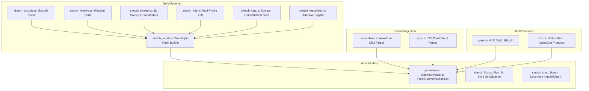

# Fleck: 3D Geometry Ingestion, Parametric Solid CAD & Asset Models

**Path:** `src/fleck/`  
**Crate Member:** `trellis::fleck`  
**Status:** 3D Geometry & Solid Modeling Subsystem

---

## 1. Module Overview & Mission

`fleck` is Trellis's 3D geometric asset representation, point cloud ingestion, and parametric solid CAD modeling engine. It combines external file ingestion (Wavefront OBJ meshes and dense LiDAR PTS point clouds) with a full suite of constructive 3D solid operations:
- **3D Solid Sweep (`sketch_sweep.rs`)**: Sweeps 2D closed sketch profiles along arbitrary 3D spatial paths using Frenet-Serret and Bishop rotation-minimizing parallel transport frames.
- **3D Solid Loft (`sketch_loft.rs`)**: Lofts between multiple distinct planar cross-sections with parametric curve correspondence and smooth skin interpolation.
- **Constructive Solid Geometry Booleans (`sketch_csg.rs`)**: CSG Union, Difference, and Intersection operations over watertight triangle boundary meshes.
- **Extrusion & Revolve (`sketch_extrude.rs`, `sketch_revolve.rs`)**: Linear prism extrusion and signed rotational revolve solids around arbitrary 3D axes.
- **Adaptive Sagitta Tessellation (`sketch_tessellate.rs`)**: Converts parametric curves into piecewise-linear chords respecting max sagitta chordal error tolerances.
- **Asset Normalization & Buffers (`geometry.rs`)**: Packs vertex positions, calculated surface normals, and triangle indices into flat GPU-ready buffers (`GeometryAsset`).

### Design Principles
- **Watertight Manifold Guarantees**: All solid operations generate closed, 2-manifold triangle meshes with consistent outward-facing normals and clean end caps.
- **Contiguous Buffer Optimization**: Polygon vertex indices, coordinates, and computed surface normals are packed into flat `silo::Buff` arrays.
- **Torsion-Free Sweep Frames**: Uses Bishop rotation-minimizing frames along 3D sweep paths to prevent artificial twisting and degenerate self-intersections.
- **Decoupled Graphics**: `fleck` has zero dependency on `wgpu` or graphics hardware; it produces pure geometry DTOs ready for ingestion by `swarm::viewport`.

---

## 2. Component Hierarchy & File Map



| File | Primary Types & Functions | Description |
|---|---|---|
| `sketch_sweep.rs` | `SweepProfileAlongPath`, `FrenetFrame`, `BishopFrame` | 3D Solid Sweep extruding 2D profiles along 3D paths using rotation-minimizing frames. |
| `sketch_loft.rs` | `LoftCrossSections`, `LoftConfig` | 3D Solid Loft skinning across multiple distinct planar cross-sections. |
| `sketch_csg.rs` | `CsgUnion`, `CsgDifference`, `CsgIntersection`, `CsgNode` | Constructive Solid Geometry Boolean operations on watertight 3D triangle meshes. |
| `sketch_extrude.rs` | `ExtrudeSketch`, `ExtrudeConfig` | Linear prism solid extrusion with automatic front/back cap triangulation. |
| `sketch_revolve.rs` | `RevolveSketch`, `RevolveConfig` | Rotational solid of revolution around an arbitrary axis and signed revolution angle. |
| `sketch_tessellate.rs`| `TessellateProfile`, `SagittaTolerance` | Adaptive chordal discretization of arcs and circles based on maximum deviation. |
| `sketch_mesh.rs` | `MeshBuilder`, `WatertightCheck` | Triangulation and stitching of side walls and planar polygon end caps. |
| `point.rs` | `Pt3f`, `Dir3f`, `BBox3f`, `WPt3f` | 3D coordinate vectors, direction vectors, and axis-aligned bounding box calculations. |
| `vex.rs` | `Vex3f`, vertex transformation traits | Vertex operations, cross products, dot products, and normal vector math. |
| `waveobjio.rs` | `WaveObjModel`, `Face`, `ParseWaveObj` | Shard-powered parser for Wavefront `.obj` files (vertices, normals, faces). |
| `ptio.rs` | `PtsCloud`, `PtsPoint`, `ParsePts` | High-speed parser for ASCII `.pts` LiDAR point clouds. |
| `geometry.rs` | `GeometryAsset`, `GeometryAssetKind`, `FleckGeometryAssetExt` | Validated, GPU-renderable asset struct with vertex positions, normals, and indices. |
| `sketch_flux.rs` | `SaveSketchToFlx`, `LoadSketchFromFlx` | High-speed binary `.flx` serialization of sketch documents and solids. |
| `sketch_io.rs` | `ExportSketchObj`, `ImportSketchDxf` | Exporting 3D CAD solids to OBJ meshes and exchanging 2D sketches via DXF. |

---

## 3. Core Data Structures & Types

### 3.1 `GeometryAsset`
The unified representation consumed by the rendering viewport:
```rust
pub struct GeometryAsset {
    pub _Kind:           GeometryAssetKind,
    pub _Points:         Buff<[f32; 3]>,
    pub _Normals:        Buff<[f32; 3]>,
    pub _Indices:        Buff<u32>,
    pub _Bbox:           BBox3f,
    pub _VertexCount:    usize,
    pub _PrimitiveCount: usize,
}

pub enum GeometryAssetKind {
    Mesh,
    PointCloud,
}
```

### 3.2 3D Sweep Frames (`BishopFrame`)
```rust
pub struct BishopFrame {
    pub _Tangent:   [f64; 3],
    pub _Normal:    [f64; 3],
    pub _Binormal:  [f64; 3],
    pub _Origin:    [f64; 3],
}
```
Computes parallel transport along 3D spatial curves without the singular inflection flips inherent to classical Frenet-Serret frames.

---

## 4. Feature-by-Feature Deep Dive

### 4.1 3D Sweep with Parallel Transport Frames (`sketch_sweep.rs`)
1. Ingests a 2D closed sketch profile and a 3D guide curve (path).
2. Computes the initial tangent and reference normal.
3. Steps along path points using Bishop's parallel transport equation:
   $$\vec{N}_{i+1} = \vec{N}_i - \frac{\vec{T}_i + \vec{T}_{i+1}}{1 + \langle \vec{T}_i, \vec{T}_{i+1} \rangle} \langle \vec{T}_{i+1}, \vec{N}_i \rangle$$
4. Transforms profile vertices into each local cross-sectional plane.
5. Stitches adjacent rings with quad/triangle strips and caps the ends.

### 4.2 Multi-Profile Lofting (`sketch_loft.rs`)
Interpolates a smooth skin across multiple distinct cross-sections:
1. Normalizes vertex count across all profiles via adaptive curve subdivision.
2. Aligns profile start vertices using minimum chordal distance matching.
3. Generates ruled surface or cubic spline skin meshes between consecutive sections.
4. Triangulates boundary start and end caps with planar polygon partitioners.

### 4.3 Watertight CSG Booleans (`sketch_csg.rs`)
Computes Boolean combinations between solid meshes:
- **Union ($A \cup B$)**: Combines outer boundaries of both solids.
- **Difference ($A \setminus B$)**: Subtracts solid $B$ from solid $A$.
- **Intersection ($A \cap B$)**: Retains the volume shared by both solids.
- Generates new planar intersection polygons, resolves coplanar faces, and produces a single watertight manifold output mesh.

---

## 5. Integration Boundaries

- **Upstream Dependencies**: `silo` (`Buff`, `Stash`), `fenst::sketch` (2D profiles), `shard` (OBJ parsing).
- **Downstream Consumers**:
  - `swarm::viewport`: Uploads `GeometryAsset` vertex/index buffers to the GPU for rendering.
  - `python::geometry`: Exposes 3D meshes to Python scripts as NumPy arrays.
