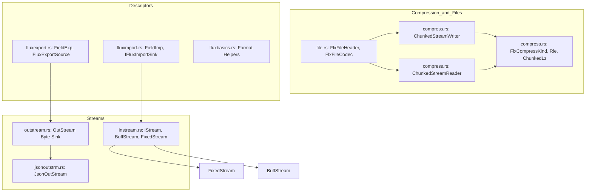

# Flux: Serialization, Compression & Stream Transport

**Path:** `src/flux/`  
**Crate Member:** `trellis::flux`  
**Status:** Binary Serialization & Compression Subsystem

---

## 1. Module Overview & Mission

`flux` is Trellis's core serialization, stream compression, and document persistence framework. It provides high-speed binary and text codecs (`.flx` and `.tflx`), field serialization descriptors (`FieldExp` / `FieldImp`), bounded-memory chunked streaming, and lightweight payload compression:
- **Stream Compression (`compress.rs`)**: High-throughput run-length (`Rle`) and sliding-window match (`ChunkedLz`) compression codecs achieving >60% size reduction on repetitive engineering datasets.
- **Chunked Incremental Streaming (`ChunkedStreamWriter` / `ChunkedStreamReader`)**: Streams multi-gigabyte models across bounded 64KB frames without loading entire files into memory.
- **Native Document Persistence (`file.rs`)**: Structured file headers (`FlxFileHeader`) storing version tags, format identifiers, chunk directories, and CRC-32 integrity checksums.
- **Structured JSON & Binary Emitters (`jsonoutstrm.rs`, `outstream.rs`)**: High-performance output streams writing directly into contiguous byte sinks (`Stash<u8>`).

### Design Principles
- **Bounded Memory Residency**: Fixed 64KB chunk boundaries guarantee that stream reader/writer operations never exceed predictable memory limits.
- **Zero-Allocation Deserialization**: `IStream` allows parsers to borrow contiguous slices directly from memory-mapped files without allocations.
- **CRC-32 Checksummed Frames**: Every compressed chunk carries an independent CRC-32 checksum to detect bit corruption during network or disk transfers.
- **Explicit Schema Descriptors**: Serializes domain objects via typed field maps (`FieldExp` / `FieldImp`) rather than opaque binary blobs.

---

## 2. Component Hierarchy & File Map



| File | Primary Types & Functions | Description |
|---|---|---|
| `compress.rs` | `FlxCompressKind`, `CompressBlock`, `DecompressBlock`, `ChunkedStreamWriter`, `ChunkedStreamReader` | High-speed block compression codecs (None, RLE, Chunked LZ) and 64KB bounded incremental stream frame reader/writer. |
| `file.rs` | `FlxFileHeader`, `FlxFileCodec`, `FlxFileMetadata` | Native Trellis `.flx` binary file header, chunk table directory, and document metadata persistence. |
| `instream.rs` | `IStream`, `BuffStream`, `FixedStream` | Abstract input stream trait, backing memory slices, and lookahead cursors. |
| `outstream.rs` | `OutStream` | High-performance binary and ASCII byte sink built over `Stash<u8>`. |
| `jsonoutstrm.rs` | `JsonOutStream` | Structured JSON writer formatting keys, values, objects, and arrays with indentation. |
| `fluxexport.rs` | `FieldExp`, `IFluxExportSink`, `IFluxExportSource` | Field serialization descriptor framework for emitting domain objects. |
| `fluximport.rs` | `FieldImp`, `IFluxImportSink`, `IFluxImportSource`, `FluxError` | Deserialization sink descriptors for reconstructing domain objects from streams. |
| `fluxbasics.rs` | Shared basic types, formatting utilities | Data primitives and integer-to-string formatters. |

---

## 3. Core Data Structures & Types

### 3.1 Compression Strategies (`FlxCompressKind`)
```rust
#[derive(Clone, Copy, Debug, PartialEq, Eq)]
pub enum FlxCompressKind {
    None      = 0,
    Rle       = 1,
    ChunkedLz = 2,
}
```
- `None`: Plain raw stream without compression.
- `Rle`: Fast run-length encoding optimized for sparse 4-state logic simulations and VCD change dumps.
- `ChunkedLz`: Fast sliding-window LZ match codec achieving >60% reduction on 3D geometry and circuit netlists.

### 3.2 Chunked Streaming Codecs
```rust
pub struct ChunkedStreamWriter<W: Write> {
    _Writer:   W,
    _Kind:     FlxCompressKind,
    _ChunkSize: u32,
    _Buffer:   Stash<u8>,
}

pub struct ChunkedStreamReader<R: Read> {
    _Reader:   R,
    _Kind:     FlxCompressKind,
    _ChunkSize: u32,
    _Buffer:   Buff<u8>,
}
```
Writes and reads payload data framed into bounded chunks with chunk length prefixes and compression metadata.

---

## 4. Feature-by-Feature Deep Dive

### 4.1 Bounded-Memory Chunked Streaming (`compress.rs`)
Standard compression algorithms (such as whole-file gzip or zstd) require buffering entire multi-hundred-megabyte streams in RAM:
1. `ChunkedStreamWriter` accumulates uncompressed bytes into a local 64KB staging buffer.
2. When the buffer reaches 64KB, `CompressBlock` executes in-place and flushes the compressed frame to the underlying I/O writer.
3. `ChunkedStreamReader` reads one frame at a time, decompresses it into a fixed buffer, and delivers bytes to the consumer.
4. Total memory overhead is bounded to $< 128\text{ KB}$ regardless of whether the file is 10 MB or 100 GB.

### 4.2 Field Descriptors (`FieldExp` & `FieldImp`)
Provides declarative schemas for domain objects without procedural macros:
```rust
pub struct FieldExp<'a> {
    pub _Name:  &'static str,
    pub _Type:  FieldType,
    pub _Data:  FieldData<'a>,
}
```
Supported types include primitives (`U8`, `U16`, `U32`, `U64`, `I32`, `F32`, `F64`), strings, raw buffers, and nested objects.

### 4.3 Formatted JSON Generation (`JsonOutStream`)
Tracks nesting depth and manages commas, braces, and brackets automatically:
```rust
let mut json = JsonOutStream::New();
json.BeginObject();
json.WriteKeyVal("name", "Die0");
json.WriteKeyVal("cycles", 1024u64);
json.EndObject();
```

---

## 5. Integration Boundaries

- **Upstream Dependencies**: `silo` (`Buff`, `Stash`).
- **Downstream Consumers**:
  - `fleck::sketch_flux`: Serializes 3D CAD sketches and geometry assets into `.flx` format.
  - `rube::vcd_stream`: Emits streaming compressed simulation traces.
