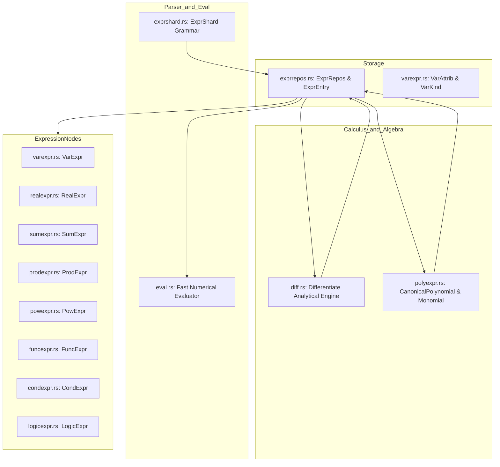

# Fresco: Symbolic Mathematics, Differentiation & Polynomial Normalization

**Path:** `src/fresco/`  
**Crate Member:** `trellis::fresco`  
**Status:** Algebraic & Symbolic Mathematics Subsystem

---

## 1. Module Overview & Mission

`fresco` is Trellis's symbolic algebra and analytical mathematics engine. It represents, parses, evaluates, differentiates, and normalizes algebraic mathematical expressions. It operates over a central transactional expression repository (`ExprRepos`), ensuring compact memory layout, zero pointer cycles, and strict adherence to Trellis memory rules:
- **Symbolic Differentiation (`diff.rs`)**: Exact analytical differentiation engine recursively computing derivatives across all elementary mathematical functions and composite rules.
- **Polynomial Normalization (`polyexpr.rs`)**: Transforms arbitrary multivariate expressions into canonical polynomial forms (`CanonicalPolynomial`, `Monomial`) ordered by graded lexicographical order.
- **High-Speed AST Evaluation (`eval.rs`)**: Fast numerical evaluation binding variables from contiguous `Arr<'_, f64>` buffers without allocations.
- **Shard-Powered Parsing (`exprshard.rs`)**: High-speed grammar parser translating infix mathematical strings into transactional expression trees.

### Design Principles
- **No Direct Pointer Graphs**: Expressions are referenced strictly by 32-bit arena IDs (`u32`).
- **Sentinel Invariants**: Unassigned links and optional IDs use `u32::MAX` (strictly zero `Option<u32>`).
- **Logarithmic Variable Interning**: Symbol tables are stored in sorted arrays searched in $O(\log N)$ time.
- **Algebraic Canonical Equivalence**: Canonical polynomial expansion and like-term collection guarantee identical polynomial representations regardless of input associativity or grouping.

---

## 2. Component Hierarchy & File Map



| File | Primary Types & Functions | Description |
|---|---|---|
| `exprrepos.rs` | `ExprRepos`, `ExprEntry`, `BaseExpr` | Central repository for expressions, managing IDs, $O(\log N)$ symbol index, checked node factories, and algebraic tree lowering. |
| `diff.rs` | `Differentiate(repos, exprId, varId)` | Recursive analytical symbolic differentiation implementing sum, product, quotient, power, and chain rules across elementary functions. |
| `polyexpr.rs` | `CanonicalPolynomial`, `Monomial`, `PolyExpr` | Multivariate polynomial representation with graded lexicographical ordering, term reduction, arithmetic operations, and expression conversion. |
| `eval.rs` | `EvalError`, `ExprRepos::Evaluate`, `ExprRepos::EvaluateNamed` | Stack-safe numerical evaluator supporting variable bindings on `Arr<'_, f64>`, strict branch laziness, and assumption validation. |
| `exprshard.rs` | `ExprShard` | Recursive-descent shard grammar parser converting infix mathematical text into staged expressions. |
| `varexpr.rs` | `VarExpr`, `VarAttrib`, `VarKind` | Named symbolic variable representation with `u32::MAX` sentinel attributes and flag bits. |
| `realexpr.rs` | `RealExpr` | Constant floating-point numerical leaf expression. |
| `sumexpr.rs` | `SumExpr` | N-ary summation/subtraction partitioned into positive and negative terms. |
| `prodexpr.rs` | `ProdExpr` | N-ary multiplication/division partitioned into numerator and denominator factors. |
| `powexpr.rs` | `PowExpr` | Strictly binary exponentiation ($u^v$). |
| `condexpr.rs` | `CondExpr` | Ternary conditional branching expression (`if cond then ifTrue else ifFalse`). |
| `logicexpr.rs` | `LogicExpr`, `LogicOp` | Binary comparisons (`==`, `!=`, `<`, `<=`, `>`, `>=`), boolean logic (`and`, `or`), and unary logical negation (`!`, `not`). |
| `funcexpr.rs` | `FuncExpr` | Named mathematical function call with a single expression argument (`name(arg)`). |
| `termtree.rs` | `TermBinNode`, `ITermNode`, `Term` | Maps expressions into binary term trees for recursive lowering and rewriting. |

---

## 3. Core Data Structures & Types

### 3.1 `CanonicalPolynomial` & `Monomial`
Represents expanded, simplified multivariate polynomials:
```rust
pub struct Monomial {
    pub _Coeff: f64,
    pub _Vars:  Buff<u32>,
    pub _Exps:  Buff<u32>,
}

pub struct CanonicalPolynomial {
    pub _Terms: Buff<Monomial>,
}
```
- **Graded Lexicographical Ordering**: Monomials are sorted first by total degree descending, then lexicographically by variable IDs.
- **Normalization**: Combines like terms, eliminates zero coefficients, and canonicalizes constants.
- **Arithmetic**: Implements `Add`, `Subtract`, and `Multiply` directly on canonical polynomials.
- **Round-Trip Isomorphism**: `FromExpr(repos, exprId)` expands arbitrary expressions into canonical polynomials; `ToExpr(repos)` synthesizes polynomial AST trees back into `ExprRepos`.

### 3.2 Analytical Differentiation (`diff.rs`)
```rust
pub fn Differentiate(
    repos:  &mut ExprRepos,
    exprId: u32,
    varId:  u32,
) -> Result<u32, String>
```
Computes $\frac{\partial}{\partial x} f(x)$ recursively, inserting newly synthesized derivative nodes into `repos`.

---

## 4. Feature-by-Feature Deep Dive

### 4.1 Recursive Analytical Differentiation Rules
`Differentiate` implements exact calculus rules:
1. **Constant Rule**: $\frac{d}{dx} C = 0$.
2. **Variable Rule**: $\frac{d}{dx} x = 1$; $\frac{d}{dx} y = 0$ for $y \neq x$.
3. **Sum & Difference Rule**: $\frac{d}{dx} (u \pm v) = u' \pm v'$.
4. **Product Rule**: $\frac{d}{dx} (u \cdot v) = u'v + uv'$.
5. **Quotient Rule**: $\frac{d}{dx} \left(\frac{u}{v}\right) = \frac{u'v - uv'}{v^2}$.
6. **Power Rule**: $\frac{d}{dx} (u^v) = u^v \left( v' \ln(u) + \frac{v \cdot u'}{u} \right)$.
7. **Elementary Functions**:
   - $\frac{d}{dx} \sin(u) = u' \cos(u)$
   - $\frac{d}{dx} \cos(u) = -u' \sin(u)$
   - $\frac{d}{dx} \exp(u) = u' \exp(u)$
   - $\frac{d}{dx} \ln(u) = \frac{u'}{u}$
   - $\frac{d}{dx} \sqrt{u} = \frac{u'}{2\sqrt{u}}$

### 4.2 Canonical Polynomial Normalization
Solves algebraic equivalence checking without heuristics:
- Two expressions $f(x)$ and $g(x)$ are identically equal if and only if `CanonicalPolynomial::FromExpr(f) == CanonicalPolynomial::FromExpr(g)`.
- Automatically expands nested multiplications: $(x + 1)(x - 1) \to x^2 - 1$.
- Simplifies complex symbolic constraint equations in `fenst::sketch_constraint`.

### 4.3 Logarithmic Variable Interning (`ExprRepos`)
- Variable attributes (`VarAttrib`) are kept in a contiguous `Stash`.
- Variable lookup uses binary search over `_SymbolIndex` ($O(\log N)$ time), eliminating hash table allocations and hash collision vulnerabilities.

---

## 5. Integration Boundaries

- **Upstream Dependencies**: `silo` (`Buff`, `Stash`, `USeg`), `shard` (expression parsing).
- **Downstream Consumers**:
  - `fenst::sketch_constraint`: Uses analytical derivatives for Jacobian calculations in Newton-Raphson constraint solving.
  - Python bindings in `src/python/`: Allows symbolic differentiation and polynomial manipulation from Python scripts.
