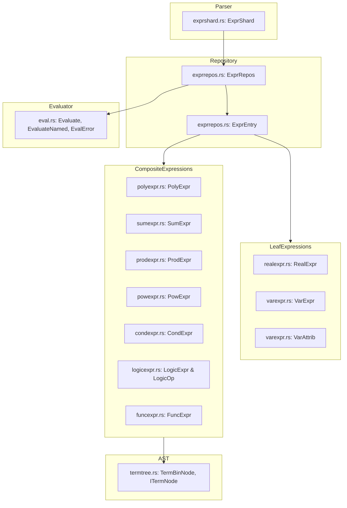

# Fresco: Symbolic Expression Modeling & Term Trees

**Path:** `src/fresco/`  
**Crate Member:** `trellis::fresco`  
**Status:** Mathematical & Symbolic Expression Framework

---

## 1. Module Overview & Mission

`fresco` provides symbolic expression modeling, algebraic term trees, high-speed parsing, numerical evaluation, and variable repositories in Trellis. Designed for analytical model evaluation, biological network simulation, and parametric optimization in physical/circuit systems, it provides structured polynomial, summation, product, power, conditional, logical, and function expressions that can be evaluated, simplified, and transformed into binary term trees.

### Design Principles
- **Repository-Backed Entities**: Expressions and variables are registered in an `ExprRepos` table, ensuring consistent symbol interning, attribute tagging, and memory efficiency.
- **Logarithmic Variable Interning**: Variables are indexed alphabetically using a secondary sorted buffer (`_SymbolIndex: Stash<u32>`), guaranteeing $O(\log N)$ binary search lookups without hash map overhead.
- **Transactional Staging & Atomic Publication**: Expressions are constructed in temporary semantic staging during parsing. Backtracking automatically discards temporary staging without touching `ExprRepos`. Only upon successful outer parse acceptance are expressions and variable identities atomically published into `ExprRepos`.
- **Algebraic Parity Propagation**: Partitioned polynomial trees (`PolyExpr`) preserve non-associative mathematical groupings via signed parity propagation ($a - (b - c) \implies a + c - b$; $a / (b / c) \implies (a \cdot c) / b$).
- **Strict Numerical Laziness**: Conditional expressions (`If`) and logical connectives (`And`, `Or`) evaluate lazily, guaranteeing that unselected branches never trigger division-by-zero or domain errors.
- **Directive Invariant Compliance**: Sentinel-based identification using `u32::MAX` for invalid/unassigned links per `AGENTS.md` Rule 21.

---

## 2. Component Hierarchy & File Map



| File | Primary Types & Functions | Description |
|---|---|---|
| `exprrepos.rs` | `ExprRepos`, `ExprEntry`, `BaseExpr` | Central repository for expressions, managing IDs, $O(\log N)$ symbol index, checked node factories, and algebraic tree lowering. |
| `eval.rs` | `EvalError`, `ExprRepos::Evaluate`, `ExprRepos::EvaluateNamed` | Stack-safe reference evaluator supporting numerical bindings on `Arr<'_, f64>`, strict branch laziness, and assumption validation. |
| `exprshard.rs` | `ExprShard` | Recursive-descent shard grammar parser with temporary semantic staging and atomic publication upon outer acceptance. |
| `varexpr.rs` | `VarExpr`, `VarAttrib`, `VarKind` | Named symbolic variable representation with `u32::MAX` sentinel attributes and flag bits (`NonZero`, `Prime`, `Scalar`). |
| `realexpr.rs` | `RealExpr` | Constant floating-point numerical leaf expression. |
| `polyexpr.rs` | `PolyExpr` | Partitioned n-ary composite expression with common size boundary (`_CoSize`). |
| `sumexpr.rs` | `SumExpr` | N-ary summation/subtraction partitioned into positive and negative terms. |
| `prodexpr.rs` | `ProdExpr` | N-ary multiplication/division partitioned into numerator and denominator factors. |
| `powexpr.rs` | `PowExpr` | Strictly binary exponentiation ($u^v$). |
| `condexpr.rs` | `CondExpr` | Ternary conditional branching expression (`if cond then ifTrue else ifFalse`). |
| `logicexpr.rs` | `LogicExpr`, `LogicOp` | Binary comparisons (`==`, `!=`, `<`, `<=`, `>`, `>=`), boolean logic (`and`, `or`), and unary logical negation (`!`, `not`). |
| `funcexpr.rs` | `FuncExpr` | Named mathematical function call with a single expression argument (`name(arg)`). |
| `termtree.rs` | `TermBinNode`, `ITermNode`, `Term` | Maps expressions into binary term trees for recursive lowering and rewriting. |

---

## 3. Core Data Structures & Invariants

### 3.1 `ExprRepos`
Central storage manager utilizing `Silo` collections:
```rust
pub struct ExprRepos
{
    _Exprs:       Stash< ExprEntry >,
    _VarAttribs:  Stash< VarAttrib >,
    _SymbolIndex: Stash< u32 >,
}
```

- **Logarithmic Variable Interning:** `_SymbolIndex` maintains sorted variable IDs by `VarAttrib::Name()`. `FindVar(name)` locates existing variable IDs in $O(\log N)$ time, returning `u32::MAX` if uninterned.
- **Transactional Staging:** `ExprRepos` contains zero checkpoint or rollback APIs. During parsing, expressions accumulate in temporary local staging in `ExprShard`; only upon successful acceptance are live nodes atomically published into `ExprRepos`. Failed matches leave `ExprRepos` 100% untouched.

### 3.2 `VarAttrib` Sentinel Invariant
Per `AGENTS.md` Rule 21, `Option<u32>` is prohibited. Unassigned links use `u32::MAX`:
```rust
pub struct VarAttrib
{
    _Name:      String,
    _DepExpr:   u32,        // u32::MAX when independent
    _AggrIndex: u32,        // u32::MAX when non-aggregate
    _Flags:     u32,
}
```

Flag bits support `VarKind::NonZero = 4`, configuring mathematical premises for domain-sensitive simplification.

### 3.3 `PolyExpr` Partitioned Invariant
`PolyExpr` represents partitioned composite operations using a contiguous child buffer and a split point `_CoSize`:
- In `SumExpr`: $(\sum_{i < \text{_CoSize}} \text{Child}_i) - (\sum_{j \ge \text{_CoSize}} \text{Child}_j)$
- In `ProdExpr`: $(\prod_{i < \text{_CoSize}} \text{Child}_i) / (\prod_{j \ge \text{_CoSize}} \text{Child}_j)$

Tree lowering propagates algebraic signs:
- $a - (b - c) \implies \text{SumExpr with positive terms } \{a, c\} \text{ and negative term } \{b\} \implies a + c - b$ (`_CoSize = 2`).
- $a / (b / c) \implies \text{ProdExpr with numerator factors } \{a, c\} \text{ and denominator factor } \{b\} \implies (a \cdot c) / b$ (`_CoSize = 2`).
- Exponentiation (`PowExpr`) is preserved as strictly binary with no flattening.

### 3.4 Numerical Evaluator & Domain Policy
The reference evaluator in `eval.rs` provides direct interpretation of AST expressions:
```rust
pub fn Evaluate( &self, root: u32, bindings: Arr< '_, f64 > ) -> Result< f64, EvalError >;
pub fn EvaluateNamed( &self, root: u32, namedBindings: Arr< '_, ( &str, f64 ) > ) -> Result< f64, EvalError >;
```

Key execution guarantees:
1. **Strict Branch Laziness**: `if (cond) then A else B` evaluates `cond`, and then evaluates *only* the chosen branch. The untaken branch is never traversed, preventing false division-by-zero or domain errors in guarded expressions like `if (x != 0) 1/x else 0`.
2. **Short-Circuit Logic**: `A and B` immediately returns `0.0` if `A` is false; `A or B` immediately returns `1.0` if `A` is true.
3. **Domain Validation**:
   - `0.0` or `-0.0` denominator in `ProdExpr` returns `EvalError::DivisionByZero`.
   - Base `0.0` with negative exponent returns `EvalError::DivisionByZero`.
   - Negative base with non-integer exponent returns `EvalError::DomainError`.
   - Negative radicand in `sqrt(x)` and non-positive arguments in `ln(x)`, `log(x)`, `log10(x)` return `EvalError::DomainError`.
4. **Assumption Enforcement**: At binding time, variables flagged with `VarKind::NonZero` are validated: binding `0.0`, `-0.0`, or `NaN` triggers `EvalError::AssumptionViolated`.
5. **Recursion Bounds**: Maximum evaluation call-depth is clamped to `K_MAX_TREE_DEPTH = 128` to prevent native stack exhaustion.

### 3.5 Numerical Contract vs. Algebraic Normalization
Fresco differentiates **symbolic canonicalization** from **IEEE-754 numerical evaluation**:
- Algebraic lowering (`CollectAdditive`, `CollectMultiplicative`) assumes real arithmetic over non-zero fields ($\mathbb{R} \setminus \{0\}$).
- Rearranging $a / (b / c)$ to $(a \cdot c) / b$ is algebraically valid, but can alter floating-point overflow, underflow, and rounding.
- `VarKind::NonZero` provides a formal precondition for symbolic simplification (e.g. $x / x \to 1$), but does not imply that arbitrary floating-point expressions can be reordered without numerical discrepancy.

---

## 4. Expression Parsing (`ExprShard`)

The grammar parser in `exprshard.rs` translates mathematical strings into expressions using temporary semantic staging:

### Supported Grammar:
1. **Numbers:** Integers, floating point, scientific notation with exponential suffixes (`1e-8`, `8.42e`).
2. **Negative Literal Folding:** Unary minus immediately followed by a number parses directly into `RealExpr(-val)` without allocating intermediate zero or summation nodes.
3. **Variables:** Alphabetic identifiers supporting `.`, `@`, `#`, `$` characters (e.g. `kras.conc`, `ifn@1`, `flag#`, `cost$`).
4. **Logical Operators:**
   - Unary prefix: `!expr`, `not expr`.
   - Binary comparisons: `==`, `=`, `!=`, `<`, `<=`, `>`, `>=`. Whitespace-independent (`x!=y` is identical to `x != y`).
   - Boolean connectives: `and`, `or`.
5. **Conditional Branching:** `if (cond) (ifTrue) else (ifFalse)` and `if cond then ifTrue else ifFalse`.
6. **Function Calls:** `name(arg)` (`abs`, `sqrt`, `exp`, `ln`, `log`, `log10`, `sin`, `cos`, `tan`, `sinh`, `cosh`, `tanh`, `floor`, `ceil`, `round`).

---

## 5. Serialization via Flux

All expressions implement `flux::IFluxExportSource` and `flux::IFluxImportSink`. Symbolic expressions serialize into structured JSON and binary flux streams with typed tags, preserving AST structure and variable attributes across sessions.

---

## 6. Integration Boundaries

- **Upstream Dependencies**: `silo` (`Stash`, `Buff`, `Arr`), `stalks` (`Node`, `BinOp`), `flux` (`FieldExp`, `IFluxExportSource`), `shard` (`IGrammar`, `Parser`).
- **Downstream Consumers**: Used in kinetic biochemical models (Cellworks/Elmer transpilations), circuit simulation, and analytical physical parameter modeling across Trellis.
