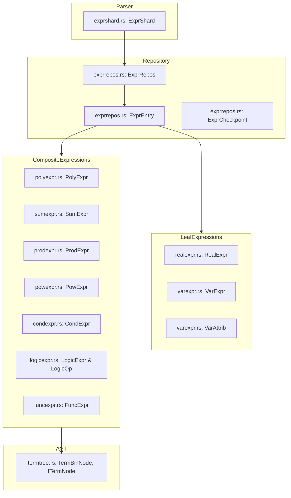

# Fresco: Symbolic Expression Modeling & Term Trees

**Path:** `src/fresco/`  
**Crate Member:** `trellis::fresco`  
**Status:** Mathematical & Symbolic Expression Framework

---

## 1. Module Overview & Mission

`fresco` provides symbolic expression modeling, algebraic term trees, high-speed parsing, and variable repositories in Trellis. Designed for analytical model evaluation, biological network simulation, and parametric optimization in physical/circuit systems, it provides structured polynomial, summation, product, power, conditional, logical, and function expressions that can be evaluated, simplified, and transformed into binary term trees.

### Design Principles
- **Repository-Backed Entities**: Expressions and variables are registered in an `ExprRepos` table, ensuring consistent symbol interning, attribute tagging, and memory efficiency.
- **Logarithmic Variable Interning**: Variables are indexed alphabetically using a secondary sorted buffer (`_SymbolIndex: Stash<u32>`), guaranteeing $O(\log N)$ binary search lookups without hash map overhead.
- **Transactional State Safety**: The parser operates under strict atomicity invariants (`ExprCheckpoint` & `Rollback`); any syntax error or trailing token failure leaves zero residual state in `ExprRepos`.
- **Algebraic Parity Propagation**: Partitioned polynomial trees (`PolyExpr`) preserve non-associative mathematical groupings via signed parity propagation ($a - (b - c) \implies a + c - b$; $a / (b / c) \implies (a \cdot c) / b$).
- **Directive Invariant Compliance**: Sentinel-based identification using `u32::MAX` for invalid/unassigned links per `AGENTS.md` Rule 21.

---

## 2. Component Hierarchy & File Map



| File | Primary Types & Functions | Description |
|---|---|---|
| `exprrepos.rs` | `ExprRepos`, `ExprEntry`, `BaseExpr`, `ExprCheckpoint` | Central repository for expressions, managing IDs, $O(\log N)$ symbol index, transactional checkpoints, and algebraic tree lowering. |
| `exprshard.rs` | `ExprShard` | Recursive-descent shard grammar parser for expressions, supporting arithmetic, logic, conditionals, functions, scientific notation, and literal folding. |
| `varexpr.rs` | `VarExpr`, `VarAttrib`, `VarKind` | Named symbolic variable representation with `u32::MAX` sentinel attributes. |
| `realexpr.rs` | `RealExpr` | Constant floating-point numerical leaf expression. |
| `polyexpr.rs` | `PolyExpr` | Partitioned n-ary composite expression with common size boundary (`_CoSize`). |
| `sumexpr.rs` | `SumExpr` | N-ary summation/subtraction partitioned into positive and negative terms. |
| `prodexpr.rs` | `ProdExpr` | N-ary multiplication/division partitioned into numerator and denominator factors. |
| `powexpr.rs` | `PowExpr` | Strictly binary exponentiation ($u^v$). |
| `condexpr.rs` | `CondExpr` | Ternary conditional branching expression (`if cond then ifTrue else ifFalse`). |
| `logicexpr.rs` | `LogicExpr`, `LogicOp` | Binary comparisons (`==`, `!=`, `<`, `<=`, `>`, `>=`), boolean logic (`and`, `or`), and unary logical negation (`!`, `not`). |
| `funcexpr.rs` | `FuncExpr` | Named mathematical function call with a single expression argument (`name(arg)`). |
| `termtree.rs` | `TermBinNode`, `ITermNode`, `Term` | Maps expressions into binary term trees for recursive lowering and rewriting. |

---

## 3. Core Data Structures & Invariants

### 3.1 `ExprRepos`
Central storage manager utilizing `Silo` collections:
```rust
pub struct ExprRepos
{
    _Exprs:       Stash< ExprEntry >,
    _VarAttribs:  Stash< VarAttrib >,
    _SymbolIndex: Stash< u32 >,
}
```

- **Logarithmic Variable Interning:** `_SymbolIndex` maintains sorted variable IDs by `VarAttrib::Name()`. `VarCreate(name, reuse)` uses binary search to locate or insert variable IDs in $O(\log N)$ time, eliminating quadratic $O(N^2)$ scanning on large models.
- **Transactional Rollback:**
  ```rust
  let cp = repos.Checkpoint();
  // On parse failure:
  repos.Rollback( cp );
  ```
  Guarantees zero memory leaks and no orphaned variable or expression nodes when syntax errors occur.

### 3.2 `VarAttrib` Sentinel Invariant
Per `AGENTS.md` Rule 21, `Option<u32>` is prohibited. Unassigned links use `u32::MAX`:
```rust
pub struct VarAttrib
{
    _Name:      String,
    _DepExpr:   u32,        // u32::MAX when independent
    _AggrIndex: u32,        // u32::MAX when non-aggregate
    _Flags:     u32,
}
```

### 3.3 `PolyExpr` Partitioned Invariant
`PolyExpr` represents partitioned composite operations using a contiguous child buffer and a split point `_CoSize`:
- In `SumExpr`: $(\sum_{i < \text{_CoSize}} \text{Child}_i) - (\sum_{j \ge \text{_CoSize}} \text{Child}_j)$
- In `ProdExpr`: $(\prod_{i < \text{_CoSize}} \text{Child}_i) / (\prod_{j \ge \text{_CoSize}} \text{Child}_j)$

Tree lowering propagates algebraic signs:
- $a - (b - c) \implies \text{SumExpr with positive terms } \{a, c\} \text{ and negative term } \{b\} \implies a + c - b$ (`_CoSize = 2`).
- $a / (b / c) \implies \text{ProdExpr with numerator factors } \{a, c\} \text{ and denominator factor } \{b\} \implies (a \cdot c) / b$ (`_CoSize = 2`).
- Exponentiation (`PowExpr`) is preserved as strictly binary with no flattening.

---

## 4. Expression Parsing (`ExprShard`)

The grammar parser in `exprshard.rs` translates mathematical strings directly into canonical repository nodes:

### Supported Grammar:
1. **Numbers:** Integers, floating point, scientific notation with exponential suffixes (`1e-8`, `8.42e`).
2. **Negative Literal Folding:** Unary minus immediately followed by a number parses directly into `RealExpr(-val)` without allocating intermediate zero or summation nodes.
3. **Variables:** Alphabetic identifiers supporting `.`, `@`, `#`, `$` characters (e.g. `kras.conc`, `ifn@1`, `flag#`, `cost$`).
4. **Logical Operators:**
   - Unary prefix: `!expr`, `not expr`.
   - Binary comparisons: `==`, `=`, `!=`, `<`, `<=`, `>`, `>=`. Whitespace-independent (`x!=y` is identical to `x != y`).
   - Boolean connectives: `and`, `or`.
5. **Conditional Branching:** `if (cond) (ifTrue) else (ifFalse)` and `if cond then ifTrue else ifFalse`.
6. **Function Calls:** `name(arg)` (e.g. `log(x)`, `exp(t)`).

---

## 5. Serialization via Flux

All expressions implement `flux::IFluxExportSource` and `flux::IFluxImportSink`. Symbolic expressions serialize into structured JSON and binary flux streams with typed tags, preserving AST structure and variable attributes across sessions.

---

## 6. Integration Boundaries

- **Upstream Dependencies**: `silo` (`Stash`, `Buff`, `Arr`), `stalks` (`Node`, `BinOp`), `flux` (`FieldExp`, `IFluxExportSource`), `shard` (`IGrammar`, `Parser`).
- **Downstream Consumers**: Used in kinetic biochemical models (Cellworks/Elmer transpilations), circuit simulation, and analytical physical parameter modeling across Trellis.
