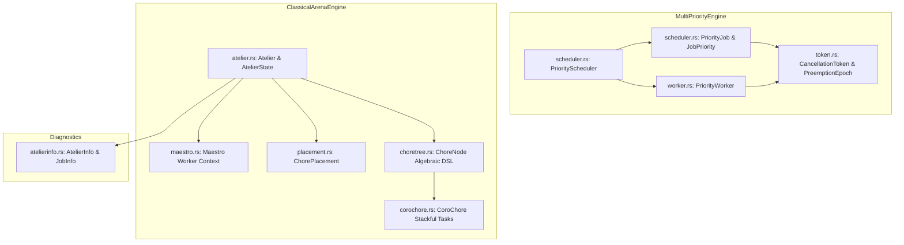

# Heist: Multi-Priority Work-Stealing Job Scheduler & Task Farm

**Path:** `src/heist/`  
**Crate Member:** `trellis::heist`  
**Status:** Concurrency & Work-Stealing Scheduling Subsystem

---

## 1. Module Overview & Mission

`heist` is Trellis's core task scheduling engine. It manages thread pools, priority work-stealing schedulers, task graphs, and cooperative cancellation tokens. It provides two complementary scheduling engines:
1. **Classical Slot Arena (`Atelier` & `Maestro`)**: Fixed-capacity pre-allocated 65,536-slot job arena with thread placement affinity (`Require`, `Prefer`, `Any`) and algebraic chore trees.
2. **Multi-Priority Work Stealing (`PriorityScheduler`)**: 4-tier priority queues (`High`, `Normal`, `Low`, `Background`), cross-worker priority work stealing, and cooperative preemption via `CancellationToken` and `PreemptionEpoch`.

### Design Principles
- **Multi-Priority Tiering**: Strict priority ordering ensuring high-priority interactive tasks preempt background indexing and layout tasks.
- **Zero-Allocation Stealable Deques**: Cache-local job queues backed by `silo` primitives, minimizing allocator locks during task handoffs.
- **Cooperative Preemption & Cancellation**: Long-running computational jobs poll lightweight `CancellationToken`s and `PreemptionEpoch` counters to pause or abort gracefully.
- **Placement & Thread Pinning**: Supports strict task-to-worker pinning (`Require`), soft affinity (`Prefer`), or unconstrained stealing (`Any`).

---

## 2. Component Hierarchy & File Map



| File | Primary Types & Functions | Description |
|---|---|---|
| `scheduler.rs` | `PriorityScheduler`, `JobPriority`, `PriorityJob` | 4-tier priority work-stealing scheduler managing High, Normal, Low, and Background job queues. |
| `token.rs` | `CancellationToken`, `PreemptionEpoch` | Atomic cooperative preemption and cancellation tokens enabling non-blocking task abortion. |
| `worker.rs` | `PriorityWorker` | Worker thread execution loop executing highest-priority local tasks and stealing from peers when idle. |
| `atelier.rs` | `Atelier`, `AtelierState`, `ExecuteLoop` | Classical 65,536-slot pre-allocated job arena, worker thread pool, and dependency graph resolver. |
| `maestro.rs` | `Maestro`, `MaestroContext` | Per-worker execution context owning local stealable and non-stealable queues. |
| `placement.rs` | `ChorePlacement`, `PlacementKind` | Affinity rules: `Any` (stealable), `Prefer(w)`, and `Require(w)` (pinned, non-stealable). |
| `choretree.rs` | `Chore`, `ChoreNode`, `PostChoreNode`, `SpawnQuellNode` | Algebraic chore tree DSL (`>>` for then, `\|` for par), type-erased closure execution, and tree decomposition. |
| `corochore.rs` | `CoroChore`, `CoroSharedFn` | Stackful coroutine chore wrapper supporting cooperative suspension and DAG successor signaling. |
| `atelierinfo.rs`| `AtelierInfo`, `JobInfo` | Introspection structures exposing worker thread counts, queue depths, and execution diagnostics. |

---

## 3. Core Data Structures & Types

### 3.1 Multi-Priority Work Scheduler (`PriorityScheduler`)
```rust
#[derive(Clone, Copy, Debug, PartialEq, Eq, PartialOrd, Ord)]
pub enum JobPriority {
    High       = 0,
    Normal     = 1,
    Low        = 2,
    Background = 3,
}

pub struct PriorityJob {
    pub _Priority: JobPriority,
    pub _Task:     Box<dyn FnOnce(&CancellationToken) + Send>,
}
```

### 3.2 Cancellation Tokens & Epochs (`token.rs`)
```rust
pub struct CancellationToken {
    _Cancelled: Arc<AtomicBool>,
}

pub struct PreemptionEpoch {
    _Epoch: Arc<AtomicU64>,
}
```
- `token.IsCancelled() -> bool`: Returns `true` if an abort was requested.
- `token.Cancel()`: Atomically signals all tasks sharing this token to abort immediately.
- `epoch.Advance()`: Increments the global scheduling epoch, signaling long-running jobs to yield.

### 3.3 `ChorePlacement` (Classical Arena)
```rust
#[derive(Clone, Copy, PartialEq, Eq)]
pub enum ChorePlacement {
    Any,
    Prefer(u32),
    Require(u32),
}
```
- `Any`: Can run on any worker thread; eligible for work stealing.
- `Prefer(w)`: Placed in Worker $w$'s local queue, but eligible for stealing if other workers starve.
- `Require(w)`: Placed strictly in Worker $w$'s non-stealable queue. **Thieves can never steal it.**

---

## 4. Feature-by-Feature Deep Dive

### 4.1 Multi-Priority Work Stealing (`scheduler.rs`)
The priority scheduler optimizes execution responsiveness:
1. Each worker thread maintains 4 distinct local queues corresponding to `High`, `Normal`, `Low`, and `Background` priorities.
2. In its execution loop, a worker always dequeues from its highest non-empty priority tier first.
3. When all local queues are empty, the worker attempts to steal work from peer workers:
   - Steals from peer `High` queues first.
   - Falls back to peer `Normal`, then `Low`, then `Background` queues.
4. Guarantees that interactive UI requests or immediate simulation steps execute before background geometry processing or disk cache warming.

### 4.2 Cooperative Preemption (`token.rs`)
Tasks performing heavy computation (e.g., SAT solving, constraint relaxation, or large mesh extrusion) periodically check `token.IsCancelled()`:
- If `true`, the task immediately exits cleanly without corrupting document state or leaking memory.
- Enables the UI shell to cancel long-running queries instantly upon new user inputs.

### 4.3 Classical Fixed-Capacity Arena (`Atelier`)
Designed for strict zero-allocation embedded or deterministic simulation modes:
- Pre-allocates 65,536 job slots during startup.
- Enqueuing tasks acquires a slot index without heap allocations.
- Predecessor count arrays (`_SzPreds`) track DAG dependencies; when predecessor count hits zero, the task automatically wakes up into a worker queue.

---

## 5. Integration Boundaries

- **Upstream Dependencies**: `silo` (`Stash`, `Buff`, `Fifo`), `stalks` (`Spinlock`, `SpinMutex`, `WorkPtr`).
- **Downstream Consumers**:
  - `rube`: Dispatches parallel combinational SIMT warps across Heist workers.
  - `swarm`: Powers parallel CPU compute kernels.
  - `fascia::geometry_load`: Streams 3D OBJ and PTS point cloud parsing in the background.
