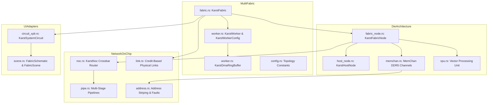

# Karst: Interconnect & Memory Fabric Simulator

**Path:** `src/karst/`  
**Crate Member:** `trellis::karst`  
**Status:** Multi-Die Interconnect & Memory Subsystem

---

## 1. Module Overview & Mission

`karst` is Trellis's cycle-accurate simulation framework for high-bandwidth multi-die interconnects, Networks-on-Chip (NoC), and multi-channel DDR5/HBM memory fabrics. It simulates the physical transport of 64-bit flits across multi-stage pipelines, crossbars, inter-die credit-based links, and near-memory Vector Processing Units (VPUs), supporting NUMA-aware multi-die scaling:
- **Zero-Allocation Cycle Advancement**: Simulates clock cycles across multi-fabric topologies without per-cycle heap allocations.
- **Zero-Copy Cross-Die DMA**: Inter-die communication via bounded lock-free static DMA ring buffers (`KarstDmaRingBuffer`).
- **NUMA Hardware Core Affinity**: Binds independent worker threads simulating separate silicon dies to dedicated physical CPU cores (`AdvanceIndependentWithAffinity`).

### Design Principles
- **Flit-Level Modeling**: All traffic is partitioned into compact, bit-packed 64-bit transfer units (`KarstFlit`).
- **Credit-Based Flow Control**: Downstream buffers advertise credit availability to upstream transmitters; transmission stops immediately when credits are exhausted.
- **Multi-Die Scalability**: Dies can be simulated in lockstep or stepped independently across host CPU cores with deterministic epoch synchronization.
- **Near-Memory Acceleration**: Embedded Vector Processing Units (`Vpu`) execute compute kernels directly adjacent to simulated memory channels via `swarm`.

---

## 2. Component Hierarchy & File Map



| File | Primary Types & Functions | Description |
|---|---|---|
| `fabric.rs` | `KarstFabric`, `KarstStats`, `KarstCycleTrace`, `AdvanceIndependentWithAffinity`, `CycleCount` | Top-level fabric coordinator, cycle advancement, stats tracking, parallel stepping with CPU affinity, and VPU batching. |
| `worker.rs` | `KarstWorker`, `KarstWorkerConfig`, `KarstDmaRingBuffer` | NUMA-aware multi-fabric worker thread executing die simulation cycles pinned to designated host CPU cores with zero-copy DMA ring buffers. |
| `fabric_node.rs` | `KarstFabricNode` | Per-die container managing 4 host nodes, 8 memory channels, NoC routers, and inter-die link ports. |
| `host_node.rs` | `KarstHostNode`, `HostTransaction`, `HostResponse` | Host processing core issuing memory read/write requests and tracking latencies. |
| `noc.rs` | `KarstNoc`, `KarstNocQueueDepths` | Network-on-Chip router managing crossbar routing, ingress/egress queues, and backpressure. |
| `memchan.rs` | `MemChan`, `MemChanStats` | DDR5 memory channel backed by `swarm::ComputeBuffer` with burst read/write handling. |
| `vpu.rs` | `Vpu` | Vector / Near-Memory Processing Unit executing Swarm compute kernels on memory channels. |
| `link.rs` | `KarstFlit`, `KarstLink` | Inter-die flit representation and credit-based physical link model. |
| `pipe.rs` | `KarstPipe` | Multi-stage transport pipeline modeling propagation delay and backpressure. |
| `address.rs` | `DecodeLocalWord`, `MemoryFault` | Physical address decoding, channel striping, and fault injection verification. |
| `circuit_xplr.rs` | `KarstSystemCircuit`, `KarstDieCircuit`, `KarstFabricCircuit` | Explorer and schematic adapters exposing Karst multi-die hierarchy to `CircuitXplr`. |
| `scene.rs` | `FabricSchematic`, `FabricScene`, `DieSchematic` | 2D classical schematic generation and 3D Cask scene models for Karst fabric. |
| `config.rs` | Constants | Topology sizing: `K_NUM_DIES = 2`, `K_HOSTS_PER_FABRIC = 8`, `K_MEM_CHANS_PER_FABRIC = 16`. |

---

## 3. Core Data Structures & Types

### 3.1 `KarstFlit` (Link Transfer Unit)
64-bit word payload with routing and command metadata:
```rust
pub struct KarstFlit {
    pub _Data:      u64,
    pub _Dest:      u8,
    pub _Src:       u8,
    pub _Op:        FlitOp,
    pub _IsTail:    bool,
}
```

### 3.2 `KarstDmaRingBuffer` (Zero-Copy DMA Transfer)
Static ring buffer enabling lock-free cross-die communication:
```rust
pub struct KarstDmaRingBuffer {
    _Queue: Fifo<KarstFlit, 1024>,
}
```
Enables sending and receiving flits between independent fabric worker threads without heap allocation or mutex overhead.

### 3.3 `KarstCycleTrace`
Captures cycle-by-cycle signal waveforms:
```rust
pub struct KarstCycleTrace {
    pub _Cycle:        u64,
    pub _IngressValid: [SignalMask; 2],
    pub _IngressReady: [SignalMask; 2],
    pub _IngressData:  [[u64; 10]; 2],
    pub _EgressValid:  [SignalMask; 2],
    pub _EgressReady:  [SignalMask; 2],
    pub _EgressData:   [[u64; 10]; 2],
    pub _HostTxCount:  u64,
    pub _HostRxCount:  u64,
}
```

---

## 4. Feature-by-Feature Deep Dive

### 4.1 NUMA Multi-Fabric Scaling (`AdvanceIndependentWithAffinity`)
When simulating multi-die systems (e.g. Dual-Die or Quad-Die accelerators):
1. `KarstFabric::AdvanceIndependentWithAffinity` accepts an array of `stalks::CpuCoreMask` targets.
2. Spawns dedicated OS worker threads (`KarstWorker`) for each simulated die.
3. Pins each worker thread to a physical core using `stalks::ApplyThreadAffinity`.
4. Workers step their local die pipelines in parallel, exchanging cross-die flits asynchronously through `KarstDmaRingBuffer`.
5. An epoch barrier ensures cycle determinism across die boundaries.

### 4.2 Credit-Based Inter-Die Links (`link.rs`)
Inter-die links connect adjacent silicon dies across package substrates:
- Transmitter checks `credit_count > 0` before emitting a flit.
- Receiver decrements downstream credits upon reception and transmits credit return tokens back when internal queue capacity frees up.
- Ensures zero dropped packets under full burst saturation.

### 4.3 Near-Memory Vector Acceleration (`Vpu`)
Each memory channel can host an adjacent `Vpu`:
- Avoids shuttling large memory buffers over the crossbar to host nodes.
- Dispatches data-parallel vector kernels (`swarm::StandardOp`) directly into the channel's backing `ComputeBuffer`.

---

## 5. Integration Boundaries

- **Upstream Dependencies**: `silo` (`Fifo`, `Buff`), `stalks` (`CpuCoreMask`, `ApplyThreadAffinity`), `swarm` (`ComputeBuffer`).
- **Downstream Consumers**:
  - `fenst::circuit_layout`: Visualizes the multi-die floorplan and routing channels.
  - `fascia::cask_view`: Renders 2D schematics and 3D Cask models of the interconnect topology.
