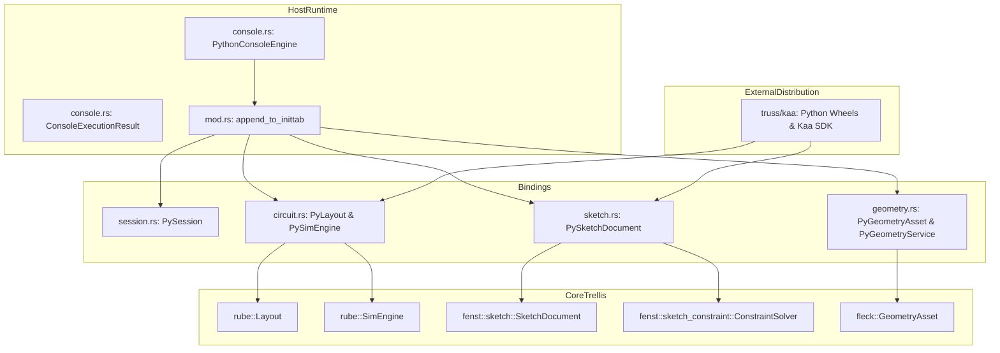

# Python: In-Process Scripting Runtime & Dual-Mode PyO3 Facade

**Path:** `src/python/`, `truss/kaa/`  
**Crate Member:** `trellis::python` (optional feature: `python`)  
**Status:** Scripting, REPL & Python SDK Subsystem

---

## 1. Module Overview & Mission

The `python` module provides an embedded CPython 3.12 execution engine and dual-mode PyO3 binding facade for Trellis. It enables two complementary operational modes:
1. **In-Process Scripting Host**: Embedded inside the `fascia` desktop GUI (`PythonConsoleEngine`), allowing users to run interactive Python scripts directly from the GUI console to manipulate circuits, query simulation traces, solve 2D geometric constraints, and generate 3D solids.
2. **Dual-Mode PyO3 Extension**: Compiled as a native extension module (`trellis` / `_trellis` and `truss/kaa`) loadable by external Python interpreters, Jupyter notebooks, or batch automation scripts.

### Design Principles
- **Dual-Mode PyO3 Architecture**: Identical API surfaces exposed whether Trellis is hosting the embedded Python interpreter or running as a loaded `.pyd`/`.so` library.
- **Inittab Static Injection**: Leverages `pyo3::append_to_inittab!` to link native Rust bindings statically into the embedded interpreter before `Py_Initialize()`, eliminating filesystem path resolution issues.
- **Robust DLL Loader Discovery**: Windows-specific search paths dynamically inspect `PYTHONHOME`, `VIRTUAL_ENV`, Conda environments, and standard registry paths to resolve `python312.dll` at runtime.
- **Zero-Copy Geometry & Vector Transfers**: Exposes flat `Buff<[f32; 3]>` buffers to Python via PyO3 without cloning, converting directly into NumPy-compatible array representations.
- **Asynchronous Execution & Interruption**: Executes console commands in isolated background threads with cooperative interruption hooks to avoid freezing the GUI event loop.

---

## 2. Component Hierarchy & File Map



| File | Primary Types & Functions | Description |
|---|---|---|
| `mod.rs` | `populate_module`, `trellis`, `_trellis`, `version`, `load_geometry` | Module definition, PyO3 extension exports, inittab registration, and framework metadata. |
| `circuit.rs` | `PyLayout`, `PySimEngine` | Python bindings for hardware simulation: circuit construction, topological sorting, clock stepping, signal getters/setters, and Verilog netlist export. |
| `sketch.rs` | `PySketchDocument` | Python bindings for CAD parametric sketching: line/circle/arc entity creation, geometric constraint solving, and 3D watertight solid extrusion. |
| `geometry.rs` | `PyGeometryAsset`, `PyGeometryService` | Python bindings for 3D meshes and point clouds: vertex/normal/index extraction, bounding box queries, and OBJ/PTS file loading. |
| `session.rs` | `PySession` | High-level interactive workspace session holding loaded documents, active circuits, and simulation handles. |
| `console.rs` | `PythonConsoleEngine`, `ConsoleExecutionResult` | Background execution worker running Python scripts, capturing stdout/stderr, and exposing cooperative preemption hooks. |
| `truss/kaa/` | Python Package Definition | Kaa Python distribution package wrapping Trellis simulation and CAD capabilities for scientific data workflows. |

---

## 3. Core Data Structures & Types

### 3.1 `PyLayout` & `PySimEngine`
Exposes the digital logic simulation pipeline to Python:
```rust
#[pyclass(name = "Layout")]
pub struct PyLayout {
    pub(crate) _Inner: Layout,
}

#[pyclass(name = "SimEngine")]
pub struct PySimEngine {
    pub(crate) _Inner: SimEngine,
}
```
- `Layout.build_and_gate(name, a, b, out)`: Instantiates primitive logic gates.
- `Layout.compile()`: Topologically sorts and synthesizes the circuit into a `SimEngine`.
- `SimEngine.step_cycle()`: Steps the digital simulation by one clock cycle.
- `SimEngine.set_input(name, value)` / `get_signal(name)`: Manipulates and reads 4-state logic signals.
- `SimEngine.export_verilog()`: Emits IEEE-1364 structural Verilog netlists.

### 3.2 `PySketchDocument`
Exposes 2D CAD drafting, geometric constraint solving, and 3D extrusion to Python:
```rust
#[pyclass(name = "SketchDocument")]
pub struct PySketchDocument {
    pub(crate) _Inner: SketchDocument,
}
```
- `add_line(x0, y0, x1, y1)`: Creates a 2D line segment.
- `add_circle(cx, cy, r)`: Creates a 2D circle.
- `add_arc(cx, cy, r, start_deg, end_deg)`: Creates a 2D arc segment.
- `solve_constraints(max_iter=100, tol=1e-6)`: Invokes `fenst::sketch_constraint::ConstraintSolver` to relax degrees of freedom.
- `extrude(depth)`: Extrudes the sketch profile into a watertight 3D triangle mesh (`GeometryAsset`).

### 3.3 `PyGeometryAsset`
Exposes 3D meshes and LiDAR point clouds to Python:
```rust
#[pyclass(name = "GeometryAsset")]
pub struct PyGeometryAsset {
    pub(crate) _Inner: GeometryAsset,
}
```
- `points()`: Returns flat array of vertex coordinate triples $(X, Y, Z)$.
- `normals()`: Returns surface normal vectors.
- `indices()`: Returns triangle element index array.
- `bbox()`: Returns bounding box minimum, maximum, and center vectors.

---

## 4. Feature-by-Feature Deep Dive

### 4.1 In-Process REPL & Console Host (`PythonConsoleEngine`)
Mounted inside `fascia::python_console`:
1. Spawns an execution worker thread initializing Python via PyO3.
2. Redirects standard output and standard error streams (`sys.stdout`, `sys.stderr`) into in-memory string sinks.
3. Evaluates multiline Python blocks asynchronously, returning structured `ConsoleExecutionResult` with output strings, evaluation results, and traceback errors.
4. Allows interrupting long-running Python execution loops via `PyErr_SetInterrupt()`.

### 4.2 Scripted Circuit Synthesis & Verification
Users can write concise Python scripts to synthesize testbench circuits programmatically:
```python
import trellis

# Build half adder circuit
layout = trellis.Layout()
layout.add_xor_gate("xor1", in_a="a", in_b="b", out="sum")
layout.add_and_gate("and1", in_a="a", in_b="b", out="carry")

# Compile and simulate
engine = layout.compile()
engine.set_input("a", 1)
engine.set_input("b", 1)
engine.step_cycle()

assert engine.get_signal("sum") == 0
assert engine.get_signal("carry") == 1
```

### 4.3 Scripted CAD & Constraint Relaxation
Parametric CAD geometry can be generated and constrained via Python:
```python
import trellis

sketch = trellis.SketchDocument()
l1 = sketch.add_line(0.0, 0.0, 10.0, 0.0)
l2 = sketch.add_line(10.0, 0.0, 10.0, 10.0)
l3 = sketch.add_line(10.0, 10.0, 0.0, 10.0)
l4 = sketch.add_line(0.0, 10.0, 0.0, 0.0)

# Relax constraints and extrude 3D solid
iterations = sketch.solve_constraints(max_iter=50)
mesh = sketch.extrude(depth=5.0)
print(f"Generated watertight mesh with {mesh.vertex_count()} vertices")
```

---

## 5. Integration Boundaries

- **Upstream Dependencies**: `pyo3`, `rube` (circuit layout & simulation), `fenst` (sketch document & constraint solver), `fleck` (3D geometry).
- **Downstream Consumers**:
  - `fascia::python_console`: Drives the embedded Python REPL tab in the desktop application.
  - `truss/kaa`: External Python distribution wheels for Jupyter and CLI tools.
