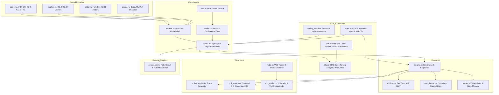

# Rube: Digital Circuit Simulation & Waveform Processing

**Path:** `src/rube/`  
**Crate Member:** `trellis::rube`  
**Status:** Digital Simulation & EDA Subsystem

---

## 1. Module Overview & Mission

`rube` is Trellis's digital logic circuit design, compilation, simulation, EDA artifact ingestion, and formal verification framework. It combines gate-level modeling, hierarchical netlists, topological layout synthesis, SIMT-style data-parallel execution engines (`FastWarp`), stateful multi-cycle coroutine modules (`CoroWarp`), an end-to-end Value Change Dump (VCD) export/parsing pipeline, and advanced EDA tools:
- **Structural Verilog Ingestion**: Ingests IEEE 1364 structural netlists via parser combinators.
- **Formal Verification (CEC)**: Ingests AIGER models, builds miter circuits, and verifies combinational equivalence using DPLL/CDCL SAT solving.
- **Static Timing Analysis (STA)**: SDC constraint-driven DAG timing analysis computing slack, Worst Negative Slack (WNS), and Total Negative Slack (TNS).
- **SDF Back-Annotation**: IEEE 1497 Standard Delay Format parser back-annotating interconnect and cell delays onto timing graphs.
- **Bounded Streaming VCD**: $O(1)$ memory streaming trace writer for long-running multi-million cycle simulations.

### Design Principles
- **Four-State Logic Simulation**: Full support for IEEE 1364 four-state logic (`0`, `1`, `X` unknown, `Z`/`I` high-impedance) across all gate and arithmetic evaluations.
- **Structure-of-Arrays (SoA) SIMT Warps**: Homogeneous combinational blocks are grouped into contiguous `FastWarp` execution chunks, evaluated without pointer indirection.
- **Zero-Allocation Parallel Drive**: Parallel evaluation chunks borrow warps via raw pointers across Heist workers, avoiding runtime buffer cloning.
- **Stateful Coroutine Logic**: Complex sequential components (multi-cycle FSMs, memory blocks) run as stackful coroutines (`CoroWarp`) that suspend and resume across clock ticks.
- **Round-Trip VCD Pipeline**: Capable of generating standard VCD traces during simulation (`VcdWriter`), bounded streaming trace output (`VcdStreamWriter`), high-speed grammar parsing of external VCD files (`vcdio.rs`), and hierarchical waveform display rendering (`VcdDisplayModel`).

---

## 2. Component Hierarchy & File Map



| File | Primary Types & Functions | Description |
|---|---|---|
| `module.rs` | `Module`, `KernelKind`, `KernelOp`, `FastWarp`, `Eval4State` | Circuit module definitions, 4-state truth-table evaluator, and SoA SIMT warp structs. |
| `port.rs` | `PortId`, `PortDesc`, `PortDir`, `PortType` | Port connectivity descriptors, directionality (`In`, `Out`, `InOut`), and width bindings. |
| `netlist.rs` | `Netlist` | Net interconnectivity graph resolving connected ports using `silo::DisjointSet`. |
| `layout.rs` | `Layout` | Topological sorting, cycle detection, and compilation of modules into executable warps. |
| `engine.rs` | `SimEngine`, `SimEngineMode`, `StepCycle` | Simulation executor managing clock cycles, input stimulus, warp evaluation, signal propagation, and lockstep co-sim. |
| `trigger.rs` | `TriggerWad`, `TriggerId` | Compact bit-packed storage for past, current, and future 4-state signal levels. |
| `coro_kernel.rs` | `CoroWarp`, `CoroInstance`, `CoroKernelFactory` | Sequential module kernel engine managing coroutine state machines across cycles. |
| `verilog_shard.rs`| `VerilogGrammar`, `VerilogModuleDef`, `VerilogPortDecl`, `VerilogWireDecl`, `VerilogGateInstance` | IEEE 1364 structural Verilog netlist parser converting Verilog files into Rube layouts and netlists. |
| `aiger.rs` | `AigerModel`, `AigerHeader`, `AigerMiter`, `SatSolver`, `CheckEquivalence` | Ingests ASCII/binary AIGER models, constructs dual-circuit miter circuits, and formally proves equivalence via CDCL SAT. |
| `sta.rs` | `TimingGraph`, `TimingNode`, `TimingEdge`, `SdcConstraint`, `StaReport`, `ComputeSlack` | SDC-driven DAG Static Timing Analysis: computes arrival/required times, slack, WNS, TNS, and critical paths. |
| `sdf.rs` | `SdfParser`, `SdfCellDelay`, `SdfInterconnectDelay`, `SdfBackAnnotate` | IEEE 1497 Standard Delay Format parser back-annotating cell and wire propagation delays onto `TimingGraph`. |
| `vcd_stream.rs` | `VcdStreamWriter`, `VcdStreamConfig` | Bounded $O(1)$ memory streaming VCD writer utilizing circular buffers for high-cycle trace emission without RAM blowout. |
| `gates.rs` | `AndGate`, `OrGate`, `XorGate`, `NandGate`, etc. | Standard logic primitive definitions. |
| `latches.rs` | `RSLatch`, `CRSLatch`, `DLatch` | Bistable feedback and clocked flip-flop / latch components. |
| `adder.rs` | `HalfAdder`, `FullAdder`, `Adder` | Structural ripple-carry and parallel adder implementations. |
| `dadda.rs` | `DaddaMult4x4` | Structural 4x4 Dadda Multiplier with 16 AND partial-product gates, 2-stage reduction tree, and Carry Propagate Adder. |
| `circuit_xplr.rs` | `RubeCircuit`, `RubeModuleXplr` | Explorer and schematic adapters exposing Rube modules to `fenst::xplr::CircuitXplr`. |
| `vcd.rs` | `VcdWriter` | Streaming VCD trace generator recording value transitions across simulation timestamps. |
| `vcdio.rs` | `VcdModel`, `VcdScope`, `ParseVcd` | High-speed grammar-based VCD parser built on `shard`. |
| `vcd_model.rs` | `VcdDisplayModel`, `VcdSignal` | Display-ready queryable waveform data structure consumed by `fascia` UI. |

---

## 3. Core Data Structures & Types

### 3.1 Four-State Signal Storage (`TriggerWad`)
Signal values are packed into 64-bit words representing three temporal stages:
- **Past**, **Current**, and **Future**.
- Each stage tracks value bits, unknown mask ($X$), and high-impedance mask ($Z$/$I$):
  ```rust
  pub const CURR_MASK: u64 = 0x0000_0000_FFFF_FFFF;
  pub const CURR_X:    u64 = 0x0000_FFFF_0000_0000;
  pub const CURR_I:    u64 = 0xFFFF_0000_0000_0000;
  ```

### 3.2 `FastWarp` (SoA SIMT Execution Chunk)
Groups up to thousands of identical combinational gates (e.g., 64-bit ALUs) into dense arrays:
```rust
pub struct FastWarp {
    pub _Op:       KernelOp,
    pub _ModStart: u32,
    pub _Count:    u32,
    pub _Mask:     u64,
    pub _In1:      Buff<TriggerId>,
    pub _In2:      Buff<TriggerId>,
    pub _Out:      Buff<TriggerId>,
}
```

### 3.3 Static Timing Graph (`TimingGraph`)
Represents the circuit timing DAG for delay propagation:
```rust
pub struct TimingGraph {
    _Nodes: Buff<TimingNode>,
    _Edges: Buff<TimingEdge>,
}

pub struct StaReport {
    pub _Wns:          f64,
    pub _Tns:          f64,
    pub _Violations:   u32,
    pub _CriticalPath: Buff<u32>,
}
```

---

## 4. Feature-by-Feature Deep Dive

### 4.1 Four-State Logic Evaluation (`Eval4State`)
Handles non-binary truth tables per IEEE standards. For example, in an `AND` gate:
- If either input is `0`, the output is definitively `0` (even if the other input is `X` or `Z`).
- If inputs are `1` and `X`, the output is unknown (`X`).

### 4.2 Structural Verilog Ingestion (`verilog_shard.rs`)
Parses IEEE 1364 structural netlists using shard parser combinators:
1. Recognizes module declarations, port lists (`input`, `output`, `inout`), wire declarations, and vector bit widths.
2. Instantiates primitive logic gates (`and`, `or`, `xor`, `nand`, `nor`, `not`) and hierarchical submodule instances.
3. Automatically maps port connections into `rube::Netlist` equivalence sets without string hash lookups.

### 4.3 Combinational Equivalence Checking (`aiger.rs`)
Ingests AIGER binary/ASCII format models and formally proves functional equivalence:
1. Constructs a Boolean **miter circuit** connecting corresponding primary inputs of Golden and Revision designs, feeding corresponding primary outputs into an XOR gate.
2. OR-reduces all XOR outputs into a single global miter output.
3. Transcribes the miter DAG into Conjunctive Normal Form (CNF) clauses.
4. Invokes a DPLL/CDCL SAT solver: if SAT, returns a counter-example input stimulus demonstrating a functional discrepancy; if UNSAT, proves exact functional equivalence.

### 4.4 Static Timing Analysis & SDF Back-Annotation (`sta.rs`, `sdf.rs`)
1. **SDC Clock Constraints**: Parses `create_clock -period T` to establish target clock boundaries.
2. **Topological Levelization**: Sorts DAG nodes in topological order from primary inputs / flip-flop outputs to primary outputs / flip-flop inputs.
3. **Arrival Time Propagation**: Computes cumulative max arrival times along forward data paths.
4. **Required Time Propagation**: Propagates required times backward from clock edge deadlines.
5. **Slack & Violations**: Computes slack $\text{Slack}_i = \text{Required}_i - \text{Arrival}_i$. Reports Worst Negative Slack (WNS) and Total Negative Slack (TNS).
6. **SDF Back-Annotation**: Parses IEEE 1497 standard delay format (`IOPATH`, `INTERCONNECT` min:typ:max triplets) and updates edge weights in the timing DAG prior to timing analysis.

### 4.5 Bounded Streaming VCD (`vcd_stream.rs`)
Designed for multi-million-cycle simulations where standard file buffers cause memory exhaustion:
- Emits header, timescale, and scope definitions upfront.
- Uses a bounded ring buffer that flushes chunks to disk whenever capacity thresholds are reached.
- Maintains strict $O(1)$ RAM residency throughout arbitrary simulation run lengths.

### 4.6 Co-Simulation Stepping (`SimEngine::StepCycle`)
Exposes `StepCycle()` as an atomic execution step:
- Advances the clock by one period, propagates primary inputs through all combinational warps, and triggers sequential clock-edge updates.
- Enables lockstep synchronization with external or in-process virtual machine CPU models (`zephyr::ZephyrCosimHarness`).

---

## 5. Integration Boundaries

- **Upstream Dependencies**: `silo` (`Buff`, `Stash`, `USeg`), `stalks` (`Coro`), `heist` (`Atelier`), `shard` (parsers for Verilog, VCD, SDF).
- **Downstream Consumers**:
  - `zephyr::cosim`: Uses `SimEngine::StepCycle` to drive lockstep hardware-software co-simulation.
  - `python::circuit`: Exposes `PyLayout` and `PySimEngine` for scripted circuit construction and verification.
  - `fascia::waveform`: Visualizes digital signal traces, bus expansions, and timing diagrams.
