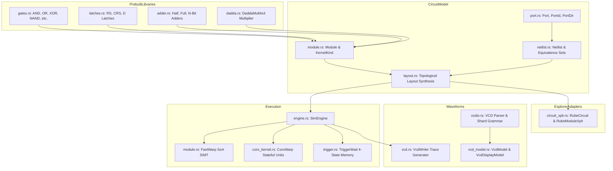

# Rube: Digital Circuit Simulation & Waveform Processing

**Path:** `src/rube/`  
**Crate Member:** `trellis::rube`  
**Status:** Digital Simulation Subsystem

---

## 1. Module Overview & Mission

`rube` is Trellis's digital logic circuit design, compilation, simulation, and waveform visualization framework. It combines gate-level modeling, hierarchical netlists, topological layout synthesis, SIMT-style data-parallel execution engines (`FastWarp`), stateful multi-cycle coroutine modules (`CoroWarp`), and an end-to-end Value Change Dump (VCD) export/parsing pipeline.

### Design Principles
- **Four-State Logic Simulation**: Full support for IEEE 1364 four-state logic (`0`, `1`, `X` unknown, `Z`/`I` high-impedance) across all gate and arithmetic evaluations.
- **Structure-of-Arrays (SoA) SIMT Warps**: Homogeneous combinational blocks are grouped into contiguous `FastWarp` execution chunks, evaluated without pointer indirection.
- **Zero-Allocation Parallel Drive**: Parallel evaluation chunks borrow warps via raw pointers across Heist workers, avoiding runtime buffer cloning.
- **Stateful Coroutine Logic**: Complex sequential components (multi-cycle FSMs, memory blocks) run as stackful coroutines (`CoroWarp`) that suspend and resume across clock ticks.
- **Round-Trip VCD Pipeline**: Capable of generating standard VCD traces during simulation (`VcdWriter`), high-speed grammar parsing of external VCD files (`vcdio.rs`), and hierarchical waveform display rendering (`VcdDisplayModel`).

---

## 2. Component Hierarchy & File Map



| File | Primary Types & Functions | Description |
|---|---|---|
| `module.rs` | `Module`, `KernelKind`, `KernelOp`, `FastWarp`, `Eval4State` | Circuit module definitions, 4-state truth-table evaluator, and SoA SIMT warp structs. |
| `port.rs` | `PortId`, `PortDesc`, `PortDir`, `PortType` | Port connectivity descriptors, directionality (`In`, `Out`, `InOut`), and width bindings. |
| `netlist.rs` | `Netlist` | Net interconnectivity graph resolving connected ports using `silo::DisjointSet`. |
| `layout.rs` | `Layout` | Topological sorting, cycle detection, and compilation of modules into executable warps. |
| `engine.rs` | `SimEngine`, `SimEngineMode` | Simulation executor managing clock cycles, input stimulus, warp evaluation, and signal propagation. |
| `trigger.rs` | `TriggerWad`, `TriggerId` | Compact bit-packed storage for past, current, and future 4-state signal levels. |
| `coro_kernel.rs` | `CoroWarp`, `CoroInstance`, `CoroKernelFactory` | Sequential module kernel engine managing coroutine state machines across cycles. |
| `gates.rs` | `AndGate`, `OrGate`, `XorGate`, `NandGate`, etc. | Standard logic primitive definitions. |
| `latches.rs` | `RSLatch`, `CRSLatch`, `DLatch` | Bistable feedback and clocked flip-flop / latch components. |
| `adder.rs` | `HalfAdder`, `FullAdder`, `Adder` | Structural ripple-carry and parallel adder implementations. |
| `dadda.rs` | `DaddaMult4x4` | Structural 4x4 Dadda Multiplier with 16 AND partial-product gates, 2-stage reduction tree, and Carry Propagate Adder. |
| `circuit_xplr.rs` | `RubeCircuit`, `RubeModuleXplr` | Explorer and schematic adapters exposing Rube modules to `fenst::xplr::CircuitXplr`. |
| `vcd.rs` | `VcdWriter` | Streaming VCD trace generator recording value transitions across simulation timestamps. |
| `vcdio.rs` | `VcdModel`, `VcdScope`, `ParseVcd` | High-speed grammar-based VCD parser built on `shard`. |
| `vcd_model.rs` | `VcdDisplayModel`, `VcdSignal` | Display-ready queryable waveform data structure consumed by `fascia` UI. |

---

## 3. Core Data Structures & Types

### 3.1 Four-State Signal Storage (`TriggerWad`)
Signal values are packed into 64-bit words representing three temporal stages:
- **Past**, **Current**, and **Future**.
- Each stage tracks value bits, unknown mask ($X$), and high-impedance mask ($Z$/$I$):
  ```rust
  pub const CURR_MASK: u64 = 0x0000_0000_FFFF_FFFF;
  pub const CURR_X:    u64 = 0x0000_FFFF_0000_0000;
  pub const CURR_I:    u64 = 0xFFFF_0000_0000_0000;
  ```

### 3.2 `FastWarp` (SoA SIMT Execution Chunk)
Groups up to thousands of identical combinational gates (e.g., 64-bit ALUs) into dense arrays:
```rust
pub struct FastWarp {
    pub _Op:       KernelOp,
    pub _ModStart: u32,
    pub _Count:    u32,
    pub _Mask:     u64,
    pub _In1:      Buff<TriggerId>,
    pub _In2:      Buff<TriggerId>,
    pub _Out:      Buff<TriggerId>,
}
```

### 3.3 `CoroWarp` (Sequential Coroutine Warp)
Manages an array of coroutine instances for stateful sequential modules:
```rust
pub struct CoroWarp {
    pub _Instances: Buff<CoroInstance>,
    pub _InPorts:   Buff<TriggerId>,
    pub _OutPorts:  Buff<TriggerId>,
    pub _Count:     u32,
}
```

---

## 4. Feature-by-Feature Deep Dive

### 4.1 Four-State Logic Evaluation (`Eval4State`)
Handles non-binary truth tables per IEEE standards. For example, in an `AND` gate:
- If either input is `0`, the output is definitively `0` (even if the other input is `X` or `Z`).
- If inputs are `1` and `X`, the output is unknown (`X`).

### 4.2 Zero-Allocation Parallel Simulation (`SimEngine::Drive`)
During each simulation cycle:
1. Combinational warps (`_FastWarps`) are sliced into 64-lane chunks.
2. In parallel mode (`SimEngineMode::Parallel(W)`), chunks are submitted to `heist::Atelier`.
3. Workers borrow the warp via a raw pointer (`*const FastWarp`), eliminating all buffer clones and heap allocations on the hot cycle path.

### 4.3 VCD Waveform Generation & Ingestion
- **Generation**: `SimEngine` emits signal delta records into `VcdWriter` whenever trigger values change.
- **Parsing**: `vcdio.rs` parses existing VCD traces at hundreds of megabytes per second using `shard::RepeatShard`.
- **Display Model**: `VcdDisplayModel` keeps signal storage private and exposes borrowed `Signals()` and `Scopes()` views, plus `TimeMin()`, `TimeMax()`, and `Timescale()` accessors. Declaration order is preserved; sorted identifier indexes resolve aliases without a hash map. Time steps are processed chronologically, with the last value at a repeated timestamp winning.
- **Timeline Queries**: `VcdSignal::ValueAt`, `NextChange`, and `PreviousChange` use binary search. `ChangesBetween(start, end)` borrows changes in `(start, end]`, returning an empty view for reversed bounds. Waveform lanes borrow signal histories and draw only visible transitions, avoiding full-history clones and scans during navigation.

### 4.4 Module Hierarchy and Cask Presentation

`Layout::Children` borrows direct child IDs during construction and after compilation.
Module and layout fields remain private. `Module(id)` and `Port(id)` return shared
references, while `Modules()` and `Ports()` return borrowed `Arr` views rather than
exposing storage containers. Raw hierarchy ranges and mutation methods stay within Rube;
presentation code uses `Children`, `Descendants`, and traversal methods.
`TraverseModules` walks all roots iteratively, with a stack proportional to depth. Each
node receives entry and exit events, including leaves. Returning `false` on entry prunes
that subtree without an exit event; returning `false` on exit stops the entire walk.

`SortModules` groups kernels for execution, moves modules without cloning their names or
factories, and remaps IDs, parents, children, and port owners together. It also stores one
shared preorder of all modules. `Descendants(id)` borrows a subtree range from that index,
excluding the module itself; hierarchy storage remains linear even for deeply nested circuits.
`Freeze` seals children before parents using reverse preorder. Sorting and freezing may be
repeated, but modules cannot be added after sorting or to an already sealed parent.
**Module IDs must be reacquired after sorting/freezing; port IDs remain stable.**

`VcdWriter` uses the same traversal to emit nested scopes with local module and port names.
For example, the module `top.half` inside `top` becomes the scope `half`, and its port
`top.half.a` becomes `a`, yielding the waveform path `top.half.a`.

`rube` implements the generic `fenst::xplr::CircuitXplr` trait on digital logic modules via `layout.AsCircuit(id)`.
This cleanly decouples `rube` from `fascia`:
- `fenst` defines the domain-neutral `CircuitXplr`, `PortDescriptor`, `WireDescriptor`, and classical 2D schematic solver `fenst::cask2d`.
- `fascia::circuit_scene` presents any entity implementing `CircuitXplr` in 2D schematics or 3D Cask scenes adhering to `ThemePalette`.
- `rube::scene` provides domain-level presentation adapters for Rube modules.

### Classical Circuit Schematic & Wire Visualization
Circuits are represented following classical EDA / schematic capture standards:
- **Functional Module Blocks**: Rectangular boxes containing instance titles and kernel types/ops (`AND`, `OR`, `XOR`, etc.).
- **Perimeter Port Terminals**:
  - Input pins positioned on the **West (left) edge** with pin stubs, terminal dots, and inner labels.
  - Output pins positioned on the **East (right) edge** with pin stubs, terminal dots, and inner labels.
  - Hierarchical frame containing primary input pins on the left boundary and primary output pins on the right boundary.
- **Topological Staging**: Submodules are arranged in left-to-right columns according to dataflow dependencies.
- **Orthogonal Manhattan Wire Routing**: Wires route between driver output pins and sink input pins using horizontal pin leads, vertical routing channels, dedicated track offsets, and collision-free clearance bypasses.
- **Junction Dots (`•`)**: Multi-drop nets with fanout > 1 render soldered branch dots at wire split points.
- **3D Circuit Hierarchy**: `CircuitScene` / `CircuitBuild` include submodules, perimeter ports, and interconnect wires in the Cask 3D hierarchy.
- **Theme Palette Adherence**: Complete styling integration using `ThemePalette` (`cask_bg_root`, `cask_bg_module`, `cask_border`, `accent` wire lines, `text_primary`, and `text_secondary`).

```rust
use trellis::fascia::{circuit_scene, theme::FasciaTheme};
use trellis::rube::{FullAdder, Layout};
use std::sync::atomic::AtomicBool;

let mut layout = Layout::New();
let adder = FullAdder::New(&mut layout, "Adder");
let palette = FasciaTheme::WindowsDark.palette();

// Generic CircuitXplr adapter:
let circuit = layout.AsCircuit(adder.Id());

// 2D Classical Schematic Layout with modules, perimeter pins, and Manhattan wires:
let schematic_2d = circuit_scene::CircuitSchematic(&circuit, &palette);

// 3D Scene with modules, ports, and wires:
let circuit_scene = circuit_scene::CircuitScene(&circuit, &AtomicBool::new(false))?;
let asset = circuit_scene::CircuitBuild(&circuit, &AtomicBool::new(false))?;
```

`rube::scene::Scene` also exposes the renderer-independent CaskScene for direct hierarchy inspection.
Accepts any valid subtree root before or after freezing.

### 4.5 Structural Arithmetic Blocks & Dadda Multiplier

`rube` includes parameterized and structural hardware arithmetic implementations:
- **`HalfAdder`**: 1-bit half adder composed of 1 `XorGate` and 1 `AndGate`.
- **`FullAdder`**: 1-bit full adder composed of 2 `HalfAdder` submodules and 1 `OrGate`.
- **`Adder<N>`**: Generic $N$-bit parallel carry-propagate adder composed of $N$ cascaded `FullAdder` slices.
- **`DaddaMult4x4` (`dadda.rs`)**: High-performance 4-bit unsigned hardware multiplier adhering strictly to the classical Dadda reduction strategy:
  1. **Partial Product Generation**: 16 `AndGate` instances compute matrix $p_{row,col} = B[row] \ \& \ A[col]$ for $row, col \in \{0..3\}$.
  2. **Reduction Stage 1** (target height $d_2 = 3$): Column 3 (height 4) is reduced by applying 1 `HalfAdder` to $p_{03}$ and $p_{12}$, generating sum $s1\_c3$ and carry $c1\_c4$.
  3. **Reduction Stage 2** (target height $d_1 = 2$):
     - Column 2: 1 `FullAdder` reduces $(p_{02}, p_{11}, p_{20})$.
     - Column 3: 1 `FullAdder` reduces $(s1\_c3, p_{21}, p_{30})$.
     - Column 4: 1 `FullAdder` reduces $(p_{13}, p_{22}, p_{31})$, followed by 1 `HalfAdder` merging stage 1 carry $c1\_c4$.
     - Column 5: 1 `FullAdder` reduces $(p_{23}, p_{32}, c2\_c5\_fa)$.
  4. **Carry Propagate Adder (CPA)**: 2 `HalfAdder`s and 4 `FullAdder`s compute the final 8-bit sum vector $Product[7:0]$.
  - **Submodule Topology**: Total 28 instances (16 AND + 4 HA + 8 FA), completely free of pointer indirection and reference counting (`Rc`, `RefCell`, `Arc`).
  - **Simulation & Verification**: Helpers `SetA`, `SetB`, and `GetProduct` drive bit patterns through `SimEngine::Settle(20)`. Verified across corner cases and an exhaustive 256-case sweep ($[0..15] \times [0..15]$).
  - **Interactive Exploration**: Registered as an `XplrExample` accessible at `example://Rube/DaddaMultiplier4x4`.

---

## 5. Integration Boundaries

- **Upstream Dependencies**: `silo` (`Buff`, `Stash`, `USeg`), `stalks` (`Coro`), `heist` (`Atelier`), `shard` (VCD parser), `flux` (VCD stream).
- **Downstream Consumers**:
  - `fascia::waveform`: Visualizes digital signal traces and timing diagrams.
