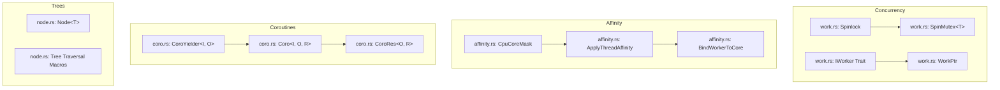

# Stalks: Synchronization, Work Primitives, Coroutines & CPU Affinity

**Path:** `src/stalks/`  
**Crate Member:** `trellis::stalks`  
**Status:** Core Foundation Module

---

## 1. Module Overview & Mission

`stalks` provides the synchronization primitives, abstract work interfaces, hardware thread affinity bindings, stackful coroutine runtimes, and reusable binary tree algorithms that underpin Trellis's concurrent schedulers (`heist`), simulation engines (`rube`, `karst`), and parsers (`shard`).

### Design Principles
- **Low-Latency Spinlocks**: CAS-based mutual exclusion with hardware CPU pauses (`std::hint::spin_loop()`) avoiding OS kernel context switches.
- **Hardware Thread & Core Affinity**: Explicit CPU core masking (`CpuCoreMask`) and OS thread binding (via Win32 `SetThreadAffinityMask`) for NUMA-aware multi-die execution.
- **Unified Work Handles**: `WorkPtr` abstracts arbitrary callable closures into single-pointer task representations for thread pools.
- **Stackful Coroutines**: Integration with `corosensei` to provide true cooperative, multi-yield execution without color-coding the codebase with async/await.
- **Intrusive/Binary Node Primitives**: Generic binary node structures for expressions, grammar trees, and layout graphs.

---

## 2. Component Hierarchy & File Map



| File | Primary Types & Functions | Description |
|---|---|---|
| `work.rs` | `Spinlock`, `SpinMutex<T>`, `IWorker`, `WorkPtr` | CAS-based spinlocks, worker thread interfaces, and zero-sized/type-erased executable work handles. |
| `affinity.rs` | `CpuCoreMask`, `ApplyThreadAffinity`, `BindWorkerToCore` | Hardware thread affinity management: 64-bit CPU masks, OS thread pinning (Win32 `SetThreadAffinityMask`), and core round-robin binding. |
| `coro.rs` | `Coro<I, O, R>`, `CoroYielder<I, O>`, `CoroRes<O, R>`, `ICoro` | Stackful coroutine wrapper around `corosensei`, supporting input/output transfers during suspension. |
| `node.rs` | `Node<T>`, tree traversal macros | Generic binary node abstraction with left/right child pointers used in ASTs. |

---

## 3. Core Data Structures & Types

### 3.1 `CpuCoreMask` & Hardware Affinity
Represents CPU core sets for worker pin allocation:
```rust
#[derive(Clone, Copy, Debug, PartialEq, Eq)]
pub struct CpuCoreMask {
    _Mask: u64,
}

impl CpuCoreMask {
    pub fn All() -> Self { ... }
    pub fn SingleCore(coreIndex: u32) -> Self { ... }
    pub fn FromMask(mask: u64) -> Self { ... }
    pub fn RawMask(&self) -> u64 { self._Mask }
}
```
- `ApplyThreadAffinity(mask: CpuCoreMask) -> bool`: Invokes the underlying OS platform API (e.g. `SetThreadAffinityMask` on Windows) to restrict the calling thread to designated logical cores.
- `BindWorkerToCore(workerIndex: u32, totalCores: u32)`: Utility that binds worker $i$ to core $i \pmod{\text{totalCores}}$.

### 3.2 `Spinlock` & `SpinMutex<T>`
Modeled after low-overhead hardware spinlocks:
- `Spinlock`: Contains an `AtomicBool`. `Acquire()` executes a tight loop with `spin_loop()` until swapping `true` succeeds via `Ordering::Acquire`.
- `SpinMutex<T>`: Wraps an `UnsafeCell<T>` protected by `Spinlock`. Returns RAII guards (`SpinMutexGuard<T>`) implementing `Deref` and `DerefMut`.

### 3.3 `IWorker` & `WorkPtr`
- **`IWorker`**: Trait representing an active thread or execution context capable of receiving sub-jobs:
  ```rust
  pub trait IWorker {
      fn PostJob(&mut self, job: WorkPtr);
      fn WorkerIndex(&self) -> u32;
      fn EnqueueJobId(&mut self, job_id: u16);
      fn PostJobWithPlacement(&mut self, job: WorkPtr, placement_packed: u16, succ_id: u16);
      fn PublishSuccessor(&mut self, succ_id: u16);
      fn CurSuccId(&self) -> u16;
      fn SetCurSuccId(&mut self, val: u16);
  }
  ```
- **`WorkPtr`**: An encapsulated executable task. Implemented as an `Option<Box<dyn FnOnce(&mut dyn IWorker) + Send>>`. Contains convenience constructors `FromFn(fn)` and `FromClosure(closure)`.

### 3.4 Stackful Coroutines (`Coro<I, O, R>`)
Provides true stack-switching coroutines:
- **`I`**: Input payload passed on resumption (`Resume(input)`).
- **`O`**: Output payload yielded during suspension (`Suspend(output)`).
- **`R`**: Return payload yielded upon completion.
- **`CoroRes`**:
  ```rust
  pub enum CoroRes<O, R> {
      Yield(O),
      Done(R),
  }
  ```

---

## 4. Feature-by-Feature Deep Dive

### 4.1 NUMA & Thread Pinning (`affinity.rs`)
In multi-fabric simulations (such as `karst`), threads simulating separate hardware dies require thread pinning to prevent OS scheduler migrations across NUMA nodes:
1. `KarstWorker` queries the host core count.
2. Calls `BindWorkerToCore(worker_id, core_count)` upon worker thread spawn.
3. Locks the worker thread to a dedicated physical CPU core, maximizing L1/L2 cache hit rates and eliminating cache-line bouncing.

### 4.2 Cooperative Execution via Coroutines (`coro.rs`)
Unlike state-machine generator transforms (`async`/`await`), `stalks::coro` switches native CPU stacks:
1. When `Coro::New(closure)` is called, a separate execution stack is allocated by `corosensei`.
2. Inside the closure, the task receives a `CoroYielder`.
3. Calling `yielder.Suspend(output)` suspends the thread context, captures current registers, and restores the caller's stack frame, returning `CoroRes::Yield(output)`.
4. Subsequent calls to `coro.Resume(input)` resume exactly where execution stopped.

---

## 5. Integration Boundaries

- **Upstream Dependencies**: Core standard library (`std::sync::atomic`, `corosensei`).
- **Downstream Consumers**:
  - `heist`: Uses `Spinlock`, `SpinMutex`, and `WorkPtr` for task execution.
  - `karst`: Uses `CpuCoreMask` and `ApplyThreadAffinity` for multi-die scaling.
  - `rube`: Uses `Coro` for sequential multi-cycle hardware coroutines.
