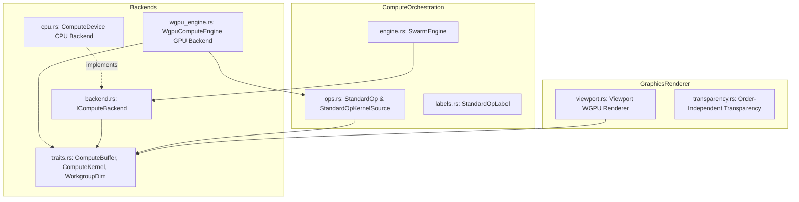

# Swarm: Compute Abstraction & GPU Acceleration

**Path:** `src/swarm/`  
**Crate Member:** `trellis::swarm`  
**Status:** Unified Compute & GPU Acceleration Subsystem

---

## 1. Module Overview & Mission

`swarm` is Trellis's unified data-parallel compute and GPU acceleration engine. It decouples high-level algorithms from physical execution backends (`IComputeBackend`), dynamically scheduling work across:
1. **Multi-Threaded Host CPU**: Parallel SIMD execution across CPU cores managed via `heist` or thread pools.
2. **Native WGPU Compute Pipelines (`WgpuComputeEngine`)**: Direct GPU compute execution via `wgpu`, compiling WGSL shaders or SPIR-V bytecodes and performing asynchronous non-blocking readbacks.
3. **Interactive 3D Viewport Renderer**: Hardware-accelerated offscreen rendering pipeline for 3D polygon meshes and point clouds in the desktop GUI (`fascia`).

### Design Principles
- **Backend Polymorphism (`IComputeBackend`)**: Unified kernel dispatch, buffer allocation, and memory transfers regardless of whether the hardware target is CPU, Vulkan, Metal, DX12, or WebGPU.
- **Direct GPU Shader Pipelines**: Compiles compute shaders directly into native GPU pipelines with zero intermediate runtime translation.
- **Bit-Exact Numerical Parity**: Guarantees identical numerical output between CPU reference kernels and GPU shader dispatches (verified by Collatz and vector math suites).
- **Asynchronous Readback Sinks**: Decouples GPU execution from host CPU synchronization via non-blocking staging buffers.

---

## 2. Component Hierarchy & File Map



| File | Primary Types & Functions | Description |
|---|---|---|
| `engine.rs` | `SwarmEngine` | Compute orchestration through `ExecuteOp`, `DispatchWith`, and `ExecuteWith`. |
| `backend.rs` | `IComputeBackend` | Trait defining backend capabilities: device creation, buffer allocation, kernel compilation, and dispatch. |
| `cpu.rs` | `ComputeDevice` | Default CPU compute backend executing kernels across host cores via `heist` or serial fast paths. |
| `wgpu_engine.rs` | `WgpuComputeEngine`, `ReadbackBuffer`, `ReadbackU32` | Native WGPU compute pipeline engine compiling WGSL/SPIR-V shaders, dispatching GPU passes, and reading back staging buffers. |
| `traits.rs` | `ComputeBuffer`, `ComputeKernel`, `WorkgroupDim`, `BackendKind`, `SwarmError` | Abstract compute types representing linear memory allocations, compiled kernels, and grid dimensions. |
| `ops.rs` | `StandardOp`, `StandardOpLabel`, `StandardOpKernelSource` | Cross-backend mapping connecting standard operations (`Double`, `Collatz`, `VectorAdd`) to CPU closures or SPIR-V/WGSL code. |
| `viewport.rs` | `Viewport` | WGPU 3D graphics renderer handling camera uniforms, vertex buffers, offscreen textures, and composite passes. |
| `transparency.rs`| `TransparencyPass` | Order-independent transparency compositing for semi-transparent 3D Cask layout objects. |

---

## 3. Core Data Structures & Types

### 3.1 `WgpuComputeEngine` (Direct GPU Compute)
Manages native WGPU hardware instances, devices, and compute queues:
```rust
pub struct WgpuComputeEngine {
    _Instance: wgpu::Instance,
    _Adapter:  wgpu::Adapter,
    _Device:   wgpu::Device,
    _Queue:    wgpu::Queue,
}
```
- `New() -> Option<Self>`: Asynchronously probes and initializes the highest-performance GPU adapter available.
- `CreatePipelineFromWgsl(wgsl_src) -> Result<wgpu::ComputePipeline, SwarmError>`: Compiles WGSL source code into an executable GPU pipeline.
- `DispatchStandardOp(op, input, output, dim)`: Dispatches standardized arithmetic and algorithmic compute passes on the GPU.
- `ReadbackBuffer(buffer, size) -> Vec<u8>`: Stages GPU storage memory into host-visible memory and reads back results asynchronously.

### 3.2 `WorkgroupDim`
Specifies 3D dispatch dimensions through constructors and read accessors:
```rust
let dim = WorkgroupDim::New( 4, 2, 1);
assert_eq!( dim.X(), 4);
assert_eq!( dim.Y(), 2);
assert_eq!( dim.Z(), 1);
```

### 3.3 `ComputeBuffer` & `ComputeKernel`
- **`ComputeBuffer`**: Owns memory allocations behind type-safe handles with bounds checking.
- **`ComputeKernel`**: Encapsulates a compiled shader or host function pointer, retaining metadata such as `StandardOp`.

---

## 4. Feature-by-Feature Deep Dive

### 4.1 Native WGPU Compute Engine (`wgpu_engine.rs`)
Directly drives GPU compute hardware:
1. **Device Initialization**: Probes physical adapters using `wgpu::Backends::all()`, requesting high-performance power profiles and compute-compatible limits.
2. **Shader Compilation**: Converts WGSL shaders (or SPIR-V compiled from `drove`) into native GPU shader modules.
3. **Bind Group Layouts**: Automatically creates bind group entries for input storage buffers (`read_only_storage`) and output storage buffers (`storage`).
4. **Compute Pass Execution**: Encodes compute passes, binds buffers, sets workgroup counts, and submits command buffers to `wgpu::Queue`.
5. **Staging Buffer Readback**: Uses host-mappable staging buffers to read GPU execution results back to CPU memory with exact bit-level parity.

### 4.2 Built-In CPU Compute Device (`cpu.rs`)
CPU compilation accepts `KernelSource::Cpu` closures or explicit standard operation sources. Provides two execution modes:
- **Serial `Dispatch`**: Runs on the calling thread for low-latency small-batch tasks.
- **Parallel `DispatchScoped`**: Borrows `heist::Atelier` workers, partitions output buffers via `flock::CpuOutputPartition`, and runs concurrently across host CPU cores.

### 4.3 Interactive 3D Viewport (`viewport.rs`)
The viewport translates user camera manipulations from `fascia` into GPU rendering passes:
- Compiles mesh and point cloud pipelines from `symph/viewport.wgsl`.
- Dynamically updates camera view-projection uniforms each frame.
- Renders to offscreen textures for smooth integration with the Iced UI shell.

---

## 5. Integration Boundaries

- **Upstream Dependencies**: `wgpu`, `silo` (`Buff`), `symph` (camera projections), `drove` (SPIR-V generation).
- **Downstream Consumers**:
  - `karst::vpu`: Executes vector compute operations on memory channels.
  - `fascia::geometry_view`: Displays 3D meshes and point clouds in the viewport canvas.
