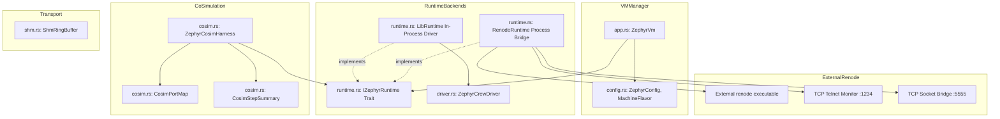

# Zephyr: Guest Virtual Machine Lifecycle & Emulation Runtime

**Path:** `src/zephyr/`  
**Crate Member:** `trellis::zephyr`  
**Status:** Guest VM, Processor Emulation & Co-Simulation Subsystem

---

## 1. Module Overview & Mission

`zephyr` orchestrates the lifecycle, execution, and digital logic co-simulation of guest processor virtual machines inside Trellis. It abstracts machine startup, instruction stepping, memory inspection, and shutdown across multiple runtime backends (`IZephyrRuntime`), specifically providing:
1. **`LibRuntime`**: An in-process, pure Rust simulation driver (`ZephyrCrewDriver`) executing guest CPU firmware logic directly.
2. **`RenodeRuntime`**: A managed external process controller that boots an actual RISC-V platform emulator (Renode), controls execution over a TCP telnet monitor, and bridges MMIO traffic into `crew::CrewHub`.
3. **Lockstep Co-Simulation (`ZephyrCosimHarness`)**: Synchronizes guest VM instruction execution and `rube::SimEngine` digital hardware simulation cycle-by-cycle, mapping MMIO register accesses and interrupt (IRQ) assertions across the software/hardware boundary.
4. **Lock-Free Inter-VM IPC (`ShmRingBuffer`)**: High-performance shared-memory ring buffers with cacheline-padded atomic pointers for zero-copy message transfers.

### Design Principles
- **Runtime Polymorphism (`IZephyrRuntime`)**: Identical management interface regardless of whether the VM is an in-process mock, an external Renode emulator, or a hardware accelerator model.
- **Deterministic State Transitions**: Rigid state machine (`Uninitialized`, `Halted`, `Running`, `Stepping`, `Terminated`, `Error`).
- **Cycle-Accurate Co-Simulation**: Precise lockstep synchronization between CPU instruction retirement and digital logic clock cycles.
- **Clean Subprocess Management**: Automatically launches, monitors, and terminates external emulator instances, capturing stdout/stderr into diagnostic logs.

---

## 2. Component Hierarchy & File Map



| File | Primary Types & Functions | Description |
|---|---|---|
| `app.rs` | `ZephyrVm` | Primary user-facing VM controller exposing `Start()`, `Stop()`, `Step()`, `Reset()`, and `State()`. |
| `config.rs` | `ZephyrConfig`, `MachineFlavor`, `PlatformConfig` | Configuration settings: platform description (`.repl`), startup script (`.resc`), ELF binary path, port numbers. |
| `runtime.rs` | `IZephyrRuntime`, `LibRuntime`, `RenodeRuntime`, `VmState` | Backend runtime trait, state machine types, and execution drivers. |
| `driver.rs` | `ZephyrCrewDriver` | Host-side bus master driver providing high-level send/receive routines over `crew::CrewHub`. |
| `cosim.rs` | `ZephyrCosimHarness`, `CosimPortMap`, `CosimStepSummary` | Cycle-accurate lockstep hardware-software co-simulation harness synchronizing VM instruction steps with `rube::SimEngine` clock cycles. |
| `shm.rs` | `ShmRingBuffer` | Lock-free shared memory circular ring buffer supporting high-throughput IPC between guest VMs and host engines. |

---

## 3. Core Data Structures & Types

### 3.1 `VmState` State Machine
```rust
#[derive(Clone, Copy, Debug, PartialEq, Eq)]
pub enum VmState {
    Uninitialized,
    Halted,
    Running,
    Stepping,
    Terminated,
    Error,
}
```

### 3.2 `IZephyrRuntime` Trait
```rust
pub trait IZephyrRuntime: Send + Sync {
    fn Start(&mut self) -> Result<(), String>;
    fn Step(&mut self, instructions: u64) -> Result<(), String>;
    fn Stop(&mut self) -> Result<(), String>;
    fn Reset(&mut self) -> Result<(), String>;
    fn State(&self) -> VmState;
    fn ReadRegister(&self, reg: &str) -> Result<u64, String>;
}
```

### 3.3 `ZephyrCosimHarness` & `CosimPortMap`
Bridges virtual CPU MMIO addresses to digital circuit pins:
```rust
pub struct ZephyrCosimHarness {
    _Vm:      Box<dyn IZephyrRuntime>,
    _Engine:  SimEngine,
    _PortMap: CosimPortMap,
}

pub struct CosimStepSummary {
    pub _VmStepOk:      bool,
    pub _SimCycle:      u64,
    pub _MmioReadHit:   bool,
    pub _MmioWriteHit:  bool,
    pub _IrqAsserted:   bool,
}
```

---

## 4. Feature-by-Feature Deep Dive

### 4.1 In-Process Rust Driver (`LibRuntime`)
Provides ultra-fast, zero-overhead testing for co-simulation protocol logic without needing an external emulator installed. `ZephyrCrewDriver` acts as the virtual CPU, directly manipulating `crew::CrewHub` MMIO registers.

### 4.2 Managed Renode Integration (`RenodeRuntime`)
For real RISC-V firmware execution:
1. Spawns `renode --plain --port 1234 ...` as a child process.
2. Connects to Renode's telnet CLI monitor over TCP.
3. Issues `start`, `pause`, and `step` commands.
4. Bridges external socket packets into `crew::CrewHub` at virtual address `0x50000000`.

### 4.3 Hardware/Software Lockstep Co-Simulation (`cosim.rs`)
The co-simulation harness advances software firmware and digital hardware in strict lockstep:
1. **Clock Edge Synchronization**: In each co-simulation step, the harness steps the CPU runtime by $K$ instructions, then steps the `SimEngine` by 1 clock cycle (`SimEngine::StepCycle`).
2. **MMIO Bus Mapping**: When the guest CPU performs a memory load or store to mapped peripheral addresses (configured via `CosimPortMap`), values are written to input trigger wires of the simulated hardware peripheral.
3. **Interrupt Feedback (IRQ)**: When the simulated digital peripheral asserts an interrupt output pin, the harness flags the guest CPU's IRQ line, triggering CPU interrupt service routines (ISRs) on the next cycle.
4. **Diagnostic Tracing**: Emits structured `CosimStepSummary` records reporting cycle number, instruction count, register state, and pin values.

### 4.4 Lock-Free Inter-VM IPC (`shm.rs`)
`ShmRingBuffer` provides zero-allocation IPC across processes or emulator boundaries:
- Head and tail pointers are cacheline-padded (`align(64)`) to eliminate false sharing.
- Uses atomic load-acquire and store-release semantics for lock-free circular queue transfers.

---

## 5. Integration Boundaries

- **Upstream Dependencies**: `rube` (`SimEngine`), `crew` (`CrewHub`), `silo` (`Buff`).
- **Downstream Consumers**:
  - Full-system hardware/firmware verification suites in `tests/`.
  - Future IDE peripheral debugging views in `fascia`.
