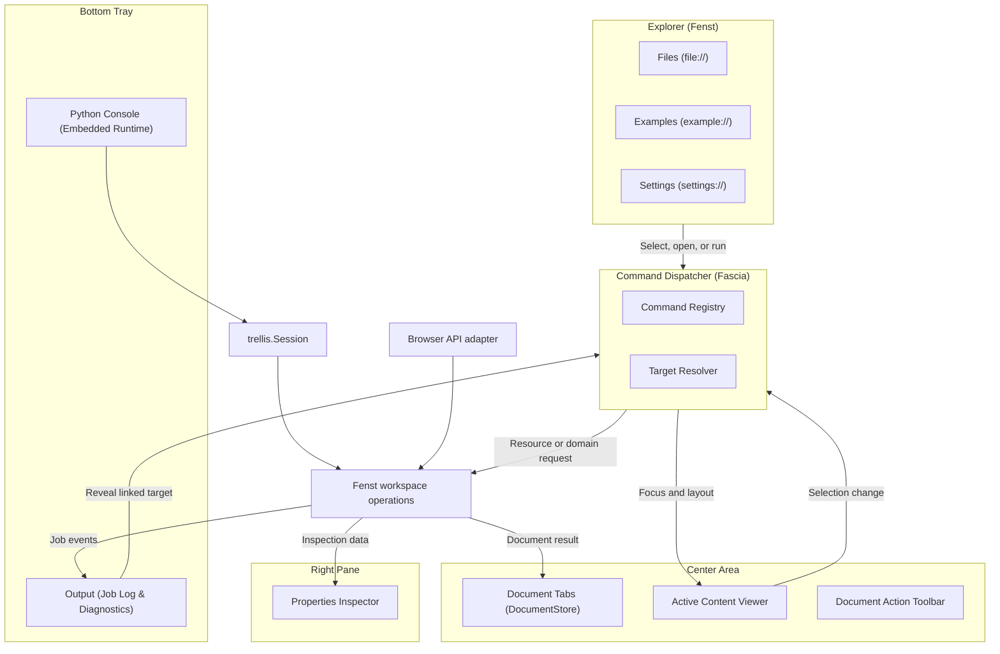

# Fascia Workbench UX and Web Migration Plan

Give Files, Examples, and Settings the same interaction model. Selecting an item shows its summary in Properties. Opening it brings the appropriate viewer or editor into the center. Running an explicit action reports progress and results in Output. Python can use the same operations through a session API. The active document stays visible throughout.

The first release connects one complete Fresco workflow (symbolic expression inspection) and one complete Rube workflow (digital circuit simulation and waveform publication). Those two integrations exercise different requirements, including mathematical occurrences, circuit signals, simulation jobs, and generated documents.

## Workspace layout

```text
 File   Edit   View   Run   Help       Workspace name       Quick Open
+------------------+---------------------------------+------------------+
| Explorer         | Document tabs                   | Properties       |
| Files            | Document actions                | Target breadcrumb|
| Examples         |                                 | Overview         |
| Settings         | Active content                  | Selection        |
|                  |                                 | Type-specific    |
|                  +---------------------------------+                  |
|                  | Python Console | Output         |                  |
+------------------+---------------------------------+------------------+
 Active document         Current job          Errors         Python state
```

Use a compact top bar, a roomy content area, quiet pane dividers, consistent line icons, and visible focus and selection in both themes. Explorer and Properties are resizable and collapsible. The bottom tray retains the Python session and recent diagnostic history when hidden. Restore pane sizes and visibility on restart. At narrow widths, open the side panes on demand and give the center pane priority. Use the same tab order, focus restoration, Escape behavior, and accessible labels for desktop and browser controls.

### Interaction details

- **Explorer.** Keep one search field for the selected root. Preserve expansion and scroll position when switching roots. Arrow keys navigate the tree, Enter opens the focused item, and an explicit **Run Example** action starts a job. Keep folders, static documents, runnable examples, and settings distinguishable by name and icon.
- **Content.** Use tabs for documents and one reusable Settings tab. Display the dirty state on the tab and keep each tab’s selection and viewport while it is inactive. Quick Open (`Ctrl+P`) searches resources and existing tabs. Command search (`Ctrl+Shift+P`) shows available actions and their shortcuts. Keep both in the same launcher with explicit modes.
- **Properties.** Show the target breadcrumb first, then the few fields users most often need. Put IDs and detailed diagnostics in a collapsible section. Show field-level errors alongside editable properties. Leave the previous good value visible until a change succeeds.
- **Output and Console.** Show a new-error count without automatically opening the tray. Keep Output scroll position when the user is reading earlier entries. Follow new entries when they are already at the end. Keep Python’s input, history, runtime state, and interrupt control in its own tab.

## Data and Event Flow



## How Explorer connects to the panes

| Explorer root | Properties on selection | Content on activation | Output | Python Console |
| --- | --- | --- | --- | --- |
| **Files** | Name, type, location, size, and known open state | Open or focus the matching document. Use a type-aware viewer and show a readable fallback for unsupported formats. | Report import progress, parse errors, and save results. Where possible, link diagnostics to the document and source location. | **Use in Python** inserts a snippet for opening the selected resource and displays its target before execution. |
| **Examples** | Description, module, inputs, and available actions | **Open Example** shows a description or opens a static sample. **Run Example** publishes successful results as a typed document, such as a waveform, schematic, or expression. | One run entry tracks progress, errors, cancellation where supported, and links to results. | Insert the equivalent example call with explicit arguments so users can inspect and rerun it. |
| **Settings** | Current value, default, effective scope, and validation details | Open one Settings tab and reveal the selected group or field. Edit and reset through this form. | Attach validation to the field. Report persistence failures and operations that require follow-up in Output. | Read scoped values and apply supported changes through the same settings service and validation rules. |

### Selection, actions, and results

- **Select** changes the inspection target without replacing content or executing a job. **Open** focuses or creates a tab. **Run** starts a job. Keep those actions distinct for both pointer and keyboard users.
- **Decouple Tree Enumeration from Execution**: In `fenst/example.rs`, expanding an `XplrExample` node must **never** call `Run()`. Browsing and expanding nodes returns static metadata and structural hierarchy without simulating circuits or computing expressions. Execution is triggered strictly by an explicit `Run Example` command.
- Maintain Explorer selection and each document’s content selection independently. Properties follows the last explicit selection action. A breadcrumb identifies its target. Navigating within a document or activating a tab restores that tab’s selection. Closing or replacing the target falls back to the active document or an empty state. Moving focus to Output or Python preserves the inspected target.
- Normalize resources through the existing provider boundary (`XplrProvider`). Give a file or static example a canonical resource identity and reuse its open tab. Give every generated result a document identity and preserve its originating run. Retain document revision and a semantic selection key in Properties and Output links. A canvas hit ID may be translated by the viewer before it leaves that viewer.
- Treat loading, running, completion, cancellation, and failure as explicit states. User-initiated commands may open their requested result when ready. Background completion publishes an Output link without stealing focus. Accept results only when the operation and target generation are still valid. A failed import, command, or save leaves the previous document or saved settings usable.
- Retain Python prompts, return values, and normal stdout and stderr in the Console. Route structured workbench diagnostics and job status to Output, with a run link between the two where applicable. Use bounded histories. Console snippets capture the intended target when inserted. Switching tabs before execution keeps that target explicit.

### First workflows to deliver

1. **Fresco inspection.** Start with a typed Math View open operation for the existing built-in document and its `Matrix_A` root. The registered `ExpressionExplorerExample` currently exposes a separate tree with text leaves, including `Matrix_M`. Keep its resource links valid if both fixtures move under one example entry. Properties shows the formula and tensor coordinates via `FrescoProperties`. **Use in Python** inserts an inspection call for the same resource and selection.
2. **Rube simulation.** Extract circuit construction from `DaddaMultiplier4x4` so Open can build a schematic without running the existing verification cases. Add a separate simulation operation with a defined stimulus and waveform result. Inspect a net or port in Properties, then open the waveform from its run link in Output. Expose the same simulation operation from Python.
3. **File and settings integration.** Open a supported VCD file from Files, inspect a signal, then reveal its source from the document tab. Open the layout group from Settings, change a pane preference, and verify the shell reflects the saved value after restart. A failed save preserves the previous effective value and gives the user a diagnostic in Output.

## Menubar, toolbars, and popups

Make every surface invoke the same typed command. A command has a stable ID, label, arguments, availability rules, optional shortcut, and handler. The dispatcher checks the resolved target and availability again when invoked. Start by adapting the existing desktop actions to this dispatcher, then remove forwarding paths as they are migrated.

```text
Command metadata     stable ID, label, group, shortcut
Invocation           command ID, resolved target, typed arguments
Availability         enabled, disabled with reason, checked when applicable
Handler result       UI change, shared operation request, or error
```

Resolve shortcuts against the focused widget and application command scope. Resolve a popup’s target when it opens and revalidate that target at invocation. Labels and shortcuts can change independently of the underlying operation.

| Surface | Purpose and placement |
| --- | --- |
| **File** | New by document type, Open File, Open Folder or Workspace, Recent, Save, Save As, Close Tab, and Exit. |
| **Edit** | Undo, Redo, Cut, Copy, Paste, and Select All. The focused editor owns the operation. |
| **View** | Explorer, Properties, Python Console, Output, Focus Pane, and Reset Layout. Theme and other preferences live in Settings. |
| **Run** | Run the selected example or supported document operation, stop the selected cancellable job, and reveal its Output entry. |
| **Help** | Documentation, shortcuts, and About. |
| **Top bar** | Workspace identity, Quick Open, command search, and pane toggles. Replaces the existing full-width duplicate toolbar with this compact bar. |
| **Document toolbar** | Show operations needed repeatedly in the active view. Fresco gets root navigation and Fit. Rube gets schematic or waveform controls and simulation actions where supported. Move lower-frequency items into overflow using the same commands. |
| **Context menus** | Explorer operations target the clicked row. Document menus target the clicked term or signal. Tab menus offer close and reveal actions. Output menus offer copy and jump to source. Resolve the target from the menu invocation, including when it differs from the active selection. |
| **Status bar** | Show active document state, current job, error count, and Python state. Interactive entries reveal the corresponding pane or run. Avoid duplicate status strips inside viewers when the same information fits here. |

Use popovers for short choices such as Open With, Output filters, or toolbar overflow. Use dialogs for file picking, save or discard decisions, and operations that need multiple inputs before execution. Keep command names, enablement, checked state, and shortcuts consistent across menus, toolbars, search, and keyboard. Place project and application settings in the single Settings editor.

## Shared framework and ownership

| Layer | Responsibility |
| --- | --- |
| **Fenst** | Extend the existing provider registry with backend-neutral resource descriptors and routing. Own shared operations used by Fascia, Python, and the browser adapter. Start with open and inspect, then add run and settings operations as the workflows exercise them. |
| **Fascia** | Own document tabs and lifecycle (`DocumentStore`, `IWorkbenchDocument`), selection and focus, the command dispatcher, pane layout, and the Iced views. Each document adapter supplies its content view and advertises the capabilities it supports. Reuse the existing tab store and lifecycle hooks during migration. |
| **Domain modules** | Rube and Fresco retain their algorithms and domain types. Register built-in workbench contributions at the application composition boundary. Adapters translate a domain model into shared resource, property, and result records. Keep specialized rendering in the appropriate viewer. |
| **Python and browser hosts** | Python calls shared application operations through Parvis bindings. A browser client consumes versioned, owned records and events through transport adapters. Desktop paths, Iced widgets, Python objects, and borrowed domain state stay inside their respective hosts. |

### State and record boundaries

| State or record | Owner and behavior |
| --- | --- |
| Resource reference | Fenst provider. Carries provider identity and a provider-normalized key. Identifies content source and supports locating the corresponding Explorer item. |
| Document and revision | The workspace document owner holds the domain model. Initially adapt the existing Fascia document store for desktop and use session-owned documents for standalone Python. The revision changes when the underlying model changes. Pane resizing, zooming, and focusing leave it stable. |
| Tab and selection state | Fascia shell and viewer adapter. A tab owns view state. A selection identifies a resource or a document revision and a semantic key, such as a Fresco root and tensor coordinate or a Rube net. Remap a selection only when the adapter can establish a valid match after an edit. |
| Command invocation | Fascia dispatcher for UI requests. Carries a command ID, arguments, and an explicit target when applicable. Python invokes the corresponding shared operation through its session. |
| Job and diagnostic events | The operation runner owns job state and terminal results. Events identify the job, stage, severity where applicable, and optional document, selection, and result references. Output keeps a bounded presentation history. Closing or clearing it leaves the job and its result available to API callers. |
| Layout and settings | Host persistence stores versioned layout preferences separately from document content. The settings service validates scope and value, then commits and publishes the effective change. |

### Module contributions and property projections

Use `XplrProvider` for discovery, `IWorkbenchDocument` for native tab lifecycle, and domain projections for inspection. Register built-in contributions at application composition. A contribution describes its resource and the operations it supports. Each operation has typed inputs and results. Fresco Open returns an owned expression document and Inspect takes a root or component key. Rube Open returns a circuit, Inspect takes a net or port key, and Run takes a stimulus and produces a waveform reference.

Share property fields such as names, types, and read-only values. Keep math previews, waveform plots, and specialized editors in their viewers. A desktop projection can borrow the owned document for rendering. Python and browser clients receive bounded owned records. Extract a capability trait or shared document store when a second implementation needs the same behavior. Defer dynamic plugins, a generic property editor, and declarative layout until a concrete integration needs them.

### Command and job lifecycle

1. **Resolve at invocation.** An Explorer context menu captures the row it opened on. A toolbar uses the current document and selection. A shortcut routes through the focused widget first when it is an editing action. For a destructive or asynchronous command, keep the resolved target through confirmation and scheduling.
2. **Validate before dispatch.** Resolve the target again, check capabilities and revision, and return a typed failure if the command can no longer apply. Menus and command search use the same availability checks to show disabled actions or their reason.
3. **Publish through one job path.** Return a job ID and report progress and one terminal outcome. Distinguish a cancellation request from completed cancellation. A document-bound job can update its target only while the revision and operation still match. A job that produces a standalone result can finish after its source tab closes according to its declared lifetime. Apply each terminal result once even if the event is repeated.
4. **Reveal linked targets explicitly.** When a user opens a diagnostic, resolve its document and semantic selection. Focus an existing tab or reopen the source when supported. If the position or revision can no longer be resolved, show the available document and explain the stale location.

### Unified Python interface

Use the existing `trellis.Session` entry point for embedded Python, the pip package, and notebooks. Align module registration, package exports, and type stubs before shipping new operations. Preserve existing Python methods during migration. Add a small set of common operations for opening resources, listing and running examples, inspecting handles, and reading or changing settings. Keep Fresco and Rube manipulation on typed handles or domain services.

The following API and Fresco resource key are proposed.

```python
import trellis

session = trellis.Session()

# 1. Resource and document opening
doc = session.open("example://Fresco/MathView")

# 2. Inspecting properties and selection
info = session.inspect(doc)
print(info.formula, info.shape)

# 3. Running explicit operations and jobs
job = session.run("example://Rube/DaddaMultiplier4x4")
print(job.wait())

# 4. Settings read/write
session.settings.set("layout/sidebar", True)
```

An embedded session can also publish results into the workbench. A notebook session returns the same typed handle or job result to the caller. Both use the same operation validation and error types. Long operations expose a job handle and structured progress, with cancellation where the underlying job supports it. Resolve handles against their session and document lifetime so a closed or replaced document produces a clear error.

Resolve an embedded session’s requests through the owning workspace. Standalone sessions own their resources and jobs. Route updates through the owner’s queue and return the committed outcome. A blocking Python wait must release the GIL where appropriate and must never block the UI thread that processes the request. Test a console-driven request while the desktop continues processing input, and use another session to verify that a foreign handle returns a clear error.

### Browser migration boundary

Prove a server-backed slice first. The browser owns panes, navigation, and focus. A headless host exposes the selected Fenst operations and owns the permitted resource set, published documents, and jobs. An isolated Python service owns each interpreter session. Check which desktop and GPU dependencies must be separated to build that host. The first proof requires the Fresco inspection and Rube run paths.

Start with a request endpoint and a job event stream. Send bounded, owned records with an explicit version and stable identifiers. Reconnect by loading the current document and job snapshot, then resuming events. If retained history has a gap, refresh the snapshot. Replaying an event leaves one job entry and one result. Choose a concrete transport after proving that flow. Add a transport trait, browser-local execution, or worker messaging when a second implementation needs it.

---

## Detailed Work-Steps and Implementation Milestones

### Phase 1: Command System & Dispatcher Unification
*Unify Menubar, Toolbar, Context Menus, and Shortcuts under a typed command registry.*

* **Architectural Scope**:
  - Replace fragmented UI actions (`MenuAction`, `ToolBarAction`, `TabBarAction`) with a centralized command dispatcher.
  - Commands check contextual enablement (e.g. read-only document disables Save; no selection disables Run).
  - Centralize keyboard shortcut handling in the command registry.
* **Concrete File Targets**:
  - Create `src/parvis/fascia/command.rs`: Define `CommandId`, `CommandDef`, `CommandRegistry`, `CommandContext`, and `CommandDispatcher`.
  - Modify `src/parvis/fascia/menubar.rs`: Adapt menu items to dispatch registered `CommandId`s.
  - Modify `src/parvis/fascia/toolbar.rs`: Adapt quick buttons to dispatch registered `CommandId`s.
  - Modify `src/parvis/fascia/app.rs`: Route shared GUI actions through the dispatcher with a resolved target and typed arguments.
* **Verification Gates**:
  - Unit tests for command lookup, keyboard shortcut matching, and contextual enablement.
  - `cargo test --all-targets` and `cargo clippy --all-targets` pass with zero warnings.

### Phase 2: Example Decoupling & Output Job Pipeline
*Separate tree inspection from execution; build the diagnostic and run event log.*

* **Architectural Scope**:
  - `BranchXplr::Children()` for `ExampleItemXplr` must inspect static metadata (inputs, ports, descriptions) **without calling `Run()`**.
  - Track execution and terminal results in the operation runner. Use `OutputStore` for the bounded diagnostic and progress history shown in the pane.
  - Explicit command `workbench.action.runExample` triggers background execution and publishes a typed document link in Output.
* **Concrete File Targets**:
  - Modify `src/parvis/fenst/example.rs`: Decouple `ExampleItemXplr` and `XplrExample` tree traversal from `Run()`.
  - Create `src/parvis/fascia/output.rs`: Implement `OutputStore`, `JobRecord`, `JobStatus`, and `OutputDiagnostic`.
  - Modify `src/parvis/fascia/app.rs`: Integrate `OutputStore` into `AppState`; handle job lifecycle events.
* **Verification Gates**:
  - Listing or expanding either example never calls its executable callback. Use a fixture that exposes unexpected calls to prove this.
  - Explicit execution logs progress in `OutputStore` and publishes a clickable result link.

### Phase 3: Shell Restructuring (Top Bar, Properties & Bottom Tray)
*Implement the 3-column + center-bottom tray workbench layout.*

* **Architectural Scope**:
  - Replace duplicate toolbar with a compact top bar (menus, workspace title, Quick Open trigger, pane toggles).
  - Add collapsible `Properties` pane on the right side showing target breadcrumb, overview, and type-specific inspection.
  - Add collapsible bottom tray with `[Python Console | Output]` tabs.
  - Maintain independent selection: selecting in Explorer updates Properties without changing the active document tab.
* **Concrete File Targets**:
  - Modify `src/parvis/fascia/shell.rs`: Redesign shell layout container into top bar, center-bottom tray, and right panel.
  - Create `src/parvis/fascia/properties.rs`: Implement `PropertiesView`, breadcrumb rendering, and field-level error display.
  - Modify `src/parvis/fascia/explorer.rs`: Ensure selection updates inspected target independently of open document tabs.
  - Modify `src/parvis/fascia/app.rs`: Wire layout persistence, pane resize handlers, and toggle commands.
* **Verification Gates**:
  - Keyboard navigation: `Escape` restores focus, `Ctrl+B` toggles sidebar, `Ctrl+J` toggles bottom tray.
  - Restoring saved layout geometry on application restart.

### Phase 4: Two Golden Workflows (Fresco & Rube)
*Deliver the two complete end-to-end integration workflows.*

* **Workflow 1: Fresco Symbolic Expression**:
  - Select the typed Math View example in Explorer $\rightarrow$ Properties shows description and metadata without evaluating.
  - Explicitly open $\rightarrow$ activates Math View (`math_view.rs`).
  - Select term or matrix cell $\rightarrow$ `FrescoProperties` populates formula, occurrence ID, and coordinate breadcrumb.
  - Context menu "Use in Python" generates an inspection snippet in Python Console.
* **Workflow 2: Rube Digital Simulation**:
  - Select `example://Rube/DaddaMultiplier4x4` in Explorer $\rightarrow$ Properties displays module ports and instance counts.
  - Explicitly open $\rightarrow$ renders schematic in Cask2D (`cask_view.rs`).
  - Explicitly run $\rightarrow$ simulation job logs progress in Output; on completion, output link opens Waveform viewer (`waveform.rs`).
* **Concrete File Targets**:
  - Modify `src/parvis/fenst/fresco_properties.rs`: Ensure compatibility with Properties pane projection.
  - Modify `src/parvis/fascia/math_view.rs` and `src/parvis/fascia/cask_view.rs`: Wire context actions and selection propagation.
  - Add comprehensive integration tests in `src/parvis/fascia/_tests.rs`.
* **Verification Gates**:
  - Test select, open, and inspect for Fresco. Test explicit simulation, job completion, result reveal, cancellation, and repeat completion delivery for Rube.

### Phase 5: Python API Parity & Web Transport Boundary
*Expose uniform session operations to Python and isolate web/remote serialization contracts.*

* **Architectural Scope**:
  - Align in-process Python Console and external `trellis` package around `trellis.Session` methods: `open()`, `inspect()`, `run()`, and `settings`.
  - Define owned inspection and job records for the selected browser workflow and use the existing Flux facilities where applicable.
  - Connect one concrete API adapter to Fenst operations and check that it builds and runs without initializing the desktop shell.
* **Concrete File Targets**:
  - Modify `src/parvis/python/session.rs` and `src/parvis/python/mod.rs`: Add `open`, `inspect`, and `run` methods to `PySession`.
  - Update Python stubs: `truss/kaa/trellis/__init__.pyi`.
  - Place versioned request and event records at the API boundary. Keep host-specific transport and encoding in the adapter.
* **Verification Gates**:
  - PyO3 test suite exercises `trellis.Session` methods with valid and stale document handles.
  - Round-trip tests for the selected boundary records and reconnect tests for duplicate or expired events.
  - Run the affected workspace and Python checks before making the new shell the default.

---

## Source references

- [Fascia document lifecycle](../../src/parvis/fascia/document.rs) · [Current menubar](../../src/parvis/fascia/menubar.rs) · [Current toolbar](../../src/parvis/fascia/toolbar.rs) · [Shell layout](../../src/parvis/fascia/shell.rs)
- [Fenst provider registry](../../src/parvis/fenst/provider.rs) · [Examples](../../src/parvis/fenst/example.rs) · [Settings](../../src/parvis/fenst/settings.rs)
- [Fresco Properties model](../../src/parvis/fenst/fresco_properties.rs) · [Math View](../../src/parvis/fascia/math_view.rs) · [Fresco expression viewer plan](fresco-expression-viewer-implementation-plan.md)
- [Python module registration](../../src/parvis/python/mod.rs) · [Python session](../../src/parvis/python/session.rs) · [Package exports](../../truss/kaa/trellis/__init__.py) · [Type stubs](../../truss/kaa/trellis/__init__.pyi)
- [Rube Dadda Multiplier Example](../../src/nexome/rube/_tests.rs) · [Fresco Explorer Example](../../src/nexome/fresco/_tests.rs)
