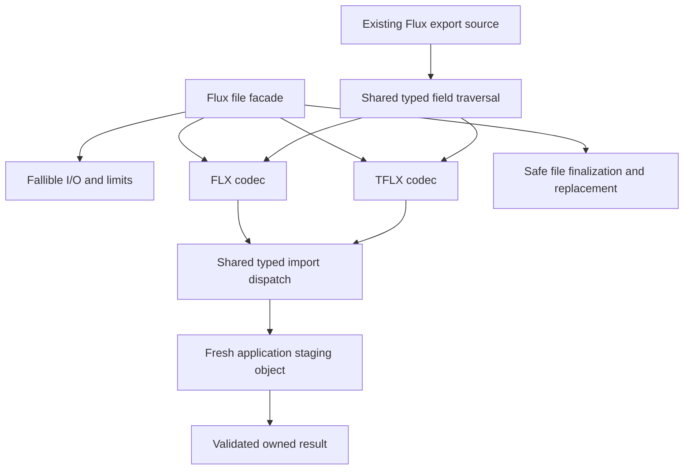

# FLX/TFLX interface implementation plan

Date: 2026-11-14. Source baseline: `41bf95b`, including the proposed format design in the current working tree.
Status: proposed work; this plan does not implement file codecs.

Implement a native file interface over Trellis's existing Flux sources and import descriptors. The result must read, write, inspect, verify, and convert `.flx` binary and `.tflx` text files while preserving the typed values, validating the preamble, and protecting the previously saved file from failed writes.

The [Flux file format specification](../formats/flux-file-format.md) is the wire-format authority. Its [binary](../formats/examples/minimal.flx) and [text](../formats/examples/minimal.tflx) reference files are acceptance fixtures. This document defines the implementation order, APIs, ownership, compatibility work, and release gates. Resolve specification ambiguities by updating that specification and its vectors together; do not establish incompatible behavior in one codec.

## 1. Scope and success criteria

The core deliverable is a synchronous Rust library interface inside `trellis::flux`. Application code can schedule it through Heist without embedding GUI or scheduler dependencies in Flux. Implement storage version 1.0, its seven value categories, required metadata, checksums, configurable limits, typed import/export, and safe save/load/conversion.

Success means:

- A source implementing `IFluxExportSource` can be saved in either format through a fallible API. Export callbacks are traversed once per save.
- Both formats load into a fresh owned application object, which is returned only after complete file and application validation. Failed loads leave live documents untouched.
- Binary/text conversion preserves ordered payload values, exact f64 bits, document identity/revision, schema, timestamps, and unknown fields. Producer changes are explicit and checksums are recomputed.
- A generic file can be inspected without creating its application model; inspection clearly distinguishes unchecked payloads from fully verified files.
- Failed writing, flushing, header backpatching, syncing, validation, or replacement never reports success or deletes the previous destination.
- Existing JSON output, Shard parsing, and unrelated module callers remain functional.

Defer compression, encryption/signatures, packed arrays/blobs, signed-integer additions, schema discovery plugins, random-access indexes, borrowed zero-copy file imports, and persistent in-place edits. A full sketch editor is outside the core deliverable; its persistence adapters consume this interface later.

## 2. Source findings and implementation choices

| Existing code | Gap relevant to native files | Decision |
| --- | --- | --- |
| [fluxexport.rs](../../src/flux/fluxexport.rs) | `DispatchFieldExp` returns `()`; collection producers are stateful callbacks. | Add a fallible export path without changing diagnostic JSON behavior. Stream once; backpatch binary lengths through real seek. |
| [fluximport.rs](../../src/flux/fluximport.rs) | Descriptors mutate targets during parsing; errors have little context; source resolution is one step. | Load into staging ownership; wrap errors with locations; bound recursive adapter resolution. |
| [fluxbasics.rs](../../src/flux/fluxbasics.rs) | Fixed-array import can panic on excess elements and has no general final cardinality hook. | Introduce checked array adapters and explicit completion validation before exposing general file import. |
| [instream.rs](../../src/flux/instream.rs) | `At` returns zero beyond EOF; `BuffStream` can suppress I/O errors and uses u32 cached positions. | Add a dedicated fallible byte cursor over `Read`, with u64 disk positions and bounded project buffers. |
| [outstream.rs](../../src/flux/outstream.rs) | Position is a buffer marker, not file seek; Drop ignores flush errors. | Use an explicit file writer/finalizer and flush before backpatching. Do not rely on Drop for success. |
| [jsonoutstrm.rs](../../src/flux/jsonoutstrm.rs) | Non-finite float output becomes null and numeric kinds are not explicit. | Implement typed TFLX syntax directly; JSON remains a separate export representation. |
| [jsonshard.rs](../../src/shard/jsonshard.rs) | Shard depends on Flux and matches import descriptor variants. | Keep the TFLX parser in Flux; update exhaustive descriptor matches only where required, preserving JSON behavior. |

Avoid a general serialization-framework rewrite. Reuse `FieldExp`/`FieldImp`, existing primitive conversions, project storage, and source macros where their semantics meet the file contract. Implement only the additive interfaces needed to make failures and container boundaries explicit.

## 3. Public interface and ownership

Names below are proposed public APIs. Final generic/lifetime details must pass the compile probes in phase 0 before implementation proceeds.

### Shared records and policies

| Proposed type | Responsibility |
| --- | --- |
| `FluxFileFormat` | `Binary` or `Text`; selects output, while input detection uses the preamble. |
| `FluxFileMetadata` | Schema/version, document ID/revision, timestamps, producer, and bounded preserved metadata extensions. It owns its strings/extension values. |
| `FluxReadLimits` | Specification defaults for file/header/metadata/string sizes, depth, per-container counts, total values, aggregate allocation, and scratch memory. |
| `FluxReadOptions` | Limits, optional expected format, unknown application field policy, and whether unchecked text integrity is allowed. Application imports reject unknown fields by default; schema owners may explicitly permit skipping. |
| `FluxWriteOptions` | Format, text integrity choice, formatting policy, and bounded traversal settings. Normal file output includes integrity checks. |
| `FluxIntegrityStatus` | `NotChecked`, `Absent`, or `Verified`; `Absent` applies only to explicit text `Integrity none`. A mismatch is an error. |
| `FluxFileInfo` | Detected format/version, available sizes, integrity coverage/status, and completion status. Distinguish verified header/metadata from verified payload. Text has no stored binary byte lengths. |
| `FluxLoaded<T>` | Owned validated metadata, payload `T`, and final file info. No model borrows from parser buffers. |
| `FluxFileError` | I/O cause or structured format/import error, u64 byte offset, bounded field path, and text line/column where applicable. |

Keep operational structs private with underscore-prefixed fields and accessor methods. Records may expose passive data according to [engineering directives](../../agents/AGENTS.md). Use project collections in public core APIs; u64 is reserved for the wire value model, disk positions/lengths, and application revisions that require it. Do not add `Arc`, `Rc`, `Cell`, `RefCell`, Serde, Tokio, or new hash-based domain storage.

### Core entry points

| Proposed function | Contract |
| --- | --- |
| `InspectFlux(reader, options)` | Detect and parse the preamble/metadata without decoding the full payload. Return metadata plus partial verification info; never label the whole document verified. |
| `VerifyFlux(reader, options)` | Walk the complete envelope and value stream without domain import; check checksums, structure, limits, End/EOF, and metadata. Return complete file info. |
| `ReadFlux(reader, options, create, validate)` | Check metadata, ask the application factory for a fresh target, import payload, verify completion/integrity, run application validation, and return `FluxLoaded<T>`. |
| `WriteFlx(writer, metadata, source, options)` | Requires `Write + Seek`; write one complete binary file and return file info only after explicit codec finalization. It does not own filesystem replacement. |
| `WriteTflx(writer, metadata, source, options)` | Requires `Write`; emit one text file with optional integrity as explicitly selected, then finalize. |
| `SaveFluxFile(path, metadata, source, options)` | Own safe sibling-temp creation, encoding, flushing/sync, and platform replacement. Return the saved document revision/metadata and file info. |
| `ConvertFluxFile(inputPath, outputPath, options)` | Schema-independent validated conversion through typed events and safe output replacement. Preserve unknown values; explicitly choose whether to preserve Producer or identify the converter. |

Accept `std::io::Read`/`Write`/`Seek` at the external I/O boundary; use `Arr`, `MutArr`, `Buff`, and `Stash` inside project APIs. Input auto-detection retains a bounded prefix so non-seekable readers work. Expected-format mismatch is explicit; there is no corrupt-binary-to-text fallback.

An illustrative load signature shows the staging boundary; it is an API sketch, not compiled source:

```rust,ignore
pub fn ReadFlux<R, T, C, V>(
    reader: R,
    options: &FluxReadOptions,
    create: C,
    validate: V,
) -> Result<FluxLoaded<T>, FluxFileError>
where
    R: std::io::Read,
    T: IFluxImportSource,
    C: FnOnce(&FluxFileMetadata) -> Result<T, FluxFileError>,
    V: FnOnce(&T) -> Result<(), FluxFileError>;
```

The factory checks schema/version and supplies ownership; no `Default` bound or hidden schema registry is required. File validity and domain validity are separate gates. The caller swaps the returned payload into its session only after success. Low-level writing does not advance revisions or change timestamps implicitly; application snapshots supply them.

## 4. Internal structure and shared codec path

| Planned file | Responsibility |
| --- | --- |
| `src/flux/file.rs` | Public facade/types, format detection, metadata validation, version/features policy, error context. |
| `src/flux/fileio.rs` | Fallible buffered cursor, bounded byte regions, u64 accounting, output/finalization helpers, allocation accounting. |
| `src/flux/checksum.rs` | Incremental CRC-32C and exact checksum scope helpers. |
| `src/flux/fieldio.rs` | One-pass export traversal, typed reader dispatch, source/sink resolution, checked collection adapters, and skip/convert traversal. |
| `src/flux/binary.rs` | Fixed header, little-endian fields, minimal varints, value tags, container state, region CRCs, and header backpatching. |
| `src/flux/text.rs` | TFLX tokenizer/parser, escapes, typed numeric spelling, canonical formatting, text envelope and integrity. |
| `src/flux/filestore.rs` | Safe save/replace, full verification, generic file conversion, cleanup, and platform handling. |
| Existing `src/flux/mod.rs`, `_tests.rs` | Exports and registered component tests. Keep new tests under the established test harness. |

These responsibilities may share a file when small; do not create public abstractions solely to match this table. Split only where ownership/testing boundaries justify it.



Use a small internal typed-event contract covering scalars, keys, and container begin/end. Binary writing, text writing, and text integrity accounting consume the same logical events. For checksum purposes, a text event is also fed to a canonical binary-byte sink that updates CRC without retaining the entire binary payload. A schema-independent converter forwards decoded events to the target writer; only bounded metadata needs staging to preserve extensions/update Producer. Do not allocate a boxed generic node for each payload value.

Readers and writers keep container-kind state, object key/value position, child counts, and depth explicitly. Duplicate key detection uses bounded owned key storage plus a sorted index per active object. Charge key storage and indexes to the allocation budget; avoid quadratic insertion behavior by choosing batched sorted runs or a balanced ordered structure if benchmarks require it. Preserve emission order independently from the duplicate-detection index.

All partial reads/writes and byte-count arithmetic are checked. A truncated region is EOF, not a zero-valued byte. Budget checks precede allocation/growth. Stop requesting export callback values immediately after an I/O error. Bound adapter expansion independently of container depth to reject self-referential `FluxSource` chains.

## 5. Descriptor compatibility and safe import

### Fallible export

Add `IFluxTryExportSink::TryDispatchFieldExp(...) -> Result<(), FluxFileError>` or an equivalently small internal fallible dispatcher used by both new writers. Preserve `IFluxExportSink` for current callers. If a legacy adapter latches errors, `Finish()` must surface the first error; file facade entry points must always invoke finalization. Do not replace failures with `false`, ignore them in `write!`, or use Drop to infer success.

### Checked containers

Add a checked-array import path, provisionally `FieldImp::ArrChecked` backed by `IFluxArrayImport`. Its interface exposes fallible element access and a final count/completion check. Fetch and fully consume one child's descriptor before requesting the next; no descriptor may outlive a reallocation of its source container. Phase 0 must prove the borrow/lifetime design without new unsafe pointer tricks.

Required semantics:

- Fixed `Arr`/`Buff` targets reject excess elements with a capacity error, and reject too few when their schema requires exact cardinality.
- A new `Stash` target grows within budget; completion establishes its exact logical size. It does not leave old trailing elements.
- Nested collections and object validation finish once, after children are fully accepted. Empty arrays and empty objects still trigger completion checks.
- Existing `ObjValidated` works through the common import path; schema adapters add required-field checks where macros currently accept missing members. Duplicate fields fail before a second mutation.
- Preserve `ExpectedType` as an exact discriminator check. Null goes only to accepting sinks/nullable targets; skipped input fields use a separate parser skip decision.
- Preserve typed U64/F64/Bool dispatch. Do not use `TryPostParsed` to infer numeric kinds from text. Narrow numeric targets report overflow/type errors through existing `TryPost...` conversions.
- Owned readers use `String` or copying sinks. Borrowed `FieldImp::Str` returns an explicit unsupported-borrow error unless a future lifetime-bound buffered API proves ownership.

Adding a descriptor variant requires updating exhaustive matches in Shard and related callers. Retain existing JSON semantics for old variants and support checked variants where used. Audit supported `IFluxImportSink` implementations so mutually recursive default conversion hooks cannot become an unbounded fallback; resolve any necessary trait-default fix in a separate compatibility commit with focused regressions.

Legacy `Arr` callbacks that can panic must not be invoked blindly by the new file path. Migrate built-in containers to the checked path before general typed import is enabled. Do not catch panics and relabel them as normal malformed input. User-defined sources/sinks must obey their Rust trait contracts; the library guarantees fallible handling for its supported adapters, not recovery from arbitrary user panics.

## 6. Ordered delivery and review slices

Phases are sequential because codec work depends on validated descriptor and ownership contracts. Each phase should be independently reviewable. Estimates are engineering-days for one developer familiar with Trellis; re-estimate after the compile probes and first binary round trip.

| Phase | Work and primary files | Acceptance gate | Estimate |
| --- | --- | --- | --- |
| 0: contract probes | Confirm public load/write shapes, checked array lifetimes, single-pass callback traversal, error ownership, text float formatting policy, and platform replacement approach. Review existing reference vectors. | Compile a nested object/array import probe without new unsafe code; demonstrate a propagated short-write and checked excess/short fixed-array input. Record API decisions. | 1-2 |
| 1: envelope foundations | `file.rs`, `fileio.rs`, `checksum.rs`, exports, errors, metadata and budgets. | CRC vectors and reference header pass; malformed versions/features/length arithmetic fail before allocation; inspection reports payload unchecked. | 2-3 |
| 2: shared field bridge | `fieldio.rs`; additive checked descriptors and built-in adapters in `fluximport.rs`/`fluxbasics.rs`; narrow Shard updates. | Typed primitive/null/ExpectedType dispatch, exact collection completion, bounded source resolution, one child borrow at a time, and fresh-target validation pass. Existing Flux/Shard tests remain passing. | 3-4 |
| 3: binary vertical slice | `binary.rs`; complete `WriteFlx`, binary `ReadFlux`, and `VerifyFlux`. | Existing 293-byte golden file loads; matching writer settings reproduce it exactly. Fresh object -> FLX -> object works; every-byte truncation and mutation/CRC cases fail. No callbacks replayed for lengths. | 4-6 |
| 4: equivalent text | `text.rs`; TFLX reader/writer, Unicode/float formatting, text integrity through canonical binary sink. | Reference pair compares by typed values/bits; whitespace/comment-only edits keep CRC valid; explicit unchecked mode is reported; stale CRC, malformed escapes, numeric-kind mismatches, and missing End fail. | 4-6 |
| 5: durable files/conversion | `filestore.rs`; temp lifecycle, explicit sync/finalization, replacement, and streaming transcoding. | Inject short writes and flush/seek/sync/replace failures: old destination survives, no false success; same-directory paths and converter output ownership are verified. Generic unknown payload fields survive conversion. | 3-5 |
| 6: core release | Limits/performance/robustness fixtures, optional CLI conversion example, API docs, compatibility review. | All required checks and matrix cases pass; reference checksums documented; no whole-payload staging in ordinary read/write/transcode paths; supported limits measured. | 2-3 |
| 7: first consumer | Fenst/Fleck schema adapters and Fascia schema routing where the document type exists; begin with an example document if sketches are not implemented. | Both extensions open through metadata dispatch; safe save/load works with immutable snapshots; failed/stale background replies leave the live document and dirty state correct. | 2-4 |

Core estimate, phases 0-6: **19-29 engineering-days**. With initial application integration: **21-33 days**, or approximately **26-40 days with 20% contingency**. Full sketch UI and editor implementation are not included. The [sketch implementation plan](sketch-construction-implementation-plan.md) depends on completion of phase 5 for reliable native save/load; core phase 6 closes release readiness.

### Practical milestone sequence

1. First review: foundations plus compile-proven safe adapter contracts.
2. First usable interface: a complete binary save/read/verify vertical slice.
3. Format parity: matching text support and bidirectional equivalence tests.
4. File-ready interface: safe replacement and schema-independent conversion.
5. Core release, followed by application integration.

Do not make a placeholder UI action appear functional before its corresponding core gate passes. Avoid a global schema registry initially; the caller supplies metadata checks and factories.

## 7. Application and filesystem behavior

Fascia detects `.flx`/`.tflx`, inspects metadata, and chooses the document handler by Schema. An unsupported schema can show metadata/read-only generic content; it must not be forced into SketchViewer. Inspection followed by actual load revalidates the same opened stream or checks the reopened file completely, so an earlier inspection is never a substitute for load-time validation.

Application save captures metadata/payload and a session/history-state token. Background completion includes that token and the saved revision. A close/reopen or subsequent edit cannot be marked clean by an old reply. Cancellation before replacement leaves the old file intact; once replacement has succeeded, report that durable outcome even if cancellation arrives later. Keep scheduling and GUI messages outside Flux.

Low-level binary output requires an exclusive seekable writer. Flush pending buffers before seeking and compute the header checksum only after final lengths/region checksums are known. Generic `Write` without seek can write TFLX directly; binary output to non-seekable destinations is initially unsupported unless an explicitly bounded spool is selected. No unknown-length placeholder is accepted in stored files.

For safe path operations, create a unique sibling temp exclusively, encode/finalize/sync it, then replace the target with platform-supported semantics. Existing target data must not be deleted first. Handle an absent target and an existing target deliberately; a filesystem lacking the required replacement guarantee returns an error instead of using an unsafe fallback. Distinguish atomic visibility from power-loss durability, including directory syncing where supported. Document Windows and other supported-platform behavior based on implementation tests.

Reject the same input/output file in the first conversion API, including detectable aliases; implicit in-place conversion is outside scope. Keep the source handle open while reading and close any output handles as required before replacement. Successful conversion has fully checked input before replacing its output destination. On any error, cleanup owns only its exclusively created temporary path; never recursively delete or glob nearby files.

## 8. Verification matrix

Put component cases in `src/flux/_tests.rs` with `jeeves_test!`. Keep fixture expectations independent from the new encoder so shared bugs do not validate themselves. The existing vector has 64 header bytes, 180 metadata bytes, and 49 payload bytes; check its stored CRCs against the specification.

| Area | Required evidence |
| --- | --- |
| Preamble | Magic/version/features, zero reserved fields, header size, exact bounds, all CRC regions, unsupported schema before publication, no trailing bytes. |
| Typed values | All primitive/root kinds, empty/nested containers, u64 boundary/minimal-varint rules, U64 distinct from F64, null distinct from missing, embedded NUL, Unicode/surrogate errors. |
| Floating point | Positive/negative zero, minimum/maximum finite values, normals/subnormals, rounded decimal input, infinity, multiple signed NaN payloads, canonical decimal spelling boundaries. Compare f64 bits rather than equality. |
| Import safety | Fixed-array excess/short counts, growing containers, nested borrow/reallocation, source-resolution cycles, invalid ExpectedType, object completion failure, rejected null, unsupported borrowed strings. |
| Integrity/parity | Both text integrity modes, altered stored CRCs, comments/whitespace/CRLF equivalence, unknown-field preservation during conversion, Producer update policy, unchanged identity/revision/timestamps. |
| Errors and limits | Truncate every byte of the golden binary; mutate each preamble region and selected payload bytes; enforce depth/count/string/file/allocation limits; detect malformed skipped fields; report bounded paths/offsets. |
| File behavior | Short-write/error-injection wrappers; flush, backpatch, sync, replacement, and cleanup failures; absent/existing destinations; cancelled save; output/source aliases; prior file preserved. |
| Existing callers | Flux JSON snapshots, Shard JSON import, existing container/USeg adapters, and relevant Fresco import/export regressions. |
| Application | Multi-tab isolation, unknown schemas, save during editing, closed/reopened sessions, dirty status, and failure/cancellation feedback. |

Use deterministic generated small value trees to compare binary/text/typed results across a bounded seed set. Fuzzing is optional additional evidence; budgets and every-byte truncation tests are mandatory. Tests must not depend on wall-clock timestamps or random document IDs: supply fixed metadata for golden output.

Performance is a measured gate, not an unverified throughput promise. On a recorded release-build machine, measure mixed scalar documents, deeply nested bounded documents, and numeric/string-heavy 1 MiB and 64 MiB fixtures. Record throughput, peak temporary allocation, per-container key-index cost, and short-read chunk sizes. Resident scratch should remain bounded by buffers, active frames/keys, largest decoded value, and declared staging budgets rather than growing with all previously streamed payload values. Model allocations legitimately scale with the loaded model. Set regression thresholds from these baselines before optimizing or raising defaults.

### Planned commands

Run the narrowest checks for each slice, then the release set once shared descriptor changes are complete:

```powershell
cargo build --offline
cargo test --offline Flux
cargo test --offline Shard
cargo test --offline Fresco
cargo check --all-targets --offline
cargo clippy --offline -- -D warnings
```

Confirm filters select the intended cases. Run filesystem failure-injection tests in unique test directories and report any platform-specific skipped checks. Root builds compile Rust-GPU artifacts: missing pinned toolchain/dependencies are an explicit environment blocker, not a passing check. GUI/schema smoke tests follow only once phase 7 exists. A baseline warning or unrelated test failure is recorded separately; it must not conceal a new regression.

## 9. Definition of done

The core interface is complete when all seven proposed operations have documented ownership/error behavior; FLX and TFLX meet the format specification and paired vectors; supported descriptor imports cannot panic from malformed capacities; complete verification precedes publication/replacement; and conversion preserves values without depending on a domain schema. Existing Flux/Shard callers pass their regressions and the implementation's limits/performance are measured. Initial application integration is accepted separately through phase 7.
