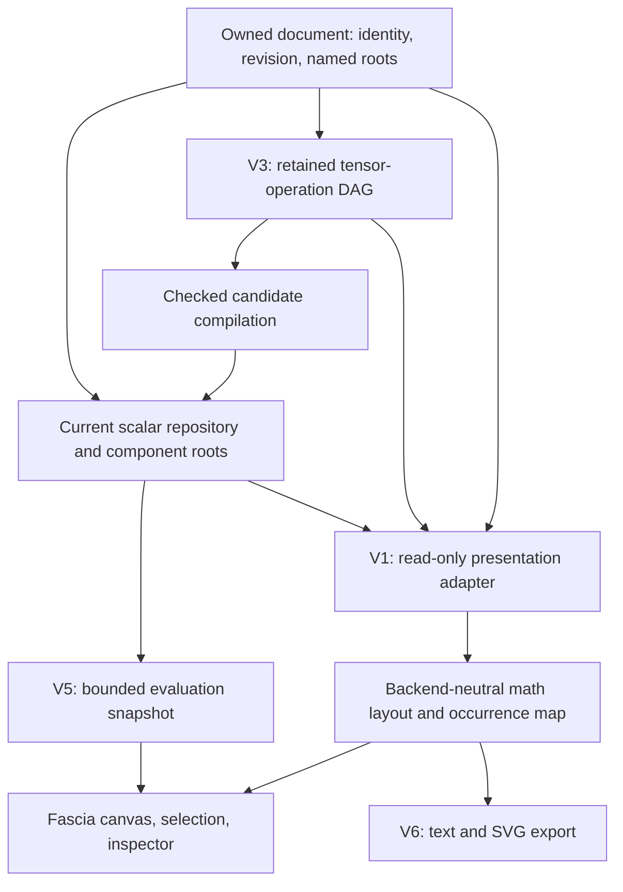

# Fresco expression viewer implementation plan

Date: 2026-11-19. Status: reframed after review; implementation has not started.
Source baseline: `abdf915`, with existing unrelated Cargo.lock changes excluded
from this planning work.

## 1. Intended result and release boundary

Build a native **Math View** tab in Fascia for inspecting Fresco expressions.
Start with a useful read-only viewer of the current scalar DAG and tensor
components. Add compact notation such as `y = A x + b` through retained tensor
semantics, then add safe input and numeric evaluation as independent extensions.
Rendering uses a dedicated math-layout layer and the existing canvas infrastructure.
This plan is Markdown; the runtime expression renderer is native canvas.

| Delivery | Included | Entry condition |
|---|---|---|
| First usable release (V0-V2) | Built-in examples and owned programmatic documents; scalar formulas; bounded vector/matrix grids; root/variable inspector; selection, Fit and pan/zoom | No parser, evaluator, or tensor-model rewrite required |
| Compact tensor notation (V3) | Retained operation nodes; symbolic/component switching; checked scalar lowering | Same typed operation model drives notation and execution |
| Scalar input (V4) | Replace a standalone scalar document from text | Bounded isolated parsing, whole-candidate validation, atomic replacement |
| Numeric inspection (V5) | Explicit bindings/results, budgeted evaluation and cancellation | Evaluation can actually stop at traversal checkpoints; worker payload is Send |
| Optional export (V6) | Accessible display text and SVG | Shared validated layout, escaping, output limits |

First-release tensor grids already have cell/work limits and omitted-count markers.
Interactive window navigation and higher-rank slice controls can follow without
making unbounded rendering acceptable in the first release. Show controls only
when their phase is implemented; do not expose an inactive Values mode or input box.

Display transformations preserve the mathematical model. Direct equation editing,
a LaTeX parser, simplification, solver controls, a browser/WebView, a file format,
and a Fresco Python adapter are outside this plan's initial delivery.

### Review comments and resulting decisions

| Comment | Review outcome | Change to the implementation approach |
|---|---|---|
| Isolate text parsing | Accept, with a narrower first input feature | Parse a complete standalone candidate and swap on success; isolated parsing alone does not provide cross-repository merging or bounded publication |
| Convert text baselines to canvas coordinates | Accept; refine the metric | Use the shaped paragraph's actual baseline offset, including line-height/fallback effects; font ascent alone is insufficient |
| Arena-backed MathBox nodes | Accept | Flat Stash arena, u32 handles, explicit work stacks and bounded occurrence expansion |
| Rebuild scalar storage when the tensor model changes | Accept for semantic model revisions | Compile a complete candidate from retained source plus any checked captured scalar subgraphs; keep the old document on failure; view/binding changes never recompile |
| Clear state and cancel on tab close | Accept; cover every teardown path | CloseTab takes a tab index today; resolve TabId and use shared teardown for individual close, close-all, replacement and shutdown |
| Owned evaluation payloads | Accept; reject cloned-repository assumption | Current boxed BaseExpr values have no Send contract; compile a bounded typed Send payload or defer workers, without adding unsafe Send |
| Small synchronous evaluation budget | Requires evaluator work | A timer around Evaluate cannot interrupt it; add traversal-level work/deadline/cancellation checks before enabling numeric UI |
| Pan threshold and bounded tensor windows | Accept | Specify threshold in logical pixels; ship an initial 16x16 cell cap and validate resource limits from V1 |

These decisions replace the earlier appended enhancement checklist. They are
design requirements, not claims that the source already implements them.

## 2. Verified source baseline

| Source | Existing capability | Consequence |
|---|---|---|
| [fascia/tabs.rs](../../src/fascia/tabs.rs) | TabKind, TabItem, TabManager and existing viewer tabs | Add a Fresco tab kind and opening/closing behavior |
| [fascia/app.rs](../../src/fascia/app.rs) | AppMessage dispatch, tab documents, per-view state, theme/status routing | Wire an actual active-tab view and document lifetime, not just an enum variant |
| [fascia/cask_view.rs](../../src/fascia/cask_view.rs) | Iced canvas rendering and interactive 2D viewer patterns | Reuse shell/camera/event patterns; math gets its own layout and hit map |
| [fenst/cask.rs](../../src/fenst/cask.rs) | Backend-neutral rectangles, colors, and simple draw commands | Reuse suitable primitives; existing text commands are not a math typesetter |
| [fascia/cask_labels.rs](../../src/fascia/cask_labels.rs) | cosmic-text measurement and raster-label planning | Useful font infrastructure reference; do not assume its atlas path matches canvas text metrics |
| [fresco/tensor.rs](../../src/fresco/tensor.rs) | TensorExpr stores shape plus flat scalar-expression IDs | Component rendering is possible; original MatMul/Dot/Transpose intent is not retained |
| [fresco/exprrepos.rs](../../src/fresco/exprrepos.rs) | Scalar node IDs, variable metadata, aggregate hierarchy | Borrow validated data for presentation; account for rollback and ID reuse |
| [fresco/eval.rs](../../src/fresco/eval.rs) | Indexed/named scalar/tensor evaluation with errors and lazy branches | Evaluate in update work, not paint callbacks |
| [fresco/exprshard.rs](../../src/fresco/exprshard.rs) | Staged parsing with recursive publication; mutable RootToken can publish | Isolation protects the active document but does not bound publication or resolve outer semantic transactions |
| [fresco/exprrepos.rs](../../src/fresco/exprrepos.rs) | Boxed BaseExpr entries; no Send bound on BaseExpr and no Clone implementation on ExprRepos | Ownership or cloned entries alone do not make a repository transferable to a worker |
| [fresco/eval.rs](../../src/fresco/eval.rs) | Recursive evaluator with depth checks; no step budget or cancellation API | Depth does not bound total work on a shared DAG; numerical UI has a separate gate |

The [current Fresco review](fresco-review-and-next-steps.md) records unresolved
transaction, derivative, normalization, validation, and publication issues. A
bounded read-only viewer can proceed independently. Showing an expression does
not certify it as valid or its derivative as correct. Evaluation/import actions
must apply their corresponding validation gates; solver/derivative execution is
not enabled merely because the renderer can display a result.

## 3. UI location and interaction

Add `TabKind::FrescoViewer` and a **File > New Math View** command. Open an owned
Fresco document with built-in examples, a root list, a math canvas, and an inspector.
Programmatic callers can supply a prepared document through the same opening path.
Accept ownership of that repository and its roots; do not imply that importing a
second repository into a live document already exists.

Target layout after the corresponding phases ship:

```text
Math tab:  [root selector] [Symbolic | Components | Values] [Fit] [100%]
+----------------+-----------------------------------+--------------------+
| Named roots    |                                   | Selected term      |
| Variables      |          math canvas              | Shape / indices    |
|                |                                   | Variable facts     |
|                |                                   | Bindings / result  |
+----------------+-----------------------------------+--------------------+
Status: selection, shape, model revision, layout/evaluation diagnostics
```

Symbolic mode shows compact tensor operations where retained semantic structure
exists; otherwise it shows an honest component representation. Components mode
expands actual scalar roots. Values mode shows a result snapshot with the same
component coordinates and shape. The initial release has a single formula/component
view; add the Symbolic toggle in V3 and Values in V5. Preserve selection where possible.

Click selects the smallest semantic occurrence under the pointer; parent selection
and breadcrumbs expose its containing operation. Double-click or an explicit
expand action reveals components. Keyboard navigation follows visual/semantic
order, Escape selects the parent or clears selection, and Fit restores visibility.
Pan and cursor-anchored zoom share the hit-testing transform. Start with a 4 logical
pixel drag threshold and confirm it in the interaction prototype. The inspector
shows zero-based coordinates [i, j] matching engine indices; no index-base toggle
is needed in the first release.

The initial inspector is read-only and reports identity, shape and assumptions,
including NonZero where set. V5 adds binding controls and an explicit Evaluate
action. Bindings are numeric input; they do not change assumptions or expression
structure. V4 scalar input is a separate replace-document command, described below.

## 4. Architecture and ownership



Use the following ownership split; names are proposals, not current APIs:

| Layer | Responsibility / proposed types |
|---|---|
| Fresco core (V3 onward) | TensorModel and typed operation nodes; checked shape semantics; lowering to existing TensorExpr/scalar IDs; later bounded evaluation support |
| Fenst document/adapter | FrescoDocument owns one active ExprRepos, named roots, document identity/revision, and optional retained TensorModel; produces read-only presentation input |
| Fenst math layout | MathLayout, MathBox, MathDrawCommand, MathOccurrence and hit regions; no Iced dependencies |
| Fascia | FrescoViewerState, FrescoAction, font adapter, canvas, inspector, tab lifecycle |

The document owns its repository exactly once. Viewer state owns the document and
view settings. V1-V2 use immutable owned documents: open by moving a prepared
repository and its roots into the document. Layout/value snapshots hold owned
IDs/data or scoped borrows, never references outliving the document. Validate
reachable roots and metadata before presentation with independent depth/work limits.

AppState currently uses separate stores for existing views even though TabDocument
describes owned document variants. Add one private per-tab Fresco store using
project containers and TabId keys; integrate the live dispatch path. Do not add
an unused second ownership path in TabDocument or migrate all existing viewers.
Add an enum variant only if the live Fresco path actually uses that enum.

Today AppMessage::CloseTab carries an index, not a TabId. Follow its existing
BeginClosing path, resolve the stable ID, and extend close_tab_internal and
close_all_tabs_internal with one shared Fresco teardown operation. Replacement
and application shutdown use the same cleanup contract. Remove state and invalidate
pending results; in V5 also signal the active job's cancellation token. Never key
async replies by an index that changes when another tab closes.

Each accepted semantic change publishes a new document revision. Build changes
off to the side and swap the complete validated candidate; rejection changes neither
the active roots nor their revision. New documents have new identities. Numeric
bindings, layout settings and job requests have separate generations. No raw mutable
repository accessor bypasses these rules. View settings never trigger scalar lowering.

Keep mutable structures private with underscore-prefixed fields, use u32 model
indexes and u32::MAX sentinels, and expose Arr/MutArr/Buff/Stash-based APIs.
Preserve the existing TabId width. Do not copy legacy public operational fields,
HashMaps, Cell/RefCell, Rc/Arc domain ownership, or shared-to-mutable casts into
the new design.

## 5. Retain tensor intent before lowering

TensorExpr alone cannot say whether a component grid was built from a matrix
product, a transpose, or handwritten scalar formulas. Avoid reverse-engineering
that intent from coincidental scalar patterns.

In V3 introduce a typed TensorModel arena with variable references, literals,
Add/Subtract, scalar Scale, Dot, MatVecMul/MatMul, and Hadamard. Add OuterProduct,
elementwise division, Transpose, Reshape and Slice in small follow-up batches,
each with shape/lowering/presentation tests. Include scalar-shaped outputs so Dot
retains its origin when used in a larger expression. Do not implement the entire
operation list before demonstrating A x+b with component parity.

One typed model feeds both checked scalar lowering and presentation. Lowering is a
cached compilation step producing a candidate repository plus bounded mappings from
(TensorNodeId, component coordinates) to scalar ExprId. First preflight checked
shape, hierarchy, node and memory counts; reject oversized compilation before
allocating all output components. Virtual display does not make lowering free.

For a semantic model revision, compile a fresh candidate rather than editing boxed
scalar nodes in place. This is a correctness-first choice for model changes, not a
requirement to rebuild on every click, display-label rename, binding edit or numeric run. Preserve
an owned source of every root: scalar leaves must be typed retained nodes or checked
captured scalar subgraphs with an explicit variable/child-ID remap. Old repository
IDs alone cannot be source leaves when rebuilding into a new repository.

Use stable document-level variable/root keys with revision-local scalar IDs.
Duplicate names remain distinct. On publication remap bindings and selection by
stable keys/occurrence paths where valid, clear stale compiled IDs, and replace
repository, roots and mappings together. On error keep the previous document intact.
Legacy component documents need no TensorModel and no automatic reconstruction.

Preserve actual operation order. Rendering never calls polynomial normalization
to make an expression prettier. Do not maintain a separate decorative tree.

Existing TensorExpr APIs remain usable. The viewer accepts legacy scalar roots or
TensorExpr values as component-backed roots without invented operation provenance.
Compact tensor notation is available only for roots constructed through the new
model or carrying validated equivalent semantic metadata.

Initial model construction is programmatic. Compact notation is a view of retained
intent; a tensor-language parser and arbitrary cross-repository merge are deferred.

## 6. Notation and semantic fidelity

| Meaning | Preferred visual notation | Required distinction |
|---|---|---|
| Scalar / vector / matrix | Italic scalar, bold vector, bold matrix | Styling comes from metadata, never capitalization alone |
| Higher-rank tensor | Consistent bold tensor style plus shape in inspector | Slice navigation instead of expanding every dimension |
| Scalar component | x with subscript i; A with subscripts i,j | Zero-based coordinates match repository indexing |
| Matrix row / slice | A with subscript i,: | Selecting it retains lower-rank shape and root offset |
| Matrix product | A B; A x | Different from elementwise multiplication |
| Dot / Hadamard / outer | x dot y; A odot B; x tensor-product y | Retain operation identity and input/output shapes |
| Elementwise division | Explicit elementwise division symbol or operator label | Do not imply a matrix inverse |
| Transpose / broadcast | Superscript T; contextual broadcast annotation | Broadcasting is explained on selection; no hidden shape conversion |

Render rank-one literals vertically for readability; this does not change their
shape from (n,) to (n,1). A true row/matrix reshape remains an explicit operation.
Show aggregate names when their identity is known. Do not parse a display name to
infer rank, split arbitrary punctuation into operators, or merge distinct same-name
variables. Preserve original Unicode names and provide distinguishable inspector IDs.

Parentheses follow the stored graph, including non-associative right operands and
nested powers. N-ary sums/products honor their positive/negative and numerator/
denominator partitions and evaluation grouping. Display mode cannot silently reorder
factors, cancel terms, change signs, or claim IEEE equivalence for an algebraic rewrite.

Function names use upright text; user identifiers remain identifiers even if they
look like a function name. Multi-character names, Greek characters, negative values,
scientific notation, comparison symbols, and conditional cases have explicit styles.
Unsupported/custom nodes display a labeled placeholder and an inspector diagnostic,
not a fabricated formula. Invalid/cyclic graphs yield bounded layout diagnostics.

## 7. Math layout and rendering backend

Build a dedicated baseline-aware layout engine rather than nesting ordinary UI rows
for every mathematical construct. Store MathBox nodes in a flat Stash arena with
u32 handles and contiguous child-placement segments. Each box records width,
ascent, descent, logical/ink bounds, child placements and semantic occurrence
identity. Measure bottom-up and place top-down
with explicit work stacks and depth/node limits.

Initial constructs: text/operator atoms, horizontal groups, precedence parentheses,
fractions, superscripts/subscripts, delimiters, and vector/matrix grids. Then add
radicals, bounded component-sum notation, and conditional cases when needed.
Grid columns share measured widths; rows share baseline metrics. Delimiters and
fraction rules use vector strokes with widths/margins from a font/style profile.

Use a small text-metrics adapter owned by Fascia. The same explicit font identity,
style, scale and shaping rules must govern measurement and painting; string byte
length is not a width estimate. Existing cosmic-text/label infrastructure is a
reference, not a guarantee that its metrics match a separately shaped canvas Text.
Prove measurement/paint consistency in the first layout prototype before freezing
the adapter. Handle font fallback/missing glyphs visibly and deterministically.
Full OpenType MATH layout or a new TeX dependency is not required for the MVP.

Emit backend-neutral positioned text runs, rules/paths, clip bounds, and semantic
regions. A Fascia Iced-canvas adapter paints them. Iced 0.14 canvas Text defaults to
top/left alignment. The adapter fixes alignment explicitly and translates the layout
baseline using y_top = y_baseline - measured_paragraph_baseline_offset. That offset
includes shaping, fallback font and line-height effects; do not substitute a bare
font ascent. Track advances separately from glyph ink bounds, including overhangs.
V0 must demonstrate matching baseline and bounds for mixed-font names and scripts.

Cask geometry/color primitives may be reused; keep math independent of schematic
Cask2dLayout. Introduce math-specific font/run commands where existing Text is
insufficient. If measurement cannot match fill_text, prototype drawing the measured
glyph runs through the existing renderer facilities before choosing a backend.

Use document-space coordinates. Pan/zoom converts them to viewport coordinates;
hit testing applies the exact inverse. Device scale and font-size changes invalidate
measurement; simple pan must not rebuild expression structure. Start with zoom
scaling a cached logical layout; scale text size, baseline offsets, strokes and hit
regions together. V0 tests whether the chosen text path honors that transform.
Font/profile changes remeasure; raster caches track device scale independently.

## 8. Selection, scale, and caching

Use occurrence IDs or root/operand paths in addition to expression IDs. The same
scalar DAG node can appear in several places; selecting one occurrence highlights
that location and may separately show other references. For tensors, retain the
semantic node, component coordinates, and mapped scalar root.

Cache keys include document identity/revision, root, view mode, expansion state,
font profile, display precision, and relevant layout width/device scale. Numeric
snapshots additionally include binding revision. Never key long-lived caches only
by u32 expression ID; rollback can reuse it. Theme-color changes invalidate paint
as needed without changing the semantic model.

From V1, cap the initial matrix window at 16x16 cells (256 total); vectors share
the cell cap. Show the full shape and explicit omitted counts. Independently cap
graph depth, expanded occurrences, text bytes, layout arena size and draw commands,
since even one cell may contain a large expression. Limits are configurable records;
measure representative fixtures before changing their defaults.

V5 adds row/column navigation and leading-axis slices for higher-rank tensors.
Never allocate an entire tensor's layout to show a small window. Document validation
and scalar compilation have separate budgets; account for their total work honestly.
Collapsed shared subexpressions carry an occurrence label and expansion action;
they do not create repository nodes.

## 9. Safe input, evaluation, and document lifetime

### V4: isolated scalar-document replacement

Keep scalar input out of the first release. When introduced, the initial command
replaces a standalone scalar document; it does not append parsed nodes into an
existing mixed tensor/scalar repository.

1. Check input byte/string limits and create a fresh candidate repository/context.
2. Parse with full-input acceptance and explicit node, depth and publication-work
   limits. Current recursive PublishSubtree needs a bounded preparation/publication
   path before this UI is enabled; isolation by itself does not prevent stack overflow.
3. Validate the candidate's supported node arities/partitions, child/variable IDs,
   cycles, shape/hierarchy metadata and total work. The viewer never calls a
   publishing result getter; candidate publication follows full-input acceptance.
4. On success, replace repository and roots together, bump the document revision,
   and invalidate selection/layout/value state as required. On any rejection,
   discard the candidate and preserve active roots, names and revision.

Use the existing scalar grammar. Do not patch live name indexes with rollback,
reparse directly into the active repository, or rely on current Flux round trips
as a validated merge path. Adding a new scalar root to a mixed document is a
separate feature requiring a checked ID/variable remapper and explicit name policy.

### V5: evaluation that can stop

Rendering and hit testing are read-only projections of prepared layout. They never
evaluate, differentiate, publish, normalize or compile expressions. An Evaluate
action captures root/component selection, bindings, and document/binding generations
in the update path.

The current evaluator checks recursion depth but has no total-work, deadline or
cancellation API. A shallow shared DAG can still repeat substantial work. Before
enabling numeric controls, add cooperative evaluation checks at node/edge and tensor
component checkpoints, with explicit stack/work/result limits and structured
budget/cancel outcomes. Preserve stored operation order and lazy conditional/AND/OR
behavior. Do not eagerly evaluate an invalid inactive branch.

Use bounded synchronous evaluation only after these checks exist and fixtures
establish an acceptable UI budget. A nominal 16 ms timer around a non-interruptible
Evaluate call is not a limit. Choose default step/deadline values from measurements;
deadline checks are cooperative, not a hard real-time guarantee.

Larger work uses the existing job/execution facilities. Compile reachable supported
nodes into an owned, bounded, typed evaluation plan with remapped child/variable
indices and owned bindings. Verify the payload is Send at compile time. Preserve
branch control flow and error semantics; this is not permission to add unsafe Send
to ExprRepos or BaseExpr. The current boxed repository is not a worker payload,
even if its individual entries can be cloned. Budget payload preparation too.

Use the existing cancellation-token/job conventions; sharing an atomic cancellation
token across an asynchronous boundary is the narrow permitted use of shared
ownership, not shared ownership of the model. No borrowed repository, domain-model
Arc/Mutex, repository-per-message clone, new runtime or bytecode VM is required.

Evaluate the selected root or visible component window explicitly. Keep independent
component results/errors where possible; do not imply the current fail-fast
EvaluateTensor already returns per-component errors. Mark uncomputed components and
stale snapshots visibly. Existing NonZero and other assumption checks remain active.

Tag each request/reply with TabId, document identity/revision, binding revision and
request generation. Apply results only if all still match and the tab exists.
New requests cancel/replace older ones; close, close-all, replacement and shutdown
invalidate generations and signal cancellation before releasing viewer state.
Late-result rejection and cooperative cancellation are both required.

Messages carry IDs, revisions and lightweight actions. Transfer an owned job/result
through the existing execution boundary or job store; do not require the document
or typed payload to be Clone merely because AppMessage is Clone. Main viewer state
is uniquely owned; draw borrows it and action handlers mutate it exclusively.

## 10. Proposed source changes

| Path | Proposed work |
|---|---|
| src/fresco/tensor_model.rs (V3) | Typed tensor operations, checked compilation/provenance and stable source identities |
| src/fresco/mod.rs | Export the intentionally supported model API |
| src/fresco/exprshard.rs, exprrepos.rs (V4) | Bounded candidate publication/validation where required; no active-document parse/rollback workaround |
| src/fresco/eval.rs and a focused evaluation-plan module if needed (V5) | Cooperative work/deadline/cancellation checks; validated typed Send input and lazy evaluation parity |
| src/fenst/fresco_document.rs | Owned document, roots/revisions, presentation adapter, validation boundary |
| src/fenst/math_layout.rs | Math boxes, placements, command buffers, hit regions, layout budgets |
| src/fenst/mod.rs | Register document/layout modules |
| src/fascia/math_view.rs | Viewer state/actions, canvas, modes, selection, zoom/pan, root list |
| src/fascia/math_text.rs | Font measurement/painting adapter; share existing facilities only where ownership and metrics match |
| src/fascia/math_inspector.rs | Shape/identity/assumption details and explicit binding/evaluation controls; split only if substantial |
| src/fascia/tabs.rs, app.rs, menubar.rs, mod.rs | New-tab metadata/open path, menu/active-view dispatch, private Fresco store, shared individual/all-tab teardown and later job cancellation; use PascalCase for new project APIs |
| Component _tests.rs files | Model lowering parity, layout geometry, interactions, tab/result lifetime, limits |
| wiki/modules/fresco.md and relevant UI docs | Document only delivered features and supported notation |
| tools/trellis.natvis | Visualize core layout/model arenas where debugger inspection is useful |

Names are review proposals. Keep the model and geometry independent of Iced;
UI-specific text/paint/input details stay in Fascia. Do not add filesystem format
dispatch in the first release; later loaders require a versioned, validated format.

## 11. Delivery sequence

| Phase | Deliverable | Acceptance gate |
|---|---|---|
| V0 | Freeze input, ownership and font contracts | Scalar/vector/matrix fixtures; explicit limits; measured paragraph baselines, ink bounds and painting agree under zoom/DPI; choose text path based on prototype |
| V1 | Headless scalar/component presentation and layout | Flat arenas; correct grouping/scripts/fractions/grids; occurrence hit map; 16x16 window; bounded diagnostics and unchanged repository |
| V2 | First usable native Math View | Built-in and moved-in documents; real menu/tab dispatch; read-only inspector, selection, Fit, pan/zoom, keyboard/theme support; individual/all-tab close/reopen; no mutation/evaluation controls |
| V3 | Retained tensor intent and candidate compiler | A x+b, Dot and Hadamard distinguishable; shape and component parity; stable keys/remapping; rejected compile leaves active document untouched; further operators added in tested batches |
| V4 | Optional standalone scalar text input | Full-string acceptance; byte/node/depth/work limits before and during publication; parse/validation failures preserve active document and symbol lookups |
| V5 | Numeric inspection and tensor navigation | Cooperative evaluator budgets; Send payload verified; lazy branch parity; per-component errors; visible-window evaluation; stale replies rejected; cancellation on replacement/close/all-close/shutdown |
| V6 | Optional display-text and SVG export | Same validated layout; names escaped; output/scale parity and budgets verified; portable-font limits documented |

Ship V0-V2 first. V3 adds compact tensor rendering without changing the component
fallback. After V2, V4 can proceed independently of V3; V5 can evaluate validated
component documents without waiting for V4. V6 is optional. These are delivery
boundaries rather than estimates; do not make a storage rewrite a dependency
of a working read-only viewer.

Each phase ends with a reviewable change and its acceptance checks. The immediate
implementation task is V0: one font/baseline/zoom prototype and the document/root
contract, not simultaneous work on parsing, an evaluator and all tensor operators.

For SVG, emit positioned text and vector primitives from the same display list,
escape names, and include a readable description. State its font dependency;
portable glyph-outline export is a separate extension. Copy display text is
human-readable and need not be parseable tensor source. Offer original scalar
source separately when retained; do not claim LaTeX or tensor-parser round trips.

## 12. Verification and quantitative checks

Use jeeves_test in owning component test files with deterministic font metrics for
headless geometry tests. Real-font visual checks supplement semantic/layout tests.
Do not rely on screenshots alone or require every platform's raster pixels to match.

| Fixture | Independent expectation |
|---|---|
| a-(b-c), a/(b/c), both power nestings | Visible grouping matches stored structure; no algebraic simplification |
| Fractions containing scripts/matrices; nested delimiters | Baselines and bounding boxes include all children; rules do not intersect glyph ink |
| Vector, matrix, tensor row/slice | Display rank/coordinates match document metadata; visual orientation does not alter shape |
| A x+b, x dot y, A odot B | Operators remain distinguishable; compact/component selections map to correct scalar roots |
| Matrix plus broadcast vector | Correct output shape and component mapping; inspector explains expansion |
| Shared DAG node displayed twice | Distinct hit occurrences with shared semantic identity |
| Unicode/multi-character names and missing glyph | Stable shaping/escaping; deterministic fallback or diagnostic |
| Selection after pan/zoom/DPI change | Forward/inverse transforms agree; smallest eligible occurrence selected |
| Invalid ID, cycle, excessive nesting/expansion | Bounded diagnostic and unchanged repository; no crash experiment |
| Large tensor with a small viewport | Work/command count scales with configured visible window, not total elements |
| Rejected scalar input, trailing input, long flat chain | Active root/revision/name lookups unchanged; publication work bounded even without syntactic nesting |
| Tensor recompile with reordered variable allocation and duplicate names | Stable variable keys preserve correct bindings; no reliance on old ExprId/VarId or name-only matching |
| Missing scalar source, shape mismatch, output-size overflow during compile | Candidate rejected before publication; previous document remains usable |
| Tall/narrow shared DAG and deep expression | Step/depth/occurrence budgets act independently; no exponential repeated evaluation without a cap |
| Inactive conditional or short-circuit branch with a domain error | Budgeted/worker evaluator preserves existing lazy semantics |
| Worker input type | Compile-time Send check succeeds for the typed payload; no unsafe Send and no boxed BaseExpr crosses the worker boundary |
| Binding/model update during evaluation; tab close | Old-generation results discarded; no dangling access or stale-value presentation |
| Close-all, document replacement, application shutdown | Same teardown contract cancels jobs and clears viewer state; late completion is harmless |
| SVG/text with punctuation and XML-like names | Correct escaping, semantic description, bounded output |

Set comparison tolerances in logical pixels for the fixed metrics backend (for
example 1e-4 for local geometry calculations); use font/platform-specific tolerances
for real shaping. Verify zoom round trips across representative scales and device
scales. Test evaluation against existing numerical fixtures and known errors, not
only against the rendered string.

Benchmark preparation, shaping/layout, paint, hit testing, and evaluation separately.
Use a small scalar, a deeply grouped expression, a shared derivative DAG, a 10x10
matrix, and a large virtually displayed matrix. Record node/cell/command counts,
allocations and timings. Choose UI latency/work limits from those baselines rather
than claiming unmeasured frame rates. Cache-hit pan/selection must not construct
expressions or allocate a new full-model layout.

Proposed implementation checks:

```powershell
cargo test -p trellis --lib fresco --offline
cargo test -p trellis --lib fenst --offline
cargo test -p trellis --lib fascia --offline
cargo check --all-targets --offline
cargo clippy --all-targets --offline -- -D warnings
```

Add a manual desktop check for tab creation, example rendering, themes, scaling,
keyboard/mouse selection, evaluation errors, and close/reopen behavior. Where CI
has no display, run document/layout/interaction-state tests headlessly and report
the manual check separately.

## 13. Plan validation and decisions

This is a planning artifact based on source and review-comment inspection. No
viewer code, runtime tests, numerical result or performance measurement is claimed.
Validated documentation checks are local-link resolution, diff whitespace checks,
and consistency between release scope, phase gates and source capabilities.

Decisions: native Fascia canvas; first release read-only; one uniquely owned active
document; arena-backed layout; zero-based coordinates; bounded preparation and
rendering; typed tensor intent in V3; isolated scalar replacement in V4; cooperative
evaluation and verified Send input in V5. No new dependency is proposed for V0-V2.

Resolve font measurement/painting feasibility in V0 before committing the renderer
adapter. Reuse current workbench patterns while following the stricter current
ownership/container directives. Promote small interfaces only where a second real
consumer justifies them.
