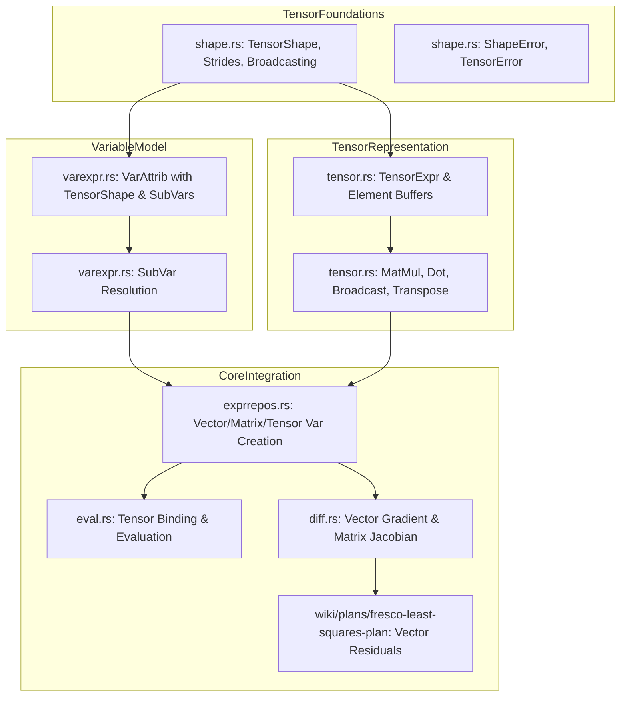

# Fresco Tensor, Matrix, and Vector Variable Architecture Plan

Date: 2026-11-18  
Status: Implemented API baseline; correctness and lifecycle hardening pending
Scope: Multi-dimensional tensors, matrices, vectors, NumPy-like shapes, sub-variable indexing (`v[i]`), and mutual algebraic interactions in `trellis::fresco`.  
Target Modules: `src/fresco/shape.rs`, `src/fresco/tensor.rs`, `src/fresco/varexpr.rs`, `src/fresco/exprrepos.rs`, `src/fresco/eval.rs`, `src/fresco/diff.rs`, `wiki/plans/fresco-least-squares-implementation-plan.md`

Implementation review, 2026-11-18: the Rust tensor APIs below are present at
`9027fba`, including fixes for multilevel indexing, constructor overflow checks,
symbol collisions, exact-name lookup, Jacobian error handling, and broadcasting.
See the [current review and improvement plan](fresco-review-and-next-steps.md)
for remaining shape-mutation/import, transaction, derivative-domain, and work-budget
issues. The focused suite passes 27 tests; historical broader totals below are not
current validation. Python/NumPy and solver integrations remain future work.

---

## 1. Executive Summary & Motivation

In physical simulation, CAD geometry, robotics, and numerical optimization, mathematical equations and parameters are rarely standalone scalar numbers; they are naturally **vectors, matrices, and multi-dimensional tensors**:
- **Robotics & Kinematics**: 3D spatial points $\vec{p} \in \mathbb{R}^3$, velocity vectors $\vec{v} \in \mathbb{R}^3$, rotation/transformation matrices $T \in \mathbb{R}^{4 \times 4}$, and inertia tensors $I \in \mathbb{R}^{3 \times 3}$.
- **CAD & Constraint Solving**: 2D coordinate pairs $(x, y) \in \mathbb{R}^2$, tangent vectors, and distance equations between point sets.
- **Least-Squares Minimization**: Parameter vectors $\vec{x} \in \mathbb{R}^m$, multi-dimensional equation residuals $\vec{r}(\vec{x}) \in \mathbb{R}^n$, and rectangular Jacobian matrices $J \in \mathbb{R}^{n \times m}$.

Fresco's underlying expression graph remains scalar (`f64`), while the implemented
TensorShape/TensorExpr layer provides dimensional metadata, aggregate variables,
and scalar lowering of high-level tensor operations. The specification below
describes that architecture and its intended extensions; it is not proof that
every numerical or lifecycle acceptance gate is satisfied.

This plan introduces native support for **Vectors, Matrices, and Tensors** in Fresco, featuring:
1. **NumPy-Style Tensor Shapes (`TensorShape`)**: N-dimensional shape descriptions, row-major strides, linear index conversion, and standard NumPy-compatible broadcasting rules.
2. **First-Class Aggregate Variables with Subvars (`v[i]`, `M[i, j]`)**: A variable can have a defined shape (e.g. vector of length 3, matrix of $4 \times 4$). Its individual components are represented as formal **sub-variables** (`subvar`), addressable via indexing expressions $v[i]$ or $M[i, j]$, while sharing an aggregate identity.
3. **Dual-Layer Tensor Expression System (`TensorExpr`)**:
   - High-level tensor operations (MatMul, Dot, Transpose, TensorAdd) compose cleanly with full dimensional validation.
   - Structural lowering transparently maps tensor operations into Fresco's underlying scalar DAG (`ExprRepos`), ensuring 100% backward compatibility with analytical differentiation (`diff.rs`), polynomial normalization (`polyexpr.rs`), and the least-squares solver.
4. **Vector/Matrix Calculus**: Automatic formation of gradient vectors $\nabla_{\vec{x}} f \in \mathbb{R}^m$ and Jacobian matrices $J = \frac{\partial \vec{r}}{\partial \vec{x}} \in \mathbb{R}^{n \times m}$.

---

## 2. Mathematical Contract & Core Concepts

### 2.1 Tensor Shape & Indexing Mechanics

A tensor $T$ has rank $R \ge 0$ and dimension tuple $\mathbf{d} = (d_0, d_1, \dots, d_{R-1})$:
- **Scalar**: Rank 0, $\mathbf{d} = ()$, total elements $K = 1$.
- **Vector**: Rank 1, $\mathbf{d} = (N)$, total elements $K = N$.
- **Matrix**: Rank 2, $\mathbf{d} = (M, N)$, total elements $K = M \times N$.
- **Rank-$R$ Tensor**: Rank $R$, $\mathbf{d} = (d_0, \dots, d_{R-1})$, total elements $K = \prod_{k=0}^{R-1} d_k$.

#### Memory Layout & Row-Major Strides
Storage is contiguous and C-style row-major. For coordinate multi-index $(i_0, i_1, \dots, i_{R-1})$ where $0 \le i_k < d_k$, the linear flat index $k_{\text{flat}}$ is computed using strides $s_k$:

\[
s_k = \prod_{j=k+1}^{R-1} d_j \quad (s_{R-1} = 1),\qquad k_{\text{flat}} = \sum_{k=0}^{R-1} i_k s_k.
\]

#### NumPy Broadcasting Semantics
Two shapes $\mathbf{a}$ and $\mathbf{b}$ are compatible for elementwise binary operations under standard NumPy rules:
1. Align shape tuples from right to left (trailing axes).
2. For each dimension pair $(d_{a, k}, d_{b, k})$, they are compatible if and only if $d_{a, k} == d_{b, k}$, or $d_{a, k} == 1$, or $d_{b, k} == 1$.
3. Missing leading dimensions in the lower-rank tensor are prepended with $1$.
4. The resulting broadcast shape has dimension $\max(d_{a, k}, d_{b, k})$ along each axis.

### 2.2 Aggregate Variables and Sub-Variables (`subvar`)

A variable declared with rank $R > 0$ is an **Aggregate Variable**.

#### Definition & Hierarchical Sub-Tensor Subvar Model
For an aggregate tensor variable $T$ of shape $(d_0, d_1, \dots, d_{R-1})$:
- A **Sub-Variable** (`subvar`) is not restricted to scalar leaves; **a subvar at position $i$ along the leading axis references a tensor of the lower shape** $(d_1, \dots, d_{R-1})$:
  - For a **1D Vector** $v \in \mathbb{R}^N$ (rank 1):
    The subvar $v[i]$ at position $i$ has lower shape `TensorShape::Scalar()` (rank 0), referencing an **element** of the vector.
  - For a **2D Matrix** $M \in \mathbb{R}^{R \times C}$ (rank 2):
    The subvar $M[i]$ at position $i$ has lower shape `TensorShape::Vector(C)` (rank 1), referencing a **row** of the matrix!
    Indexing further, $M[i][j]$ or $M[i, j]$ has lower shape `TensorShape::Scalar()` (rank 0), referencing an **element** of the matrix.
  - For a **3D Tensor** $T \in \mathbb{R}^{D_0 \times D_1 \times D_2}$ (rank 3):
    The subvar $T[i]$ at position $i$ has lower shape `TensorShape::Matrix(D_1, D_2)` (rank 2), referencing a **2D matrix slice** of the tensor.
    The subvar $T[i][j]$ or $T[i, j]$ has lower shape `TensorShape::Vector(D_2)` (rank 1), referencing a **row vector**.
    The subvar $T[i][j][k]$ or $T[i, j, k]$ has lower shape `TensorShape::Scalar()` (rank 0), referencing an **element**.
  - In general, for any rank $R \ge 1$: indexing along $m$ leading dimensions yields a subvar representing a tensor of lower rank $R - m$.
- Every subvar has:
  1. An independent `varId` in `_VarAttribs`.
  2. A reference to its parent aggregate root variable: `_AggrIndex = T.var_id()`.
  3. A deterministic linear offset: `_SubVarOffset = k_flat` relative to the root aggregate.
  4. Its own shape: `_Shape: TensorShape` (e.g. `Vector(C)` for a matrix row, `Scalar()` for a leaf).
  5. A canonical string name: `"v[0]"`, `"M[0]"` for rows, `"M[0,0]"` for elements.
  6. Normalized symbol indexing allowing both `"M[0,2]"` and `"M[0][2]"` lookups.

```
Aggregate Variable: "M" (Shape [2, 3], VarId = 4)
  │
  ├── Row SubVar 0: Name "M[0]", VarId = 5, Shape [3] (Vector), AggrIndex = 4, Offset = 0
  │     ├── Leaf SubVar (0,0): Name "M[0,0]" / "M[0][0]", VarId = 7, Shape (), Offset = 0
  │     ├── Leaf SubVar (0,1): Name "M[0,1]" / "M[0][1]", VarId = 8, Shape (), Offset = 1
  │     └── Leaf SubVar (0,2): Name "M[0,2]" / "M[0][2]", VarId = 9, Shape (), Offset = 2
  │
  └── Row SubVar 1: Name "M[1]", VarId = 6, Shape [3] (Vector), AggrIndex = 4, Offset = 3
        ├── Leaf SubVar (1,0): Name "M[1,0]" / "M[1][0]", VarId = 10, Shape (), Offset = 3
        ├── Leaf SubVar (1,1): Name "M[1,1]" / "M[1][1]", VarId = 11, Shape (), Offset = 4
        └── Leaf SubVar (1,2): Name "M[1,2]" / "M[1][2]", VarId = 12, Shape (), Offset = 5
```

#### Why This Model is Architecturally Optimal for Trellis
1. **Zero Special-Casing in Scalar AST**: Any scalar expression can directly reference $v[i]$ as a standard `VarExpr(subVarId)`. No new scalar node types are required for basic arithmetic.
2. **Automatic Symbolic Differentiation**: Differentiating $f$ with respect to vector component $v[i]$ immediately invokes existing `diff::Differentiate(repos, f_id, subVarId)`.
3. **Seamless Numerical Evaluation**: `eval::Evaluate(root, bindings)` works out of the box because every subvar has an exact index in `bindings: Arr<'_, f64>`.
4. **Symbolic Index Resolution**: Variable lookup `repos.FindVar("v[1]")` immediately resolves to the subvar's scalar `varId` via the existing $O(\log N)$ `_SymbolIndex`.

---

## 3. Mutual Interactions & Tensor Operations

Fresco will support four categories of mutual tensor interactions:

```mermaid
flowchart TD
    subgraph ElementwiseOps
        Add[TensorAdd: A + B with broadcast]
        Sub[TensorSub: A - B with broadcast]
        Had[TensorHadamard: A .* B elementwise]
        Div[TensorDiv: A ./ B elementwise]
        Scale[TensorScale: alpha * A scalar scaling]
    end
    subgraph LinearAlgebra
        Dot[VectorDot: u . v -> scalar]
        MatVec[MatVecMul: M * v -> vector]
        MatMul[MatMul: A * B -> matrix]
        Outer[OuterProduct: u (x) v -> matrix]
        Contr[TensorContract: general contraction]
    end
    subgraph StructuralOps
        Transp[Transpose: M^T axis permutation]
        Resh[Reshape: re-interpret dimensions]
        Flat[Flatten: convert to 1D vector]
        Slice[SubTensor / Slicing: M[i, :] row/col]
    end
    subgraph Calculus
        Grad[Gradient: nabla_x f -> vector]
        Jac[Jacobian: partial r / partial x -> matrix]
    end

    ElementwiseOps --> Lowering[Structural Lowering into ExprRepos]
    LinearAlgebra --> Lowering
    StructuralOps --> Lowering
    Calculus --> Lowering
    Lowering --> ExprRepos[Fresco ExprRepos Scalar DAG]
```

### 3.1 Elementwise Arithmetic & Broadcasting
Given tensor expressions $A$ (shape $\mathbf{a}$) and $B$ (shape $\mathbf{b}$):
- **Broadcast Resolution**: Computes output shape $\mathbf{c} = \text{BroadcastShape}(\mathbf{a}, \mathbf{b})$.
- **Lowering**: For each coordinate $(i_0, \dots, i_{R-1})$ in shape $\mathbf{c}$:
  - Determine source element in $A$ by collapsing axes where $d_{a, k} = 1$.
  - Determine source element in $B$ by collapsing axes where $d_{b, k} = 1$.
  - Construct the corresponding scalar expression in `ExprRepos` (`AddCreate`, `DiffCreate`, `MultCreate`, `DivCreate`).
  - Emit result element into output `TensorExpr`.

### 3.2 Linear Algebra & Contractions

#### Vector Dot Product
For vectors $\vec{u}, \vec{v} \in \mathbb{R}^N$:

\[
\vec{u} \cdot \vec{v} = \sum_{i=0}^{N-1} u_i v_i.
\]

Produces a **scalar expression ID** in `ExprRepos`:
```rust
let dotId = repos.SumCreate(products, empty);
```

#### Matrix-Vector Multiplication
For matrix $M \in \mathbb{R}^{P \times Q}$ and vector $\vec{v} \in \mathbb{R}^Q$:

\[
(M \vec{v})_i = \sum_{j=0}^{Q-1} M_{ij} v_j, \quad i = 0, \dots, P-1.
\]

Produces a `TensorExpr` vector of length $P$.

#### Matrix-Matrix Multiplication
For $A \in \mathbb{R}^{P \times K}$ and $B \in \mathbb{R}^{K \times Q}$:

\[
(A B)_{ij} = \sum_{p=0}^{K-1} A_{ip} B_{pj}, \quad i = 0, \dots, P-1,\; j = 0, \dots, Q-1.
\]

Produces a `TensorExpr` matrix of shape $(P, Q)$.

#### Outer Product
For $\vec{u} \in \mathbb{R}^P$ and $\vec{v} \in \mathbb{R}^Q$:

\[
(\vec{u} \otimes \vec{v})_{ij} = u_i v_j.
\]

Produces a `TensorExpr` matrix of shape $(P, Q)$.

#### Matrix Transposition
For $M \in \mathbb{R}^{P \times Q}$, $(M^T)_{ji} = M_{ij}$, returning shape $(Q, P)$.

---

## 4. Component Hierarchy & File Map



| File | Primary Types & Functions | Description |
|---|---|---|
| `src/fresco/shape.rs` | `TensorShape`, `K_MAX_TENSOR_RANK`, `ShapeError`, `Broadcaster` | N-dimensional tensor shape representation, row-major strides, multi-index to flat mapping, and NumPy broadcasting. |
| `src/fresco/tensor.rs` | `TensorExpr`, `TensorError`, `MatMul`, `VectorDot`, `Transpose`, `Hadamard` | High-level tensor expression holding shape and flat `Buff<u32>` of scalar expression IDs, plus linear algebra operators. |
| `src/fresco/varexpr.rs` | `VarAttrib`, `VarKind`, `SubVar` | Expanded variable attribute storing shape, aggregate parent link, subvar offset, and subvar range. |
| `src/fresco/exprrepos.rs`| `VectorVarCreate`, `MatrixVarCreate`, `TensorVarCreate`, `SubVar`, `SubVarExpr` | Repository APIs for declaring tensor variables, auto-generating scalar subvars, and querying components. |
| `src/fresco/eval.rs` | `EvaluateTensor`, `TensorBinding` | Batch evaluation of tensor expressions into contiguous `Buff<f64>` and vector/matrix binding utilities. |
| `src/fresco/diff.rs` | `DifferentiateVector`, `Jacobian` | Vector gradient $\nabla_{\vec{x}} f$ and matrix Jacobian $\frac{\partial \vec{r}}{\partial \vec{x}}$ generation. |

---

## 5. Detailed Type Specifications

### 5.1 `TensorShape` (`shape.rs`)

To avoid heap allocations for common small-dimension tensors while strictly complying with Trellis directives (zero `RefCell`, zero `Option<u32>`):

```rust
pub const K_MAX_TENSOR_RANK: usize = 6;

#[derive(Clone, Copy, Debug, PartialEq, Eq)]
pub struct TensorShape {
    _Rank: u8,
    _Dims: [u32; K_MAX_TENSOR_RANK],
}

impl TensorShape {
    pub fn Scalar() -> Self;
    pub fn Vector(len: u32) -> Self;
    pub fn Matrix(rows: u32, cols: u32) -> Self;
    pub fn FromSlice(dims: &[u32]) -> Result<Self, ShapeError>;

    pub fn Rank(&self) -> u32;
    pub fn Dim(&self, axis: u32) -> u32;
    pub fn TotalElements(&self) -> u32;
    pub fn IsScalar(&self) -> bool;
    pub fn IsVector(&self) -> bool;
    pub fn IsMatrix(&self) -> bool;

    pub fn Strides(&self) -> [u32; K_MAX_TENSOR_RANK];
    pub fn LinearIndex(&self, indices: &[u32]) -> Result<u32, ShapeError>;
    pub fn MultiIndex(&self, linearIndex: u32) -> [u32; K_MAX_TENSOR_RANK];

    pub fn CanBroadcastWith(&self, other: &Self) -> bool;
    pub fn BroadcastWith(&self, other: &Self) -> Result<Self, ShapeError>;
}
```

### 5.2 Extended `VarAttrib` (`varexpr.rs`)

```rust
#[derive(Clone, Debug)]
pub struct VarAttrib {
    _Name:         String,
    _DepExpr:      u32,
    _AggrIndex:    u32,         // u32::MAX if not a subvar; parent VarId if subvar
    _SubVarOffset: u32,         // Linear offset k in parent aggregate (0 if parent)
    _Shape:        TensorShape, // Shape of variable (Scalar for standard scalars and subvars)
    _SubVarStart:  u32,         // First subvar ID in _VarAttribs if aggregate; u32::MAX otherwise
    _Flags:        u32,
}
```

### 5.3 `TensorExpr` (`tensor.rs`)

```rust
pub struct TensorExpr {
    _Shape: TensorShape,
    _Elems: Buff<u32>, // Flat array of u32 expression IDs in ExprRepos
}

impl TensorExpr {
    pub fn New(shape: TensorShape, elems: Buff<u32>) -> Result<Self, TensorError>;
    pub fn FromScalar(exprId: u32) -> Self;
    pub fn FromVar(repos: &ExprRepos, varId: u32) -> Result<Self, TensorError>;

    pub fn Shape(&self) -> &TensorShape;
    pub fn TotalElements(&self) -> u32;
    pub fn Elements(&self) -> Arr<'_, u32>;

    pub fn Get(&self, indices: &[u32]) -> Result<u32, TensorError>;
    pub fn GetLinear(&self, flatIndex: u32) -> u32;

    pub fn Transpose(&self, repos: &mut ExprRepos) -> Result<Self, TensorError>;
    pub fn Reshape(&self, newShape: TensorShape) -> Result<Self, TensorError>;
    pub fn Flatten(&self) -> Self;
}
```

---

## 6. Implementation Mechanics & Code Examples

### 6.1 Creating Vector and Matrix Variables
```rust
let mut repos = ExprRepos::New();

// Create 3D vector variable: v \in R^3
let v_id = repos.VectorVarCreate("v", 3);
// Automatically interns:
//   VarId for "v" (aggregate, shape [3])
//   VarId for "v[0]" (subvar, offset 0, aggrIndex = v_id)
//   VarId for "v[1]" (subvar, offset 1, aggrIndex = v_id)
//   VarId for "v[2]" (subvar, offset 2, aggrIndex = v_id)

// Create 3x3 transformation matrix: M \in R^{3x3}
let m_id = repos.MatrixVarCreate("M", 3, 3);
// Interns "M", and 9 subvars "M[0,0]", "M[0,1]", ..., "M[2,2]"
```

### 6.2 Matrix-Vector Multiplication & Dot Product
```rust
// Lift variables into TensorExpr structures:
let v = TensorExpr::FromVar(&repos, v_id)?; // Shape [3]
let m = TensorExpr::FromVar(&repos, m_id)?; // Shape [3, 3]

// Matrix-vector multiplication: y = M * v
let y = MatVecMul(&mut repos, &m, &v)?;     // Returns TensorExpr of shape [3]

// Dot product: norm_sq = v . v
let norm_sq = VectorDot(&mut repos, &v, &v)?; // Returns scalar exprId: v[0]^2 + v[1]^2 + v[2]^2
```

### 6.3 Vector Gradient and Jacobian Generation
```rust
// Scalar function f(v) = v[0]^2 + v[1]^2 + v[2]^2
let f_id = norm_sq;

// Compute analytical gradient: nabla_v f \in R^3
let grad = DifferentiateVector(&mut repos, f_id, v_id)?;
// grad is a TensorExpr of shape [3] containing:
//   grad[0] = 2 * v[0]
//   grad[1] = 2 * v[1]
//   grad[2] = 2 * v[2]

// Compute Jacobian matrix of residual vector: J = dr / dv \in R^{3x3}
let jacobian = DifferentiateMatrix(&mut repos, &y, v_id)?;
// jacobian is a TensorExpr of shape [3, 3] matching d(M*v)_i / d(v_j) == M_{ij}
```

---

## 7. Integration with the Least-Squares Minimization Plan

In [the least-squares implementation plan](fresco-least-squares-implementation-plan.md), the problem is defined as minimizing residual expressions $r_i(x, p)$.

With the Tensor & Vector extension:
1. **Vector Residual Acceptance**:
   Instead of forcing callers to manually construct and register an array of scalar equations, `LeastSquaresProblem` can accept high-level vector residual expressions:
   ```rust
   let problem = LeastSquaresProblem::FromVectorResidual(
       &repos,
       &residualVector,  // TensorExpr of shape [n]
       &[activeVectorId] // Vector variable of shape [m]
   )?;
   ```
2. **Automatic Active Subvar Unfurling**:
   The problem constructor inspects `activeVectorId`. Seeing that it has shape $[m]$ with subvars $x[0], \dots, x[m-1]$, it automatically registers all $m$ scalar sub-variables into the active column index list!
3. **Structured Vector Bindings**:
   Users can supply initial estimates as contiguous vectors:
   ```rust
   workspace.BindVector("x", &[1.0, 2.5, -0.5]);
   ```
   The workspace automatically maps vector entries to the corresponding subvar binding slots.

---

## 8. Delivery Phases & Implementation Roadmap

| Phase | Milestone Deliverables | Status | Dependencies |
| :--- | :--- | :--- | :--- |
| **Phase T1** | **`TensorShape` & Broadcasting Core**<br>• Implemented in `src/fresco/shape.rs` with `TensorShape`, row-major strides, linear index math, `SubShape`, `SliceShape`, `LeadingOffset`, and NumPy broadcast rules.<br>• Unit tests for rank 0..4, index conversions, and broadcast compatibility. | **Implemented; hardening pending** | None |
| **Phase T2** | **Aggregate Variables & Hierarchical Subvars in `ExprRepos`**<br>• Extended `VarAttrib` with shape, aggregate links, and subvar offsets.<br>• Implemented `VectorVarCreate`, `MatrixVarCreate`, `TensorVarCreate`, `SubVar`, and `SubVarExpr` in `exprrepos.rs`.<br>• Subvar lower shape indexing ($M[i]$ row vector, $T[i]$ matrix slice) and leaf interning in `_SymbolIndex` (`"v[i]"`, `"M[i]"`, `"M[i,j]"`). | **Implemented; hardening pending** | Phase T1 |
| **Phase T3** | **`TensorExpr` Data Structure & Structural Ops**<br>• Implemented `src/fresco/tensor.rs` with `TensorExpr` holding `Buff<u32>` expression IDs.<br>• Implemented `Transpose`, `Reshape`, `Flatten`, `Row`, `Col`, and `SubTensor`. | **Implemented; hardening pending** | Phase T2 |
| **Phase T4** | **Mutual Tensor Interactions & Linear Algebra**<br>• Implemented elementwise broadcasting: `TensorAdd`, `TensorSub`, `TensorHadamard`, `TensorDiv`, `TensorScale`.<br>• Implemented contractions: `VectorDot`, `MatVecMul`, `MatMul`, `OuterProduct`. | **Implemented; hardening pending** | Phase T3 |
| **Phase T5** | **Vector Calculus & Evaluation**<br>• Implemented `DifferentiateVector` ($\nabla_{\vec{x}} f$) and `Jacobian` ($\frac{\partial \vec{r}}{\partial \vec{x}}$) in `diff.rs`.<br>• Implemented `EvaluateTensor` and `EvaluateTensorNamed` in `eval.rs`.<br>• Focused Fresco baseline: 27 tests pass; broader totals not reverified in this review. | **Implemented; hardening pending** | Phase T4 |
| **Phase T6** | **Python SDK & NumPy Interoperability**<br>• Expose `TensorShape`, vector variables, and tensor operations to Python via PyO3.<br>• Enable seamless interop with NumPy `ndarray` and Python `@` matrix multiplication. | Pending | Phase T5 |

---

## 9. Verification Fixtures & Acceptance Criteria

1. **Shape & Broadcasting Fixtures**:
   - Verify `(3, 1)` and `(1, 4)` broadcast to `(3, 4)`.
   - Verify `(3, 3)` and `(4,)` fail broadcast check with structured `ShapeError`.
   - Verify linear index to multi-index round-trip for 1D, 2D, 3D, and 4D tensors.
2. **Subvar Naming & Lookup Fixtures**:
   - Declaring vector `"p"` of length 3 creates `"p[0]"`, `"p[1]"`, `"p[2]"`.
   - `repos.FindVar("p[1]")` returns the exact subvar ID.
   - `repos.VarAttrAt(p_1).AggrIndex()` equals `p.var_id()`.
3. **Linear Algebra Parity Fixtures**:
   - $M \vec{v}$ for $M = \begin{bmatrix} 1 & 2 \\ 3 & 4 \end{bmatrix}$ and $\vec{v} = \begin{bmatrix} x \\ y \end{bmatrix}$ produces:
     $y_0 = 1x + 2y$, $y_1 = 3x + 4y$.
   - Evaluating with $x = 2, y = 3$ yields exact vector $[8.0, 18.0]$.
4. **Differentiation Parity Fixtures**:
   - Differentiating $\vec{u} \cdot \vec{v}$ with respect to $\vec{u}$ returns vector $\vec{v}$.
   - Differentiating $M \vec{v}$ with respect to $\vec{v}$ returns matrix $M$.
   - Quadratic form $\frac{1}{2} \vec{x}^T A \vec{x}$ differentiated with respect to $\vec{x}$ returns $A \vec{x}$ (for symmetric $A$).
5. **Directive Compliance**:
   - Zero `RefCell`, `Cell`, `Rc`, or `Arc` domain references.
   - All optional references use `u32::MAX`.
   - Clean compilation under `cargo clippy --all-targets --offline -- -D warnings`.
