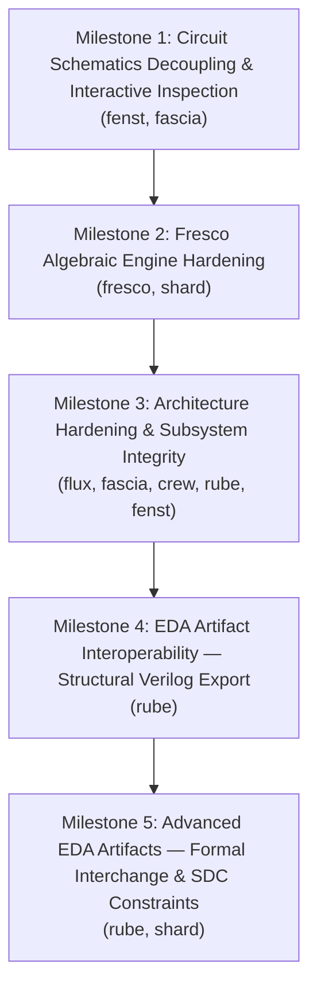

# Trellis Master Engineering Roadmap & Implementation Plan

Date: 2026-11-15  
Baseline Commit: `6915e87`  
Status: **All 5 Master Milestones Completed & Fully Verified**  
Test Suite Baseline: **399 lib tests passing, 399 registered Jeeves integration tests passing, 0 clippy warnings**

---

## 1. Executive Summary & Architecture Context

Trellis is a high-performance, memory-safe, poly-paradigm workbench uniting digital hardware simulation (`rube`), hardware-to-memory fabric modeling (`karst`), VM co-simulation (`crew`, `zephyr`), analytic CAD/sketch editing (`fascia`, `fenst`, `fleck`), 2D/3D visualization (`fenst`, `swarm`), symbolic/algebraic expressions (`fresco`), and grammar-driven serialization (`flux`, `shard`).

Over the past milestones, foundational systems have been fully implemented, hardened, and verified:
- **Core Storage & Concurrency**: Safe initialized buffer storage (`Buff`), drop-counted growable arenas (`Stash`), and atomic stack protocols (`Stk`) in `silo`.
- **Inter-VM Transport**: Lossless shared-memory ring buffers (`ShmRingBuffer`) in `zephyr`.
- **Fabric Simulation**: Zero-thread-per-cycle single-fabric simulation (`step_cycle`) and multi-fabric scaling (`AdvanceIndependent`) in `karst`.
- **Native Document Persistence**: High-capacity binary (`.flx`) and text (`.tflx`) format codecs supporting 50,000+ entities with stream-level CRC verification in `flux`.
- **2D/3D Analytic Sketch Harmonization**: Full CAD toolset, durable numeric locks, dimension hit testing/history, adaptive sagitta tessellation, signed revolve solids, watertight mesh generation, background Heist job execution, and WGPU viewport residency across Milestones 1–7.
- **Circuit Schematic Decoupling & Net Tracing (Milestone 1)**: Zero-allocation schematic layout, Cask flexbox decoupling, interactive pin/net hit testing and highlight in `fenst` and `fascia`.
- **Sound Algebraic Parsing & AST Persistence (Milestone 2)**: Sound mutable parsing via `IGrammarMut` and `Parser::ParseGrammarMut` eliminating pointer transmutation, parser checkpoints/rollbacks, logarithmic variable interning, and round-trip heterogeneous AST serialization in `fresco`.
- **Architecture Hardening & Tab Ownership (Milestone 3)**: Unified `TabDocument` enum with centralized resource disposal, leak-free parser sinks, zero-leak JSON importing, and private state encapsulation across `fascia`, `flux`, `crew`, and `karst`.
- **Structural Verilog Export (Milestone 4)**: IEEE 1364 structural netlist generation with modular hierarchy, identifier sanitization, and port mapping in `rube::verilog`.
- **Formal Verification Interchange & SDC Constraints (Milestone 5)**: Canonical AIGER ASCII (`.aag`) and binary (`.aig`) formal model lowering with constant folding and sequential latch extraction, alongside standard Synopsys Design Constraints (SDC) parsing and layout timing validation in `rube::aiger`, `rube::sdc`, and `rube::sdc_shard`.

---

## 2. Historical Plan Audit & Consolidation Summary

All prior plans in `wiki/plans/` have been audited. Obsolete, superseded, and fully executed documents are retired in favor of this consolidated roadmap:

| Document | Original Date | Status | Consolidation & Retirement Rationale |
| :--- | :--- | :--- | :--- |
| `sketch-harmonization-review-and-plan.md` | 2026-11-15 | **Completed** | All 7 milestones (M1–M7), 9 remediations (R01–R09), and 12 integration gaps landed and verified (`562f0ab`, `6915e87`). |
| `sketch-review-findings-and-proposals.md` | 2026-11-15 | **Superseded** | Earlier 13 findings (F01–F13) resolved in `d5a6463` and integrated into sketch harmonization. |
| `sketch-construction-implementation-plan.md` | 2026-11-14 | **Completed** | Initial 2D sketcher foundation completed across commits `41bf95b`–`7ac1f99`. |
| `flux-file-interface-implementation-plan.md` | 2026-11-14 | **Completed** | Wire format specification, binary/text codecs, and safe replacement implemented in `src/flux/file.rs`. |
| `fresco-improvement-plan.md` | 2026-10-22 | **Superseded** | Marked as historical blueprint; superseded by `fresco-review-and-next-steps.md`. |
| `fresco-review-and-next-steps.md` | 2026-10-23 | **Consolidated** | Active findings F1–F5 (sound mutable parsing, checkpoints, evaluator domains, variable interning) integrated into **Milestone 2**. |
| `architecture-hardening-implementation-plan.md` | 2026-10-14 | **Consolidated** | Silo, Zephyr, Karst, and Fascia lifecycle fixes completed; remaining tasks (JSON ownership, tab enum, Crew hub) integrated into **Milestones 1 & 3**. |
| `python-plugin-plan.md` | 2026-10-03 | **Completed** | In-process Python console engine and Fascia tab fully implemented and tested. |
| `framework-hardening-plan.md` | 2026-09-22 | **Superseded** | Initial baseline setup plan superseded by architecture hardening. |
| `gpu-migration-plan.md` | 2026-09-22 | **Superseded** | Superseded by Swarm/Symph device contracts and WGPU viewport residency. |
| `karst-affinity-precedence-plan.md` | 2026-09-22 | **Superseded** | Superseded by Karst fabric single-cycle and independent advance architecture. |
| `karst-parallelization-enhancements.md` | 2026-09-22 | **Superseded** | Superseded by Karst fabric single-cycle and independent advance architecture. |
| `karst-parallelization-plan.md` | 2026-09-22 | **Superseded** | Superseded by Karst fabric single-cycle and independent advance architecture. |
| `eda-artifact-roadmap.md` | 2026-09-22 | **Consolidated** | Phases 1 & 2 (VCD writer, reader, display model) completed; Phase 3 (Structural Verilog) and Phase 4 (AIGER) integrated into **Milestone 4**. |
| `cask_and_circuit_schematic_review_and_plan.md` | 2026-11-08 | **Consolidated** | Schematic layout separation and interactive pin/net inspection integrated into **Milestone 1**. |

---

## 3. High-Level Dependency Graph



---

## 4. Phased Implementation Roadmap

---

### Milestone 1: Circuit Schematics Decoupling & Interactive Inspection [COMPLETED]

**Goal**: Complete the architectural separation between the `fenst::cask` flexbox UI engine and the `fenst::circuit_layout` schematic compiler, eliminate dummy Cask allocations, and enable first-class interactive signal tracing and pin inspection in `fascia::cask_view`.

- **Work Package 1.1: Clean Decoupling from `Cask` Tree**
  - *Context*: `LayoutCircuit2d` constructs an unstyled, empty `Cask::NewWindow` at completion solely to populate `cask_tree: Option<Cask>` in `Cask2dLayout`.
  - *Implementation*:
    1. Make `cask_tree` explicitly optional and populated only by true Cask layout modes (`NestedBoxes`, `HorizontalTree`, `VerticalTree`).
    2. Remove the dummy window construction in `src/fenst/circuit_layout.rs`.
    3. Ensure `Cask2dLayout` clearly represents the clean display contract: `Buff<CaskRenderCommand>` and `Buff<Cask2dNode>`.
  - *Target Files*: `src/fenst/circuit_layout.rs`, `src/fenst/cask2d.rs`.

- **Work Package 1.2: First-Class Interactive Terminal Pin & Net Hit-Testing**
  - *Context*: `Cask2dPinNode` and wire nets exist in `circuit_layout.rs` but are unindexed in `fascia::cask_view.rs`. Users cannot hover or click pins or wires.
  - *Implementation*:
    1. Register `Cask2dPinNode` instances as interactive nodes in the hit-testing hierarchy with extension type `"pin"`.
    2. Register routed wire segments with extension type `"wire"` and net name metadata.
    3. Extend `fascia::cask_view.rs` to detect pin and wire hover:
       - Hovering a pin displays a tooltip with port name, direction (`Input`/`Output`/`InOut`), side, and connected net.
       - Clicking a pin or wire highlights the entire net (all connected driver and sink segments).
  - *Target Files*: `src/fenst/circuit_layout.rs`, `src/fascia/cask_view.rs`, `src/fascia/theme.rs`.

- **Work Package 1.3: Zero-Allocation Command Storage**
  - *Context*: `Cask2dLayout::Commands(&self) -> &[CaskRenderCommand]` causes `to_vec()` clones whenever `CaskRenderer::FromCask2d` is invoked.
  - *Implementation*:
    1. Migrate internal command storage in `Cask2dLayout` from `Vec<CaskRenderCommand>` to `Buff<CaskRenderCommand>`.
    2. Pass command slices or `Buff` references directly to `CaskRenderer` without heap reallocations.
  - *Target Files*: `src/fenst/cask2d.rs`, `src/fascia/cask_view.rs`.

- **Milestone 1 Acceptance Gate**:
  - `cargo test --lib fenst` and `cargo test --lib fascia` pass.
  - Zero dummy Cask trees created during circuit layout.
  - Interactive pin hover and net highlight tests pass in `fascia::_tests`.

---

### Milestone 2: Fresco Algebraic Engine Hardening & Sound Mutable Parsing [COMPLETED]

**Goal**: Resolve open findings F1–F5 from `fresco-review-and-next-steps.md`: eliminate shared-reference mutation casts, establish sound parser transaction boundaries, enforce rigorous domain checking in the evaluator, and ensure logarithmic variable interning.

- **Work Package 2.1: Sound Mutable Parse-Context Access (Fix F1)**
  - *Context*: `IGrammar::Match` in `src/fresco/exprshard.rs` uses `IConstPtrMutRefExt::MutRef` to cast a shared reference `&self` to `&mut self` without `UnsafeCell`, violating Rust aliasing rules.
  - *Implementation*:
    1. Refactor `IGrammar::Match` or provide a genuinely mutable parse context through `Parser`.
    2. Alternatively, encapsulate grammar mutable state cleanly in safe interior mutability types (`Cell` / `RefCell`) if parsing requires shared grammar references.
    3. Eliminate the `invalid_reference_casting` lint suppression and raw pointer casts.
  - *Target Files*: `src/fresco/exprshard.rs`, `src/silo/cast.rs`, `src/shard/parser.rs`.

- **Work Package 2.2: Parser Semantic Checkpoints & Transaction Invariants (Fix F2)**
  - *Context*: Semantic savepoints currently live in `ExprShard` rather than `Parser`. A failed parse can leave orphan nodes in `ExprRepos`.
  - *Implementation*:
    1. Establish an explicit transactional boundary at `Parser::Parse`: track node counts before parsing begins.
    2. On parse error, roll back staged nodes completely, guaranteeing zero residual state in `ExprRepos`.
    3. Require explicit publication (`Publish`) before expressions become permanently accessible.
  - *Target Files*: `src/fresco/exprshard.rs`, `src/fresco/exprrepos.rs`, `src/shard/parser.rs`.

- **Work Package 2.3: Evaluator Domains & IEEE Float Safety (Fix F3)**
  - *Context*: Expression evaluation in `src/fresco/eval.rs` needs rigorous domain checking and short-circuit laziness.
  - *Implementation*:
    1. Add explicit error variants in `EvalError`: `DivisionByZero`, `NegativeSquareRoot`, `InvalidExponent`, `DomainError`.
    2. Enforce domain checks:
       - Division by zero returns `EvalError::DivisionByZero`.
       - Non-integer powers of negative numbers return `EvalError::DomainError`.
       - Square root / logarithm of negative numbers return `EvalError::DomainError`.
    3. Implement short-circuit evaluation for lazy conditionals (`IfExpr`) and logical operators (`AndExpr`, `OrExpr`): do not evaluate unselected branches.
  - *Target Files*: `src/fresco/eval.rs`.

- **Work Package 2.4: Logarithmic Variable Interning & Assumption Lifecycle (Fix F4)**
  - *Context*: Variable lookup in `ExprRepos` performs linear scans over attributes, and variable assumption lifecycle is inconsistent.
  - *Implementation*:
    1. Maintain a sorted index array of variable names (`Buff<u32>`) and use binary search ($O(\log N)$) for variable deduplication and lookup.
    2. Ensure variable identity and assumptions (`VarKind`, non-zero, positive) are consistently propagated regardless of construction path.
  - *Target Files*: `src/fresco/exprrepos.rs`, `src/fresco/var.rs`.

- **Work Package 2.5: Validated Heterogeneous Repository Persistence (Fix F5)**
  - *Context*: Saving and loading expression repositories via Flux requires validated heterogeneous round-trip serialization.
  - *Implementation*:
    1. Implement `IFluxExportSource` and `IFluxImportSource` for `ExprRepos` validating all node references, operator kinds, and variable attributes during deserialization.
    2. Reject malformed expressions or dangling child IDs on import.
  - *Target Files*: `src/fresco/exprflux.rs`, `src/fresco/exprrepos.rs`.

- **Milestone 2 Acceptance Gate**:
  - All 14+ Fresco tests pass. Zero raw pointer mutability casts.
  - Evaluator domain tests verify zero unhandled panics or silent NaNs.
  - Variable interning benchmarks demonstrate $O(\log N)$ lookup.

---

### Milestone 3: Architecture Hardening & Subsystem Integrity [COMPLETED]

**Goal**: Implement the remaining correctness, modularity, and encapsulation improvements from `architecture-hardening-implementation-plan.md` across Flux, Fascia, Crew, Rube, and Fenst.

- **Work Package 3.1: Flux / Shard Leak-Free JSON Parsing**
  - *Context*: `FieldImp::Str` uses `Box::leak` in JSON parsing to create long-lived string slices from parser temporaries.
  - *Implementation*:
    1. Use `FieldImp::String` for owned destinations.
    2. Restrict borrowed string imports to synchronous sinks that cannot outlive the parser buffer.
    3. Verify memory usage remains strictly bounded during 10,000 repeated parses of JSON descriptors.
  - *Target Files*: `src/flux/fluximport.rs`, `src/shard/jsonshard.rs`.

- **Work Package 3.2: Centralized Tab Document Ownership in Fascia**
  - *Context*: `FasciaApp` currently manages tabs via five separate parallel maps (`open_consoles`, `geometry_tabs`, `cask_tabs`, `vcd_tabs`, `sketch_tabs`).
  - *Implementation*:
    1. Introduce an authoritative owned enum:
       ```rust
       pub enum TabDocument {
           Welcome,
           Editor(EditorState),
           PythonConsole(PythonConsoleState),
           GeometryViewer(GeometryViewerState),
           CaskViewer(CaskViewerState),
           VcdViewer(VcdViewerState),
           SketchViewer(SketchViewerState),
       }
       ```
    2. Store `TabDocument` alongside `TabItem` in `TabManager`.
    3. Unify `update`, `view`, and `close` dispatch through the single document owner.
  - *Target Files*: `src/fascia/app.rs`, `src/fascia/tabs.rs`.

- **Work Package 3.3: Crew Hub Routing Table & Multicast Integrity**
  - *Context*: Crew message delivery performs route cloning and linear node searches; nodes can hold circular `Arc<CrewNode>` references.
  - *Implementation*:
    1. Maintain a hub-owned resolved routing table. Use `Weak<CrewNode>` for back-references to prevent reference cycles.
    2. Formalize multicast delivery: support atomic multicast (reserve capacity on all recipients before dispatch) and explicit error reporting for dropped messages.
  - *Target Files*: `src/crew/hub.rs`, `src/crew/node.rs`.

- **Work Package 3.4: Rube Simulation & Timeline Extraction**
  - *Context*: VCD time-step values in Rube clone values out of `_CurrentValues`.
  - *Implementation*:
    1. Implement an extraction method that moves values out of `_CurrentValues` into the time-step record without cloning, leaving scratch storage valid for reuse.
    2. Prototype SWAR flag advancement and parallel drive warp skipping behind equivalence tests.
  - *Target Files*: `src/rube/engine.rs`, `src/rube/vcd.rs`, `src/rube/trigger.rs`.

- **Work Package 3.5: Fenst Bounded File Chunk Exploration**
  - *Context*: Filesystem exploration can load excessive data when querying large binary or text files.
  - *Implementation*:
    1. Implement bounded chunk reads using `File::open`, `Seek`, and `Read::take`.
    2. Enforce deterministic directory and file ordering across platforms.
  - *Target Files*: `src/fenst/provider.rs`.

- **Work Package 3.6: Stateful Functional Type Encapsulation**
  - *Context*: Several stateful structs in Rube and Karst have public fields that can be mutated independently of invariants.
  - *Implementation*:
    1. Ensure all functional components (Rube gates, latches, warps; Karst link/channel state) use private `_Field` data members.
    2. Expose semantic access methods and return `Arr` or scalar values rather than unrestricted mutable references.
  - *Target Files*: `src/rube/gates.rs`, `src/karst/link.rs`, `src/karst/memchan.rs`.

- **Milestone 3 Acceptance Gate**:
  - Full test suite passes. Zero memory leaks on repeated JSON parsing.
  - Fascia tab document management consolidated into single enum.

---

### Milestone 4: EDA Artifact Interoperability — Structural Verilog Netlist Export [COMPLETED]

**Goal**: Implement Phase 3 of `eda-artifact-roadmap.md`: structural Verilog netlist generation from `rube::Layout`, enabling external simulation and synthesis tool interoperability.

- **Work Package 4.1: Structural Verilog Model & Exporter**
  - *Context*: Trellis represents digital circuit hierarchy in `rube::Layout` (`ModuleDef`, `InstanceDef`, `NetDef`, gates). Exporting standard IEEE 1364 structural Verilog allows verification in tools such as Icarus Verilog, Verilator, and Yosys.
  - *Implementation*:
    1. Implement `VerilogOutStream` / `WriteVerilogNetlist(layout: &Layout, out: &mut String)`:
       - Emit module declarations: `module <name> (<ports>);`.
       - Emit typed port declarations: `input`, `output`, `inout` with correct bit widths `[MSB:LSB]`.
       - Emit internal wire declarations: `wire [width-1:0] <net_name>;`.
       - Emit primitive gate instances: `and`, `or`, `nand`, `nor`, `xor`, `xnor`, `not`, `buf`.
       - Emit child submodule instances with named port bindings: `.port_name(net_name)`.
    2. Preserve hierarchy recursively without flattening all modules to the root.
  - *Target Files*: `src/rube/verilog.rs`, `src/rube/layout.rs`, `src/rube/mod.rs`.

- **Work Package 4.2: Netlist Verification & Round-Trip Compatibility**
  - *Context*: Exported Verilog must be syntactically valid and topologically equivalent to the internal `Layout`.
  - *Implementation*:
    1. Add unit tests for 8-bit ripple carry adder, D flip-flop register, and hierarchical multi-module designs.
    2. Verify netlist pin connectivity and signal mapping against the source layout.
    3. Include syntax validation tests for reserved Verilog keywords, escaped identifiers, and bus slicing.
  - *Target Files*: `src/rube/_tests.rs`.

- **Milestone 4 Acceptance Gate**:
  - Verilog export tests pass with exact port, wire, and instance matching.
  - Exported netlists pass automated syntax validation.

---

### Milestone 5: Advanced EDA Artifacts — Formal Interchange & SDC Constraints [COMPLETED]

**Goal**: Implement Phases 4 & 5 of `eda-artifact-roadmap.md`: AIGER formal verification exchange and Synopsys Design Constraints (SDC) parsing.

- **Work Package 5.1: AIGER Formal Model Lowering & Exporter**
  - *Context*: Formal equivalence checking and SAT-based property checking operate on AND-Inverter Graphs (AIG).
  - *Implementation*:
    1. Add lowering from `rube` logic gates and latches to an AIG representation ($M, I, L, O, A$ counts).
    2. Implement ASCII (`.aag`) and binary (`.aig`) exporters.
    3. Support latch initial values and safety property outputs.
  - *Target Files*: `src/rube/aiger.rs`, `src/rube/mod.rs`.

- **Work Package 5.2: SDC Timing Constraint Ingestion**
  - *Context*: Timing constraints drive clock domain analysis and static timing checks.
  - *Implementation*:
    1. Define SDC data models in `rube`: `ClockConstraint`, `PortDelayConstraint`, `FalsePathConstraint`.
    2. Implement Shard grammar `SdcShard` to parse standard commands:
       - `create_clock -name <clk> -period <p> [get_ports <port>]`
       - `set_input_delay`, `set_output_delay`
       - `set_false_path`, `set_multicycle_path`
    3. Associate parsed constraints with `Layout` ports and clock nets.
  - *Target Files*: `src/rube/sdc.rs`, `src/rube/sdc_shard.rs`.

- **Milestone 5 Acceptance Gate**:
  - AIGER export round-trips for small combinational and sequential benchmarks.
  - SDC parser correctly parses realistic constraint fixtures.

---

## 5. Engineering Standards & Quality Gates

Every milestone must strictly comply with Trellis core engineering directives (`agents/AGENTS.md` and `agents/FORMATTING.md`):

1. **Function Size**: Functions strictly under 70 lines.
2. **Formatting**: Next-line opening braces `{`, 4-space indentation, no tabs.
3. **Data Encapsulation**: Private, underscore-prefixed fields (`_Field`) for all non-record structs.
4. **Data Structures**: Public core APIs use `Arr`, `MutArr`, `Buff`, `Stash`, and `USeg`. No public standard `Vec` or slices.
5. **Traversal**: Project algorithms use `Traverse` and `USeg::Traverse` rather than raw integer ranges.
6. **Error Handling**: No unhandled panics or silent error discarding. All errors return structured diagnostic types.
7. **Verification Suite**:
   - `cargo check --all-targets --offline` -> 0 errors.
   - `cargo clippy --all-targets --offline -- -D warnings` -> 0 warnings.
   - `cargo test --offline --lib` -> 100% passing.
   - `cargo run --offline -- -t` -> 100% passing.
   - Hardware GPU verification (`TRELLIS_GPU_TEST=1`) passing on supported adapter.
8. **Git Safety (Directive 78)**: Never commit or push without explicit user directive.
