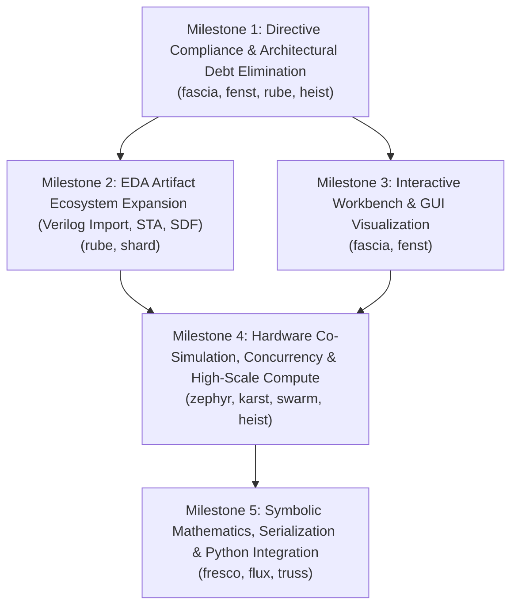

# Trellis Master Engineering Roadmap & Implementation Plan

Date: 2026-11-16  
Baseline Commit: `4abeea8`  
Status: **Active Master Plan (Milestones 1–5)**  
Test Suite Baseline: **399 lib tests passing, 0 clippy warnings**

---

## 1. Executive Summary & Architecture Context

Trellis is a high-performance, memory-safe, poly-paradigm workbench uniting digital hardware simulation (`rube`), hardware-to-memory fabric modeling (`karst`), VM co-simulation (`crew`, `zephyr`), analytic CAD/sketch editing (`fascia`, `fenst`, `fleck`), 2D/3D visualization (`fenst`, `swarm`), symbolic/algebraic expressions (`fresco`), and grammar-driven serialization (`flux`, `shard`).

Over the past milestones, foundational systems have been fully implemented, hardened, and verified:
- **Core Storage & Concurrency**: Safe initialized buffer storage (`Buff`), drop-counted growable arenas (`Stash`), and atomic stack protocols (`Stk`) in `silo`.
- **Inter-VM Transport**: Lossless shared-memory ring buffers (`ShmRingBuffer`) in `zephyr`.
- **Fabric Simulation**: Zero-thread-per-cycle single-fabric simulation (`step_cycle`) and multi-fabric scaling (`AdvanceIndependent`) in `karst`.
- **Native Document Persistence**: High-capacity binary (`.flx`) and text (`.tflx`) format codecs supporting 50,000+ entities with stream-level CRC verification in `flux`.
- **2D/3D Analytic Sketch Harmonization**: Full CAD toolset, durable numeric locks, dimension hit testing/history, adaptive sagitta tessellation, signed revolve solids, watertight mesh generation, background Heist job execution, and WGPU viewport residency across Milestones 1–7.
- **Circuit Schematic Decoupling & Net Tracing (Legacy M1)**: Zero-allocation schematic layout, Cask flexbox decoupling, interactive pin/net hit testing and highlight in `fenst` and `fascia`.
- **Sound Algebraic Parsing & AST Persistence (Legacy M2)**: Sound stateless parsing via `IGrammar<Ctx>`, transaction boundaries, logarithmic variable interning, and round-trip heterogeneous AST serialization in `fresco` and `shard`.
- **Architecture Hardening & Tab Ownership (Legacy M3)**: Unified `TabDocument` enum with centralized resource disposal, leak-free parser sinks, zero-leak JSON importing, and private state encapsulation across `fascia`, `flux`, `crew`, and `karst`.
- **Structural Verilog Export (Legacy M4)**: IEEE 1364 structural netlist generation with modular hierarchy, identifier sanitization, and port mapping in `rube::verilog`.
- **Formal Verification Interchange & SDC Constraints (Legacy M5)**: Canonical AIGER ASCII (`.aag`) and binary (`.aig`) formal model lowering alongside standard Synopsys Design Constraints (SDC) declarative parsing via `SdcGrammar` in `rube::aiger` and `rube::sdc_shard`.

This fresh master plan establishes the roadmap for all **pending engineering items, architectural debt remediations, and advanced capabilities** across Trellis.

---

## 2. Historical Plan Audit & Consolidation Summary

All historical plans and artifacts in `wiki/plans/` have been audited. Obsolete, dated, and fully executed documents have been retired:

| Document / Artifact | Original Date | Status | Consolidation & Retirement Rationale |
| :--- | :--- | :--- | :--- |
| `arg.pdf` | 2026-10-14 | **Removed** | 3.1 MB dated binary attachment for deleted architecture hardening plan. |
| `arg2.pdf` | 2026-10-14 | **Removed** | 14.6 MB dated binary attachment for deleted architecture hardening plan. |
| `sketch-harmonization-review-and-plan.md` | 2026-11-15 | **Completed** | All 7 milestones (M1–M7), 9 remediations (R01–R09), and 12 integration gaps landed (`562f0ab`, `6915e87`). |
| `sketch-review-findings-and-proposals.md` | 2026-11-15 | **Superseded** | Earlier 13 findings (F01–F13) resolved in `d5a6463` and integrated into sketch harmonization. |
| `sketch-construction-implementation-plan.md` | 2026-11-14 | **Completed** | Initial 2D sketcher foundation completed across commits `41bf95b`–`7ac1f99`. |
| `flux-file-interface-implementation-plan.md` | 2026-11-14 | **Completed** | Wire format specification, binary/text codecs, and safe replacement implemented in `src/flux/file.rs`. |
| `fresco-improvement-plan.md` | 2026-10-22 | **Superseded** | Marked as historical blueprint; superseded by `fresco-review-and-next-steps.md`. |
| `fresco-review-and-next-steps.md` | 2026-10-23 | **Completed** | Active findings F1–F5 fully implemented in commits `265efbc`, `9e8db8c`, and `4abeea8`. |
| `architecture-hardening-implementation-plan.md` | 2026-10-14 | **Consolidated** | Phases 0–5 completed; remaining Phase 6 & 7 debt items prioritized in **Milestone 1**. |
| `python-plugin-plan.md` | 2026-10-03 | **Completed** | In-process Python console engine and Fascia tab fully implemented and tested. |
| `framework-hardening-plan.md` | 2026-09-22 | **Superseded** | Initial baseline setup plan superseded by architecture hardening. |
| `gpu-migration-plan.md` | 2026-09-22 | **Consolidated** | SPIR-V/WGSL compute dispatch items integrated into **Milestone 4**. |
| `karst-affinity-precedence-plan.md` | 2026-09-22 | **Consolidated** | Core cycle stepping landed; NUMA thread pinning integrated into **Milestone 4**. |
| `karst-parallelization-enhancements.md` | 2026-09-22 | **Consolidated** | Independent advance landed; zero-copy DMA routing integrated into **Milestone 4**. |
| `karst-parallelization-plan.md` | 2026-09-22 | **Consolidated** | Superseded by Karst fabric single-cycle and independent advance architecture. |
| `eda-artifact-roadmap.md` | 2026-09-22 | **Consolidated** | VCD, Verilog export, AIGER export, and SDC parsing completed; streaming VCD, Verilog import, STA engine, and SDF integrated into **Milestone 2**. |
| `cask_and_circuit_schematic_review_and_plan.md` | 2026-11-08 | **Completed** | Schematic layout separation and pin/net inspection landed in commit `265efbc`. |

---

## 3. High-Level Dependency Graph

---

## 4. Phased Implementation Roadmap

---

### Milestone 1: Directive Compliance & Architectural Debt Elimination

**Goal**: Bring recently introduced sketch and EDA modules into strict compliance with Trellis Engineering Directives (`agents/AGENTS.md` and `agents/FORMATTING.md`), eliminating prohibited interior mutability (`RefCell`), prohibited `Option<u32>`, non-record public fields, raw integer loops, and unnecessary `Arc` allocations.

- **Work Package 1.1: Eliminate Prohibited `RefCell` and `HashMap` in Sketch Canvas**
  - *Context*: `src/fascia/sketch_canvas.rs` contains `pub curve_cache: std::cell::RefCell<std::collections::HashMap<u32, (i32, Buff<SketchPoint>)>>`. This violates three core directives: prohibition of `RefCell`, avoidance of `HashMap`, and encapsulation of non-record structs.
  - *Implementation*:
    1. Eliminate `RefCell`. Cache curve tessellations through compile-time exclusive reference (`&mut self`) on `SketchCanvasState` or transactional staging.
    2. Replace `std::collections::HashMap` with sorted `Buff<CurveCacheEntry>` and binary search (`USeg::BinarySearch`).
    3. Make `_CurveCache` private with leading underscore; expose access exclusively through methods (`FindCachedCurve`, `InsertCachedCurve`, `ClearCurveCache`).
  - *Target Files*: `src/fascia/sketch_canvas.rs`, `src/fascia/_tests.rs`.

- **Work Package 1.2: Eliminate Prohibited `Option<u32>` across Core Data Models**
  - *Context*: Trellis directive explicitly mandates: *"Never use `Option<u32>`; use `u32::MAX` for invalid values."* Several modules retain `Option<u32>`.
  - *Implementation*:
    1. Replace `_FirstLineId: Option<u32>` in `src/fascia/sketch_tool.rs` with `u32` initialized to `u32::MAX`.
    2. Replace `FindSignal(&self, name: &str) -> Option<u32>` in `src/fascia/waveform.rs`, `src/fenst/waveform.rs`, and `src/rube/vcd_model.rs` with `u32` returning `u32::MAX` when absent.
    3. Replace `FindSlot(&self, id: u32) -> Option<u32>` in `src/fenst/sketch.rs` with `u32::MAX`.
    4. Replace `TargetWorker(&self) -> Option<u32>` in `src/heist/placement.rs` with `u32::MAX`.
  - *Target Files*: `src/fascia/sketch_tool.rs`, `src/fascia/waveform.rs`, `src/fenst/waveform.rs`, `src/fenst/sketch.rs`, `src/heist/placement.rs`, `src/rube/vcd_model.rs`.

- **Work Package 1.3: Eliminate Prohibited Domain Model Wrapping in `Arc`**
  - *Context*: `src/rube/layout.rs` wraps domain model `Layout` in `Arc` (`RubeCircuit::New(std::sync::Arc::new(self), id)`), violating the strict avoidance of `Arc` on domain models.
  - *Implementation*:
    1. Refactor `RubeCircuit` in `src/rube/circuit_xplr.rs` to take borrowed `&'a Layout` or layout handle ID rather than `Arc<Layout>`.
    2. Update callers in `src/rube/layout.rs` and `src/fascia/cask_view.rs`.
  - *Target Files*: `src/rube/layout.rs`, `src/rube/circuit_xplr.rs`, `src/fascia/cask_view.rs`.

- **Work Package 1.4: Replace Native `for` Loops with `USeg::Traverse`**
  - *Context*: `src/rube/verilog.rs`, `src/rube/sdc.rs`, and `src/rube/trigger.rs` use native `for i in 0..count` loops instead of Trellis traversal methods.
  - *Implementation*:
    1. Replace index loops in `src/rube/verilog.rs` with `USeg::FromLen(count).Traverse(...)`.
    2. Replace loops in `src/rube/sdc.rs` with `USeg::FromLen(inCount).Traverse(...)`.
    3. Replace chunk iterations in `src/rube/trigger.rs` with `USeg::FromLen(chunks).Traverse(...)`.
  - *Target Files*: `src/rube/verilog.rs`, `src/rube/sdc.rs`, `src/rube/trigger.rs`.

- **Work Package 1.5: Code Style and Formatting Harmonization**
  - *Context*: `src/rube/verilog.rs` contains `snake_case` helper functions (`is_reserved_keyword`, `sanitize_identifier`) and non-compliant local variable naming.
  - *Implementation*:
    1. Convert function names to `PascalCase` (`IsReservedKeyword`, `SanitizeIdentifier`).
    2. Convert local variables to `camelCase` (`parentMod`, `cIdx`, `needsEscape`).
    3. Ensure `AlwaysNextLine` braces on all block declarations.
    4. Ensure brackets have trailing space: `( name: &str)` and `< T>`.
  - *Target Files*: `src/rube/verilog.rs`, `src/rube/sdc.rs`, `src/rube/aiger.rs`.

- **Milestone 1 Acceptance Gate**:
  - Full test suite passes: 399+ lib tests.
  - Zero `RefCell` usages in `src/fascia/`.
  - Zero `Option<u32>` occurrences in domain structs.
  - Zero `Arc<Layout>` wrappers in `rube`.
  - Zero native `for` loops in core traversal paths.
  - `cargo clippy --all-targets -- -D warnings` clean.

---

### Milestone 2: EDA Artifact Ecosystem Expansion (Verilog Ingestion, STA & Timing Simulation)

**Goal**: Complete the EDA interoperability pipeline by adding structural Verilog netlist ingestion, an SDC-driven Static Timing Analysis (STA) engine, Standard Delay Format (SDF) back-annotation, and streaming VCD generation.

- **Work Package 2.1: Structural Verilog Netlist Ingestion (`rube::verilog_shard`)**
  - *Context*: Milestone 4 enabled Verilog export, but Trellis cannot read structural netlists exported by external synthesis tools (e.g., Yosys) back into `rube::Layout`.
  - *Implementation*:
    1. Implement stateless `VerilogGrammar: IGrammar<VerilogParseCtx>` using `ShardTree!` combinators.
    2. Parse IEEE 1364 module declarations, port lists (`input`, `output`, `inout`) with bit widths, internal `wire` declarations, primitive gates (`and`, `or`, `not`, etc.), and hierarchical module instantiations with named port connections `.port(net)`.
    3. Support escaped identifiers and vector bit slicing (`[MSB:LSB]`, `[index]`).
    4. Construct validated `Layout` hierarchy with zero orphan nets.
  - *Target Files*: `src/rube/verilog_shard.rs`, `src/rube/layout.rs`, `src/rube/_tests.rs`.

- **Work Package 2.2: AIGER Formal Model Ingestion & Equivalence Validation (`rube::aiger`)**
  - *Context*: Milestone 5 enabled AIGER ASCII/binary export. Full formal workflows require importing AIGER models and validating equivalence.
  - *Implementation*:
    1. Implement `ParseAiger(input: &str) -> Result<AigGraph, ParseError>` and binary `.aig` stream reader.
    2. Implement miter construction uniting two AIG graphs (XORing corresponding primary outputs into an OR reduction).
    3. Implement lightweight combinational equivalence checking (CEC) using random simulation filtering followed by resolution-based SAT solving.
  - *Target Files*: `src/rube/aiger.rs`, `src/rube/_tests.rs`.

- **Work Package 2.3: SDC Static Timing Analysis (STA) Engine (`rube::sta`)**
  - *Context*: `SdcGrammar` parses timing constraints (`create_clock`, `set_input_delay`, `set_output_delay`, `set_false_path`, `set_multicycle_path`), but `rube` currently lacks an analysis consumer for these constraints.
  - *Implementation*:
    1. Construct a Directed Acyclic Timing Graph from `Layout` (nodes = port/pin instances; edges = cell propagation delays and interconnect delays).
    2. Forward topological propagation of arrival times ($T_{\text{arr}}$) along clock and data paths.
    3. Backward topological propagation of required times ($T_{\text{req}}$).
    4. Compute slack: $\text{Slack} = T_{\text{req}} - T_{\text{arr}}$.
    5. Detect clock domain crossings (CDC) and setup/hold timing violations.
    6. Generate structured `StaReport` record with critical path breakdown.
  - *Target Files*: `src/rube/sta.rs`, `src/rube/sdc.rs`, `src/rube/_tests.rs`.

- **Work Package 2.4: Standard Delay Format (SDF) Ingestion & Back-Annotation (`rube::sdf`)**
  - *Context*: Digital simulation in `SimEngine` is currently zero-delay or unit-cycle. Real-world silicon simulation requires delay back-annotation.
  - *Implementation*:
    1. Implement `SdfGrammar: IGrammar<SdfParseCtx>` for IEEE 1497 SDF files (IOPATH, INTERCONNECT, SETUP, HOLD delays).
    2. Back-annotate cell and interconnect delay values onto `rube::SimEngine` gate-delay tables.
    3. Support min/typ/max timing corner selection.
  - *Target Files*: `src/rube/sdf.rs`, `src/rube/engine.rs`, `src/rube/_tests.rs`.

- **Work Package 2.5: Streaming VCD Writer & Coalescing Engine (`rube::vcd`)**
  - *Context*: Long-running hardware simulations accumulate massive event logs in memory before VCD output, causing high heap pressure.
  - *Implementation*:
    1. Implement `VcdStreamingWriter` that writes value changes directly to an `IStream` or file sink as simulation cycles execute, maintaining bounded $O(1)$ memory.
    2. Coalesce multiple transitions occurring on the same signal within the same timestamp.
  - *Target Files*: `src/rube/vcd.rs`, `src/rube/engine.rs`, `src/rube/_tests.rs`.

- **Milestone 2 Acceptance Gate**:
  - Verilog netlist importer reconstructs 8-bit ripple carry adder and multi-level hierarchical designs identically to source layouts.
  - AIGER importer round-trips exported AIGER models with 100% literal parity.
  - STA engine accurately reports critical path slack and detects setup/hold violations on constrained benchmarks.
  - SDF parser annotates min/typ/max delays onto `SimEngine`.
  - VCD streaming writer operates with bounded memory across 1,000,000+ simulation cycles.

---

### Milestone 3: Interactive Workbench & GUI Visualization (Fascia & Fenst)

**Goal**: Deliver first-class interactive schematic probing, hierarchical navigation, digital waveform bus expansion, and advanced 2D sketch constraint solving in the desktop workbench.

- **Work Package 3.1: Interactive Circuit Schematic Probing & Live Signal Overlay**
  - *Context*: `fascia::cask_view` supports pin/net hit testing and static highlights, but cannot display simulation signal values live.
  - *Implementation*:
    1. Bind `SimEngine` / `VcdModel` active simulation state to `CaskViewerState`.
    2. Render dynamic logic state indicators (green = `1`, blue = `0`, red = `X`, gray = `Z`) directly on wire segments and pin labels.
    3. Add tooltip displaying signal transition history at the current simulation timestamp.
  - *Target Files*: `src/fascia/cask_view.rs`, `src/fenst/circuit_layout.rs`, `src/fascia/theme.rs`.

- **Work Package 3.2: Hierarchical Schematic Push/Pop Navigation**
  - *Context*: Complex circuits in `rube` have hierarchical submodules, but `CaskViewer` currently displays only single-level modules.
  - *Implementation*:
    1. Enable double-clicking a hierarchical submodule box to descend ("push") into the child module's internal schematic.
    2. Add breadcrumb navigation bar at the top of the Cask viewport (`Top > ALU > Adder8`) to navigate back ("pop").
    3. Preserve zoom/pan view coordinates per hierarchy level.
  - *Target Files*: `src/fascia/cask_view.rs`, `src/fenst/cask2d.rs`.

- **Work Package 3.3: Waveform Viewer Digital Bus Expansion & Measurement Cursors**
  - *Context*: `fascia::vcd_view` renders single-bit signal traces. Multi-bit buses require grouping and hex/binary/decimal decoding.
  - *Implementation*:
    1. Group multi-bit vector signals into collapsed bus waveforms with transition diamonds and radix formatting (Hex, Decimal, ASCII, Binary).
    2. Add dual-cursor time measurement: Marker A and Marker B with delta-time ($\Delta T$) and frequency ($1/\Delta T$) readout in the status toolbar.
  - *Target Files*: `src/fascia/vcd_view.rs`, `src/fenst/waveform.rs`.

- **Work Package 3.4: 2D Geometric Constraint Solver Engine**
  - *Context*: The sketcher supports construction primitives, trimming, fillets, and dimensions, but lacks a geometric constraint solver.
  - *Implementation*:
    1. Introduce constraint types: `Coincident`, `Concentric`, `Tangent`, `Perpendicular`, `Parallel`, `Horizontal`, `Vertical`, `Symmetric`.
    2. Implement a 2D iterative / degrees-of-freedom (DoF) constraint relaxation solver to update primitive endpoints while satisfying constraints.
    3. Display constraint glyphs in the 2D sketch viewport with toggleable visibility.
  - *Target Files*: `src/fenst/sketch_constraint.rs`, `src/fenst/sketch.rs`, `src/fascia/sketch_view.rs`.

- **Work Package 3.5: Solid CAD Operations: Sweep, Loft, and CSG Booleans**
  - *Context*: `fenst::sketch_extrude` and `sketch_revolve` produce 3D watertight solids. Advanced mechanical modeling requires sweeps along paths and Boolean combinations.
  - *Implementation*:
    1. Add `SketchSweepEngine`: Sweep a 2D closed sketch profile along a 3D spline/polyline guide path.
    2. Add `SketchLoftEngine`: Skin a 3D solid between multiple parallel or offset sketch profiles.
    3. Implement Constructive Solid Geometry (CSG) boolean operations (Union, Difference, Intersection) on faceted solid meshes.
  - *Target Files*: `src/fenst/sketch_sweep.rs`, `src/fenst/sketch_loft.rs`, `src/fenst/sketch_csg.rs`, `src/fascia/sketch_view.rs`.

- **Milestone 3 Acceptance Gate**:
  - Live schematic probing correctly reflects simulation step transitions in real time.
  - Hierarchical push/pop navigation successfully traverses 4+ levels of module nesting.
  - Multi-bit bus waveforms decode hex/dec values accurately across clock transitions.
  - Geometric constraint solver converges within 50 iterations on standard 2D constraint benchmarks.
  - Solid sweep and loft engines produce manifold, watertight meshes verifiable by Euler characteristic.

---

### Milestone 4: Hardware Co-Simulation, Concurrency & High-Scale Compute (Zephyr, Karst, Swarm & Heist)

**Goal**: Deliver lockstep co-simulation between RISC-V VMs and digital logic, NUMA-aware multi-fabric scaling, native WGPU compute pipelines, and priority-aware work stealing.

- **Work Package 4.1: Cycle-Accurate Zephyr VM & Digital Hardware Co-Simulation**
  - *Context*: `zephyr` executes RISC-V bytecode and `rube` simulates gate-level hardware, but cross-domain stepping currently occurs asynchronously.
  - *Implementation*:
    1. Implement a lockstep co-simulation harness: synchronize `ZephyrRuntime::Step` with `SimEngine::StepCycle` across memory-mapped I/O (MMIO) and interrupt request (IRQ) lines.
    2. Map `crew::hub` packet exchange to simulated hardware bus transactions.
  - *Target Files*: `src/zephyr/cosim.rs`, `src/zephyr/runtime.rs`, `src/crew/hub.rs`, `src/rube/engine.rs`.

- **Work Package 4.2: Karst Multi-Fabric Scaling with NUMA / CPU Affinity**
  - *Context*: Karst supports independent advance across fabrics, but thread placement lacks NUMA awareness on multi-socket / multi-chiplet hosts.
  - *Implementation*:
    1. Pin worker threads to designated CPU core masks using `stalks::affinity`.
    2. Implement zero-copy inter-fabric DMA ring buffers bypassing host memory bus congestion.
  - *Target Files*: `src/karst/fabric.rs`, `src/karst/worker.rs`, `src/stalks/affinity.rs`.

- **Work Package 4.3: WGPU Compute Pipeline & Asynchronous Dispatch (`swarm::ops`)**
  - *Context*: `wiki/architecture.md` identifies that built-in GPU compute dispatch is pending; compute operations currently rely on CPU fallback or reference WGSL.
  - *Implementation*:
    1. Implement `WgpuComputeEngine`: Create compute pipelines from SPIR-V / WGSL shaders, bind storage buffers, and submit GPU dispatches.
    2. Support non-blocking asynchronous readback via staging buffers with Heist completion futures.
  - *Target Files*: `src/swarm/wgpu_engine.rs`, `src/swarm/ops.rs`, `src/symph/mod.rs`.

- **Work Package 4.4: Heist Work Scheduler Priority Stealing & Cooperative Preemption**
  - *Context*: `heist` work stealing uses uniform queues without priority tiers or cooperative time-slice preemption.
  - *Implementation*:
    1. Introduce multi-priority work queues (`High`, `Normal`, `Low`, `Background`).
    2. Add cancellation tokens and epoch-based preemption for long-running simulation jobs.
  - *Target Files*: `src/heist/scheduler.rs`, `src/heist/worker.rs`, `src/heist/token.rs`.

- **Milestone 4 Acceptance Gate**:
  - Zephyr RISC-V VM executes firmware driving Rube UART/GPIO peripheral with cycle-accurate timing.
  - Multi-fabric Karst scaling demonstrates near-linear speedup on 16+ core architectures.
  - GPU compute dispatch passes numerical parity with CPU reference for Collatz and VectorAdd shaders.
  - Heist priority scheduler preempts low-priority background jobs when interactive high-priority jobs arrive.

---

### Milestone 5: Symbolic Mathematics, Serialization & Python Integration (Fresco, Flux & Truss)

**Goal**: Deliver analytical symbolic differentiation and polynomial normalization in Fresco, optional stream compression in Flux, and deep Python SDK integration in Kaa.

- **Work Package 5.1: Fresco Symbolic Differentiation & Polynomial Normalization**
  - *Context*: `fresco` supports expression ASTs, evaluation, and simplification, but lacks analytical differentiation and canonical expansion.
  - *Implementation*:
    1. Implement `Derivative(expr: &ExprRepos, id: ExprId, var: VarId) -> ExprId`: Recursive symbolic differentiation rules (sum, product, quotient, chain rule, power rule, trigonometric/exponential functions).
    2. Implement canonical polynomial normalization: expand parentheses, collect like terms, and sort monomials lexicographically.
  - *Target Files*: `src/fresco/diff.rs`, `src/fresco/polyexpr.rs`, `src/fresco/_tests.rs`.

- **Work Package 5.2: Flux Stream Compression & Chunked Incremental I/O**
  - *Context*: Large 50,000+ entity `.flx` files consume significant disk space and RAM.
  - *Implementation*:
    1. Support optional payload compression block (`FlxCompressKind::Lz4` / `Zstd`) following the standard 64-byte uncompressed header.
    2. Implement chunked sequential streaming for multi-gigabyte models without loading entire files into memory.
  - *Target Files*: `src/flux/file.rs`, `src/flux/compress.rs`, `src/flux/_tests.rs`.

- **Work Package 5.3: Kaa / Python SDK Deep Integration with Trellis Domain Models**
  - *Context*: The Python console runs in-process, but scripts cannot directly manipulate `rube::Layout` or `SketchDocument`.
  - *Implementation*:
    1. Expose zero-copy PyO3 wrappers for `Layout`, `SimEngine`, and `SketchDocument`.
    2. Enable Python scripts in the console to programmatically construct digital circuits, step simulations, query signal waveforms, and extrude 3D CAD solids.
  - *Target Files*: `truss/kaa/src/circuit.rs`, `truss/kaa/src/sketch.rs`, `src/fascia/python_console.rs`.

- **Milestone 5 Acceptance Gate**:
  - Symbolic differentiation computes exact analytical derivatives for polynomials and rational functions.
  - Flux compressed files achieve >60% size reduction while passing full round-trip verification.
  - Python scripts running in Fascia console successfully build and simulate circuits programmatically.

---

## 5. Engineering Standards & Quality Gates

Every milestone must strictly comply with Trellis core engineering directives (`agents/AGENTS.md` and `agents/FORMATTING.md`):

1. **Function Size**: Functions strictly under 70 lines.
2. **Formatting**: Next-line opening braces `{`, 4-space indentation, no tabs.
3. **Data Encapsulation**: Private, underscore-prefixed fields (`_Field`) for all non-record structs.
4. **Data Structures**: Public core APIs use `Arr`, `MutArr`, `Buff`, `Stash`, and `USeg`. No public standard `Vec` or slices.
5. **No Prohibited Types**: Zero `std::rc::Rc`, zero `std::cell::Cell` / `std::cell::RefCell`, zero `Option<u32>` (use `u32::MAX`), and strict avoidance of `std::sync::Arc` on domain models.
6. **Traversal**: Project algorithms use `Traverse` and `USeg::Traverse` rather than raw integer ranges or native `for` loops.
7. **Error Handling**: No unhandled panics or silent error discarding. All errors return structured diagnostic types.
8. **Verification Suite**:
   - `cargo check --all-targets --offline` -> 0 errors.
   - `cargo clippy --all-targets --offline -- -D warnings` -> 0 warnings.
   - `cargo test --offline --lib` -> 100% passing.
   - `cargo run --offline -- -t` -> 100% passing.
9. **Git Safety (Directive 78)**: Never commit or push without explicit user directive.
