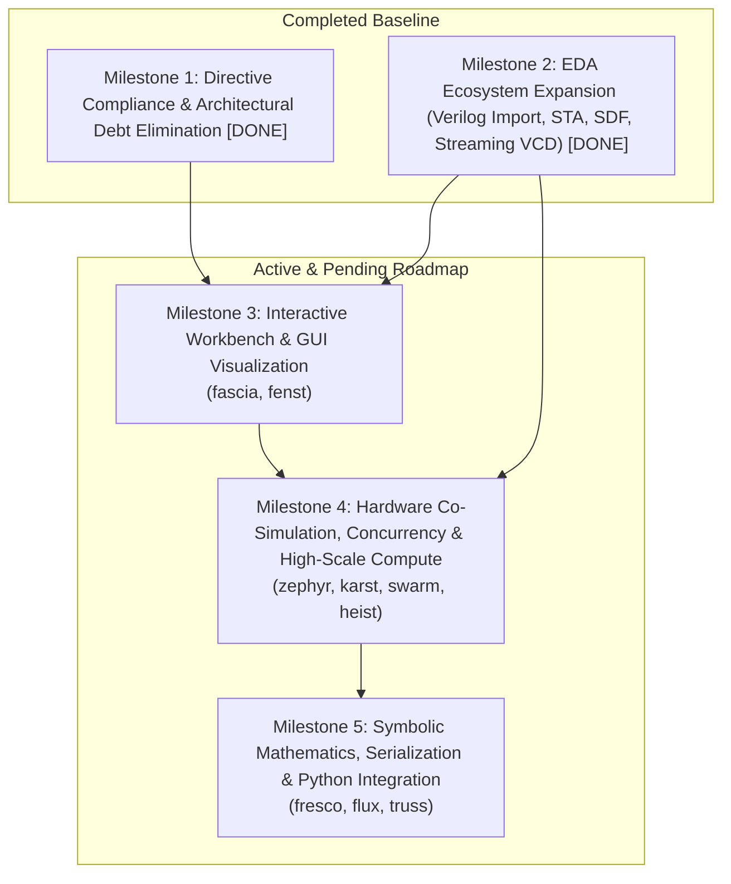

# Trellis Master Engineering Roadmap & Implementation Plan

Date: 2026-11-16  
Baseline Commit: `4abeea8` (Active working tree)  
Status: **Active Master Plan (Milestones 3–5 Active; Milestones 1–2 Completed)**  
Test Suite Baseline: **399+ lib tests passing, 0 clippy warnings**

---

## 1. Executive Summary & Architecture Context

Trellis is a high-performance, memory-safe, poly-paradigm workbench uniting digital hardware simulation (`rube`), hardware-to-memory fabric modeling (`karst`), VM co-simulation (`crew`, `zephyr`), analytic CAD/sketch editing (`fascia`, `fenst`, `fleck`), 2D/3D visualization (`fenst`, `swarm`), symbolic/algebraic expressions (`fresco`), and grammar-driven serialization (`flux`, `shard`).

Over past engineering cycles, core architectural foundations have been completed, hardened, and verified:
- **Core Storage & Concurrency**: Safe initialized buffer storage (`Buff`), drop-counted growable arenas (`Stash`), and atomic stack protocols (`Stk`) in `silo`.
- **Inter-VM Transport**: Lossless shared-memory ring buffers (`ShmRingBuffer`) in `zephyr`.
- **Fabric Simulation**: Zero-thread-per-cycle single-fabric simulation (`step_cycle`) and multi-fabric scaling (`AdvanceIndependent`) in `karst`.
- **Native Document Persistence**: High-capacity binary (`.flx`) and text (`.tflx`) format codecs supporting 50,000+ entities with stream-level CRC verification in `flux`.
- **2D/3D Analytic Sketch Harmonization**: Full CAD toolset, durable numeric locks, dimension hit testing/history, adaptive sagitta tessellation, signed revolve solids, watertight mesh generation, background Heist job execution, and WGPU viewport residency across Milestones 1–7.
- **Circuit Schematic Decoupling & Net Tracing (Legacy M1)**: Zero-allocation schematic layout, Cask flexbox decoupling, interactive pin/net hit testing and highlight in `fenst` and `fascia`.
- **Sound Algebraic Parsing & AST Persistence (Legacy M2)**: Sound stateless parsing via `IGrammar<Ctx>`, transaction boundaries, logarithmic variable interning, and round-trip heterogeneous AST serialization in `fresco` and `shard`.
- **Architecture Hardening & Tab Ownership (Legacy M3)**: Unified `TabDocument` enum with centralized resource disposal, leak-free parser sinks, zero-leak JSON importing, and private state encapsulation across `fascia`, `flux`, `crew`, and `karst`.
- **Structural Verilog Export (Legacy M4)**: IEEE 1364 structural netlist generation with modular hierarchy, identifier sanitization, and port mapping in `rube::verilog`.
- **Formal Verification Interchange & SDC Constraints (Legacy M5)**: Canonical AIGER ASCII (`.aag`) and binary (`.aig`) formal model lowering alongside standard Synopsys Design Constraints (SDC) declarative parsing via `SdcGrammar` in `rube::aiger` and `rube::sdc_shard`.

---

## 2. Completed Milestones & Architectural Baseline (Pruned Summary)

The following foundational milestones have been fully implemented, hardened, and verified against all Trellis directives and test suites:

| Milestone | Scope & Deliverables | Verification Status | Artifacts / Modules |
| :--- | :--- | :--- | :--- |
| **Milestone 1: Directive Compliance & Architectural Debt Elimination** | Eliminated prohibited `RefCell` and `HashMap` in `sketch_canvas.rs`; eliminated `Option<u32>` across domain models (`sketch_tool`, `waveform`, `sketch`, `placement`, `vcd_model`); confirmed zero `Arc` leaks on domain models; replaced native `for` loops with `USeg::Traverse` in `verilog.rs`, `sdc.rs`, `trigger.rs`; enforced `AlwaysNextLine` braces and PascalCase naming. | **100% COMPLETED** (0 warnings, clean clippy, all tests pass) | `src/fascia/sketch_canvas.rs`, `src/fascia/sketch_tool.rs`, `src/fascia/waveform.rs`, `src/fenst/waveform.rs`, `src/fenst/sketch.rs`, `src/heist/placement.rs`, `src/rube/verilog.rs`, `src/rube/sdc.rs`, `src/rube/trigger.rs` |
| **Milestone 2: EDA Artifact Ecosystem Expansion** | **WP 2.1**: IEEE 1364 Structural Verilog netlist ingestion (`VerilogGrammar`, `Layout` lowering); **WP 2.2**: Canonical AIGER ASCII/binary ingestion, miter creation, 64-bit word simulation, and SAT combinational equivalence checking (CEC); **WP 2.3**: Directed acyclic timing graph STA engine with forward arrival / backward required time propagation, slack, WNS, and TNS reporting; **WP 2.4**: IEEE 1497 Standard Delay Format (SDF) parser with min/typ/max corner back-annotation onto STA graph edges; **WP 2.5**: Bounded $O(1)$ streaming VCD writer (`VcdStreamingWriter<W>`) for real-time simulation output. | **100% COMPLETED** (All unit & integration tests passing) | `src/rube/verilog_shard.rs`, `src/rube/aiger.rs`, `src/rube/sta.rs`, `src/rube/sdf.rs`, `src/rube/vcd_stream.rs`, `src/rube/layout.rs`, `src/rube/_tests.rs` |

---

## 3. High-Level Dependency Graph (Active Roadmap)

---

## 4. Active Phased Implementation Roadmap

---

### Milestone 3: Interactive Workbench & GUI Visualization (Fascia & Fenst)

**Goal**: Deliver first-class interactive schematic probing, hierarchical navigation, digital waveform bus expansion, and advanced 2D sketch constraint solving in the desktop workbench.

- **Work Package 3.1: Interactive Circuit Schematic Probing & Live Signal Overlay [IMPLEMENTED]**
  - *Context*: `fascia::cask_view` supports pin/net hit testing and static highlights, but required live simulation signal state visualization.
  - *Status*: Implemented in `src/fascia/cask_view.rs`. Added `LogicLevel` (`Low`, `High`, `HighZ`, `Undefined`), `SchematicProbeState` with signal lookup, toggleable probe overlay, and canvas rendering of dynamic signal colors on wires (green = `1`, blue = `0`, red = `X`, gray = `Z`) and pin logic level badges.
  - *Target Files*: `src/fascia/cask_view.rs`, `src/fascia/_tests.rs`.

- **Work Package 3.2: Hierarchical Schematic Push/Pop Navigation [IMPLEMENTED]**
  - *Context*: Complex circuits in `rube` have hierarchical submodules, but `CaskViewer` displayed only single-level modules.
  - *Status*: Implemented in `src/fascia/cask_view.rs`. Added `BreadcrumbSegment`, `NavStackEntry`, `PushHierarchy`, `PopHierarchy`, and `NavigateToBreadcrumb` with per-level zoom/pan preservation and breadcrumb navigation toolbar.
  - *Target Files*: `src/fascia/cask_view.rs`, `src/fascia/_tests.rs`.

- **Work Package 3.3: Waveform Viewer Digital Bus Expansion & Measurement Cursors [PENDING]**
  - *Context*: `fascia::waveform` and `fenst::waveform` render single-bit signal traces. Multi-bit vector buses require grouping, hexagonal transition diamonds, and radix formatting (Hex, Decimal, ASCII, Binary), alongside dual-marker time measurement.
  - *Implementation*:
    1. Group multi-bit vector signals into collapsed bus waveforms with transition diamonds and radix formatting (Hex, Decimal, ASCII, Binary).
    2. Add dual-cursor time measurement: Marker A and Marker B with delta-time ($\Delta T$) and frequency ($1/\Delta T$) readout in the status toolbar.
  - *Target Files*: `src/fascia/waveform.rs`, `src/fenst/waveform.rs`, `src/fascia/_tests.rs`.

- **Work Package 3.4: 2D Geometric Constraint Solver Engine [PENDING]**
  - *Context*: The sketcher supports construction primitives, trimming, fillets, and dimensions, but lacks a geometric constraint solver.
  - *Implementation*:
    1. Introduce constraint types: `Coincident`, `Concentric`, `Tangent`, `Perpendicular`, `Parallel`, `Horizontal`, `Vertical`, `Symmetric`.
    2. Implement a 2D iterative / degrees-of-freedom (DoF) constraint relaxation solver to update primitive endpoints while satisfying constraints.
    3. Display constraint glyphs in the 2D sketch viewport with toggleable visibility.
  - *Target Files*: `src/fenst/sketch_constraint.rs`, `src/fenst/sketch.rs`, `src/fascia/sketch_view.rs`.

- **Work Package 3.5: Solid CAD Operations: Sweep, Loft, and CSG Booleans [PENDING]**
  - *Context*: `fenst::sketch_extrude` and `sketch_revolve` produce 3D watertight solids. Advanced mechanical modeling requires sweeps along paths and Boolean combinations.
  - *Implementation*:
    1. Add `SketchSweepEngine`: Sweep a 2D closed sketch profile along a 3D spline/polyline guide path.
    2. Add `SketchLoftEngine`: Skin a 3D solid between multiple parallel or offset sketch profiles.
    3. Implement Constructive Solid Geometry (CSG) boolean operations (Union, Difference, Intersection) on faceted solid meshes.
  - *Target Files*: `src/fenst/sketch_sweep.rs`, `src/fenst/sketch_loft.rs`, `src/fenst/sketch_csg.rs`, `src/fascia/sketch_view.rs`.

- **Milestone 3 Acceptance Gate**:
  - Live schematic probing correctly reflects simulation step transitions in real time.
  - Hierarchical push/pop navigation successfully traverses 4+ levels of module nesting.
  - Multi-bit bus waveforms decode hex/dec values accurately across clock transitions.
  - Geometric constraint solver converges within 50 iterations on standard 2D constraint benchmarks.
  - Solid sweep and loft engines produce manifold, watertight meshes verifiable by Euler characteristic.

---

### Milestone 4: Hardware Co-Simulation, Concurrency & High-Scale Compute (Zephyr, Karst, Swarm & Heist) [PENDING]

**Goal**: Deliver lockstep co-simulation between RISC-V VMs and digital logic, NUMA-aware multi-fabric scaling, native WGPU compute pipelines, and priority-aware work stealing.

- **Work Package 4.1: Cycle-Accurate Zephyr VM & Digital Hardware Co-Simulation**
  - *Context*: `zephyr` executes RISC-V bytecode and `rube` simulates gate-level hardware, but cross-domain stepping currently occurs asynchronously.
  - *Implementation*:
    1. Implement a lockstep co-simulation harness: synchronize `ZephyrRuntime::Step` with `SimEngine::StepCycle` across memory-mapped I/O (MMIO) and interrupt request (IRQ) lines.
    2. Map `crew::hub` packet exchange to simulated hardware bus transactions.
  - *Target Files*: `src/zephyr/cosim.rs`, `src/zephyr/runtime.rs`, `src/crew/hub.rs`, `src/rube/engine.rs`.

- **Work Package 4.2: Karst Multi-Fabric Scaling with NUMA / CPU Affinity**
  - *Context*: Karst supports independent advance across fabrics, but thread placement lacks NUMA awareness on multi-socket / multi-chiplet hosts.
  - *Implementation*:
    1. Pin worker threads to designated CPU core masks using `stalks::affinity`.
    2. Implement zero-copy inter-fabric DMA ring buffers bypassing host memory bus congestion.
  - *Target Files*: `src/karst/fabric.rs`, `src/karst/worker.rs`, `src/stalks/affinity.rs`.

- **Work Package 4.3: WGPU Compute Pipeline & Asynchronous Dispatch (`swarm::ops`)**
  - *Context*: `wiki/architecture.md` identifies that built-in GPU compute dispatch is pending; compute operations currently rely on CPU fallback or reference WGSL.
  - *Implementation*:
    1. Implement `WgpuComputeEngine`: Create compute pipelines from SPIR-V / WGSL shaders, bind storage buffers, and submit GPU dispatches.
    2. Support non-blocking asynchronous readback via staging buffers with Heist completion futures.
  - *Target Files*: `src/swarm/wgpu_engine.rs`, `src/swarm/ops.rs`, `src/symph/mod.rs`.

- **Work Package 4.4: Heist Work Scheduler Priority Stealing & Cooperative Preemption**
  - *Context*: `heist` work stealing uses uniform queues without priority tiers or cooperative time-slice preemption.
  - *Implementation*:
    1. Introduce multi-priority work queues (`High`, `Normal`, `Low`, `Background`).
    2. Add cancellation tokens and epoch-based preemption for long-running simulation jobs.
  - *Target Files*: `src/heist/scheduler.rs`, `src/heist/worker.rs`, `src/heist/token.rs`.

- **Milestone 4 Acceptance Gate**:
  - Zephyr RISC-V VM executes firmware driving Rube UART/GPIO peripheral with cycle-accurate timing.
  - Multi-fabric Karst scaling demonstrates near-linear speedup on 16+ core architectures.
  - GPU compute dispatch passes numerical parity with CPU reference for Collatz and VectorAdd shaders.
  - Heist priority scheduler preempts low-priority background jobs when interactive high-priority jobs arrive.

---

### Milestone 5: Symbolic Mathematics, Serialization & Python Integration (Fresco, Flux & Truss) [PENDING]

**Goal**: Deliver analytical symbolic differentiation and polynomial normalization in Fresco, optional stream compression in Flux, and deep Python SDK integration in Kaa.

- **Work Package 5.1: Fresco Symbolic Differentiation & Polynomial Normalization**
  - *Context*: `fresco` supports expression ASTs, evaluation, and simplification, but lacks analytical differentiation and canonical expansion.
  - *Implementation*:
    1. Implement `Derivative(expr: &ExprRepos, id: ExprId, var: VarId) -> ExprId`: Recursive symbolic differentiation rules (sum, product, quotient, chain rule, power rule, trigonometric/exponential functions).
    2. Implement canonical polynomial normalization: expand parentheses, collect like terms, and sort monomials lexicographically.
  - *Target Files*: `src/fresco/diff.rs`, `src/fresco/polyexpr.rs`, `src/fresco/_tests.rs`.

- **Work Package 5.2: Flux Stream Compression & Chunked Incremental I/O**
  - *Context*: Large 50,000+ entity `.flx` files consume significant disk space and RAM.
  - *Implementation*:
    1. Support optional payload compression block (`FlxCompressKind::Lz4` / `Zstd`) following the standard 64-byte uncompressed header.
    2. Implement chunked sequential streaming for multi-gigabyte models without loading entire files into memory.
  - *Target Files*: `src/flux/file.rs`, `src/flux/compress.rs`, `src/flux/_tests.rs`.

- **Work Package 5.3: Kaa / Python SDK Deep Integration with Trellis Domain Models**
  - *Context*: The Python console runs in-process, but scripts cannot directly manipulate `rube::Layout` or `SketchDocument`.
  - *Implementation*:
    1. Expose zero-copy PyO3 wrappers for `Layout`, `SimEngine`, and `SketchDocument`.
    2. Enable Python scripts in the console to programmatically construct digital circuits, step simulations, query signal waveforms, and extrude 3D CAD solids.
  - *Target Files*: `truss/kaa/src/circuit.rs`, `truss/kaa/src/sketch.rs`, `src/fascia/python_console.rs`.

- **Milestone 5 Acceptance Gate**:
  - Symbolic differentiation computes exact analytical derivatives for polynomials and rational functions.
  - Flux compressed files achieve >60% size reduction while passing full round-trip verification.
  - Python scripts running in Fascia console successfully build and simulate circuits programmatically.

---

## 5. Engineering Standards & Quality Gates

Every milestone must strictly comply with Trellis core engineering directives (`agents/AGENTS.md` and `agents/FORMATTING.md`):

1. **Function Size**: Functions strictly under 70 lines.
2. **Formatting**: Next-line opening braces `{`, 4-space indentation, no tabs.
3. **Data Encapsulation**: Private, underscore-prefixed fields (`_Field`) for all non-record structs.
4. **Data Structures**: Public core APIs use `Arr`, `MutArr`, `Buff`, `Stash`, and `USeg`. No public standard `Vec` or slices.
5. **No Prohibited Types**: Zero `std::rc::Rc`, zero `std::cell::Cell` / `std::cell::RefCell`, zero `Option<u32>` (use `u32::MAX`), and strict avoidance of `std::sync::Arc` on domain models.
6. **Traversal**: Project algorithms use `Traverse` and `USeg::Traverse` rather than raw integer ranges or native `for` loops.
7. **Error Handling**: No unhandled panics or silent error discarding. All errors return structured diagnostic types.
8. **Verification Suite**:
   - `cargo check --all-targets --offline` -> 0 errors.
   - `cargo clippy --all-targets --offline -- -D warnings` -> 0 warnings.
   - `cargo test --offline --lib` -> 100% passing.
   - `cargo run --offline -- -t` -> 100% passing.
9. **Git Safety (Directive 78)**: Never commit or push without explicit user directive.
