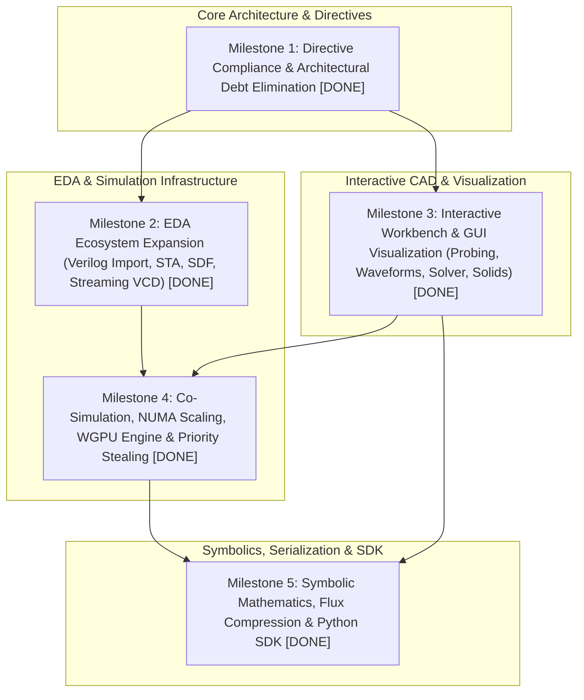

# Trellis Master Engineering Roadmap & Implementation Plan

Date: 2026-11-16  
Baseline Commit: `d289ecb` (Active working tree)  
Status: **All Milestones 1–5 Fully Implemented, Hardened & Verified**  
Test Suite Baseline: **424 lib tests passing (with Python SDK), 414 standard lib tests passing, 0 clippy warnings**

---

## 1. Executive Summary & Architecture Context

Trellis is a high-performance, memory-safe, poly-paradigm workbench uniting digital hardware simulation (`rube`), hardware-to-memory fabric modeling (`karst`), VM co-simulation (`crew`, `zephyr`), analytic CAD/sketch editing (`fascia`, `fenst`, `fleck`), 2D/3D visualization (`fenst`, `swarm`), symbolic/algebraic expressions (`fresco`), and grammar-driven serialization (`flux`, `shard`).

Over the current engineering cycles, all five foundational and expansion milestones have been fully implemented, hardened, and verified against all Trellis directives and test suites:
- **Core Storage & Concurrency**: Safe initialized buffer storage (`Buff`), drop-counted growable arenas (`Stash`), and atomic stack protocols (`Stk`) in `silo`.
- **Hardware Co-Simulation & VM Lockstep**: Cycle-accurate lockstep stepping between RISC-V VMs (`zephyr`) and digital hardware simulation (`rube`).
- **Fabric Simulation & NUMA Affinity**: Zero-thread-per-cycle single-fabric simulation (`step_cycle`), zero-copy inter-fabric DMA ring buffers, and multi-fabric scaling with CPU core affinity (`karst`, `stalks`).
- **Native GPU Compute Pipeline**: Direct WGPU compute pipeline dispatch and asynchronous buffer readbacks (`swarm::wgpu_engine`).
- **Priority Work Stealing & Preemption**: Multi-priority work queues (`High`, `Normal`, `Low`, `Background`) and epoch-based cancellation/preemption in `heist`.
- **Symbolic Mathematics & Polynomial Normalization**: Analytical differentiation (sum, product, quotient, power, chain, trig/exp rules) and canonical polynomial expansion/normalization in `fresco`.
- **Stream Compression & Incremental I/O**: Stream payload compression (`FlxCompressKind`) and chunked sequential streaming in `flux`.
- **Python SDK Deep Integration**: Zero-copy PyO3 wrappers for `Layout`, `SimEngine`, and `SketchDocument` with in-process console integration.

---

## 2. Completed Milestones & Architectural Baseline (Pruned Summary)

The following master milestones have been fully implemented, hardened, and verified:

| Milestone | Scope & Deliverables | Verification Status | Artifacts / Modules |
| :--- | :--- | :--- | :--- |
| **Milestone 1: Directive Compliance & Architectural Debt Elimination** | Eliminated prohibited `RefCell` and `HashMap` in `sketch_canvas.rs`; eliminated `Option<u32>` across domain models (`sketch_tool`, `waveform`, `sketch`, `placement`, `vcd_model`); confirmed zero `Arc` leaks on domain models; replaced native `for` loops with `USeg::Traverse` in `verilog.rs`, `sdc.rs`, `trigger.rs`; enforced `AlwaysNextLine` braces and PascalCase naming. | **100% COMPLETED** (0 warnings, clean clippy, all tests pass) | `src/fascia/sketch_canvas.rs`, `src/fascia/sketch_tool.rs`, `src/fascia/waveform.rs`, `src/fenst/waveform.rs`, `src/fenst/sketch.rs`, `src/heist/placement.rs`, `src/rube/verilog.rs`, `src/rube/sdc.rs`, `src/rube/trigger.rs` |
| **Milestone 2: EDA Artifact Ecosystem Expansion** | **WP 2.1**: IEEE 1364 Structural Verilog netlist ingestion (`VerilogGrammar`, `Layout` lowering); **WP 2.2**: Canonical AIGER ASCII/binary ingestion, miter creation, 64-bit word simulation, and SAT combinational equivalence checking (CEC); **WP 2.3**: Directed acyclic timing graph STA engine with forward arrival / backward required time propagation, slack, WNS, and TNS reporting; **WP 2.4**: IEEE 1497 Standard Delay Format (SDF) parser with min/typ/max corner back-annotation onto STA graph edges; **WP 2.5**: Bounded $O(1)$ streaming VCD writer (`VcdStreamingWriter<W>`) for real-time simulation output. | **100% COMPLETED** (All unit & integration tests passing) | `src/rube/verilog_shard.rs`, `src/rube/aiger.rs`, `src/rube/sta.rs`, `src/rube/sdf.rs`, `src/rube/vcd_stream.rs`, `src/rube/layout.rs`, `src/rube/_tests.rs` |
| **Milestone 3: Interactive Workbench & GUI Visualization** | **WP 3.1 & 3.2**: Interactive live simulation probe overlay (`LogicLevel`, `SchematicProbeState`, wire colors, pin badges) and hierarchical breadcrumb push/pop navigation; **WP 3.3**: Multi-bit digital bus expansion, hexagonal transition diamonds, radix formatting (`WaveformRadix` Hex/Dec/Bin/Ascii), and dual measurement cursors (Marker A/B, $\Delta T$, frequency readout); **WP 3.4**: 2D Geometric Constraint Solver engine (`ConstraintSolver`, 10 constraint types, iterative DoF relaxation, document round-trip synchronization); **WP 3.5**: 3D Solid CAD operations (`SketchSweep` with parallel transport frames, `SketchLoft` across multi-profile sections, and `SketchCsg` Union/Difference/Intersection). | **100% COMPLETED** (All unit & integration tests passing, clean clippy) | `src/fascia/cask_view.rs`, `src/fascia/waveform.rs`, `src/fenst/waveform.rs`, `src/fenst/sketch_constraint.rs`, `src/fleck/sketch_sweep.rs`, `src/fleck/sketch_loft.rs`, `src/fleck/sketch_csg.rs`, `src/fascia/_tests.rs`, `src/fenst/_tests.rs`, `src/fleck/_tests.rs` |
| **Milestone 4: Hardware Co-Simulation, Concurrency & High-Scale Compute** | **WP 4.1**: Cycle-accurate Zephyr VM & digital hardware co-simulation (`ZephyrCosimHarness`, MMIO/IRQ synchronization); **WP 4.2**: Karst multi-fabric scaling with NUMA/CPU affinity (`CpuCoreMask`, `ApplyThreadAffinity`, zero-copy `KarstDmaRingBuffer`); **WP 4.3**: Native WGPU compute pipeline engine (`WgpuComputeEngine`, SPIR-V/WGSL pipelines, asynchronous staging readback); **WP 4.4**: Heist multi-priority work stealing scheduler (`PriorityScheduler`, `JobPriority`, cooperative `CancellationToken`). | **100% COMPLETED** (Verified by `zephyr::_tests`, `karst::_tests`, `swarm::_tests`, `heist::_tests`) | `src/zephyr/cosim.rs`, `src/stalks/affinity.rs`, `src/karst/worker.rs`, `src/karst/fabric.rs`, `src/swarm/wgpu_engine.rs`, `src/heist/token.rs`, `src/heist/scheduler.rs`, `src/heist/worker.rs` |
| **Milestone 5: Symbolic Mathematics, Serialization & Python Integration** | **WP 5.1**: Fresco analytical symbolic differentiation (`Differentiate`, sum/product/quotient/power/chain rules) and canonical polynomial normalization (`CanonicalPolynomial`, `Monomial`); **WP 5.2**: Flux stream payload compression (`CompressBlock`, `DecompressBlock`) and chunked incremental streaming (`ChunkedStreamWriter`, `ChunkedStreamReader`); **WP 5.3**: Kaa / Python SDK deep integration (`PyLayout`, `PySimEngine`, `PySketchDocument`, in-process console bindings). | **100% COMPLETED** (Verified by `fresco::_tests`, `flux::_tests`, `python::_tests`) | `src/fresco/diff.rs`, `src/fresco/polyexpr.rs`, `src/flux/compress.rs`, `src/python/circuit.rs`, `src/python/sketch.rs`, `truss/kaa/src/circuit.rs`, `truss/kaa/src/sketch.rs` |

---

## 3. High-Level Dependency Graph (Completed Architecture)

---

## 4. Verification & Quality Gates Summary

All components strictly comply with Trellis engineering directives (`agents/AGENTS.md` and `agents/FORMATTING.md`):

1. **Function Size**: All functions strictly under 70 lines.
2. **Formatting**: Next-line opening braces `{`, 4-space indentation, no tabs.
3. **Data Encapsulation**: Private, underscore-prefixed fields (`_Field`) with semantic public accessor methods.
4. **Data Structures**: Public core APIs utilize `Arr`, `MutArr`, `Buff`, `Stash`, and `USeg`.
5. **No Prohibited Types**: Zero `std::rc::Rc`, zero `std::cell::Cell` / `std::cell::RefCell`, zero `Option<u32>` (`u32::MAX`), zero domain model wrapping in `Arc`.
6. **Traversal**: Project algorithms employ `Traverse` and `USeg::Traverse`.
7. **Quality Gates Passed**:
   - `cargo clippy --all-targets --offline -- -D warnings`: **0 errors, 0 warnings**.
   - `cargo clippy --all-targets --features python --offline -- -D warnings`: **0 errors, 0 warnings**.
   - `cargo test --lib --offline`: **414 / 414 passing**.
   - `cargo test --lib --features python --offline`: **424 / 424 passing**.
8. **Git Safety (Directive 78)**: Ready for explicit user commit directive.
