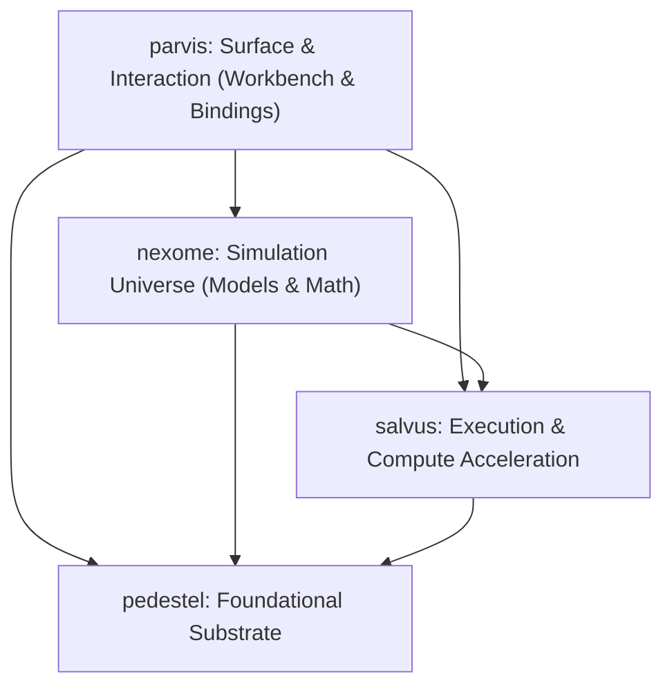

# Code organization for the Trellis simulation platform

Draft for review · 2026-11-20 · Source baseline `14c1823`

Group the existing subsystems under four directories in `src/`: `pedestel`, `salvus`, `nexome`, and `parvis`. Preserve public Rust paths through the root facade during the move. The first architectural milestone is a CPU-only executable that can load a circuit, simulate it, and write a trace on a machine with neither a desktop stack nor shader tools. That workload gives the folder boundaries a concrete test before PDE and neural-network models arrive.

## Proposed source map

The library currently declares 18 ordinary subsystem modules and the feature-gated Python module as peers at `src/` root. Fascia alone contains 29 Rust files, Rube 27, and Fenst 21. The proposed reorganization groups these into four cohesive layers reflecting the simulation platform lifecycle. [Library entry point](../../src/lib.rs) · [Current architecture guide](../architecture.md)

| Tier under `src/` | Subsystems | Scope and responsibilities |
| --- | --- | --- |
| `pedestel/` | `silo`, `stalks`, `flux`, `shard`, `cove` | **Foundations.** Memory management, arena/buffer storage, coroutines and task suspension, byte streams, serialization, lexer and grammar parsing, and the unified verification harness. Low-level primitives shared across all domains. |
| `salvus/` | `heist`, `flock`, `swarm`, `symph`, `drove` | **Execution.** Host work-stealing job scheduling, CPU/SIMD compute kernels, device compute abstraction, shared shader algorithms/math, and GPU program artifacts (SPIR-V). Headless CPU execution is the first build target. |
| `nexome/` | `fresco`, `rube`, `karst`, `crew`, `zephyr`, `fleck` *(future: `pde`, `nn`)* | **Models and mathematics.** Owns mathematical physics, symbolic and tensor algebra (`fresco`), geometry and spatial boundaries (`fleck`), digital logic simulation (`rube`), hardware interconnect fabric (`karst`), guest VM execution (`zephyr`), and interconnect/MMIO routing (`crew`). Models own their time and domain semantics. |
| `parvis/` | `fenst`, `fascia`, `python` | **Interfaces.** Owns human interaction (workbench desktop UI, explorer providers, canvas viewers, inspectors) and programmatic interaction (CPython runtime bindings, PyO3/Kaa interop, and notebook scripting). |

Keep `src/lib.rs` as the public facade and `src/main.rs` as the executable entry point. Use group modules with root re-exports such as `pub use nexome::fresco;` so existing external paths (`trellis::fresco::ExprRepos`) remain stable. Keep the tier modules private initially so their layout can evolve independently of the public API. Examples, build tooling, guest firmware, and Python packaging continue to maintain their distinct entry points outside this map. [Workspace manifest](../../Cargo.toml) · [Python packaging](../../pyproject.toml)

Arrows show the permitted direction of production dependencies after extraction. Several current imports cross these boundaries.

## Review of the current changes

At `14c1823`, the native Fresco viewer spans Fresco examples, Fenst documents and layout, and Fascia tabs and rendering. The four-tier proposal describes the intended dependency direction. The following dependencies in the current code determine which parts can move independently.

| Priority | Finding | Consequence for the plan |
| --- | --- | --- |
| First | The root package always depends on Iced, wgpu and the shader builder. Its build script invokes Rust-GPU for every build. Even the GPU compute engine uses `iced::futures::executor::block_on`. | Create an explicit CPU build and an independently selectable GPU compute build. Moving the viewport only removes one dependency. [Manifest](../../Cargo.toml) · [Build script](../../tools/build.rs) · [GPU compute](../../src/swarm/wgpu_engine.rs) |
| First | The new document validator, layout builder and inspector all call crate-private `ExprEntryAt` and inspect concrete expression types. A root re-export preserves import syntax but cannot grant access across crates. | Introduce a checked read-only expression view inside Fresco before extracting it. Keep the existing font-metrics boundary, which already lets Fenst lay out math without Iced. [Repository](../../src/fresco/exprrepos.rs) · [Validation](../../src/fenst/fresco_document.rs) · [Layout](../../src/fenst/math_layout.rs) · [Inspector](../../src/fascia/math_inspector.rs) |
| High | Rube exposes Fenst through inherent `Layout` methods, scene builders, and waveform trait implementations and registration. Fleck imports Fenst sketch types and registers a geometry provider against Fenst's registry. | Move each adapter with its registration and its consumer test. A module rename can compile while the application silently loses a provider. [Circuit methods](../../src/rube/layout.rs) · [VCD registration](../../src/rube/vcd_model.rs) · [Geometry registration](../../src/fleck/geometry.rs) |
| High | The viewer added another tab-state collection to `AppState`. Its public `TabDocument` enum omits Fresco and the actual open/close paths maintain several collections. Fascia's `app.rs` is 1,790 lines, and the Fascia and Fenst test files each exceed 3,000. | Consolidate document ownership first. Moving the math files into a directory improves navigation but still makes every new viewer edit shared lifecycle code. [Application state](../../src/fascia/app.rs) · [Tab manager](../../src/fascia/tabs.rs) |

Fresco currently supplies symbolic differentiation and tensor expressions whose elements are repository IDs. Compiled AD and the least-squares solver are proposed work. Likewise, Swarm has CPU kernels and a direct wgpu path, while Drove's embedded compute SPIR-V is available for `Double` only. These distinctions determine what PDE and NN can reuse today. [Tensor representation](../../src/fresco/tensor.rs) · [Solver and AD roadmap](fresco-least-squares-implementation-plan.md) · [Drove artifacts](../../src/drove/compute.rs)

## Subsystem boundaries inside the tiers

The subdirectories below group code that changes together. Existing small subsystems can move whole. Create each deeper directory when its contents move.

| Proposed home | Move together | Boundary to preserve |
| --- | --- | --- |
| `pedestel/{silo,stalks,flux,shard,cove}` | Storage and traversal, synchronization, streams, generic grammars, and test registration respectively. | Domain codecs and explorer examples belong to their consumers. Keep storage macros usable by an external crate. |
| `salvus/{heist,flock,symph,swarm,drove}` | Heist schedules host jobs. Flock implements CPU kernels. Symph supplies shared operation definitions. Split Swarm internally into dispatch contracts, CPU implementation, and GPU implementation. Keep Drove's host artifact access distinct from its shader target. | Karst's VPU uses a concrete CPU device today. Keep that path working. Choose a backend at the boundary that creates a device. Kernels own their buffers and synchronization follows the selected backend's contract. [Backend trait](../../src/swarm/backend.rs) · [Karst VPU](../../src/karst/vpu.rs) |
| `nexome/fresco/{expr,parse,calculus}` | Arena, symbols and tensor shapes in `expr`; Shard grammar and semantic staging in `parse`; evaluation and symbolic derivatives alongside their expression contracts. | Keep a single repository and ID space. The parser owns input savepoints. Repository edits and import must publish valid model state. Add solver and compiled-program modules when their roadmap gates pass. [Parser](../../src/fresco/exprshard.rs) · [Correctness plan](fresco-review-and-next-steps.md) |
| `nexome/rube/{netlist,simulation,formats,analysis}` | Put layout, ports and connectivity together; triggers, fast warps and coroutine kernels together; Verilog, VCD and SDF at format entry points; and timing and equivalence code in analysis. Split AIGER parsing from equivalence checking when moving that file. | A parsed netlist can run, export a trace, or undergo static analysis with no dependency on viewer types. Keep four-state signal semantics and settle limits in Rube. [Engine](../../src/rube/engine.rs) · [AIGER and equivalence](../../src/rube/aiger.rs) |
| `nexome/{karst,crew,zephyr}` | Karst owns fabric topology and per-cycle behavior, Crew owns MMIO protocol and transport, Zephyr owns guest execution. Group Crew's Rube-specific VM adapters separately from its packet protocol. | Keep lockstep ordering explicit in the existing harness. It advances hardware, samples IRQ, steps the guest, then updates status. Promote coordination into `nexome/cosim` when a second pairing establishes shared behavior. [Crew VM adapter](../../src/crew/vm_adaptor.rs) · [Lockstep](../../src/zephyr/cosim.rs) |
| `nexome/fleck/{sketch,geometry,formats}` | Move analytic sketch primitives, dimensions, constraints, and the asset records used by Fleck and Python to their headless owner. Put OBJ, PTS and sketch codecs at the edge. | Move mutually referencing sketch types together. Re-export the old Fenst types as aliases to their single definition. Retain explorer, selection and display layouts in Parvis. [Sketch](../../src/fenst/sketch.rs) · [Geometry records and registry](../../src/fenst/geometry.rs) · [Python sketch consumer](../../src/python/sketch.rs) |
| `parvis/{fenst,fascia,render,python}` | Fenst owns presentation models and adapters. Fascia owns shell, tabs and feature views. Render owns the viewport, label/transparency passes and associated WGSL. Python owns bindings and embedded interpreter integration. | Move rendering shaders with their relative includes. Preserve headless geometry loading for scripts and keep the installed Python extension and embedded console as separate entry points. [Viewport](../../src/swarm/viewport.rs) · [Python module](../../src/python/mod.rs) |

## Abstractions to introduce at actual points of use

**Expression inspection.** Add a checked lookup taking a repository-local ID and returning a borrowed description of the node. Expose its kind, scalar or symbol data, operation and ordered children, including numerator/denominator and positive/negative partitions. Distinguish invalid IDs, empty slots and unrecognized extension nodes. Keep allocations and mutation out of inspection. Use it first in document validation, then layout and the inspector. Each consumer retains its depth and work budgets. Check identical validation errors, expression grouping, selected occurrence and variable assumptions before retiring those consumers' downcasts. [Fresco entries](../../src/fresco/exprrepos.rs) · [Viewer plan](fresco-expression-viewer-implementation-plan.md)

**Tab ownership.** Give each stateful tab one payload keyed by its stable `TabId`. Extend the existing document enum internally or stage a private replacement if adding a variant would break downstream exhaustive matches. Keep tab ordering and active selection in `TabManager`. Migrate Fresco first, then sketch, geometry, console and the smaller viewers. Delegate feature messages to their owning module. The shell owns close prompts and calls one teardown path for both close and close-all. Test a cancelled close, two independent math tabs, and a late job result after a tab closes. Public mutable state maps need an accessor migration before removal. [Tab lifecycle](../../src/fascia/app.rs)

**Workbench adapters.** Put circuit/scene and waveform adapters in Fenst where the explorer traits live. Keep the raw VCD model and streaming writer in Rube. While both are in the same crate, feature-gated inherent forwarding methods can preserve `Layout::AsCircuit` and `IntoCircuit`. Before moving Rube into another crate, migrate callers to an adapter constructor or an explicitly imported extension trait. Rust requires an inherent implementation to live in the type's defining crate. Keep the old default-build API until a documented compatibility decision permits removal. Apply the same rule to public re-exports such as `swarm::viewport`. [Circuit adapter](../../src/rube/circuit_xplr.rs) · [Waveform provider API](../../src/fenst/waveform.rs)

**Compute and numerical data.** Use Swarm's existing `IComputeBackend` associated buffer and kernel types for portable dispatch. Put backend-specific source selection and unsupported-operation errors at the backend edge. Keep upload/readback visible to the caller. Use one CPU reference and compare output on an available GPU before generalizing a kernel. A Fresco tensor stores symbolic expression IDs. A PDE field also needs units, mesh association and time level; NN activations need an element type, layout and storage lifetime. Share a numeric kernel or shape rule once two actual callers agree on inputs, layout, precision and errors. [Swarm operations](../../src/swarm/ops.rs) · [wgpu dispatch and readback](../../src/swarm/wgpu_engine.rs)

**Simulation and observation.** Rube owns settling, Karst owns fabric cycles, and a future PDE solver owns timestep acceptance. Heist provides scheduling and cancellation. For a shared run panel, first adapt the existing Karst cycle trace and Rube waveform to display model-specific progress and output. Keep the trace format, clock unit and sample order with the producer. If a headless recorder becomes a second consumer, extract a small observation contract below Parvis. For coupled runs, define exchange points, conversion of time units and behavior on partial failure in the pairing. This matters even today because a hardware cycle can complete before a guest step reports an error. [Karst trace](../../src/karst/fabric.rs) · [Guest step](../../src/zephyr/cosim.rs) · [Cancellation](../../src/heist/token.rs)

## First workloads for testing reuse

| Model | First end-to-end example | What it decides |
| --- | --- | --- |
| Reactive HDL | Load a structural Verilog design, apply a stimulus, settle it and write VCD from a CPU-only caller. Compare transition order and four-state values with the pre-move fixture. Open the same VCD in the desktop viewer. | The headless model, file format and viewer adapter each have a usable entry point. A second event-driven model can then establish which scheduling rules to share. |
| PDE | Solve heat diffusion on a small structured grid with specified boundary values. Start with a CPU stencil, compare a known solution under refinement, and check that a rejected trial step preserves the last accepted field if adaptive stepping is introduced. | This case establishes field layout and numerical error behavior. Add Fleck for meshed geometry or Fresco for symbolic residuals when a formulation calls for them. |
| Neural networks | Implement a small affine layer and activation with fixed weights and inputs. Check CPU output against hand-computed values, then compare a supported accelerator path at declared precision. | This case establishes operator shapes, tensor storage and capability reporting. Qualify gradient execution separately when training or Fresco AD is introduced. |

Keep dense QR with the planned Fresco least-squares implementation initially. If PDE and a second numerical consumer need the same independently testable linear algebra, promote that operation into a sibling `nexome/numerics` module. This keeps numerical buffers usable without constructing a symbolic graph. [Least-squares roadmap](fresco-least-squares-implementation-plan.md)

## Build boundaries and migration order

Keep the root `trellis` package as the compatibility facade. Use features first to cut build dependencies, then extract packages along those tested cuts. Four folders need not imply four workspace packages. The first package candidate is an optional host-side Drove artifact package that owns the Rust-GPU build dependency and builds the separate shader target. The next candidates are a headless model library and a desktop workbench that depends on it. The facade can depend on both in the desktop profile. Neither package can depend back on the facade. Python should depend on the headless model API, with the desktop console as a consumer. Split individual model crates only for an independent consumer or a measured build benefit.

Enforce the boundaries at two levels. Inside the current crate, review imports from core modules, exported macro expansions, and enabled example registrations against the tier diagram. During migration, record the known upward references from the review and remove them one by one. After extraction, use Cargo manifests to enforce direction and build each consumer in isolation in CI. Workspace builds can enable features through other members and conceal a missing dependency or an accidental desktop dependency.

| Review unit | Change | Exit check |
| --- | --- | --- |
| 1. Baseline and pilot | Capture default and CPU dependency trees, Cove registrations, one HDL trace, and external Rust call sites. Move only Fresco under `nexome` and add its root re-export in the same change. | Default clients still compile through `trellis::fresco`. Fresco, Fenst and Fascia tests pass. Check Natvis against defining paths. |
| 2. Mechanical moves | Move the remaining modules in tier-sized batches. Carry component tests, Flux fixtures' relative include paths, WGSL assets and source links. For Drove update workspace members, default members, the watched path and the compiler input in `tools/build.rs` together. | Clean workspace build, all-target checks and the same expected suite registrations. Keep firmware's excluded cross-target package independently buildable. |
| 3. Remove upward imports | Land expression inspection, then circuit/VCD and geometry adapters, then viewport relocation as separate changes. Move workbench-only examples to their adapter tests, including the Fresco explorer example. Separate Cove's ordinary test registration from its Fenst-aware macro arm in the compatibility facade. | Headless source and its enabled tests compile without Fenst or Fascia. Desktop still discovers the named Cove example and OBJ/PTS/VCD providers. Use the normal explorer and file-open entry points. [Cove macro](../../src/cove/jeeves.rs) · [Example registration](../../src/fresco/_tests.rs) |
| 4. Cut build dependencies | Add optional desktop, GPU compute and SPIR-V artifact features. Preserve current default desktop behavior and the existing Python flags. Gate library exports, CLI UI branch, adapter tests and Drove's embedded artifact consistently. Keep Python DLL setup independent of shader creation. Remove the Iced executor import from GPU compute. | Run the profile matrix below. Karst can execute a CPU kernel with GPU and desktop disabled. GPU compute can run WGSL on a headless host with an adapter. |
| 5. Refactor feature internals | Consolidate tab ownership. Group Rube simulation/format/analysis and Fenst math lowering/measurement/placement in separate reviews. Keep a single immutable layout result for painting and hit testing. Put tests in the owning component's `_tests.rs` as smaller components emerge. | Identical HDL traces, sketch round trips, math selection and viewer close/cancel behavior. Use unchanged workloads from the baseline for comparison. |
| 6. Extract packages and try new models | Extract the optional shader build owner as part of unit 4 if needed. After dependency cuts pass, compile a standalone headless consumer before extracting further crates. Re-export canonical types from the facade and verify exported macros from a downstream crate. Introduce PDE and NN through the reference examples above. | The package dependency graph is acyclic. Record clean-build time and resolved dependencies for CPU and desktop. Retain further splits only when they enable a consumer or produce a measured improvement. |

Keep every move independently buildable. Preserve the facade or forwarding implementation until its replacement passes the same caller tests. If one cut needs a public API break, defer that cut and proceed with independent modules. [Workspace and features](../../Cargo.toml) · [Shader build](../../tools/build.rs) · [Flux fixtures](../../src/flux/_tests.rs) · [Natvis](../../tools/trellis.natvis)

## Acceptance by build profile

The profile names below are proposed. Today `cargo tree -p trellis --no-default-features --depth 1` still lists Iced, wgpu and the build dependency `spirv-builder`. Target the root **package** when checking headless isolation, because a workspace-wide build also selects the shader member.

| Build | Evidence required after migration |
| --- | --- |
| CPU headless | Run `cargo check -p trellis --no-default-features --all-targets` and the HDL reference example. Inspect the normal **and build** dependency tree for absence of Iced, wgpu and `spirv-builder`. Run CPU suites explicitly with their test-registration feature enabled as well. |
| GPU compute | Enable GPU compute alone. Dispatch a known WGSL operation and compare CPU output. Inspect the tree for absence of Iced and the Rust-GPU builder. In a separate SPIR-V-enabled run, verify the embedded Drove artifact and its entry point. |
| Default desktop | Run workspace tests, strict all-target Clippy and `cargo run -- -t`. Exercise schematic, waveform, geometry and math viewer entry points. Check source compatibility, registrations, fixtures and debugger names across moves. |
| Python | Run Python-feature Rust tests, the embedded interpreter probe, and the installed-package smoke tests against a freshly built wheel. Both packaging manifests target the root manifest and the root library currently declares only `rlib`. Establish an actual wheel/import baseline before promising compatibility. [Python packaging](../../pyproject.toml) · [Package-local manifest](../../truss/kaa/pyproject.toml) · [Smoke tests](../../truss/kaa/tests/test_smoke.py) |
