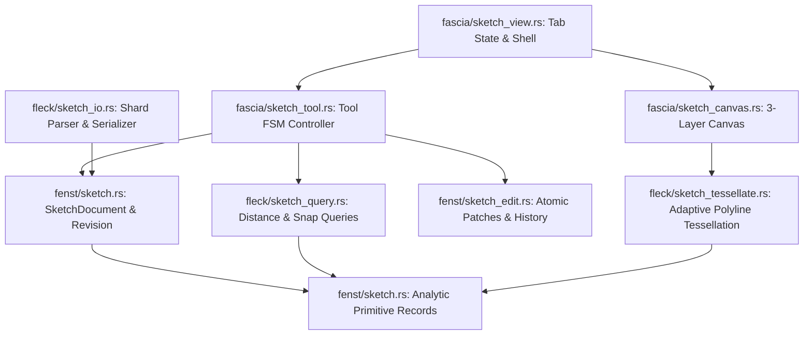
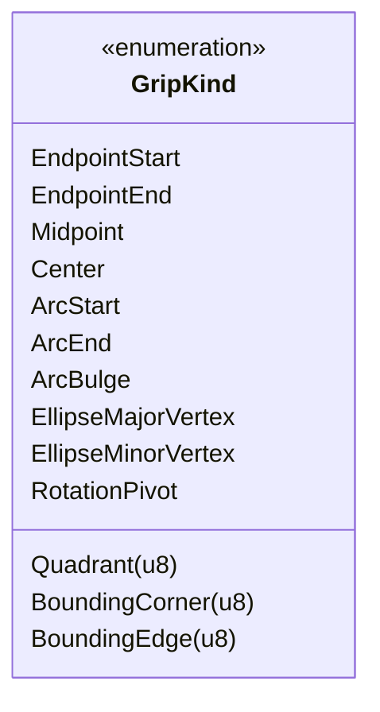
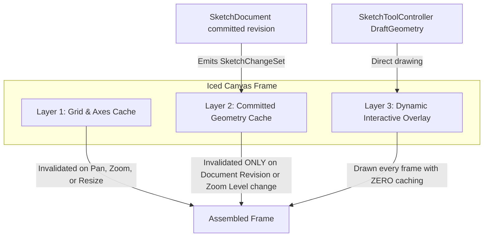
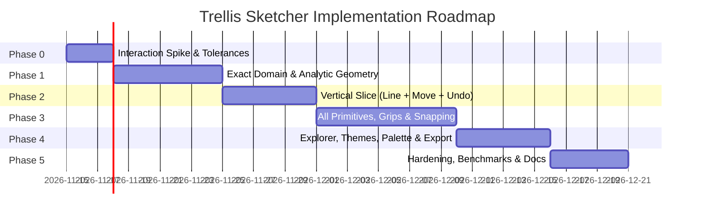

# Sketch construction across Fascia, Fenst, and Fleck

Date: 2026-11-14. Source baseline: `81bda84`.
Status: Proposed implementation plan with engineering enhancements; ready for phase 0 spike.

Build a dedicated 2D sketch editor inside the existing native Trellis workbench. Users should be able to construct precise planar geometry through clicks, dragging, or numeric entry; see immediate fluid previews; select and reshape objects directly through grip handles; and recover every committed edit through undo/redo.

---

## 1. Scope and defaults

The first release supports planar sketches with finite line segments, connected polylines, sets of independent lines, circles, circular arcs, and rotated ellipses.

### Primitives and editing semantics
- **Line segments**: Two distinct endpoints.
- **Polyline**: Connected sequence of vertices, open or closed. Vertices are stored in a document-wide contiguous vertex arena to eliminate per-entity heap allocations.
- **Set of lines**: Supported both as a repeated-line placement workflow (successive clicks emit independent `LineSegment` entities) and as multi-object selections grouped via `SketchGroup`.
- **Circles**: Center point and positive radius.
- **Circular arcs**: Center, radius, start angle, and signed sweep angle ($0 < |\theta_{\text{sweep}}| < 2\pi$). Signed sweep eliminates angle wraparound discontinuities across the $0 / 2\pi$ branch cut.
- **Rotated ellipses**: Center, positive semimajor axis $a$, positive semiminor axis $b$, and rotation angle $\phi \in [0, \pi)$. Equal semiaxes ($a = b$) are valid.

### Coordinate frame and workplane
- 2D orthographic XY editor operating in local plane coordinates $(u, v) \in \mathbb{R}^2$ with `f64` precision.
- Documents define an explicit 3D `SketchPlane` (origin $O$, orthonormal axes $\vec{u}, \vec{v}$, normal $\vec{n}$) in world space, enabling future projection into the 3D viewport (`CaskScene` / WGPU) via $P_{3d} = O + u \cdot \vec{u} + v \cdot \vec{v}$ without modifying 2D sketch records.
- Default new documents to millimetres (`mm`). Store angles internally as radians, displayed in the interface as degrees.

### Initial toolset
- **Creation**: Select, Line, Polyline, Circle, Arc, Ellipse.
- **Modification**: Move, Rotate, uniform Scale, Group/Ungroup, Delete, numeric property editing.
- **Construction guides**: First-class non-exporting entities (infinite guidelines, reference circles, reference points).
- **Rectangle preset**: Closed 4-vertex polyline preset available as a shortcut.
- Later extensions: Trim/extend, offsets, fillets, elliptical arcs, persistent geometric constraints, and 3D workplanes.

---

## 2. Existing implementation and integration points

| Subsystem / File | Current behavior | Planned integration & new files |
|---|---|---|
| [fenst/geometry.rs](../../src/fenst/geometry.rs) | Owns `GeometryAsset`, vertex records, normalization, and geometry-provider contracts. | Preserve the imported 3D render-asset path. Add editable sketch contracts in new files `fenst/sketch.rs`, `fenst/sketch_edit.rs`, and `fenst/sketch_xplr.rs`. |
| [fleck/geometry.rs](../../src/fleck/geometry.rs), [fleck/point.rs](../../src/fleck/point.rs) | Re-exports Fenst geometry types and implements OBJ/PTS conversion and point math (`Pt3f`, `Vex3f`). | Implement sketch algorithms in new files `fleck/sketch_geometry.rs` (analytic primitives), `fleck/sketch_query.rs` (distance/snaps), `fleck/sketch_tessellate.rs` (adaptive curves), and `fleck/sketch_io.rs` (native `.tsketch` & SVG). |
| [fenst/xplr.rs](../../src/fenst/xplr.rs), [provider.rs](../../src/fenst/provider.rs) | Read-oriented filesystem/virtual trees and circuit inspection. | Expose sketch layers, groups, and entities via a read-only `SketchXplr` projection without wrapping documents in `Arc` or exposing mutable references to registries. |
| [fascia/app.rs](../../src/fascia/app.rs), [tabs.rs](../../src/fascia/tabs.rs) | Tab management (`TabKind`, `TabManager`), command routing, menu bar, status bar. | Add `TabKind::SketchViewer`, `.tsketch` extension detection (`icon: "✏️"`), dirty tab indicator `●`, focused undo/redo routing, and guarded close workflows. |
| [fascia/cask_view.rs](../../src/fascia/cask_view.rs) | Iced canvas drawing, pan/zoom, hit-testing, selection. | Re-use theme tokens and interaction lessons. Implement dedicated 3-layer canvas program in `fascia/sketch_view.rs`, `fascia/sketch_canvas.rs`, `fascia/sketch_tool.rs`, and `fascia/sketch_inspector.rs`. |
| [fascia/theme.rs](../../src/fascia/theme.rs), [toolbar.rs](../../src/fascia/toolbar.rs) | Workbench palette tokens and contextual toolbars. | Provide sketch toolstrip buttons, active tool glyphs, snap badge styling, and numeric input popups. |

---

## 3. Responsibilities, memory model, and API contracts

### Dependency direction


**Boundary invariants**:
- `fenst` has zero dependencies on `fleck`, `fascia`, `iced`, or `wgpu`.
- `fleck` depends only on `fenst` (for primitive records) and `silo` / `shard` / `flux`.
- `fascia` coordinates UI interaction, delegates geometric math to `fleck`, and applies validated mutations through `fenst::sketch_edit`.

### Record vs. Non-Record struct visibility (Strict Trellis Invariant)

To strictly enforce the directive in [`agents/AGENTS.md`](../../agents/AGENTS.md):
- **Records (Passive DTOs / POD value carriers)** have public data members and no operational lifecycle methods.
- **Non-Records (Engines, Documents, Controllers, Indexes)** have strictly private data members prefixed with `_Field`, exposing accessors and mutator methods.

| Classification | Struct / Type | Data member visibility | Purpose |
|---|---|---|---|
| **Record** | `SketchPoint` | `pub _X: f64`, `pub _Y: f64` | Planar model coordinates (finite `f64`). |
| **Record** | `SketchBounds` | `pub _Min: SketchPoint`, `pub _Max: SketchPoint` | Axis-aligned bounding box. |
| **Record** | `SketchPlane` | `pub _Origin: [f64; 3]`, `pub _U: [f64; 3]`, `pub _V: [f64; 3]`, `pub _Normal: [f64; 3]` | 3D reference basis. |
| **Record** | `LineSegment` | `pub _Start: SketchPoint`, `pub _End: SketchPoint` | Finite line segment. |
| **Record** | `Circle` | `pub _Center: SketchPoint`, `pub _Radius: f64` | Circle ($r > 0$). |
| **Record** | `CircularArc` | `pub _Center: SketchPoint`, `pub _Radius: f64`, `pub _StartAngle: f64`, `pub _SweepAngle: f64` | Signed sweep arc ($0 < |\theta| < 2\pi$). |
| **Record** | `Ellipse` | `pub _Center: SketchPoint`, `pub _SemiMajor: f64`, `pub _SemiMinor: f64`, `pub _Rotation: f64` | Rotated ellipse ($a \ge b > 0$). |
| **Record** | `PolylineHeader` | `pub _PointOffset: u32`, `pub _PointCount: u32`, `pub _IsClosed: bool` | Slice into document point pool. |
| **Record** | `SketchStyle` | `pub _Color: [f32; 4]`, `pub _LineWidth: f32`, `pub _LinePattern: u8` | Stroke styling. |
| **Non-Record** | `SketchEntity` | Private `_Id`, `_Primitive`, `_LayerId`, `_GroupId`, `_IsConstruction` | Entity with invariant enforcement. |
| **Non-Record** | `SketchDocument` | Private `_Entities`, `_PointArena`, `_Layers`, `_Groups`, `_Revision`, `_IdMap` | Document root and memory pool. |
| **Non-Record** | `SketchPatch` | Private `_Added`, `_Removed`, `_Replaced` | Atomic forward/inverse transaction. |
| **Non-Record** | `SketchHistory` | Private `_UndoStack`, `_RedoStack`, `_SavedRevision`, `_MemoryLimit` | Bounded undo/redo engine. |
| **Non-Record** | `SketchToolController` | Private `_ToolKind`, `_FsmState`, `_Draft`, `_ActiveSnap` | Headless interaction FSM. |

### Memory layout and zero-allocation entity pooling
1. **Contiguous polyline point arena**: Polylines do not own individual `Vec<SketchPoint>`. The `SketchDocument` maintains a single contiguous `Stash<SketchPoint>`. Each polyline entity stores a `PolylineHeader { _PointOffset: u32, _PointCount: u32, _IsClosed: bool }`. Slicing and editing uses `USeg`.
2. **Dense entity storage with sorted ID map**:
   - Entities reside in a contiguous `Stash<SketchEntity>`.
   - Entity IDs (`SketchEntityId(u32)`) are allocated monotonically (`1, 2, ...`).
   - A sorted lookup table `MutArr<SketchIdSlot>` maps `entity_id` $\to$ slot index. Binary search (`USeg::BinarySearch`) provides $O(\log N)$ lookup with zero hash collisions and zero hash-map allocations.
3. **Sentinels**: Missing or invalid IDs use `u32::MAX` rather than `Option<u32>`.

---

## 4. Construction and editing experience

### Interactive grip matrix

Every entity type exposes specialized grips for direct manipulation. Grips take precedence over body hit-testing (8 logical pixels radius).



- **Line**: 2 Endpoint grips (reshapes length/angle while anchoring opposite end); 1 Midpoint grip (translates line).
- **Polyline**: Per-vertex grips (move vertex); segment midpoint ghost grips (dragging a midpoint splits the segment and inserts a new vertex).
- **Circle**: 1 Center grip (translates circle); 4 Quadrant grips (resizes radius along principal axes).
- **Arc**: 1 Center grip (translates); 1 Start grip (rotates start angle along circle); 1 End grip (adjusts sweep angle); 1 Bulge grip at arc midpoint (re-solves radius/sagitta through fixed endpoints).
- **Ellipse**: 1 Center grip; 2 Major-axis vertex grips (adjusts $a$ and orientation $\phi$ simultaneously); 2 Minor-axis vertex grips (adjusts $b$ perpendicular to major axis).
- **Selection bounding box**: 8 bounding grips (corner grips perform uniform scale; edge grips perform 1D stretch); 1 rotation grip positioned 24px above top center.

### Snapping engine and hysteresis

Snapping operates with **8px acquisition** and **12px release** hysteresis to prevent visual flickering near candidate clusters.

| Priority | Snap type | Visual glyph | Candidate calculation |
|---|---|---|---|
| 1 (Highest) | Active angle locks / Numeric locks | Solid ray line | Shift-held ($15^\circ$ increments) or explicit field entry. |
| 2 | Endpoints / Vertices | Square $\square$ | Distance to line endpoints, polyline vertices, arc endpoints. |
| 3 | Centers | Circle $\odot$ | Circle, arc, ellipse center points. |
| 4 | Midpoints | Triangle $\triangle$ | Segment midpoints, arc arc-length bisector. |
| 5 | Quadrants | Diamond $\diamond$ | Circle / ellipse extrema along principal axes. |
| 6 | Tangent / Perpendicular | Tangent $\top$ / Ortho $\perp$ | Ray from current anchor tangent or orthogonal to existing curve. |
| 7 | Tracking rays | Dashed guide | Horizontal/vertical alignment with existing vertices ($0^\circ, 90^\circ$). |
| 8 (Lowest) | Grid | Small dot $\cdot$ | Adaptive world grid intersection. |

### Floating precision HUD and keyboard entry
- Moving the pointer displays a subtle floating HUD near the cursor showing active dimensions:
  - Line: `L: 45.00 mm  ∠: 30.0°`
  - Circle: `R: 25.00 mm  (D: 50.00 mm)`
  - Arc: `R: 25.00 mm  Sweep: 90.0°`
  - Ellipse: `A: 40.00 mm  B: 20.00 mm  ∠: 45.0°`
- Typing a number immediately transfers focus to the active HUD field.
- `Tab` cycles between primary and secondary dimension fields (e.g., Length $\leftrightarrow$ Angle).
- `Enter` locks that value for the current step without closing the tool.
- Unit suffixes (`mm`, `cm`, `m`, `in`, `deg`, `rad`) are parsed automatically; unitless values assume document default (`mm` / `deg`).

---

## 5. Tool state, transactions, and history

### Headless FSM tool controller (`fascia/sketch_tool.rs`)

The tool controller is 100% decoupled from Iced GUI types and operates as a pure finite state machine, allowing complete headless automated testing.

```text
[Idle] 
  │ PointerDown
  ▼
[AwaitingAnchor]
  │ PointerMove (Snap evaluation)
  ▼
[Previewing] ◄───► [NumericInput / Tab]
  │ PointerUp / Enter
  ▼
[Validating] ──(Valid)──► [Committed] ──► [Idle / Repeat]
  │ (Invalid)
  ▼
[Cancelled] ──► [Idle]
```

#### Decoupled event protocol:
```rust
pub enum SketchInputEvent {
    PointerDown { pos: SketchPoint, button: PointerButton, modifiers: KeyModifiers },
    PointerMove { pos: SketchPoint, modifiers: KeyModifiers },
    PointerUp   { pos: SketchPoint, button: PointerButton, modifiers: KeyModifiers },
    KeyDown     { key: KeyCode, modifiers: KeyModifiers },
    Numeric     { field: NumericFieldKind, value: f64 },
    Cancel,
}
```

The controller consumes `SketchInputEvent` and emits:
1. `DraftGeometry`: Ephemeral geometry rendered on the interactive canvas layer (rubber-band line, ghost circle, dimension badge, snap indicator).
2. `Option<SketchPatch>`: Atomic changes committed to `SketchDocument` upon gesture completion.

### Transaction coalescing during continuous grip manipulation
- **Dragging grips or entities**: Each `PointerMove` produces a transient `DraftGeometry` preview. No undo entry is generated during the drag.
- **Commit on release**: Exactly one atomic `SketchPatch` is committed to the undo stack upon `PointerUp`, recording `(old_entity, new_entity)`.
- **Property scrubbing**: Dragging an inspector spinbox/slider produces interactive preview patches; release commits one coalesced transaction.

---

## 6. Rendering, geometry queries, and performance

### 3-Layer cached canvas architecture (`fascia/sketch_canvas.rs`)

To ensure smooth 60 FPS interactions with 10,000+ entities, canvas rendering is partitioned into 3 isolated layers using Iced's `canvas::Cache`:



1. **Layer 1 (`_GridCache`)**: Renders document origin, axes, coordinate ticks, and adaptive grid lines. Invalidated only when pan, zoom, or window size changes.
2. **Layer 2 (`_CommittedGeometryCache`)**: Renders all committed entities using adaptive tessellation. **Not invalidated by cursor movement or tool previews.** Only invalidated when the document's revision advances or zoom changes significantly.
3. **Layer 3 (`_InteractiveOverlayLayer`)**: Zero-cache, high-speed overlay drawn dynamically on every cursor movement:
   - Tool preview geometry (rubber-band lines, circle previews).
   - Selection outlines and halos.
   - Active grip handles.
   - Active snap glyph and tracking rays.
   - Floating dimension badges.
   - Marquee selection rectangle (solid border for window selection; dashed border for crossing selection).

### Adaptive curve tessellation with guaranteed error bounds (`fleck/sketch_tessellate.rs`)

Curves are tessellated into linear segments matching an exact visual tolerance: **maximum deviation $\delta \le 0.5$ logical screen pixels** at the current zoom level $Z$.

#### Circle and Arc sagitta formulation:
For radius $R_{\text{screen}} = R \cdot Z$, the required number of segments per radian is:
$$N_{\text{rad}} = \left\lceil \frac{1}{2 \arccos(1 - \frac{\delta}{R_{\text{screen}}})} \right\rceil$$
The step angle $\Delta \theta = \frac{1}{N_{\text{rad}}}$ is clamped to a minimum of 12 segments per full circle ($30^\circ$) and maximum 512 segments.

#### Rotated ellipse curvature-adaptive formulation:
For an ellipse with semimajor axis $a$ and semiminor axis $b$ ($a \ge b$), maximum curvature occurs at the major vertices: $\kappa_{\max} = \frac{a}{b^2}$ (minimum radius of curvature $\rho_{\min} = \frac{b^2}{a}$).
- Rather than uniform angular sampling (which severely under-samples high-curvature ends), we use parameter subdivision where the step size $\Delta t$ satisfies:
$$\Delta t(t) \le \sqrt{\frac{8 \delta}{\kappa(t) \cdot Z}}$$
- Vertices are generated via 2D affine basis rotation:
$$\begin{bmatrix} x \\ y \end{bmatrix} = \begin{bmatrix} x_c \\ y_c \end{bmatrix} + \begin{bmatrix} \cos\phi & -\sin\phi \\ \sin\phi & \cos\phi \end{bmatrix} \begin{bmatrix} a \cos t \\ b \sin t \end{bmatrix}$$

### Spatial broad-phase acceleration (`fleck/sketch_query.rs`)
- Store entity bounding boxes (`SketchBounds`) in a contiguous array `Buff<SketchBounds>` ordered along a Morton Z-order curve.
- Broad-phase frustum culling and pick candidate search use SIMD-friendly AABB overlap tests (`USeg` traversal).
- Narrow-phase analytic distance tests only run on candidate entities passing the AABB broad phase.

---

## 7. Explorer, native persistence, and workbench lifecycle

### Explorer tree projection (`fenst/sketch_xplr.rs`)
`SketchXplr` implements `fenst::xplr::Xplr` and `BranchXplr`:
- **Hierarchy**:
  ```text
  Sketch: <filename> [example://... or file://...]
  ├── Layers (count)
  │   ├── Layer 0: "Default" [visible, unlocked]
  │   └── Layer 1: "Construction" [visible, unlocked, guide]
  ├── Groups (count)
  │   └── Group 1 (3 members)
  └── Entities (count)
      ├── Line 101 [Layer: Default, L=50.00mm]
      ├── Circle 102 [Layer: Default, R=25.00mm]
      └── Polyline 103 [Layer: Default, 4 vertices, Closed]
  ```
- Selecting a node in the explorer selects the entity on the canvas; selecting on the canvas highlights the node in the explorer tree.

### Native `.tsketch` format grammar (`fleck/sketch_io.rs`)

The native format is human-readable, deterministic, and parsed using Trellis's zero-copy `shard` grammar parser:

```text
TSKETCH 1.0
UNITS mm
PLANE origin=(0.0, 0.0, 0.0) u=(1.0, 0.0, 0.0) v=(0.0, 1.0, 0.0) normal=(0.0, 0.0, 1.0)
LAYERS count=2
  layer id=0 name="Default" color=(1.0, 1.0, 1.0, 1.0) width=1.0 flags=visible
  layer id=1 name="Guides" color=(0.5, 0.5, 0.5, 0.7) width=1.0 flags=visible,construction
GROUPS count=0
ENTITIES count=5
  entity id=101 type=Line layer=0 start=(0.0, 0.0) end=(100.0, 0.0)
  entity id=102 type=Circle layer=0 center=(50.0, 50.0) radius=25.0
  entity id=103 type=Arc layer=0 center=(50.0, 50.0) radius=25.0 start_angle=0.0 sweep=1.5707963268
  entity id=104 type=Ellipse layer=0 center=(150.0, 50.0) a=40.0 b=20.0 rot=0.7853981634
  entity id=105 type=Polyline layer=0 closed=true points=[(0.0, 0.0), (30.0, 0.0), (15.0, 25.0)]
END
```

- **Safety & Invariants**: The parser rejects files with duplicate IDs, NaN/infinite coordinates, negative radii, or dangling layer/group references.
- **Deterministic ordering**: Entities are sorted by ascending `SketchEntityId` during serialization to ensure bit-exact version control diffs.

### Safe atomic save & guarded tab closing
- **Atomic write**: Document snapshots are written to `<filename>.tsketch.tmp`, flushed to disk (`sync_all()`), and renamed atomically over the destination file.
- **Guarded close**: When the user requests to close a dirty tab, `TabManager` intercepts the request and presents a modal prompt (`Save`, `Don't Save`, `Cancel`). Cancelling keeps the tab active and preserves all edit history.

---

## 8. Implementation phases and acceptance gates



| Phase | Files & Target Work | Gate & Acceptance Criteria | Days |
|---|---|---|---|
| **Phase 0: Interaction & Event Spike** | Pinned Iced pointer/keyboard event routing prototype; verify numeric field focus; establish tolerance defaults ($10^{-6}$ model, $8\text{px}$ snap). | Headless event simulation verifies click-click and drag-release previews; outside releases cancel safely; adapter decisions documented. | 2-3 |
| **Phase 1: Exact Domain & Geometry** | `src/fenst/sketch.rs`<br>`src/fenst/sketch_edit.rs`<br>`src/fleck/sketch_geometry.rs`<br>`src/fleck/sketch_query.rs`<br>`src/fleck/sketch_tessellate.rs` | Unit tests prove analytic precision; arc sweep crossing $0/2\pi$; high-eccentricity ellipse curvature; reversible `SketchPatch` application; zero allocation in polyline point arena. | 6-8 |
| **Phase 2: Useful Vertical Slice** | `src/fascia/sketch_view.rs`<br>`src/fascia/sketch_canvas.rs`<br>`src/fascia/sketch_tool.rs`<br>`src/fleck/sketch_io.rs`<br>`src/fascia/tabs.rs`<br>`src/fascia/app.rs` | Complete end-to-end loop: New sketch $\to$ Draw line with rubber-band preview $\to$ Numeric length lock $\to$ Move with grip $\to$ Undo/Redo $\to$ Save `.tsketch` $\to$ Reopen. Dirty close prompt tested. | 5-7 |
| **Phase 3: Full Construction & Editing** | `src/fascia/sketch_inspector.rs`<br>Extend `sketch_tool.rs` and `sketch_query.rs` for Circle, Arc, Ellipse, Polyline, Line Set, Grouping, Grips, Snapping, and Marquee selection. | All 5 primitives constructible by mouse or numeric entry; all grip handles reshape accurately; snap hysteresis prevents flicker; crossing vs window marquee verified. | 8-10 |
| **Phase 4: Workspace & Polish** | `src/fenst/sketch_xplr.rs`<br>`src/fascia/menubar.rs`<br>`src/fascia/toolbar.rs`<br>`src/fascia/status_bar.rs`<br>SVG export in `fleck/sketch_io.rs`. | Bidirectional canvas $\leftrightarrow$ explorer selection sync; SVG export validated; light/dark themes and DPI scaling (100%, 150%, 200%) verified without blur or handle misplacement. | 5-7 |
| **Phase 5: Scale & Hardening** | Morton AABB spatial index in `fleck/sketch_query.rs`; 10,000 entity stress test; example registration in `fenst/example.rs`; wiki updates. | 10,000 entities maintain $<16.7\text{ms}$ frame update; $<4\text{ms}$ snap queries; `cargo clippy -- -D warnings` clean; all existing 336 unit tests pass without regressions. | 4-5 |

---

## 9. Verification and test suite plan

Component tests must be registered with `jeeves_test!` in the respective module `_tests.rs`:

### 1. Headless domain & geometry tests (`src/fenst/_tests.rs`, `src/fleck/_tests.rs`)
- **Degeneracy rejection**: Zero-length lines, zero-radius circles, arcs with sweep $\le 0$ or $\ge 2\pi$, ellipses with $a \le 0$ or $b \le 0$ return explicit validation errors.
- **Arc angles and branch cuts**: Arc passing through $0^\circ$ (e.g., $350^\circ \to 20^\circ$) computes correct bounding box, tessellation vertices, and point-containment without inversion.
- **Ellipse curvature & tessellation**: High-eccentricity ellipses ($a=100, b=5$) maintain $<0.5\text{px}$ sagitta deviation at the sharp vertices under $10\times$ zoom.
- **Patch invertibility**: For any random sequence of 100 entity mutations, applying forward patches followed by inverse patches restores the document bit-for-bit with original monotonic IDs.

### 2. Headless controller tests (`src/fascia/_tests.rs`)
- **FSM event replay**:
  ```rust
  let mut ctrl = SketchToolController::New();
  ctrl.SetTool(SketchToolKind::Line);
  ctrl.ProcessEvent(SketchInputEvent::PointerDown { pos: Pt(0.0, 0.0), ... });
  ctrl.ProcessEvent(SketchInputEvent::PointerMove { pos: Pt(100.0, 0.0), ... });
  jeeves_assert!(ctx, ctrl.DraftGeometry().is_some());
  ctrl.ProcessEvent(SketchInputEvent::PointerUp { pos: Pt(100.0, 0.0), ... });
  let patch = ctrl.TakeCommittedPatch().expect("committed line");
  jeeves_assert_eq!(ctx, patch.AddedCount(), 1);
  ```
- **Snap priority & hysteresis**: Proving that moving within 8px acquires the snap, and moving to 11px maintains the snap until exceeding 12px.
- **Cancellation**: Pressing `Escape` or losing window focus discards draft geometry without committing a transaction.

### 3. Verification commands
```powershell
cargo check --all-targets
cargo test -p trellis --lib fleck::_tests::
cargo test -p trellis --lib fenst::_tests::
cargo test -p trellis --lib fascia::_tests::
cargo clippy --all-targets -- -D warnings
cargo run -- -t -e Sketch
```
