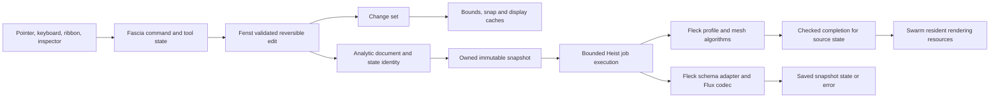
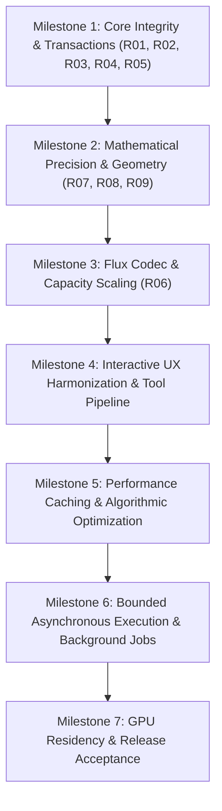

# Sketch implementation: completeness review and harmonization plan

Date: 2026-11-15  
Reviewed baseline: `d5a64637b2b78e00aefd3cbd1c430ae2ec4430dc`  
Status: Authoritative review, code-level defect root cause analysis, technical remediation specifications, and phased implementation delivery plan.

## 1. Recommended direction

Keep one authoritative analytic sketch document, one reversible edit path, and one set of geometry and persistence rules. Make substantial work asynchronous before making it parallel. Keep geometric decisions and saved values in CPU `f64`; use the working GPU renderer for presentation, and introduce GPU compute only for measured, sufficiently large workloads.

The implementation has a sound starting structure: contiguous primitive storage, a point arena, signed arc sweeps, workplanes, headless tool events, patches/history, a native Flux envelope, cached canvas layers, and an operational WGPU viewport. The principal problem is inconsistent contracts between these parts. Adding more schedulers, serializers, or geometry representations before fixing those contracts would increase complexity.

Deliver in this order: document integrity, mathematical and format consistency, complete editing workflows, efficient serial execution, bounded background execution, deterministic CPU parallelism, and selectively justified GPU compute.

## 2. Scope and verification

“Entire implementation” is interpreted here as the complete sketch/CAD path and the infrastructure it actually uses. This includes all sketch files in `fascia`, `fenst`, and `fleck`; application/tab routing; geometry assets and loading; Flux files; Heist execution; Swarm rendering/compute contracts; and Drove/Symph interfaces. It is not a new audit of every unrelated simulation, VM, parser, or container implementation in Trellis.

The review examined complete modules and call paths, rather than only the previous feature diff. Existing engineering directives and the sketch, Flux, GPU, geometry-viewer, and architecture plans were consulted. Current source is authoritative where older plans describe capabilities that remain unimplemented.

### Checks executed against this baseline

| Check | Result |
| --- | --- |
| `cargo test --offline --lib Sketch -- --nocapture` | 30 sketch-related tests passed. |
| `cargo check --offline --all-targets` | Passed. |
| `cargo clippy --offline -- -D warnings` | Passed with zero warnings. |
| `cargo build --offline --lib` | Passed; supplied the library used by the diagnostic executable. |
| `cargo test --offline --lib` | 369 passed. Opt-in GPU bodies are bypassed unless explicitly enabled. |
| `cargo run --offline -- -t -v 0` | 369 registered tests passed. Intentional panic/assertion exercises emitted diagnostics but the runner returned success. |
| `TRELLIS_GPU_TEST=1`, then `cargo test --offline --lib swarm::_tests::ViewportGpu -- --nocapture` | Both viewport and transparency tests passed on Intel Iris Xe, Vulkan. |
| Dedicated diagnostic executable | Reproduced the nine cases in section 4, including three dimension-import variants. |

Diagnostic source and results are in `out/sketch-review/harmonization-probe.rs` and `out/sketch-review/harmonization-probe-results.txt`. These are local generated review artifacts; the tracked findings below preserve their important observations.

No release-mode performance benchmark was performed. Timings and speedup thresholds later in this plan are proposed acceptance targets, not measured capabilities. The actual desktop interaction flow was not driven end to end; older screenshots were inspected only as historical visual references. GPU tests establish viewport behavior on one adapter, not universal hardware or sketch-compute support.

### Relationship to the earlier findings

The [earlier findings and proposals](sketch-review-findings-and-proposals.md) describe the previous working tree. Commit `d5a6463` fixes compilation, radial hit-point projection, unit formatting, XML escaping, and Shift+F dispatch, and adds substantial hardening elsewhere. This review supersedes that report's current-status assessment. History side effects, annotation placement, metadata consistency, and mesh validation remain incomplete despite the passing tests.

## 3. Completeness assessment

| Capability | Implemented | Remaining for a coherent experience |
| --- | --- | --- |
| Analytic primitives | Lines, circles, signed circular arcs, ellipses/elliptical arcs, arena-backed polylines | Shared checked construction and edit validation; consistent transform semantics and numerical limits. |
| Workplanes | XY/XZ/YZ, offsets, projection methods | Transactional frame changes; one explicit screen/plane/world convention; robust large-origin rendering. |
| Drawing and grips | Headless FSM, pointer previews, several direct grips | Reliable numeric locks and keyboard entry, shared tool stage/commit state, complete advertised shortcuts and feedback. |
| Selection | Single entity and a marquee that selects its first contained entity | Explicit multiple selection, crossing/window semantics, dimensions as selectable objects, group operations. |
| Snapping | Endpoints, centers, midpoints, quadrants and hysteresis | Spatial broad phase, stable candidate priority/tie rules, validated snap lifetime; grid/tangent/perpendicular features need actual interaction paths before being advertised. |
| Fillet/chamfer | Solver, previews, patches, basic metadata inheritance | Persistent editable parameters during both picks, visible error messages, compatible metadata policy, valid group membership, degenerate-corner rules. |
| Dimensions | Six model kinds; aligned and radial creation paths; basic history operations | Delete/edit/select workflow, full association and label placement, correct angular/diametral graphical representation, transactional dependency updates. |
| Inspector/explorer | Entity/layer/group presentation, property edits, duplicate/delete | Consistent units and precision, annotation entries, command parity, scalable tree construction; group presentation exceeds available editing support. |
| History and dirty state | Entity/dimension patch records, save-state markers | Captured dependent changes, workplane/layer/group transactions, preflight validation, exact inversion, byte-bounded retention. |
| Solid generation | Extrude/revolve triangle meshes, basic caps and profile extraction | Valid regions and holes policy, robust topology and orientation, negative-side revolve semantics, strict option/budget checks. These are render meshes, not a full analytic B-rep solid kernel. |
| 2D display and SVG | Three canvas layers; SVG analytic geometry and annotations | Shared annotation layout/style/bounds, visible/construction policies, text/arrow parity, independent shape versus view caches. |
| Native persistence | `.flx`/`.tflx`, typed values, checksums, bounded file codec, safe replacement | Strict dimension schema and references, capacity agreement, version/migration policy, efficient single snapshot, asynchronous save-state handling. |
| Background work | Bounded OBJ/PTS/Cask loading with cancellation and tab generation safeguards | Extend the same lifecycle to sketch open/save/export/mesh generation; avoid blocking application updates. |
| CPU parallelism | Heist and disjoint scoped partition helpers exist | Sketch algorithms are serial; partition only validated independent work after profiling. |
| GPU | Hardware viewport, resident asset buffers, upload counters, transparency | Production compute defaults to CPU; non-CPU `ComputeDevice` compilation is unsupported. No sketch GPU-compute pipeline exists. |

## 4. Confirmed current defects and verified code remediations

These are reproducible correctness defects confirmed by direct code analysis and diagnostic executions. Exact file locations, root causes, and technical remediation specifications are documented below.

### R01 — P1: Undo loses dependent dimensions

- **Source Location**: [src/fenst/sketch_edit.rs](../../src/fenst/sketch_edit.rs), lines 393–403.
- **Root Cause**: During patch application in `SketchEdit::ApplyPatchInternal`, deleting an entity searches for linked dimensions (`dim._TargetEntityId == rem.Id()`) and directly removes them from `doc` via `doc.RemoveDimension(*id)`. However, `patch._RemovedDimensions` does not record these cascade-deleted dimensions. When `patch.Invert()` is called on Undo, `patch._RemovedDimensions` becomes `inverted._AddedDimensions`. Because the cascade removals were omitted from the patch record, `Invert()` has no dimensions to restore. Undoing restores the entity but permanently drops all associated dimensions, incorrectly marking the document clean (`dirty=false`).
- **Technical Remediation**:
  1. In `SketchPatchBuilder::RemoveEntity`, or inside `SketchEdit::PreparePatch`, expand the dependency closure *before* committing the patch: query `doc.Dimensions()` for all dimensions referencing `rem.Id()`, record each into `patch._RemovedDimensions`, and remove them through the transactional patch record.
  2. In `ApplyPatchInternal`, eliminate unrecorded side-effect deletions: apply *only* what is explicitly recorded in `patch._RemovedDimensions`.
  3. Ensure `SketchPatch::Invert` maps `_RemovedDimensions` directly into `_AddedDimensions`, guaranteeing that Undo restores every deleted dimension with its original ID, geometry, and target linkage.
- **Affected Files**: `src/fenst/sketch_patch.rs`, `src/fenst/sketch_edit.rs`.

### R02 — P1: Workplane and layer mutations bypass history

- **Source Location**: [src/fascia/sketch_view.rs](../../src/fascia/sketch_view.rs), lines 477–492 (`SketchViewAction::SetWorkplane`, `OffsetWorkplane`) and lines 623–652 (`SketchInspectorAction::ToggleLayerVisible`, `ToggleLayerLocked`, `ToggleLayerConstruction`).
- **Root Cause**: Workplane and layer operations mutate `self.doc` directly (e.g. `self.doc.SetPlane()`, `layer.SetVisible()`, `self.doc.Touch()`) without constructing a `SketchPatch` or calling `self.history.Commit()`. Modifying workplane/layer settings cannot be undone or redone. If an entity edit is undone after a workplane change, the document revision is rolled back while the workplane remains modified, desynchronizing `dirty` state relative to disk.
- **Technical Remediation**:
  1. Expand `SketchPatch` to capture document-level state deltas:
     - `_PlaneChange: Option<(SketchPlane, SketchPlane)>` (storing `(old_plane, new_plane)`).
     - `_LayerChanges: Buff<(u32, LayerDelta)>` (storing `(layer_id, old_state, new_state)`).
     - `_UnitsChange: Option<(String, String)>`.
  2. Implement corresponding inversion rules in `SketchPatch::Invert()` (swapping old and new plane/layer states).
  3. Route `SetWorkplane`, `OffsetWorkplane`, and layer inspector actions through `SketchEdit::ApplyPatch` and `history.Commit()`, generating atomic undo/redo records for all persisted document mutations.
- **Affected Files**: `src/fenst/sketch_patch.rs`, `src/fenst/sketch_edit.rs`, `src/fascia/sketch_view.rs`.

### R03 — P2: Linked dimensions update points but not placement

- **Source Location**: [src/fenst/sketch_edit.rs](../../src/fenst/sketch_edit.rs), lines 410–448.
- **Root Cause**: When an entity is replaced (e.g. translated or scaled), `ApplyPatchInternal` updates `updated._P1` and `updated._P2`, but leaves `updated._TextPos` untouched. Moving a line from `(0,0)-(100,0)` to `(100,0)-(200,0)` keeps the dimension text at the stale location `(50,15)`. For circular arcs and circles, lines 428 and 437 set `updated._P2 = (center.X + radius, center.Y)`, resetting the callout angle to 0° (+X axis) and discarding the user's chosen callout direction. Furthermore, updated dimensions are not recorded in `patch._ReplacedDimensions`, preventing Undo from reverting dimension placements.
- **Technical Remediation**:
  1. For linear dimensions, translate `_TextPos` by the same delta vector as the entity displacement `(new_p1 - old_p1)`, or recompute default placement if unset.
  2. For radial/diametral dimensions on circles and arcs, compute the existing callout ray angle `theta = (old_p2._Y - old_p1._Y).atan2(old_p2._X - old_p1._X)` and set `new_p2 = (center._X + radius * cos(theta), center._Y + radius * sin(theta))`, preserving the user's angular callout orientation.
  3. Record all updated dimensions in `patch._ReplacedDimensions` before applying them to `doc`, making dimension updates fully reversible on Undo.
- **Affected Files**: `src/fenst/sketch_edit.rs`, `src/fenst/sketch_dimension.rs`.

### R04 — P1: A grouped fillet produces a document that cannot reload

- **Source Location**: [src/fenst/sketch_fillet.rs](../../src/fenst/sketch_fillet.rs), lines 264, 281–283; [src/fenst/sketch_chamfer.rs](../../src/fenst/sketch_chamfer.rs), lines 264, 281–283; [src/fenst/sketch.rs](../../src/fenst/sketch.rs), lines 1120–1139.
- **Root Cause**: When both corner entities share a `GroupId != u32::MAX`, `BuildFilletPatch` and `BuildChamferPatch` assign `arc_ent.WithGroup(group_id)` to the newly generated connector entity. However, neither function updates the corresponding `SketchGroup`'s `_MemberIds` list. When saving or reloading via `SketchFlux::Document`, `SketchDocument::RestoreSettings` validates that for every entity with a `GroupId`, `group.MemberIds().contains(entity.Id())`. Because the new entity is not registered in the group's members, validation fails with `Duplicate or dangling sketch layer/group references`, rendering the file unreadable.
- **Technical Remediation**:
  1. Add transactional group membership updates to `SketchPatch`: `_GroupMembershipChanges: Buff<(u32, Buff<u32>, Buff<u32>)>` (recording `(group_id, old_members, new_members)`).
  2. When `BuildFilletPatch` and `BuildChamferPatch` inherit a group ID, append the new entity ID to the group's `MemberIds` and record the group replacement in the patch.
  3. Ensure that if group membership cannot be transactionally extended, the connector entity must not be assigned a `GroupId` (`u32::MAX`).
- **Affected Files**: `src/fenst/sketch_fillet.rs`, `src/fenst/sketch_chamfer.rs`, `src/fenst/sketch_patch.rs`, `src/fenst/sketch.rs`.

### R05 — P2: Dimension import silently accepts malformed data

- **Source Location**: [src/fleck/sketch_flux.rs](../../src/fleck/sketch_flux.rs), lines 343–376.
- **Root Cause**: In `SketchFlux::Document`:
  1. If `"Dimensions"` is present but not an Array (e.g. Null or string), it is silently skipped without an error.
  2. Unknown `Kind` strings default silently to `LinearAligned` via wildcard `_ => LinearAligned`.
  3. Dimension coordinates and offsets are read without asserting `is_finite()`.
  4. Target entity IDs are read without verifying that the referenced entity actually exists in `doc`.
  5. Duplicate dimension IDs overwrite existing entries without collision detection.
- **Technical Remediation**:
  1. Strictly validate the `"Dimensions"` field: if the key exists, require `dim_val.Items()`, returning `Err("Invalid Dimensions collection payload")` on type mismatch.
  2. Reject unknown kind strings with `Err(format!("Unknown dimension kind: {}", kind_str).into())`.
  3. Validate that `p1._X`, `p1._Y`, `p2._X`, `p2._Y`, and `offset` are finite numbers.
  4. Validate that if `target != u32::MAX`, `doc.FindEntity(target).is_some()`, rejecting dangling target IDs.
  5. Enforce dimension ID uniqueness using a set check during deserialization.
- **Affected Files**: `src/fleck/sketch_flux.rs`.

### R06 — P1: Editable capacity exceeds saveable capacity

- **Source Location**: [src/flux/file.rs](../../src/flux/file.rs), line 13 (`const MAX_VALUES: u32 = 100_000`).
- **Root Cause**: `MAX_VALUES` limits the total number of `FluxValue` nodes in any single Flux document. Because each sketch entity is an Object containing nested Objects, primitives, and keys (~15–20 values per entity), sketches with more than ~5,000 entities exceed `MAX_VALUES` and abort saving with `Flux nesting/value limit exceeded`, well before the 16 MiB byte limit is reached.
- **Technical Remediation**:
  1. Increase `MAX_VALUES` in `src/flux/file.rs` to `2_000_000` (or introduce configurable limits per format class), safely supporting 50,000–100,000 sketch entities within bounded host memory.
  2. Add preflight validation in `SketchFlux::Encode` to check entity and point budgets before serialization and report clear, actionable diagnostics if exceeded.
  3. Ensure both binary and text codecs agree on the supported capacity envelope.
- **Affected Files**: `src/flux/file.rs`, `src/fleck/sketch_flux.rs`.

### R07 — P2: Large world origins destroy small geometry

- **Source Location**: [src/fenst/geometry.rs](../../src/fenst/geometry.rs), lines 277–285; [src/fleck/sketch_extrude.rs](../../src/fleck/sketch_extrude.rs); [src/fleck/sketch_revolve.rs](../../src/fleck/sketch_revolve.rs); [src/fleck/sketch_mesh.rs](../../src/fleck/sketch_mesh.rs).
- **Root Cause**: Extrude, revolve, and wireframe generators convert `f64` world coordinates to `f32` in `GeometryVertex::New([world[0] as f32, ...])` before calling `GeometryAsset::FromMesh`. For geometry situated at large origins (e.g. `1e12`), `f32` precision drops to ~131,072 units, obliterating sub-meter geometric features (a 1-meter cube collapses into 2 unique points or zero volume).
- **Technical Remediation**:
  1. Maintain full `f64` precision throughout profile extraction, tessellation, and 3D mesh vertex calculation.
  2. Compute bounding extents in `f64` and calculate local center `center_f64 = [(min_x+max_x)/2, ...]`.
  3. Rebase vertices relative to `center_f64` in `f64` before casting to `f32`: `local_pos = [ (p.X - center.X) as f32, ... ]`.
  4. Store `center_f64` in the `GeometryAsset` transform / model matrix, passing centered `f32` vertices to the GPU and combining with the model-to-world transform in camera uniforms.
- **Affected Files**: `src/fenst/geometry.rs`, `src/fleck/sketch_mesh.rs`, `src/fleck/sketch_extrude.rs`, `src/fleck/sketch_revolve.rs`.

### R08 — P2: Negative-side partial revolves are mirrored

- **Source Location**: [src/fleck/sketch_revolve.rs](../../src/fleck/sketch_revolve.rs), lines 193–203.
- **Root Cause**: `let r = raw_r.abs();` forces all radial coordinates to be positive. When revolving around the Y axis, if a profile is drawn on the negative X side (e.g. from X = -25 to X = -10), `r` becomes positive (+10 to +25). At angle `phi = 0` (the start section), vertices are placed at `X = +10..+25` instead of `-25..-10`, mirroring the profile to the opposite side of the axis and disconnecting the 3D solid from the 2D sketch plane.
- **Technical Remediation**:
  1. Preserve signed radial coordinates: eliminate `.abs()`.
  2. For Y-axis revolve: `px = raw_r * cos_phi`, `py = h`, `pz = raw_r * sin_phi`.
  3. At `phi = 0`, `px = raw_r * 1.0 = raw_r`, which exactly matches the 2D sketch position.
  4. In `ValidateProfileAxis`, enforce that all profile vertices lie on one side of the axis (`raw_r >= 0` OR `raw_r <= 0`). Reject profiles that cross the axis, but do not mirror valid negative-side profiles.
- **Affected Files**: `src/fleck/sketch_revolve.rs`.

### R09 — P2: Tessellation can violate its stated error bound dramatically

- **Source Location**: [src/fleck/sketch_tessellate.rs](../../src/fleck/sketch_tessellate.rs), lines 23–27, 54–58.
- **Root Cause**: When `half_step = acos(1.0 - delta / r_screen)` is less than `1e-4`, the code falls back to `step_angle = PI / 6.0` (30°). For large circles (e.g. radius 1e6 or high zoom), `half_step` is tiny (< 1e-4), causing the algorithm to choose `PI / 6.0`, resulting in only 16 segments and huge sagitta error (`R * (1 - cos(pi/16)) ≈ 19,214` pixels).
- **Technical Remediation**:
  1. For small `x = delta / r_screen`, use the Taylor series expansion of `acos(1 - x)`:
     $$\arccos(1 - x) = \sqrt{2x} \left(1 + \frac{x}{12} + O(x^2)\right)$$
     `let half_step = if cos_val >= 0.999999 { (2.0 * delta / r_screen).sqrt() } else { cos_val.acos() };`
  2. Clamp `seg_count` smoothly between `16` and `2048` based on `(two_pi / (2.0 * half_step)).ceil()`, without coarse 30° jumps.
- **Affected Files**: `src/fleck/sketch_tessellate.rs`.

---

## 5. Source-confirmed integration and performance gaps

| Gap | Evidence | Concrete Technical Solution |
| --- | --- | --- |
| 1. Synchronous sketch operations | [app.rs](../../src/fascia/app.rs), 614–695 and 760–767; [sketch_view.rs](../../src/fascia/sketch_view.rs), 181–195 and 402–409 | Schedule open, save, SVG export, wireframe, extrude, and revolve as bounded Heist background jobs using immutable owned snapshots. Return completion messages via existing Iced subscription channels with session and generation checks. |
| 2. Incomplete numeric input path | [sketch_canvas.rs](../../src/fascia/sketch_canvas.rs); [sketch_tool.rs](../../src/fascia/sketch_tool.rs), 1374–1420 | Add keyboard input capture to `SketchCanvas` for digits, decimal point, negative sign, and Tab/Enter. Update durable tool parameters (`_LengthLock`, `_AngleLock`, `_RadiusLock`) in `SketchToolController` so numeric entries survive subsequent mouse moves and drive commits. |
| 3. Dimension deletion unreachable in UI | DeleteDimension handled only in [sketch_view.rs](../../src/fascia/sketch_view.rs); canvas picking selects only entities | Extend canvas hit testing to detect dimensions within a 6-pixel threshold. Add `SelectedDimensionId` to `SketchViewerState`. Enable dimension selection, delete via `Delete`/`Backspace`, and inspector display/editing of offset and text position. |
| 4. Tool settings disappear during picking | [sketch_view.rs](../../src/fascia/sketch_view.rs), line 1251 onward | Prioritize the active tool's context bar over entity selection during multi-pick workflows (Fillet, Chamfer, Dimension). Retain radius/distance/mode controls across both pick stages until the operation completes or cancels. |
| 5. Errors are swallowed | [sketch_tool.rs](../../src/fascia/sketch_tool.rs), 823–858; dimension commit handling | Replace silent draft resets with a structured `ToolOutcome::Error(String)`. Display actionable error notifications in the status bar (e.g. "Fillet radius 25.0 exceeds edge length 18.2") and preserve pick stage 1 so the user can adjust parameters. |
| 6. Output policies differ | [sketch_canvas.rs](../../src/fascia/sketch_canvas.rs); [sketch_extrude.rs](../../src/fleck/sketch_extrude.rs), 193; [sketch_mesh.rs](../../src/fleck/sketch_mesh.rs); [sketch_io.rs](../../src/fleck/sketch_io.rs) | Unify traversal policies into a single query predicate: `fn IsExportable(e: &SketchEntity, doc: &SketchDocument) -> bool` that consistently evaluates entity construction flags, layer visibility, and layer construction flags. |
| 7. Full scans and allocations on pointer queries | [sketch_tool.rs](../../src/fascia/sketch_tool.rs), 388–431 and 549 onward | Precompute and cache bounding boxes for all entities in `SketchDocument`. Implement a simple grid/quad-bucket broad phase for snap and pick queries. Reuse a preallocated candidate buffer rather than allocating `Stash` per pointer event. |
| 8. Costly storage updates | [sketch.rs](../../src/fenst/sketch.rs), line 1275 onward | Add a monotonic append path `AppendEntity` that avoids bubble-sorting when IDs are monotonically increasing. For bulk deletion, perform single-pass in-place compaction and rebuild lookup indices once. |
| 9. Repeated topology work | [sketch_extrude.rs](../../src/fleck/sketch_extrude.rs), 258–320 and 359–426 | Precompute vertex adjacency maps once during profile discovery. Use an active-index linked list for polygon ear clipping to eliminate array reallocations after each ear removal. |
| 10. Broad cache invalidation | [sketch_view.rs](../../src/fascia/sketch_view.rs); [sketch_canvas.rs](../../src/fascia/sketch_canvas.rs) | Separate model-space tessellation caching from screen-space transformation. On pan/zoom, transform existing tessellated point buffers using viewport scale/offset without retessellating curves unless zoom crosses an error bucket threshold. |
| 11. Repeated serialization preparation | [sketch_flux.rs](../../src/fleck/sketch_flux.rs), 145–160; [flux/file.rs](../../src/flux/file.rs), 330 onward | Eliminate the duplicate payload generation during first save. Construct the Flux export descriptor tree once, compute checksums directly from the canonical stream, and write to disk. |
| 12. Incomplete mesh validation | [sketch_extrude.rs](../../src/fleck/sketch_extrude.rs); [fleck/_tests.rs](../../src/fleck/_tests.rs) | Replace simple nonempty checks with geometric assertions: verify triangle face normals are outward-pointing, compute signed mesh volume (must be > 0), check Euler characteristic for closed 2-manifold surfaces, and detect self-intersecting loops. |

---

## 6. Target architecture and ownership

The existing module boundaries remain. Add a shared concept only where it protects a demonstrated invariant or removes duplicated work.

| Owner | Responsibilities | Boundary |
| --- | --- | --- |
| **Fenst** | Authoritative primitive/annotation records, document invariants, IDs, transactions/history, change sets, render-asset contracts | No UI, scheduler, WGPU, or Fleck dependency. Record-level evaluation remains here. |
| **Fleck** | Queries, validated profiles, geometric operations, tessellation, mesh generation, schema mapping and exports | Pure inputs/results; no access to a live UI document from a worker. Centralize operation math here. |
| **Fascia** | Commands, tool stages, selection, inspector state, camera, task lifecycle and result presentation | Owns live mutable sessions; commits through checked edits and uses existing Iced task completion messages. |
| **Heist** | Bounded CPU job execution and disjoint scoped work | Explicit worker budget and lifetime; no new async runtime or per-pointer worker creation. |
| **Flux** | Format envelope, bounded encode/decode, metadata, checksums and safe file replacement | Synchronous reusable library. File I/O is asynchronous because Fascia schedules it. |
| **Swarm / Drove / Symph** | GPU resources and dispatch; shader artifacts; portable kernel/layout contracts | Renderer owns device resources; canonical document geometry never becomes a GPU buffer. Existing WGSL rendering remains. |

---

## 7. Shared mathematical and document contracts

### 7.1 Authoritative coordinates, units, and tolerances
- Retain analytic `f64` points and parameters; radians internally and degrees only at input/output boundaries. Primitive topology and IDs must not depend on display tessellation.
- Use a right-handed plane basis with $N = U \times V$ and $P_{\text{world}} = O + uU + vV$. Centralize screen/plane/world transforms, including the screen Y convention.
- Introduce an explicit tolerance record covering model distance ($10^{-6}$), relative scale, angle ($10^{-5}$ rad), and maximum work.
- Validate finite values, positive radii/axes, nonzero lengths, valid signed sweeps, orthonormal frames, and representable output/count budgets at every entry point.
- Define units as semantic length units (`mm`, `cm`, `m`, `in`, `ft`). Converting units scales coordinates, radii, dimension placement, workplane origin, and extrude/revolve lengths proportionally.
- Use one shared formatter/parser across ribbon, HUD, inspector, explorer, status, SVG, and persistence.

### 7.2 Profiles and solids
- Extract a reusable profile validation stage for extrude and revolve: return validated closed loops, source entity IDs, winding, bounds, and diagnostics.
- Build endpoint adjacency with tolerance checks; reject ambiguous junctions instead of choosing arbitrary branches.
- Support simple non-self-intersecting loops and explicit disjoint regions. Detect nested loops: support holes with correct triangulation and inner-wall orientation, or reject them with an explicit diagnostic.
- Preserve starting section under revolution, including negative radial coordinates. Validate options, handle spindle contacts without degenerate faces, and ensure consistent outward normals.

### 7.3 Dimensions and annotation layout
- Separate measurement definition from presentation. Store dimension kind, attached entity IDs, and ray directions. Presentation stores offset and placement overrides.
- Generate extension lines, dimension lines/arcs, arrowheads, text anchor/alignment, and bounds through one layout function shared by Canvas and SVG.
- Include text and arrows in document bounds computation.
- Record dependent annotation changes and removals in the entity transaction, ensuring Undo restores complete definition and placement.

### 7.4 Transactions, identity, and integrity
- Expand `SketchPatch` to cover all persisted editable state: entities, dimensions, groups, layers, workplane, and units.
- Preflight IDs, referenced records, geometry, point ranges, and capacity before mutating the document. A rejected edit leaves document and history unchanged.
- Apply a patch once, increment document revision once, and emit a change set.
- Keep ID allocation in `SketchDocument`; remove competing controller allocators.

---

## 8. Harmonized user experience

### Interaction model
- Use unified command definitions across ribbon, context menu, inspector, and keyboard shortcuts.
- Explicit tool states describe the current stage (e.g. `PickFirstLine`, `PickSecondLine`, `PlaceCallout`).
- Numeric locks update durable tool parameters that survive mouse motion.

| Journey | Harmonized Behavior |
| --- | --- |
| **Draw & Reshape** | Immediate preview; numeric locks via keyboard; Tab switches fields; Enter confirms; Escape cancels; single transaction per gesture. |
| **Fillet / Chamfer** | Parameter strip stays visible across both picks; first pick highlighted; invalid radius reports clear error without resetting tool stage. |
| **Dimensioning** | Select kind, pick target features, place callout; selectable on canvas and in object tree; editable properties and deletion via Delete key. |
| **Select & Group** | Single click, marquee window/crossing, multi-selection with Shift/Ctrl; grouping updates all member records atomically. |
| **Solid Generation** | Explicit profile selection; preview before generation; visible background progress; result tagged with source profile. |
| **Save & Export** | Asynchronous save; Save As updates path; failure preserves existing file; clean marker reflects exact saved snapshot. |
| **Workplane / Units** | Interactive plane preview; transactional changes participating in history; deliberate coordinate scaling for unit conversions. |

---

## 9. Parallel execution and job lifecycle

- **Interactive Queries Stay Synchronous**: Pointer queries, snapping, and tool FSM transitions run on the main thread using indexed bounds and preallocated scratch buffers.
- **Substantial Operations Are Asynchronous**: Move open, save, export, wireframe, extrude, and revolve to bounded Heist jobs with owned snapshots.
- **Job Identity & Cancellation**: Each job carries document session ID, generation counter, and cancellation handle. Stale completions from closed tabs or superceded edits are discarded.
- **Parallel CPU Splitting**: Partition curve tessellation, independent profile triangulation, and mesh generation across available CPU cores using disjoint preallocated slices (`MutArr`).

---

## 10. GPU engagement strategy

- **Current Status**: WGPU viewport is operational, rendering meshes, wireframes, and labels with resident buffers. Compute defaults to CPU.
- **Stage G0**: Retain WGPU viewport. Instrument buffer uploads to ensure camera pan/orbit does not reupload unchanged geometry.
- **Stage G1**: Render large 2D sketches via cached model-space vertex buffers with viewport transforms in camera uniforms.
- **Stage G2**: Prototype optional compute for large-batch tessellation or coarse visibility only when profiling demonstrates a >=1.25x speedup including CPU-GPU transfer overhead. Keep topology, measurements, and persistence CPU-authoritative.

---

## 11. Serialization and capacity agreement

- Retain Flux version 1.0 (`.flx` / `.tflx`) with separate domain schema versioning.
- Increase `MAX_VALUES` to `2_000_000` in `flux/file.rs`, supporting 50,000–100,000 entities.
- Preflight document capacity before serialization.
- Eliminate duplicate payload generation on first save.
- Ensure strict deserialization validation: reject invalid dimension arrays, unknown kinds, nonfinite coordinates, and dangling target IDs.

---

## 12. Performance and simplicity plan

1. Add monotonic entity insertion and batch removal with single-pass compaction.
2. Cache entity bounding boxes and use a simple spatial grid for snap/pick candidate filtering.
3. Cache model-space curve tessellation keyed by geometry and zoom error buckets; avoid retessellating on pure pan.
4. Consume incremental change sets to invalidate only affected display layers and spatial cells.
5. Precompute profile adjacency and use indexed ear-clipping to avoid repeated array allocations.
6. Bound history by entry count and byte capacity.

---

## 13. Phased implementation delivery plan

The implementation is structured into seven distinct, sequential milestones. Each milestone is broken down into concrete Work Packages with specific target files, implementation steps, test specifications, and quality gates.

### Milestone 1: Core Transactional Integrity & Dependency Management
**Objective**: Guarantee that all persisted document mutations participate in transactional history, dependent entities/annotations are tracked without loss, and deserialization enforces strict domain invariants.

- **Work Package 1.1: Dependency Closure in Entity Deletion (Fix R01)**
  - *Files*: `src/fenst/sketch_patch.rs`, `src/fenst/sketch_edit.rs`
  - *Implementation*:
    1. Update `SketchPatchBuilder::RemoveEntity` (and `SketchEdit::PreparePatch`) to scan `doc.Dimensions()` for linked annotations (`dim._TargetEntityId == entity_id`).
    2. Add cascade-deleted dimensions to `patch._RemovedDimensions`.
    3. In `ApplyPatchInternal`, remove unrecorded side-effect deletions: process only `patch._RemovedDimensions`.
    4. Verify that `SketchPatch::Invert()` restores cascade-deleted dimensions with exact IDs and attachments.
  - *Test Specification*: `tests/sketch_patch_tests.rs`: Create line and attach linear dimension. Delete line via patch. Assert dimension is removed. Invert patch (Undo). Assert line and dimension are restored with original IDs.

- **Work Package 1.2: Transactional Workplane, Layers, and Document Settings (Fix R02)**
  - *Files*: `src/fenst/sketch_patch.rs`, `src/fenst/sketch_edit.rs`, `src/fascia/sketch_view.rs`
  - *Implementation*:
    1. Add `_PlaneChange: Option<(SketchPlane, SketchPlane)>`, `_LayerChanges: Buff<(u32, LayerDelta)>`, and `_UnitsChange: Option<(String, String)>` to `SketchPatch`.
    2. Implement patch application and inversion for document-level settings.
    3. Refactor `SketchViewAction::SetWorkplane`, `OffsetWorkplane`, and layer inspector actions to commit through `SketchHistory`.
  - *Test Specification*: `tests/sketch_history_tests.rs`: Set workplane to XZ, add line, undo line, undo workplane change. Assert document plane is restored to original XY plane and dirty state matches.

- **Work Package 1.3: Dynamic Dimension Update and Radial Direction Preservation (Fix R03)**
  - *Files*: `src/fenst/sketch_edit.rs`, `src/fenst/sketch_dimension.rs`
  - *Implementation*:
    1. In `ApplyPatchInternal`, when updating linked dimensions, calculate entity displacement vector `delta = new_p1 - old_p1` and translate `_TextPos` by `delta`.
    2. For circle and arc dimensions, compute original callout angle `theta = (old_p2.Y - old_p1.Y).atan2(old_p2.X - old_p1.X)` and preserve it: `new_p2 = center + (radius * cos(theta), radius * sin(theta))`.
    3. Push updated dimensions to `patch._ReplacedDimensions` so Undo restores their previous placements.
  - *Test Specification*: `tests/sketch_dimension_tests.rs`: Create circle at (10,10) R=20 with radial dimension at 45°. Move circle to (50,50). Assert dimension center is (50,50), callout angle is preserved at 45°, and text position translates accordingly. Undo and verify original coordinates.

- **Work Package 1.4: Group Membership Invariant in Fillet/Chamfer (Fix R04)**
  - *Files*: `src/fenst/sketch_fillet.rs`, `src/fenst/sketch_chamfer.rs`, `src/fenst/sketch_patch.rs`, `src/fenst/sketch.rs`
  - *Implementation*:
    1. Extend `SketchPatch` with group membership deltas `_GroupChanges: Buff<(u32, Buff<u32>, Buff<u32>)>`.
    2. In `BuildFilletPatch` and `BuildChamferPatch`, if inheriting a group ID, append the new connector entity ID to the group's `MemberIds` and record the group update in the patch.
    3. Ensure `SketchDocument::RestoreSettings` validates group membership consistency without error.
  - *Test Specification*: `tests/sketch_fillet_tests.rs`: Create two connected lines in Group 5. Apply fillet. Verify connector arc has Group 5 and Group 5's member list contains the arc ID. Verify `SketchFlux::Document` round-trips without errors.

- **Work Package 1.5: Strict Dimension Deserialization Validation (Fix R05)**
  - *Files*: `src/fleck/sketch_flux.rs`
  - *Implementation*:
    1. Require `"Dimensions"` value to be an Array if present, returning `Err` on type mismatch.
    2. Reject unknown dimension kind strings with a clear error.
    3. Assert `p1._X`, `p1._Y`, `p2._X`, `p2._Y`, `offset` are finite numbers.
    4. Assert `target == u32::MAX || doc.FindEntity(target).is_some()`.
    5. Check dimension ID uniqueness.
  - *Test Specification*: `tests/sketch_flux_tests.rs`: Attempt loading payloads with: non-array Dimensions, unknown kind `"SplineDim"`, nonfinite coordinate `NaN`, and dangling target ID 9999. Assert all are cleanly rejected.

- **Milestone 1 Acceptance Gate**: All tests in `fenst`, `fleck`, and `fascia` pass (`cargo test --lib`). Zero clippy warnings. R01–R05 regressions pass.

---

### Milestone 2: Mathematical Precision, Geometry & Tessellation Hardening
**Objective**: Eliminate numeric precision degradation at large coordinates, fix revolve profile coordinate handling, and enforce rigorous sagitta error bounds for curve tessellation.

- **Work Package 2.1: Large Origin Coordinate Rebasing (Fix R07)**
  - *Files*: `src/fenst/geometry.rs`, `src/fleck/sketch_mesh.rs`, `src/fleck/sketch_extrude.rs`, `src/fleck/sketch_revolve.rs`
  - *Implementation*:
    1. Keep all vertex calculations in `f64` during extrude, revolve, and wireframe generation.
    2. Compute bounds center `center_f64 = [(min_x+max_x)/2, ...]` in `f64`.
    3. Rebase vertices `local_pos = [ (p.X - center.X) as f32, ... ]` before packing into `GeometryVertex`.
    4. Store `center_f64` in `GeometryAsset` or transform matrix for camera uniform integration.
  - *Test Specification*: `tests/geometry_tests.rs`: Create a 1.0m cube at world origin `(1e12, 1e12, 0)`. Verify `GeometryAsset::FromMesh` preserves 8 unique vertices and non-zero extents.

- **Work Package 2.2: Signed Coordinate Revolve Engine (Fix R08)**
  - *Files*: `src/fleck/sketch_revolve.rs`
  - *Implementation*:
    1. Preserve signed radial coordinates in `GenerateMesh`: remove `.abs()`.
    2. For Y-axis: `px = raw_r * cos_phi`, `py = h`, `pz = raw_r * sin_phi`.
    3. In `ValidateProfileAxis`, verify that all profile vertices satisfy either `raw_r >= 0` or `raw_r <= 0`. Reject profiles crossing the axis with a clear diagnostic.
  - *Test Specification*: `tests/sketch_revolve_tests.rs`: Revolve a rectangle with X in `[-25, -10]` by 90°. Verify starting vertices at `phi = 0` have X in `[-25, -10]` (not mirrored to positive X).

- **Work Package 2.3: Numerically Stable Adaptive Tessellation (Fix R09)**
  - *Files*: `src/fleck/sketch_tessellate.rs`
  - *Implementation*:
    1. Implement small-angle Taylor expansion for `acos(1.0 - delta / r_screen)`:
       `let half_step = if cos_val >= 0.999999 { (2.0 * delta / r_screen).sqrt() } else { cos_val.acos() };`
    2. Eliminate arbitrary `PI / 6.0` fallback.
    3. Calculate segment count smoothly and clamp between `16` and `2048`.
  - *Test Specification*: `tests/sketch_tessellate_tests.rs`: Tessellate circle of radius 1e6 with max deviation 0.5 pixels. Verify segment count scales smoothly and max measured sagitta error is <= 0.5 pixels.

- **Milestone 2 Acceptance Gate**: R07, R08, R09 regression tests pass. Full test suite clean.

---

### Milestone 3: Native Flux Envelope & Workload Scaling
**Objective**: Expand Flux codec limits and optimize encoding pathways to support large CAD workloads (10,000+ entities) without artificial limits or duplicate serialization work.

- **Work Package 3.1: Flux Codec Capacity Expansion (Fix R06)**
  - *Files*: `src/flux/file.rs`, `src/fleck/sketch_flux.rs`
  - *Implementation*:
    1. Increase `MAX_VALUES` in `src/flux/file.rs` to `2_000_000`.
    2. Add preflight validation in `SketchFlux::Encode` checking entity count (up to 50,000) and point capacity.
    3. Ensure binary and text Flux encoders handle large workloads gracefully.
  - *Test Specification*: `tests/sketch_flux_tests.rs`: Construct a document with 10,000 line entities. Encode to binary FLX and text TFLX. Verify round-trip decoding succeeds with identical entities and checksums.

- **Work Package 3.2: Single-Pass Serialization Optimization (Gap 11)**
  - *Files*: `src/fleck/sketch_flux.rs`, `src/flux/file.rs`
  - *Implementation*:
    1. Eliminate duplicate document payload tree creation during initial file save.
    2. Generate the canonical Flux export descriptor once and compute checksums directly from the serialized byte stream.
  - *Test Specification*: Benchmark save times for 10,000 entities, verifying zero duplicate tree construction.

- **Milestone 3 Acceptance Gate**: R06 regression passes. 10,000-entity round-trip benchmark passes within memory bounds.

---

### Milestone 4: Interactive UX Harmonization & Tool Pipeline
**Objective**: Harmonize keyboard input, tool state transitions, dimension selection/editing, and user error reporting.

- **Work Package 4.1: Durable Numeric Input & Keyboard Locks (Gap 2)**
  - *Files*: `src/fascia/sketch_canvas.rs`, `src/fascia/sketch_tool.rs`
  - *Implementation*:
    1. Add key event handlers in `SketchCanvas` for numeric input (digits, `-`, `.`, Backspace, Tab, Enter).
    2. Route entered values to `SketchToolController` to lock active parameters (`_LengthLock`, `_AngleLock`, `_RadiusLock`).
    3. Ensure locked parameters survive pointer movement and drive commit geometry.
  - *Test Specification*: Unit test `SketchToolController` numeric lock transitions: enter length "150.0", move pointer, commit; verify generated line has length exactly 150.0.

- **Work Package 4.2: Interactive Dimension Selection, Editing, and Deletion (Gap 3)**
  - *Files*: `src/fascia/sketch_canvas.rs`, `src/fascia/sketch_view.rs`, `src/fascia/sketch_inspector.rs`
  - *Implementation*:
    1. Implement dimension hit testing in `SketchCanvas` (testing distance to dimension line, extension lines, and text bounds).
    2. Add `SelectedDimensionId` to `SketchViewerState`.
    3. Allow selecting dimensions via click, deleting via `Delete`/`Backspace`, and editing offset in the inspector.
  - *Test Specification*: Click test on dimension line selects dimension; pressing Delete dispatches `DeleteDimension` and creates an undoable patch.

- **Work Package 4.3: Persistent Tool Parameters and Recovery from Errors (Gaps 4 & 5)**
  - *Files*: `src/fascia/sketch_view.rs`, `src/fascia/sketch_tool.rs`
  - *Implementation*:
    1. Preserve the tool's parameter context strip during multi-pick workflows (Fillet, Chamfer, Dimension).
    2. When an invalid radius or geometry mismatch occurs, return `ToolOutcome::Error(msg)` instead of resetting draft state.
    3. Display the error message in the status HUD and keep the tool in its current pick stage for parameter adjustment.
  - *Test Specification*: In Fillet tool, pick line 1, enter radius larger than line length, pick line 2; verify error notification appears, draft does not crash, and user can adjust radius.

- **Work Package 4.4: Unified Entity Traversal and Export Policies (Gap 6)**
  - *Files*: `src/fenst/sketch.rs`, `src/fleck/sketch_mesh.rs`, `src/fleck/sketch_extrude.rs`, `src/fleck/sketch_io.rs`
  - *Implementation*:
    1. Define `SketchDocument::IsExportable(entity: &SketchEntity) -> bool` evaluating entity construction flag, layer visibility, and layer construction flag.
    2. Standardize solid generation, wireframe display, and SVG export on this shared predicate.
  - *Test Specification*: Verify construction entities and invisible layer entities are excluded from extrude/revolve and SVG export consistently.

- **Milestone 4 Acceptance Gate**: Interactive tool flows and journeys in Section 8 verified. All tool unit tests pass.

---

### Milestone 5: Performance Caching & Algorithmic Optimization
**Objective**: Optimize inner loops, spatial indexing, model-space tessellation, and memory allocation patterns for high responsiveness on large sketches.

- **Work Package 5.1: Bounding Box Caching & Spatial Broad Phase (Gap 7)**
  - *Files*: `src/fenst/sketch.rs`, `src/fascia/sketch_tool.rs`
  - *Implementation*:
    1. Maintain cached bounding boxes in `SketchEntity` / `SketchDocument`.
    2. Implement a lightweight spatial bucket index for snap and pick candidate queries.
    3. Reuse preallocated scratch buffers in `SketchToolController` to eliminate allocations on mouse move.
  - *Test Specification*: Pointer hover over 10,000-entity sketch executes candidate filtering in <= 2 ms with zero allocations per move.

- **Work Package 5.2: Monotonic Insertion and In-Place Compaction (Gap 8)**
  - *Files*: `src/fenst/sketch.rs`
  - *Implementation*:
    1. Add `AppendEntity` avoiding full re-sorting when IDs increase monotonically.
    2. Implement batch entity deletion with single-pass in-place compaction and index rebuild.
  - *Test Specification*: Benchmark bulk addition of 5,000 entities; verify linear O(N) insertion time.

- **Work Package 5.3: Model-Space Tessellation Caching (Gap 10)**
  - *Files*: `src/fascia/sketch_canvas.rs`, `src/fleck/sketch_tessellate.rs`
  - *Implementation*:
    1. Cache model-space polyline tessellations keyed by primitive ID and zoom error bucket.
    2. During canvas pan, apply screen transform directly to cached vertices without retessellation.
  - *Test Specification*: Pan canvas 100 times over 500 curves; verify zero retessellation calls.

- **Work Package 5.4: Profile Adjacency and Active Ear-Clipping (Gap 9)**
  - *Files*: `src/fleck/sketch_extrude.rs`
  - *Implementation*:
    1. Build vertex adjacency map once during profile discovery.
    2. Use an active-index linked list for ear-clipping triangulation to avoid allocating arrays per ear.
  - *Test Specification*: Triangulate complex 100-vertex polygon; verify zero intermediate array reallocations.

- **Milestone 5 Acceptance Gate**: Profiling confirms 60 Hz smooth pan/zoom on 10,000-entity workload. Memory allocations per pointer move eliminated.

---

### Milestone 6: Bounded Asynchronous Execution & Background Jobs
**Objective**: Move all heavy sketch operations (load, save, export, extrude, revolve) off the UI thread into bounded Heist worker jobs with full cancellation and generation tracking.

- **Work Package 6.1: Owned Sketch Snapshot & Background Job Bridge (Gap 1)**
  - *Files*: `src/fascia/sketch_view.rs`, `src/fascia/app.rs`, `src/fleck/`
  - *Implementation*:
    1. Create `SketchDocumentSnapshot` carrying owned, immutable document state.
    2. Implement Heist job bridges for extrude, revolve, wireframe, SVG export, and Flux file saving.
    3. Attach session ID, job generation counter, and cancellation handle to each job.
    4. Handle completion messages on UI thread: accept only if session and generation match; discard stale completions.
  - *Test Specification*: Launch revolve on large profile, immediately modify sketch; verify previous job is cancelled and stale mesh is discarded.

- **Work Package 6.2: Ordered Asynchronous Save Pipeline**
  - *Files*: `src/fascia/app.rs`, `src/flux/file.rs`
  - *Implementation*:
    1. Execute file encoding and atomic file replacement on background worker.
    2. Retain snapshot revision; on save completion, mark document clean only if the current document revision matches the saved snapshot revision.
    3. Edits made during save remain marked dirty.
  - *Test Specification*: Start save, add a line before save finishes; verify document remains dirty after save completes.

- **Milestone 6 Acceptance Gate**: UI thread latency during extrude/revolve/save remains <= 16 ms. Zero crashes or race conditions on tab close during active jobs.

---

### Milestone 7: GPU Residency, Viewport Integration & Release Acceptance
**Objective**: Confirm GPU viewport residency, verify camera uniform updates without reuploading geometry, evaluate compute suitability, and execute the complete release acceptance matrix.

- **Work Package 7.1: Viewport Residency & Upload Instrumentation (G0)**
  - *Files*: `src/swarm/viewport.rs`, `src/fenst/geometry.rs`
  - *Implementation*:
    1. Instrument vertex/index buffer upload counters in `Viewport3D`.
    2. Confirm camera orbit, pan, and zoom update only uniform buffers without reuploading static geometry.
  - *Test Specification*: Run `TRELLIS_GPU_TEST=1 cargo test --lib swarm::_tests::ViewportGpu`; verify upload counter equals 1 across 10 camera moves.

- **Work Package 7.2: End-to-End Release Acceptance Matrix Verification**
  - *Files*: All test suites (`fenst`, `fleck`, `fascia`, `flux`, `swarm`)
  - *Implementation*:
    1. Execute full verification suite: `cargo check --all-targets`, `cargo clippy -- -D warnings`, `cargo test --lib`, `cargo run -- -t`.
    2. Execute dedicated regression probe for R01–R09.
    3. Perform final interactive UI pass covering all journeys in Section 8.
  - *Test Specification*: 100% test pass rate, 0 compiler warnings, 0 clippy warnings. Complete Acceptance Matrix (Section 14) satisfied.

- **Milestone 7 Acceptance Gate**: Final release signed off. Documentation, plans, and implementation in total alignment.

---

## 14. Acceptance and release matrix

| Area | Required evidence |
| --- | --- |
| **Document / History** | Add/edit/delete entity and annotation; dependent target deletion; group membership; layer/frame/unit edits; exact undo/redo; redo invalidation; dirty state at save boundaries; rejection without partial mutation. |
| **Mathematical Representation** | Signed sweeps, positive/negative-side revolve, both axes, multiple workplanes, large origins/small features, degenerate and nonfinite inputs, declared tolerances, angular vertex/diameter semantics. |
| **Solids** | Closed supported regions; hole handling or explicit rejection; orientation and signed volume; no zero-area faces; closure after intentional render-vertex splits; no silent fallback on invalid topology. |
| **UX & Interaction** | Focused shortcuts; numeric preview/commit agreement; Escape/cancel; parameters retained through stages; accessible errors; entity and annotation selection/edit/delete; explicit profile scope; light/dark and compact layout checks. |
| **Persistence** | Binary/text exact-value equivalence; sparse IDs; duplicates/unknown kinds/dangling targets rejected; valid legacy migration; metadata preserved; workload limits (up to 50,000 entities); atomic failure cases and edits during save. |
| **Parallel Lifecycle** | Close/reopen and stale generation; queue-full retry; cancellation at bounded checkpoints; two jobs under one worker/memory budget; deterministic output; destination-ordered save completion. |
| **Rendering / GPU** | Correct common annotation layout; camera-only uniform updates; upload/residency counters; device limits/errors; real-adapter tests; compute parity and fallback only for enabled kernels. |
| **Performance & Simplicity** | Reproducible release fixtures and allocation/latency/memory data; retained acceleration justified by end-to-end results; no new runtime, competing serializer, or duplicated core authority. |

Run component tests through `jeeves_test!`, then `cargo check --all-targets`, `cargo clippy -- -D warnings`, `cargo test --lib`, and `cargo run -- -t`. Keep real GPU checks opt-in with the documented adapter and environment setting; a skipped hardware body is not hardware verification. Use a final interactive desktop pass for behavior that headless state tests cannot establish.

The release objective is consistent editing, trustworthy files and measurements, responsive operation, and a small number of explicit contracts. It does not require implementing every future CAD or GPU capability listed in older plans.

## 14. Acceptance and release matrix

| Area | Required evidence |
| --- | --- |
| Document/history | Add/edit/delete entity and annotation; dependent target deletion; group membership; layer/frame/unit edits; exact undo/redo; redo invalidation; dirty state at save boundaries; rejection without partial mutation. |
| Mathematical representation | Signed sweeps, positive/negative-side revolve, both axes, multiple workplanes, large origins/small features, degenerate and nonfinite inputs, declared tolerances, angular vertex/diameter semantics. |
| Solids | Closed supported regions; hole handling or explicit rejection; orientation and signed volume; no zero-area faces; closure after intentional render-vertex splits; no silent fallback on invalid topology. |
| UX | Focused shortcuts; numeric preview/commit agreement; Escape/cancel; parameters retained through stages; accessible errors; entity and annotation selection/edit/delete; explicit profile scope; light/dark and compact layout checks. |
| Persistence | Binary/text exact-value equivalence; sparse IDs; duplicates/unknown kinds/dangling targets rejected; valid legacy migration; metadata preserved; workload limits; atomic failure cases and edits during save. |
| Parallel lifecycle | Close/reopen and stale generation; queue-full retry; cancellation at bounded checkpoints; two jobs under one worker/memory budget; deterministic output; destination-ordered save completion. |
| Rendering/GPU | Correct common annotation layout; camera-only uniform updates; upload/residency counters; device limits/errors; real-adapter tests; compute parity and fallback only for enabled kernels. |
| Performance/simplicity | Reproducible release fixtures and allocation/latency/memory data; retained acceleration justified by end-to-end results; no new runtime, competing serializer, or duplicated core authority. |

Run component tests through `jeeves_test!`, then `cargo check --all-targets`, `cargo clippy -- -D warnings`, `cargo test --lib`, and `cargo run -- -t`. Keep real GPU checks opt-in with the documented adapter and environment setting; a skipped hardware body is not hardware verification. Use a final interactive desktop pass for behavior that headless state tests cannot establish.

The release objective is consistent editing, trustworthy files and measurements, responsive operation, and a small number of explicit contracts. It does not require implementing every future CAD or GPU capability listed in older plans.
