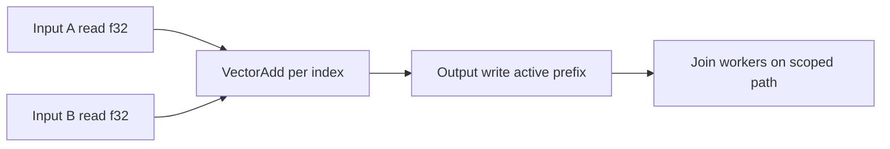

# Trellis framework review for AI-generated Rust

Trellis already has the beginnings of a restricted Rust vocabulary for reviewing AI-generated code. Silo gives storage and traversal recognizable names, and Flock makes disjoint writes explicit. The main gap is that a reviewer still has to follow several layers to see what an operation reads, writes, allocates, and hands off. Start with one checked contract in Swarm and use it to generate a memory map and a flow diagram.

## Where Trellis already supports spatial reasoning

**Storage and traversal.** `Arr` and `MutArr` name borrowed contiguous views, `Buff` owns a fixed-capacity heap allocation, and `Stash` builds a growing sequence. `USeg`, `Traverse`, `TraverseMut`, and `Span` give range, mutation, and early-exit patterns familiar forms. Keep these distinctions. A fixed-capacity buffer can still allocate when constructed, and a traversal closure can still allocate or write elsewhere. The names provide a starting point for review. `src/pedestel/silo/arr.rs` · `src/pedestel/silo/buff.rs:120` · `src/pedestel/silo/stash.rs:14` · `src/pedestel/silo/traits.rs:8`.

**Ownership and scheduling.** Flock's `CpuOutputPartition` pairs a mutable view with a global index base. The partition can be consumed and split into disjoint regions. Heist's scoped execution joins workers before returning. This gives a reviewer a concrete picture of who can write each range and when control returns to the caller. Swarm's `IComputeBackend` likewise keeps backend-specific buffer and kernel types explicit through associated types. `src/salvus/flock/kernel.rs:10` · `src/salvus/heist/scoped.rs:63` · `src/salvus/swarm/backend.rs:14`.

**Topology and time.** Fenst already draws topology from connected components, and Karst has a bounded cycle trace for ingress and egress state. Those are two useful models for a future code review view. A static graph can show possible routes and access rights. A trace can show which route a specific run took. `src/parvis/fenst/circuit_layout.rs:272` · `src/nexome/karst/fabric.rs:57`.

## Where the review model breaks down

**A named operation has an incomplete contract.** `StandardOpDescriptor` gives each operation a name, backend entry points, buffer count, and dispatch shape. For CPU `VectorAdd`, the reviewer still has to read the dispatch and buffer acquisition code to learn that the first two bindings are read-only `f32` inputs, the third is the destination, and all three buffer objects must be distinct. The active output range is capped by the dispatched invocation count and all three lengths. Those facts define the spatial model and belong next to the operation name. `src/salvus/swarm/ops.rs:12` · `src/salvus/swarm/cpu.rs:207` · `src/salvus/swarm/traits.rs:500`.

**Storage shape and byte layout need different levels of precision.** Silo's pointer-backed types describe ownership and contiguity, while comments such as the exact size of `Arr` need a target-specific check before a reviewer can rely on them. Reserve fixed offsets and alignment assertions for boundaries that consume bytes directly. The viewport already uses an explicit representation and a `Pod` derive for its uniform record. Check the consumer's layout too when that record crosses a shader boundary. `src/pedestel/silo/arr.rs:10` · `src/salvus/swarm/viewport.rs:27`. [Rust Reference on type layout](https://doc.rust-lang.org/reference/type-layout.html)

**The subset is currently expressed largely as directives and APIs.** `agents/AGENTS.md` establishes a consistent vocabulary for AI-generated changes. The formatter addresses style, and Rust types enforce some ownership rules. Guarantees such as zero allocation across calls require a more specific boundary and enforcement. Before treating Silo views as a trusted basis for that boundary, review `Arr::New`. It accepts a raw pointer and length through a public safe constructor, and safe conversion to a slice later relies on that pointer being valid for the chosen lifetime. Favor constructors from safe borrows and put raw construction behind an explicit, audited unsafe boundary. `agents/AGENTS.md` · `tools/format.py:609` · `src/pedestel/silo/arr.rs:54`.

## Pilot a checked contract for VectorAdd

1. **Extend the existing operation descriptor.** Give each binding a name, element format, access mode, and alias rule. Record the active range and completion semantics for the CPU path first. Use the same contract to validate bindings and generate the review view. For later GPU support, compare shader bindings and element stride with the shared contract, and show transfer and synchronization where they occur.

2. **Scope the Rust subset to the kernel body.** Allow typed views, explicit traversal, and a small set of reviewed calls. Keep allocation, lock acquisition, raw construction, and backend submission in the surrounding code, where their costs and invariants can be shown. For a zero-allocation kernel, check the permitted call chain with a conservative allowlist and use an allocation counter as a regression test. Keep formatting rules distinct from checks that guarantee a memory or execution property.

3. **Generate a memory and flow view from the contract.** For each buffer show the element type and stride, read or write access, and the range touched. Show dispatch, partitioning, and worker join as stages. Underneath, link to the Rust entry point and make target-specific assembly or shader output available when instruction-level review matters.

Use the existing Swarm tests for ordinary execution, distinct bindings, and scoped partitioning as a baseline. Add contract checks for malformed buffers, a shorter input, and an output tail that must remain untouched. Then compare reviewed AI-generated variants against the same contract. The pilot succeeds if a reviewer can identify the buffers, write ranges, allocation boundary, and completion point from the generated view, and a violating variant fails validation or the corresponding regression test. `src/salvus/swarm/_tests.rs:641` · `src/salvus/swarm/_tests.rs:720` · `src/salvus/swarm/_tests.rs:769`.
